# 密歇根大学《总体数据质量（框架、度量、设计策略）total data quality》 p06 5_示例：网络数据爬取实践.zh_en -BV1Jn4y1X7uS_p6-

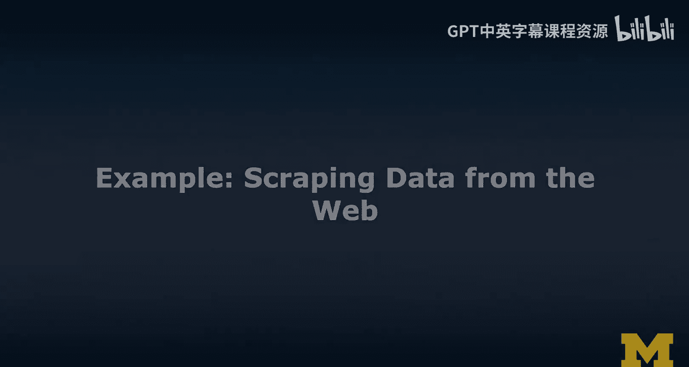

Hello， welcome to the total data quality specialization Web scraping demonstration。 I'm Tt Busker。

 I'm going to be walking you through how to scrape a few tables using data Minr。

 a tool that is available through the Google Chrome as an extension。In this particular demonstration。

 we're going to be using the data minor tool， as I mentioned。

 but there are other tools that can be used for scraping data。

 includingoctopparse and import IO that are slightly more expensive than the data minor tool。

 There are also libraries available in both Python and R。

 such as beautiful super Ar that can be more customizable for advanced web scraping。

 The main part of what we're trying to do here to demonstrate is so that you can get a sense of what can happen during web scraping and what can go right and what can go wrong and how that might relate to data quality issues in the gather data side。

 So without further ado， we're going to go through this document and we're going to show you how to install the data minorr extension and then we're going to use it on a simple table。

If we go back to the document， I will show you how to install the data minorr Chrome extension。

 We can see through a series of screenshots exactly how to do it。

 I'm going to demonstrate that for you here now。 So if I click。

 if I go to the website that is illustrated here from data Minr。

You will see that in the middle of the web page， I will have an option to add to Chrome。

 This allows me to create the data minor extension in Chrome and use it for data extraction。

 You can click on the add to Chrome tab。And this will take me to the website that allows me to add data Minr as an extension to Chrome。

 so I'm going to click on add to Chrome again， and then I'm going to click on add extension here。

This will allow me to add the extension。 Now， right now， I nothing looks like it's happened。

 But in fact， if we go up to this upper right hand corner。

 you'll see an add in button here that looks like a broken puzzle piece。

 If I click on that and you'll see the data scraper option here。 and a little pin。

 I'm going to click on the pin to ensure that now I that I have that I've data minor or data scraper available as a tool and readily seen by me。

 the user on my on my web browser。So if you go back to the web scraping learner instructions document that you're able to download from the course materials。

 at the very bottom， there is a list of websites that we' are going to scrape as an example for this demonstration。

 And I've picked a list of counties in the state of Ohio where I live。

 So we're going to go ahead and we can click on this link and that will take us to this web page。

 So right now， I want to point out a few things on this website。 First。

 if I look in the upper right hand corner， you're going to notice that my data scraper icon is still active。

 This is an important consideration because we already enabled it and we already pinned it to the browser So it's readily available。

 The other thing I want to mention is if you get to the point where you right click。

 You should see an option for data minorrs show up here as well。

 This is going to be really important for simple scraping activities like a table on a web page。

 So you can access it。😊，Right clicking or you can also click on this particular browser extension icon at the top for now。

 we're just going to focus on the right clicking。Now， for this website。

 one thing you will notice is that there is a table already built in。 This looks like a table。

 It looks like information that I want。 It might have more than what I want。 So in other words。

 there might be a lot of information here like the etymology of a county， for example。

 that I might not necessarily need for my data analysis or my tasks。 but it's included in the table。

 and we can always choose to edit that after we scrape， or we can edit it during the scrape。

 and we're going to show you how to do that in a minute。

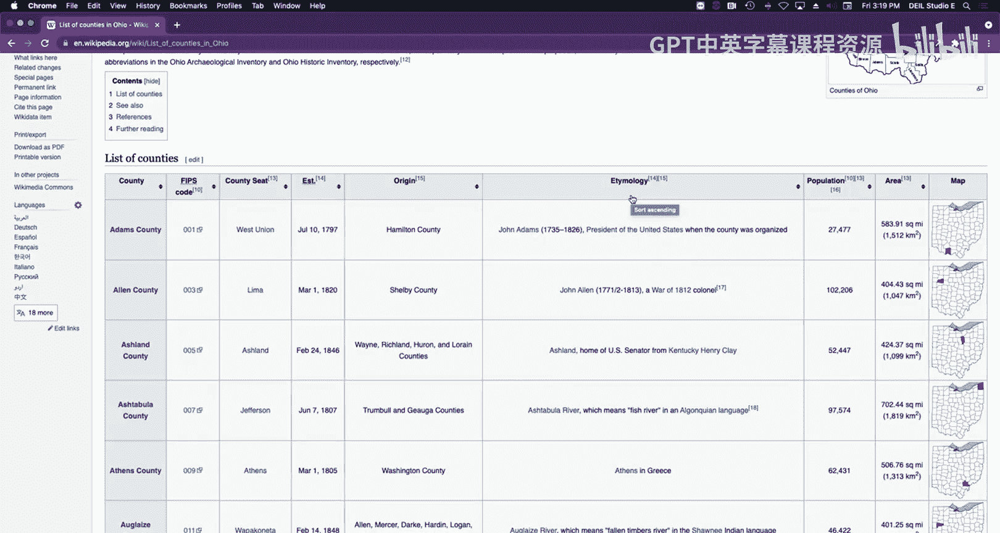

I also may not need the map because for a couple of reasons， One。

 it may not store is the image that I need， or it might not be compatible with my database software。

 and B， it might be too much visual images or it might increase the size of my files unnecessarily and if I'm not planning to use those images of my analysis。

 it may not want them at the time of scraping。 These are all considerations that you need to think through what we call sort of a website analysis before we scrape to sort of figure out what it is that we want and what it is that we don't。

 and whether or not it's worth scraping and postproces later to clean that or whether we just want to scrape only the columns that we care about for this particular exercise。

 I'm going to do a very simple scrape and I'm going to grab everything here and we'll show you how to do some of the post processing or cleaning steps in just a minute with another part of the demonstration in order to get this table that appears on the website into。

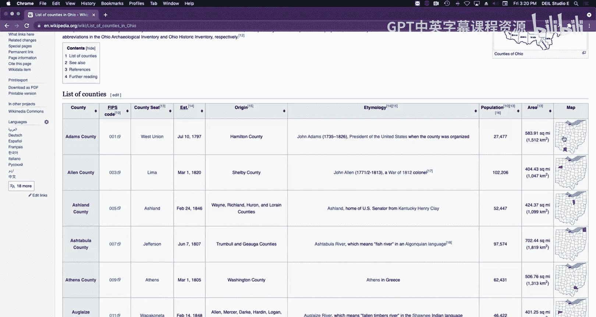

A tabular structured data file。 What I'm going to do simply is I'm going to highlight a portion of the table by just scrolling over it and highlighting it as though I were copying and pasting the text。

 Once I've scrolled over， you can see that it's highlighted。 I'm going to right click my mouse。

 And I'm going to go down to data minorr。😊，And you're going to see an option for something that says get similar scrape with auto generated recipe。

 This is what you want to select in order to get data minor to generate a tabular structure and capture all of the data that is inside this table。

 So let's go ahead and right click the get similar option that I've highlighted here。

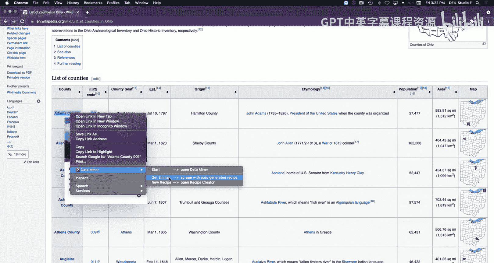

And now you will see data Minr is getting going。Now。

 I'm going to expand this a bit so we can see a little bit more about what data miner has done。

 And you can see that the data minorr structure is set up like this。

 I've got a couple of different parts to this web page。

 You're going to see the select a recipe option。 You're going to see scrappe and download option。

And then you're going to see recipes here that are generated from data Minr。

 and so you notice that the option that we chose gets similar with auto generated recipe is that basically what data Minr is doing in the background is it's generating the code needed to scrape the information that you're requesting。

 and that's what we call a recipe。Think of it as an algorithm for what to do or sort of a to do list for the scraper。

So were you can see very clearly here that we've gotten all of the information from this scrape。

 and we have a couple of different things。 The columns aren't necessarily named as to what we want。

 They're not necessarily descriptive， we can do all of those changes cosmetically to the recipe little at a later time。

 But for now， what I would like to do is move to the next step。 If we click on next step。

 It looks like we have the structure here。 If I scroll down this list。

 you can see that I have 89 rows。 The first row is the header row。

 So that means that I have a total of 88 counties。 that I'm getting information from。

 and you can see from the Wikipedia webpage。 There are 88 counties in Ohio。

 So I'm fairly certain that I have covered all those counties。

 we'll now move on to the next step of going from the recipe generation to the actual extraction。😊。

So if I click on the next step option here。You will see that I have another。

 So now Ive moved to the scrape and download tab。 and now I can。

 this is the information that I have retrieved。 It is through a series of pages so I can toggle through and get and see all of the data that has been scraped。

 And now I have options for downloading the data or saving the data in a different format。

 So if I click on the download tab， it gives me options for the C SV file for an Excel file or to copy the table to the clipboard if you wanted to paste it somewhere else。

 I'm going to choose an Excel file and download this as a dot Excel S X file。😊。

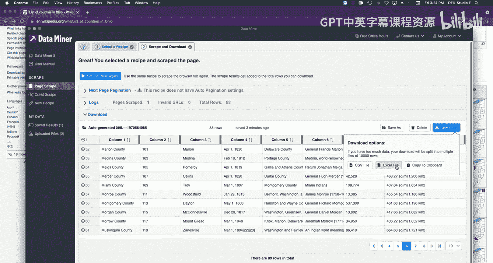

So I'll click on the tab。 So now that I've chosen to save this as an Excel file。

 I have an option to name this file， so I'm just going to call it Ohio County scrappe。

And I'll save the file。

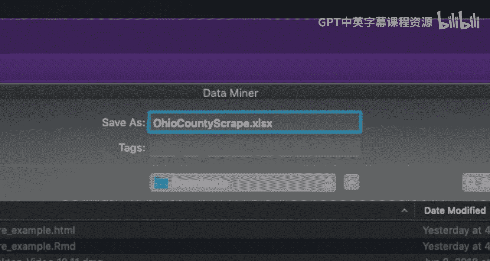

And now I should be able to open the file。So now this is the Excel version of the file。

 and what you'll notice is that I have a column for the county。

 I have a column for the Phps code and I have a column for the square footage。 Now。

 let's just take a quick peek at this column， make it a little wider so we can see the actual data that we have。

 we can also see the data in all of these things。 Now notice that we don't have any hyperlinks that were captured here。

 All of this is plain text that has been recorded through the auto recipe。

 You may want the county website。 You may want the seat website。

 You may only want the year that the county was established。

 we may want to only pull out the square miles of the county but in any case we've captured all of the text that was available in the in the table on the Wikipedia webpage。

 Now if I scroll all the way down。 I should see a total of 89 rows。

 Remember the first row is the column header row。😊。

So there are 89 corresponding to a total of 88 unique counties that we've captured information for。

 so we've pretty much been able to reproduce this table in very flat form and notice that there is an empty column to the right of the square footage column or the square miles column。

 and that was where the image was that we didn't actually store。

So now I can actually delete this column because I actually I don't need that。

And I can actually rename these columns accordingly to what the information is contained in there。

 And I can also delete columns that I don't want。 All of this is an example of post processing after we've done the Web scrape In our next example。

 I'm going to show you a little bit about how to do some processing at the time that you scrape data so that I don't have to spend extra time at the end of the data file cleaning。

 relabelling and also parsing information in this situation。

 it would be nice to be able to parse out the square miles without having all of this extra stuff included。

 In other words， I don't need the square kilometers。 I don't need the word square miles。

 I can simply title this column area in square miles。

 and then I can just capture the numeric value because if you wanted to do an analysis of the square miles distribution。

 for example， or the area the distribution of the areas of counties。

 You're not going to be able to do it with just data。😊，In this column。

 data in this column is in textual form， in text format and won't be amenable to histograms or other kinds of numeric graphical techniques or methods that you may want to use。

 or other kind of statistical summary measures that you may want to include。

 So it's going to be important for us to learn a little bit about how we might be able to do that extraction at the point of the web page。

 rather than having to do it after we get the data downloaded。

OkayIn this second part of the demonstration， I'd like to show you a little bit about how you might customize the results of a web scraping task on the same website that we just went to。

 So back in the document that you were able to download with the instructions on how to install data minorr you have this customizing a web scraping task link as well。

 which is the same one we can click on that link that'll take us to the Wikipedia webpage for the Ohio counties。

 Now this webage I haven't started the data scraper at this point。

 but what I can do is I can click on the data minorr tab here。

 the data scrapcraer icon extension and when I click on that the data minorr software will start up and I can choose to make my own recipe。

 Now we already saw what happens when we autospe this webpage。

 we're getting extra columns and so on that we may not want。

 and we might want to customize this a bit more。 So in order to do that。

 we're going to make our own recipe and I'll walk you through how to do that very briefly。

So I'm going to click on the make Your own recipe and you're going to get this tab available here that's going to ask you a series of questions going through a series of tabs that we need to do。

 So now in order to start we're going to actually click on the type tab and data minorr is asking us what kind of web page we're actually trying to scrape And so essentially we're trying to scrape a table with rows of data。

 So I'm going to choose the list option from among the two。 So I have a two options here。

 list or search the page and details or profile page， I'm going to click the first one。

Now I move to the Rose tab。And it's going to ask me a couple things。

 I'm going to choose the easy row finder， which is going to allow data miner and myself to interact with each other。

 And the web page to tell the scraper exactly what I want to grab as the row。 So let's do this。

 I'm going to click on the row， Ey row finder。 And now it's asking me to select the first row of the data table that I want。

 Now， keep in mind that the first row of this table looks like the headers。 But really。

 I'm going to add those headers later。 So at this point。

 what I want to focus on is I want to capture the data layer。

 the first row of data that I want to include in my web scrape。

 So I'm going to hover the mouse over the first row。

 And I'm going to click the number one button on the keyboard。😊。

And what you notice is that I've captured the contents of this particular column and row。

And I'm going to then select the second row。 I'm going to hover over it。

 and I'm going to click the number2。 and you'll see very quickly how the rows are now being identified。

 Now， one thing to keep in mind here is that webs are set up differently and auto scrapes and the scrapers。

 these built in tools have different mechanisms for detecting the underlying structure of the web page。

 What I'm getting back from this scrapers so far is that it found 100 rows。 Now。

 we know this table only has there are only 88 counties in this table。

 So what is happening is this webscraer is detecting additional rows for possibly footnotes and other ancillary materials that are associated with this table and we can't identify them。

 There are two different ways that these scraper works to find information on a page。

 The autoscraer that I demonstrated just a few moments ago。

 uses a different tool based on jascript where。😊。

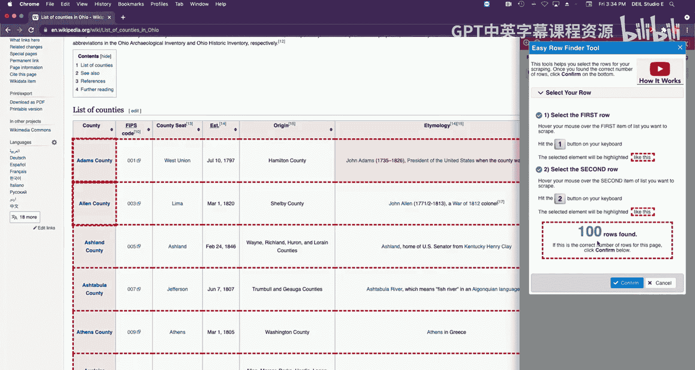

As this one is based on using X path notation。There are two different ways that a web scraper can actually detect information on a web page。

 One is through Xpath coordinates， and one is through Javascript。

 The first scraper that I showed you a few moments ago using the auto generated recipes use an Xpath situation or an Xpath technology that allows them to detect only the primary rows of a table。

In this in the recipes that we're creating interactively。

 they use a JavaScriptscript interaction tool， and so sometimes with those tools。

 you will pick up additional rows of data that you don't necessarily need as primary to the table that you're trying to scrape。

These are all things to think about and keep in mind when you're trying to scrape data for yourself。

 because if you scrape the data using this tool and then you went straight from scraping the data to analysis。

 you may actually have too many rows in your data file。 And this is an example of that。

 And we're going to go forward with this knowing that it's an error。

 but I'm going to show you how we can resolve that later。 once we get the data itself。

 It might be a result， we'll have to expunge some of the rows from the actual data file。

 but no big deal。 We know which rows those are。 And this is the fastest way we can get data in here using the nonau generatedrated recipe。

😊。

So I'm going to confirm this。And now I'm going to move to the column section。

And there are certain columns that I want， so now that the scraper knows the general structure of the table。

 I don't want to grab all of the columns， I only want to grab a few of them because I don't need all of the columns for my analysis。

So what I want to do is add a new column。And I'm going to title this column。County name。Or county。

 And I'm going to use the easy column finder very similar to how I did for the row findder。

 And I'll click on that button。 And now it asks me， what kind of data am I trying to extract。

 In this case， I want to get the text because I want to get the name of the county。

 But notice when I scroll over the county itself。 There is a hyperlink that takes me to a county web page。

 So there's actually two different kinds of data being represented here。

 One is the county name and text form， The other is an embedded hyperlink that takes me to the county's URL。

 So I'm going to just grab the text。 So for this purpose， I'm going to choose text。

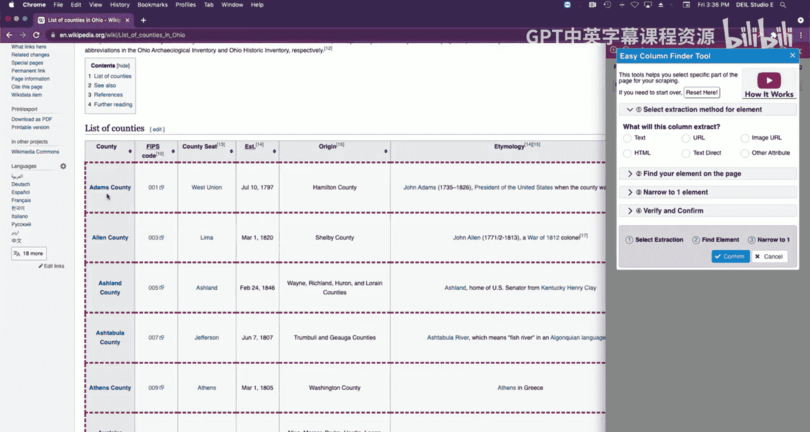

Now， what I want to do is hover my mouse over the part of the page that I want。

 And then I'm going to click C for column。 Keep in mind that I don't want to grab the column header。

 I want to grab the data itself。 So I need to be hovering over the name of the county。

 I'm going to click C。 and you'll notice that the item found was the name of the county。

 That's what the scraper identified。 And that's actually what I want。 So I'm going to click confirm。

And now I can add an additional column in this particular column， I'm going to add the Phps code。

And then I'm going to use the easy column finder in the same way。 And I only want to grab the text。

 I don't need to grab the actual URL。 So in this case， I'm going to hover over。

And I'm going to click C。And I found the actual numeric number for the PhPS code。

 I'm going to confirm This is an important field to get right。

 because I'm going to use this as a link， potentially for this data file to another data file that has even more information about counties that are catalogued or of using PhPS code as the key to connect those two data sources。

And the last thing I want to include here， I'm going to add two more columns。

 I'm going to add the date， the establishment date。And I'm going to click on easy column finder。

 And what I want again is text。 And I'm going to get the date here。 So I'm going to click on C。

And now it gives me several different options that it thinks that I'm actually trying to get。

 And so really， what I want is item number 3， which is the date。 And I'm going to click confirm。

And lastly， I'm going to add a website to the county itself。

 so I'm going to add a new column for county URL。I'll choose the easy column finder again。

 And now this time， what I want to pull off is the URL R。 So I don't want to grab the text itself。

 I want to grab the underlying URL that I can't see directly。

 But I know it's there because when I hover over that county。

 I get a little indication that there is a URL there。 So in this case。

 what I'm going to do is I'm going to select this button or select this text。 Click see。

 And what you'll notice is that I have the actual URL R or the website for that particular county。

And I'm going to click confirm。

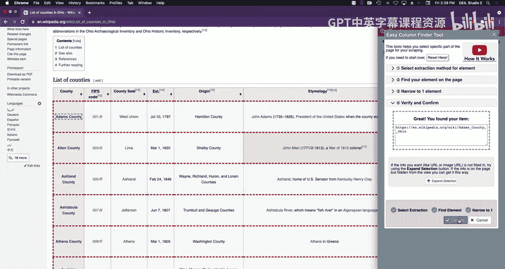

So now we can click on the navigation tab， one thing to note here is theres this website is fairly simple。

 we're trying to scrape data from a table， so there's no additional scrolling or logging in or any other navigation that we need to do on the page to capture the data。

 so this navigation tab doesn't really help us in a situation like this so we're going to skip it。

The actionsions tab allows us to do a few things that we might need to interact with the website in order to get more data so if I wanted to get information about the county from the county websites。

 I would choose to click on the county URL and then I would scrape something from that page but again。

 we're only trying to scrape this simple table so these actions here aren't relevant for us and so we're going to skip those as well。

 but one thing that we are going to do is we're going to click on this JS tab and we are going to try to use some additional processing。

To capture only the date。That a county was established。 So remember when we were recording this。

 if I go back to the the columns that I've chosen， the， the establishment date。

 which is the second column that I'm using here。 This establishment date is actually capturing the full。

Date of establishment。 the， the month， the day and the year。But I only want the year。

 and I want to be a number so that I can analyze the distribution of when or in terms of the years these counties were established。

 so I could either save the data as it is and in Excel or in Saas or in R or whatever software I'm using。

 I can scrape off or just extraction the year。 or I can do it at the time of extraction。 Now。

 the reason why I like to do it at the time of extraction is for two reasons。1。

 it makes the resulting data file smaller because I don't have to store information that I don't need。

 and two， if there are any errors in the extraction。

 and there are errors in my code for pulling off the date。

 I compound data quality in error issues by not doing it at the point of data origin or at the website itself。

 So this is far more reproducible and I know exactly what I'm able to do。

And I can confirm that I've actually recorded this properly at the place where I'm extracting the information。

Now we can click on the JS tab， this allows us to create some JavaScript functions that will allow us to process the data at the time of scraping。

Notice that when we were to when we captured the establishment column， the establishment date。

 we were capturing the month， day and year。 But in essence。

 we really only want to work with the year in our data analysis。

 And so what I would like to be able to do is to pull out the year separated from the month and the day。

 Now， I can do this after I scrape the data as they are now。

 and I can do it in Excel or Saas or R whatever software package that I'm using。

 and very easily extract that information。 that would be what we would call a post scrape activity。

 But I don't like to use post scraping activities if I can avoid them for two reasons。 One。

 if I scrape this entire data set or scrape this entire field。

 I'm having to carry that field with me into the data file and it potentially makes the data file larger than it needs to be。

😊，Secondly， I may make errors in my post data scraping methods in R or Excel that might compound other data origin errors that I have at the scraping phase and this actually can compound the overall errors that could exist or degrade the data quality further so to avoid that I would rather just be able to do this processing at the point of origin here where the data exists on this webage so that I could confirm that I've actually recorded the right information。

 So what we want to do is we're going to create an additional column of data so that we can store the two parts of the date。

 One is the month in the day the other is the year。

 Then that will allow us to retain the different parts of the date accordingly。

So we're going to go back to the columns portion or the columns tab。

 and we're going to make note of a few things。 First。

 we're going to note that the that the columns are ordered from 0 up to the number of columns we have。

 And the second column is the established date。 That's the column that we want to split。

 I need to make a placeholder column to store the information that I want to record。

 So I'm going to make that as an additional column here。

So I'm going to use the easy column finder and I'm going to use this as the establishment year。

And let's do the easy column finder just like we did before。 We want to capture text。

 I want to hover over this column and click C。 And then I'm going to choose the date again。

 So I'm basically repeating or reproducing this column， and I'm going to click confirm。

And notice that the second column is the established date that I'm going to split。

 and this is the year column that I this is the column that I want to store the year in。

So now I can go back over to the JS tab。And I'm going to click on split a column value。

This is going to generate some jascript code down here。 Now， I don't know much about this code。

 but what I do know is the column that I want to split on is column number two。

 and what I want to split on the character that I want to use to split is the comma。

 Everything that's to the right of the comma is going to go in column number 4。

 Everything to the left of the column comma is going to go in column number 2。 So let's do that now。

 So we're going to split column number two。 And we're going to split on the comma。

And we're going to take。The contents， the the first part， which is the part to the left， Part 0。

 That's to the left of the comma。 That's going to stay in column 2。

Everything to the right of the comma is going to stay in column number 4。So once I have that。

 I can click Run selecteded script， and then I can go to the saveve option。

 I can name my scraper and I can click scrappe in a data minorr and that will save the scraper and it will take me to the scraping portion of the software。

Now what you'll see here is a preview of the scraper。

 you can very clearly see that I have columns for county FIPS code。

 I have the first part of the established date， I have the county URL and I have the established year。

Now I can go to the next step and actually scrape the data。

And what you'll notice here is that I have all the columns that I had before。

 But one thing to note is I have 100 rows。 So if we go to the end of it。

 what you're going to notice is。I scroll all the way down to the end。

You're going to start to see that I've got a bunch of different junk rows here that don't correspond to any counties。

 This is， in part a result of the scraper picking up additional footnotes as additional rows of that table by virtue of the jascript underlying technology that it uses to capture the data from the web page。

 We can always delete those rows once we get to the data file stage。

 And this is a small price to pay here for being able to customize the scrape accordingly。

 This happens pretty regularly in web scraping because we're using standard software to scrape different web pages that are formed from very different architectures。

 So from here I can download the data file。 and I'm going to choose to an Excel file。

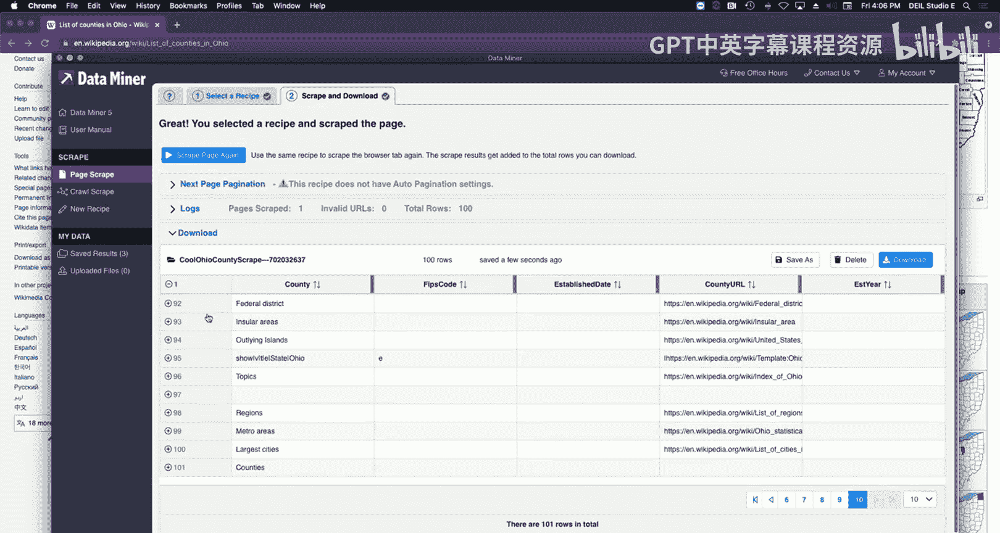

And I will go ahead and save it。And then I should be able to view the file。

And what you notice here is that I have counties for or columns for the county， the Fps code。

 I really don't need this column C。 And so I'm going to delete it here。

 There are other ways to delete it in data minorr， but it's a little bit more complicated。

 So I'll just choose to delete it here。 I have the established gear。

 It's already in the form that I need it to be in。 if I scroll all the way down。

 I'm going to notice that I have a little bit of I don't need these extra rows。

 so I can choose to delete those。 So there's a little bit of cleanup that I have to do here。

 But in general， I have a data file that's pretty that now you can notice that there's one of these rows where the date had a couple of footnotes。

 I can go in and I can clean that up specifically just get rid of those footnote indicators here。

 there's a little bit of work that I need to do there。

 But in any case it gives me a format of generally all of the things that I want in the form that I want them in Let me see if I can zoom in on this。

 you can see it a little bit better。 So there we can see we have information。😊，On the county。

 the FPS code， the URL and the year I can format the year as a number and then I can work with that data in my analyses。

 So this is a little bit of a more complicated or customized scrape， if you will。 working on tables。

 which are still pretty easy to scrape generally speaking but you can see that part of these scrapes。

 give you more than you need So you do have to do a little bit of cleaning on the backend。

 but you also do have control over how you can parse information at the time that you take that information and extract it from the website。

 which is always a safe bet when you're thinking about quality and threats to data origin。

 So thanks a lot for joining me for webs scraping。 I hope that you can try this out on your own with the web pages that we've suggested in the document。

 Thanks a lot for joining us。

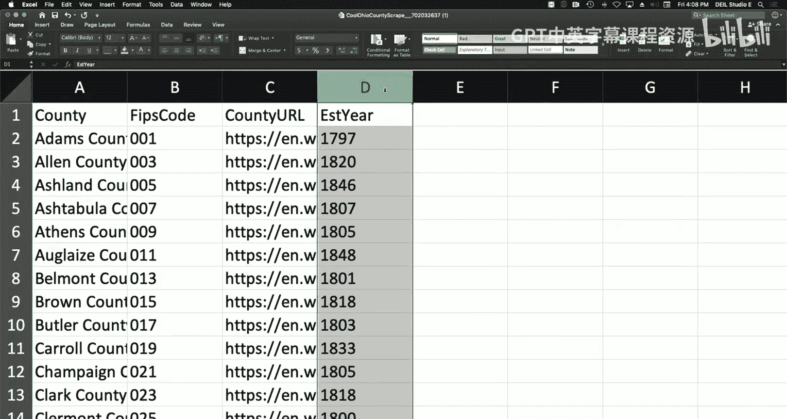

