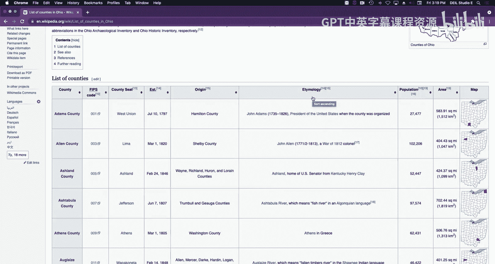
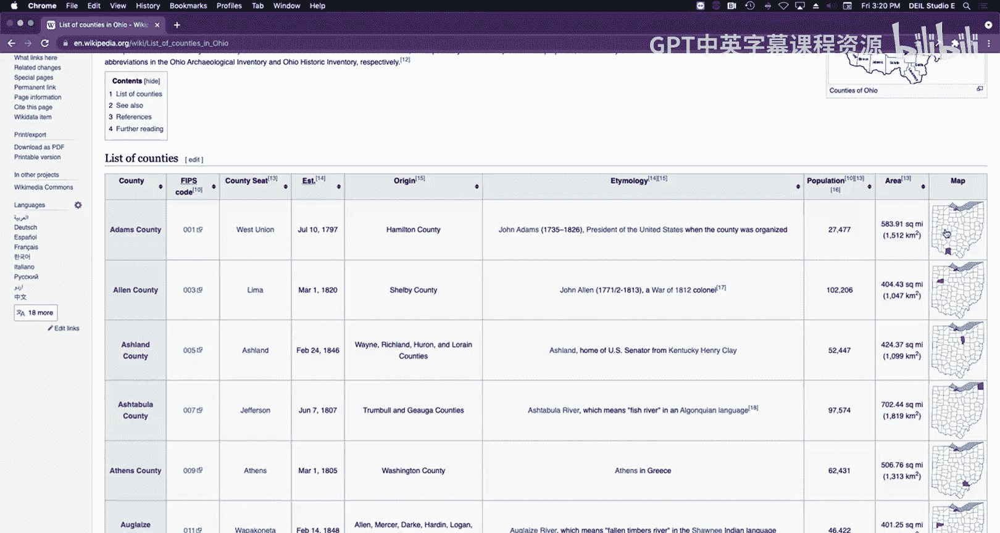
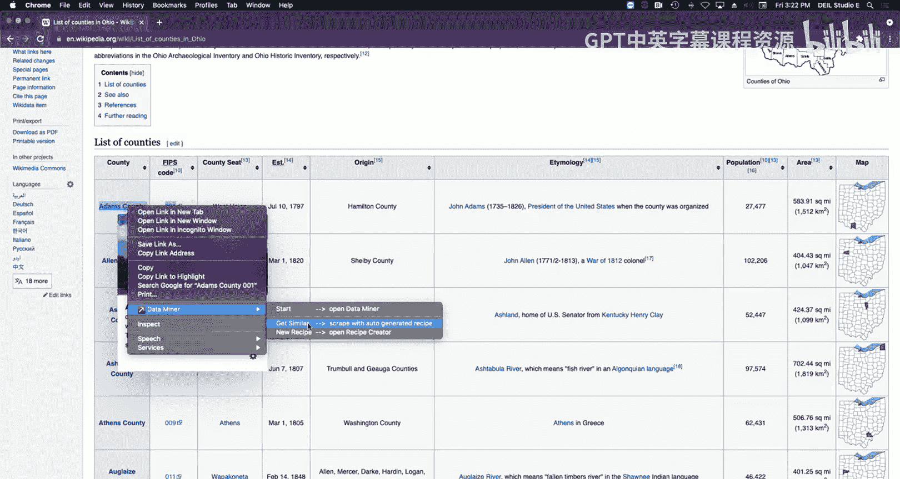
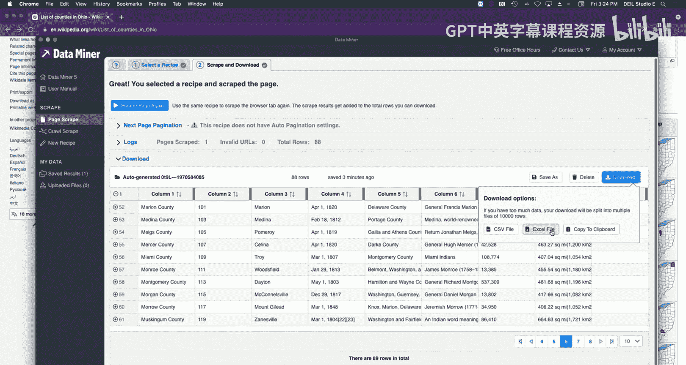
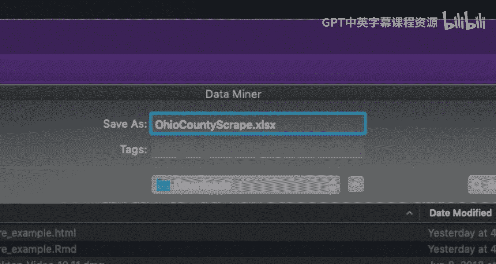
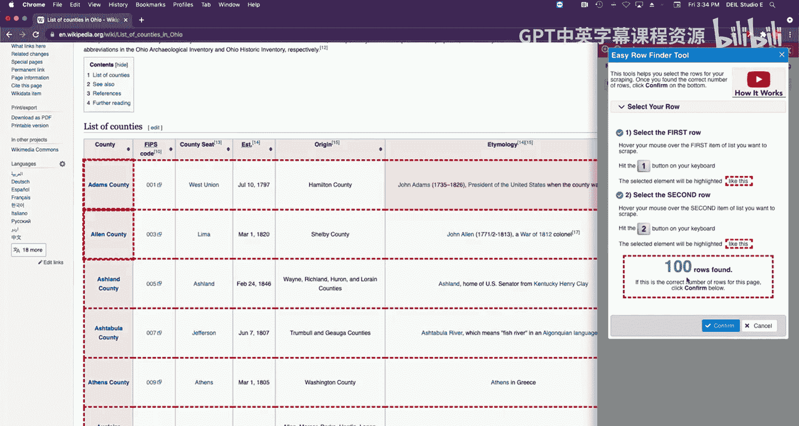
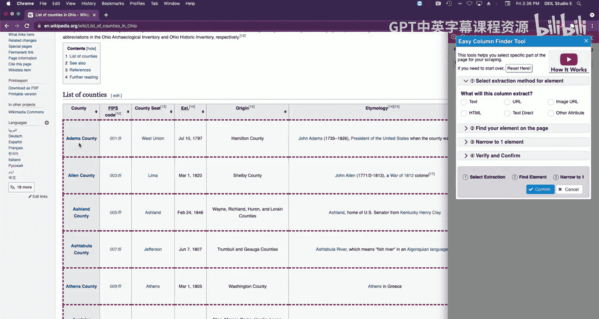
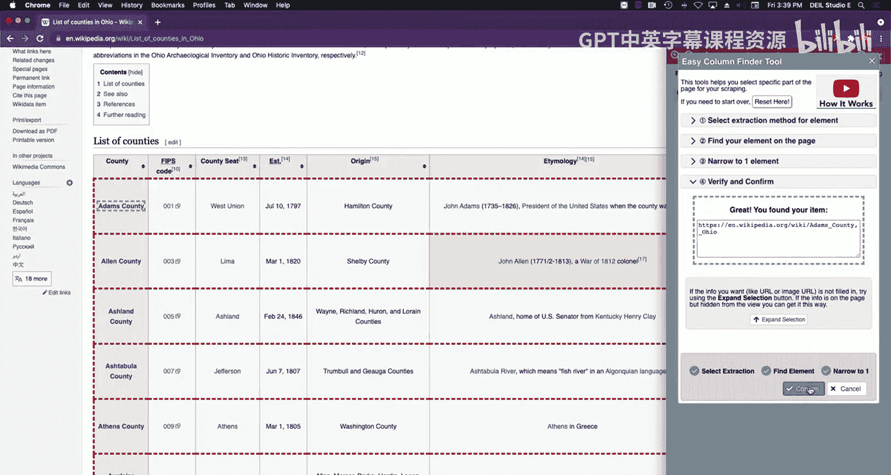
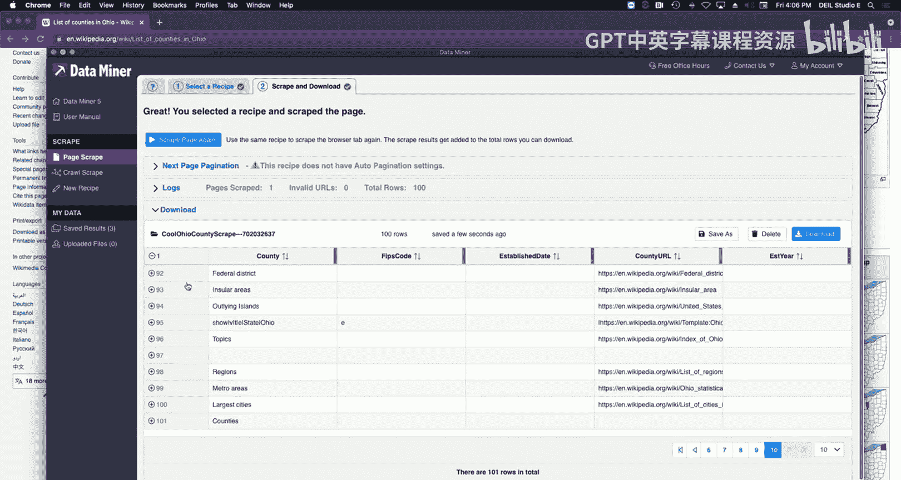
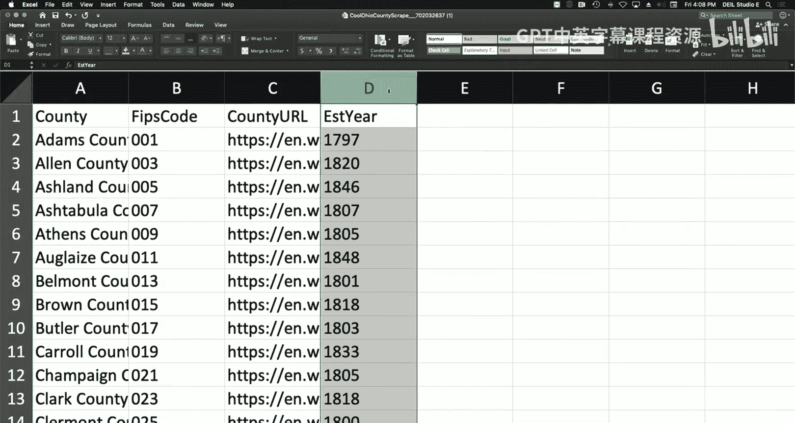

# 总体数据质量（框架、度量、设计策略）：P06：示例：网络数据爬取实践 🕷️

在本节课中，我们将学习如何使用 Data Miner 工具进行网页数据爬取。我们将通过一个具体的例子——爬取俄亥俄州各县信息表——来演示整个流程，包括安装工具、执行简单爬取以及自定义爬取任务。通过这个过程，你将了解在数据采集阶段可能遇到的数据质量问题，以及如何通过预处理来提升数据质量。

## 安装 Data Miner 扩展

上一节我们介绍了课程目标，本节中我们来看看如何安装爬取工具。

首先，我们需要安装 Data Miner 扩展。这是一个免费的 Chrome 浏览器插件，可以方便地从网页中提取表格数据。

以下是安装步骤：
1.  访问 Data Miner 官方网站。
2.  在网页中央找到“添加到 Chrome”按钮并点击。
3.  在弹出的确认窗口中，再次点击“添加扩展程序”。
4.  安装完成后，在浏览器右上角的扩展程序图标区域（通常显示为拼图块形状）找到 Data Miner 图标，并点击图钉图标将其固定在工具栏上，以便随时访问。

现在，工具已准备就绪，我们可以开始进行数据爬取。

## 执行简单表格爬取

上一节我们安装了工具，本节中我们来看看如何使用它进行第一次数据爬取。

我们将爬取一个包含俄亥俄州各县信息的维基百科页面。在开始前，我们需要分析网页结构，决定需要爬取哪些数据。例如，我们可能不需要县名来源的“词源”列，也可能不需要地图图片，因为它们会增加文件大小且不便于后续分析。

以下是执行简单爬取的步骤：
1.  打开目标网页。
2.  在表格区域，用鼠标拖动选中部分数据行，就像复制文本一样。
3.  在选中的区域上点击鼠标右键。
4.  在弹出的菜单中，选择“Data Miner” -> “Get similar (scrape with auto-generated recipe)”。

Data Miner 会自动分析网页结构并生成一个“配方”（recipe），即爬取数据的指令集。在预览界面，我们可以看到它识别出了表格的所有行和列。确认无误后，点击“下一步”进入数据提取阶段。

在“Scrape and Download”标签页，我们可以预览爬取到的数据。确认数据正确后，点击“Download”按钮，选择导出为 CSV 或 Excel 文件。

下载并打开文件后，我们会发现所有表格文本（不包括超链接和图片）都被成功捕获。但数据可能包含不需要的列（如图片占位列）或格式不理想（如面积字段包含“平方英里”文本，不便进行数值计算）。这引出了数据清洗的需求，我们可以在爬取后处理，也可以在爬取过程中进行定制。

## 自定义爬取任务

上一节我们执行了自动爬取并看到了后续清洗的需要，本节中我们来看看如何在爬取过程中进行定制，以获取更干净、更符合需求的数据。

我们再次打开同一个网页，但这次通过点击工具栏的 Data Miner 图标来启动，并选择“Make your own recipe”来自定义爬取。

以下是创建自定义配方的关键步骤：
1.  **选择页面类型**：在“Type”标签页，选择“List”（列表），因为我们爬取的是表格数据。
2.  **定义数据行**：在“Rows”标签页，使用“Easy Row Finder”。将鼠标悬停在表格的第一行数据（而非标题行）上，按键盘数字`1`。然后对第二行数据按数字`2`。工具会识别出所有相似行。**注意**：自定义方法可能比自动方法捕获更多行（如页脚注释），这需要在后续处理中删除。
3.  **定义数据列**：在“Columns”标签页，添加我们需要的列。对于每一列（如“County name”）：
    *   点击“Add Column”并命名。
    *   使用“Easy Column Finder”。
    *   选择需要提取的数据类型（如“Text”文本或“URL”链接）。
    *   将鼠标悬停在目标单元格上，按键盘`C`键确认捕获。
4.  **使用 JavaScript 预处理数据**：这是为了在爬取时直接处理数据，避免后期清洗的复杂性和潜在错误。例如，我们想从“Established”列（格式如“March 1, 1803”）中单独提取出年份。
    *   首先，添加一个新列（如“Established Year”）来存放年份。
    *   然后，切换到“JS”标签页。
    *   选择“Split a column value”功能。
    *   设置参数：分割**第2列**（Established），以**逗号（,）** 为分隔符。
    *   将分割后的**第一部分（Part 0，逗号左侧）** 保留在原列（第2列），将**第二部分（Part 1，逗号右侧）** 存入新列（第4列，即Established Year）。
    *   点击“Run selected script”运行脚本。
5.  **保存并执行**：完成配置后，保存配方并开始爬取。爬取完成后，下载数据。

打开最终的数据文件，我们得到了仅包含所需列（县名、FIPS代码、年份、URL）的数据。虽然可能仍需删除由工具误抓的额外行，但核心数据（特别是年份）已经在爬取时被成功解析为独立、干净的数值字段，极大地便利了后续分析。

## 总结

本节课中我们一起学习了网页数据爬取的基本实践。我们首先安装了 Data Miner 工具，然后使用其自动生成配方功能快速爬取了一个完整表格。接着，为了获得更精确、更便于分析的数据，我们深入学习了如何创建自定义爬取配方，包括精确定义行和列，并利用内置的 JavaScript 功能在数据采集源头进行预处理（如分割日期字段提取年份）。这个过程揭示了数据采集阶段的质量考量：**在爬取时进行数据清洗和格式化，比在获取数据后再处理更为可靠和高效**，能减少错误累积并提升最终数据集的质量。