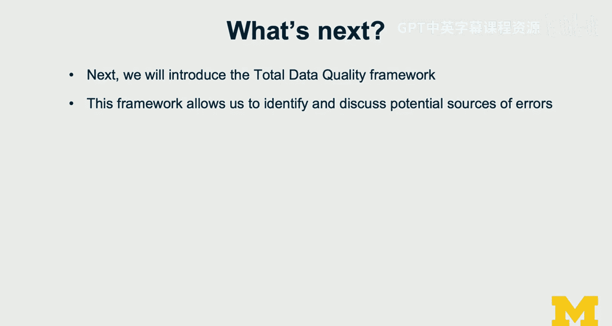

# 密歇根大学《总体数据质量（框架、度量、设计策略）total data quality》 p07 6_混合型数据：设计与采集的结合.zh_en -BV1Jn4y1X7uS_p7-

Welcome today today's lecture on hybrid data that is data where we've combined both designed and gathered data。

Hybrid data， we learned about the distinction between designed versus gathered data in lecture 2。

 And often， these are distinct types。 The main example of design data that we've been using are surveys。

Gathered data has a number of different examples including administrative records。

 social media data and web scraping。In some situations， we combine elements of both types of data。

We label these situations as hybrid。Now hybrid datata combine types of data and unite the strengths of each type。

Design data strengths include that the designer controls the quality and that they've designed the data such that the data align with the concepts of interest。

That's the concept of validity that we introduced in an earlier lecture。

The weakness of design data is that they're often expensive to collect。Gathered data。

 on the other hand， strengths include large amounts of data。

 and they're often less expensive to collect。Weaknesses include that they're not necessarily perfectly aligned with the concepts the researcher is interested in。

They may be closed， but slightly adjacent to the target concepts。

They may require labeling or other procedures to create training data。

 and those processes may be expensive。Now there are two main ways in which hybrid data are created。

Adding design data to gathered data to create training data。

Or adding gathered data to design data to enrich or widen the data set。

 We'll look at examples of each。Adding gathered data to design data。 Now。

 a survey might ask respondents permission to link administrative records to their survey data。

 thereby adding gathered data or administrative data in this case to their survey data。We could。

 for example， ask for permission to link tax records to survey data。If we're able to do this。

 it allows for a partial validation of survey reports on income。Now， as we were just discussing。

 it might be the case that those administrative data don't perfectly match the target concept。

In this case， there may be unreported income income that's not reported in tax records that could be reported in a survey。

It's also the case that tax records might provide additional detail。

 detail that it's difficult to ask respondents to report。They need to look up records。

 There's information in tax forms that they may not recall。

 And so linking tax records can provide additional detail。Now。

 an issue that can occur when we're adding gathered data to design data is that some respondents may not give consent to link the administrative records to their survey data。

This creates a risk of representation bias。Imagine， for example。

 that a particular kind of person is less likely to give consent。

Maybe it's someone who has higher income。If persons with higher income are less likely to consent to this procedure。

 than our final data set will be less representative。

 It will not well represent the whole population， and that issue might distort our inferences about the population。

 We'll return to that concept in detail。Now， another issue is that tax records did not measure all income。

 as I said a moment ago， and they may also have measurement error。 So for those reasons。

 they're not a perfect validation of survey reports。

Another example is adding design data to gather data。For example。

 we could add labels to a set of images。 This process creates training data that can be used to train an algorithm。

 which will then be used to label new data。Now this process is subject to measurement error。

 just like other designed elements。On the right， we see a picture of a dog with a soccer ball。

At least that's the label that's been applied in this case。

But is this a soccer ball or could we describe this as a football？

NowPs from different countries might use different labels。Is this a dog or a puppy？

Both seem to apply in this situation， but one might be more relevant for the task at hand。

Could someone describe the dog as a retriever？Let's imagine that the point of my algorithm was to classify dogs by breed。

 Then I would want that level of detail in order to accurately label this picture。Now。

 these differences can lead to differences in labeling。

 which may have an impact on the results of the algorithm。

This has been described as noisy human labeling。 And if you're interested in this idea。

 there's a citation that goes in more detail into this issue。What's next， next。

 will' introduce the total data quality framework。This framework allows us to identify and discuss potential sources of error。

 and it gives us a way to think about the problem of how do we maximize the quality of the data we intend to work with。

