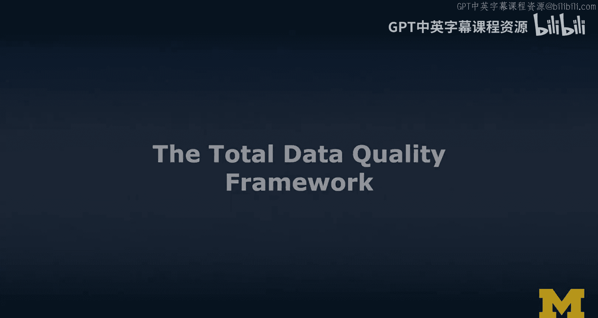
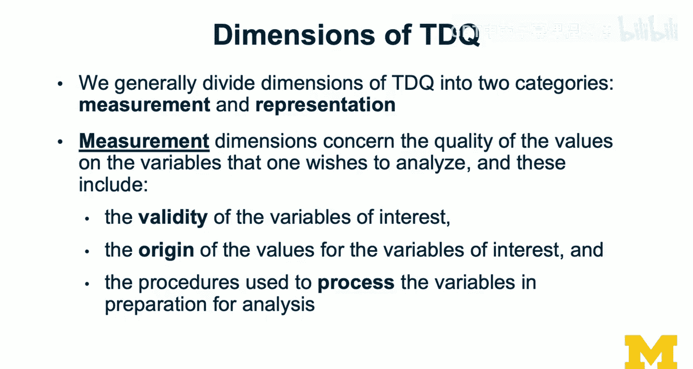
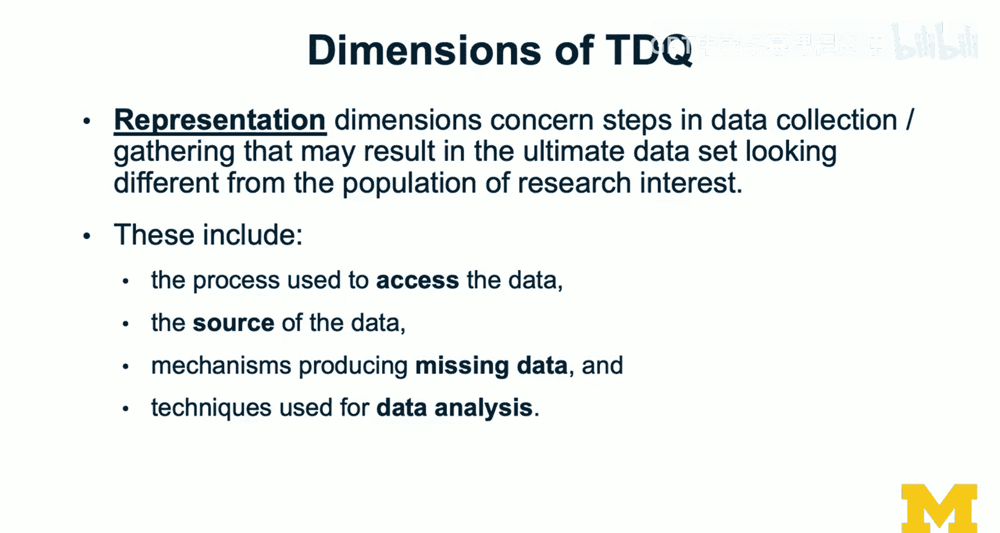
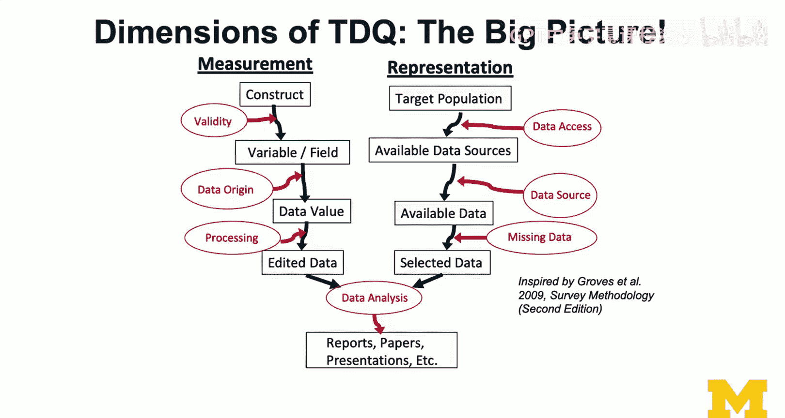
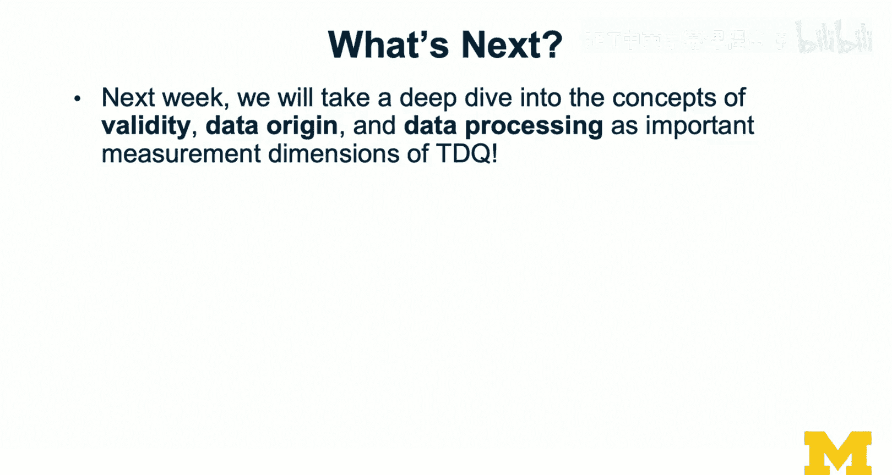

# 密歇根大学《总体数据质量（框架、度量、设计策略）total data quality》 p08 7_全数据质量框架解析.zh_en -BV1Jn4y1X7uS_p8-

Okay， well hello again everyone， today we're going to be talking about the total data quality framework we've learned a little bit about design data and gather data thus far。

 and now we're going to talk about the framework that really motivates this entire specialization。

 but we want to start with the beginning and just talk about what this framework means with respect to this first course。

So what exactly is total data quality for both designed and organic or gathered data。

 total data quality refers to a scientific framework for measuring and optimizing the overall quality of the data that you're collecting and we think about optimizing the overall quality of the data collected along multiple different dimensions。

 so the courses in this specialization are going to be structured based on these different dimensions of the total data quality framework。

This framework allows for careful thinking about how to maximize the quality of the data collected in a given research study and how to clearly measure the quality of the data collected。

So these dimensions of the total data quality framework。

 we generally divide dimensions of total data quality into two categories。

 measurement and representation。So the measurement dimensions concern the quality of the values on the variables that one wishes to analyze。

And these include the validity of the variables of interest， the origin of the values。

 for the variables of interest， and the procedures used to process the variables in preparation for analysis。

 so these are all different dimensions of measurement when we think about the overall quality of the data that we have access to for a given research study。

 and we're going to be spending a lot of time talking about these different measurement dimensions when thinking data quality along the lines of measurement。

We also have representation dimensions。 These dimensions concern steps in data collection or data gathering that may result in the ultimate data set looking different from the population of research interests。

So the representation dimensions include the process used to access the data。The source of the data。

The mechanisms that might be producing missing data and then techniques that you ultimately use to analyze the data that you've collected。

 So again， we're really focusing on the quality of the data。

 but we're including data analysis techniques as a part of this larger overall total data quality framework。

Because even if you do a great job with the measurement dimensions and the representation dimensions。

 if you're sloppy about your data analysis procedures。

 that can defeat all the work that you did to try and optimize quality leading up to that point of data analysis。

 so we're also going to be talking about appropriate techniques to use for data analysis。

 but the representation dimensions really concern the parts of the overall data collection and data gathering process that could result in deviations from the population that you're ultimately trying to talk about with your data analysis。

So here's a big picture of the total data quality framework that we're going to spend a lot of time looking at in this specialization。

 and this kind of lays out visually the measurement and the representation dimensions of the overall TDQ or total data quality framework。

 So this is the big picture。 and we're going to keep seeing this as we spend time focusing on each of these different dimensions that you see here circled in red。

 So on the measurement side of the framework again， we have validity。

 we have data origin and we have processing on the representation side。

 we have data access we have the data source， we have missing data。

 and then ultimately we have data analysis combining what we get from both sides of this overall picture。

 So on the left- hand side of the picture again are the measurement dimensions。😊。

In the typical design of a research study， we start with the construct that we're interested in gathering data on or collecting data on and that process is going from a theoretical construct to the variable that we're actually analyzing。

 that's where validity becomes so important as a dimension of total data quality is what we're measuring a valid measure of that theoretical construct that we're interested in。

And then going from the variable or field that we're working with to the actual data value for that particular variable or for that particular field。

 that's where we think about the data origin， So where did those data values come from on the variables or the fields that we're interested in analyzing。

And then we have our data values and going from the data values that we've collected or gathered as a part of our study。

 going from that step to having edited data， that's where the processing procedures that we use to create an electronic data set or to create a clean data set for ultimate analysis that's where we worry about what happens during processing to make sure that we go from the collected values to edited data that are clean and ready for analysis So those three dimensions all speak to measurement on the right hand side of the total data quality framework again。

 we have the representation dimensions So we start with the target population that we might be interested in Then we think about available data sources that we could use to collect or gather data on that target population and that has to do with data access what data sources do we have access to in trying to gather or collect data from our target population。

Then once we think about the available data sources and actually obtaining the data that we want to work with。

 that's where we think carefully about the source of the data。

 so where exactly did that data come from and where are we getting that available data that we have for our actual analysis。

Then once we have our available data from one of the sources that we've identified。

 then we think about the problem of missing data， or the fact that only selected data are actually available for our analysis。

 and that's that missing data dimension of the total data quality framework that we're really worried about in thinking about the selected data that we ultimately have for analysis purposes。

 so we'll spend a lot of time talking about issues related to missing data in one of the sources that we've identified。

And then finally， once we have our edited data on the measurement side coming from the data that we've selected from our available data sources。

 those combined to give us the data that we're ultimately going to be working with。

 and that's where data analysis， that final seventh dimension comes into play choosing appropriate techniques to make sure that we do a high quality analysis of the resulting data and once we analyze the data that's where we produce reports or papers or presentations or technical work。

 whatever it is that we ultimately want to do by analyzing the data that's what leads to what we ultimately share with the world based on data analysis so you can see all these different steps。

 that's what we' really focused on in this particular specialization is thinking about optimizing quality on all of those earlier dimensions。

 validity， data origin processing， data access， data source missing data and then finally data analysis we're going focus on optimizing quality on all these different dimensions to make sure that those reports。

 papers and presentations are as of。

High quality as possible。

Okay， now that we've seen the total data quality framework and talked briefly about these different dimensions。

 what's next next week we're going to take a deep dive into the concepts of validity。

 data origin and data processing as important measurement dimensions of the total data quality framework。

 so we'll look forward to seeing you when we start talking about validity。

