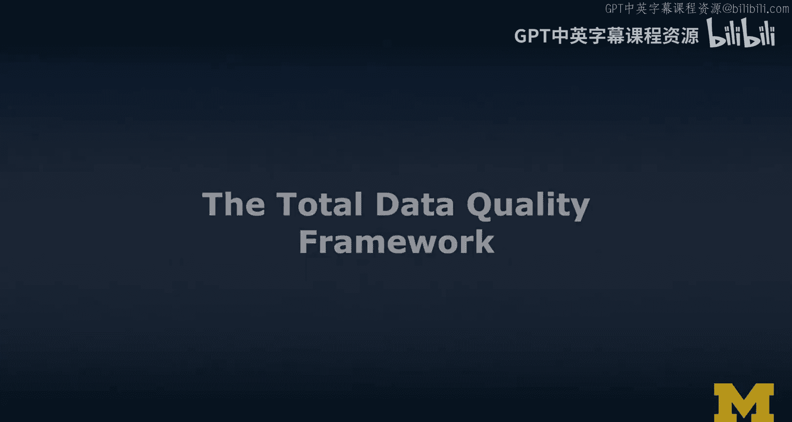
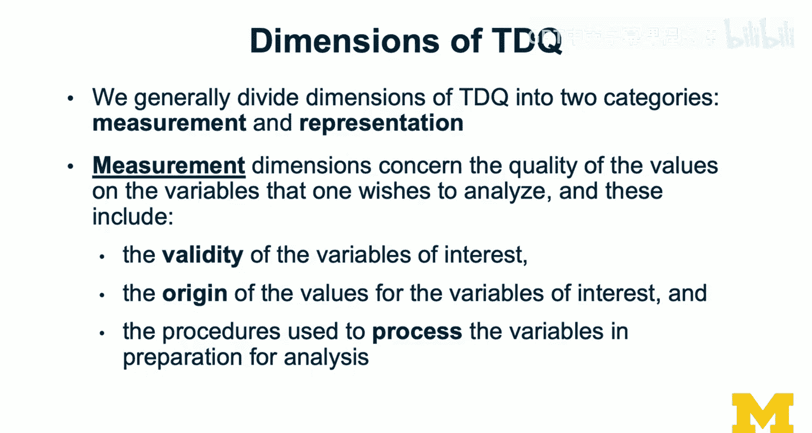
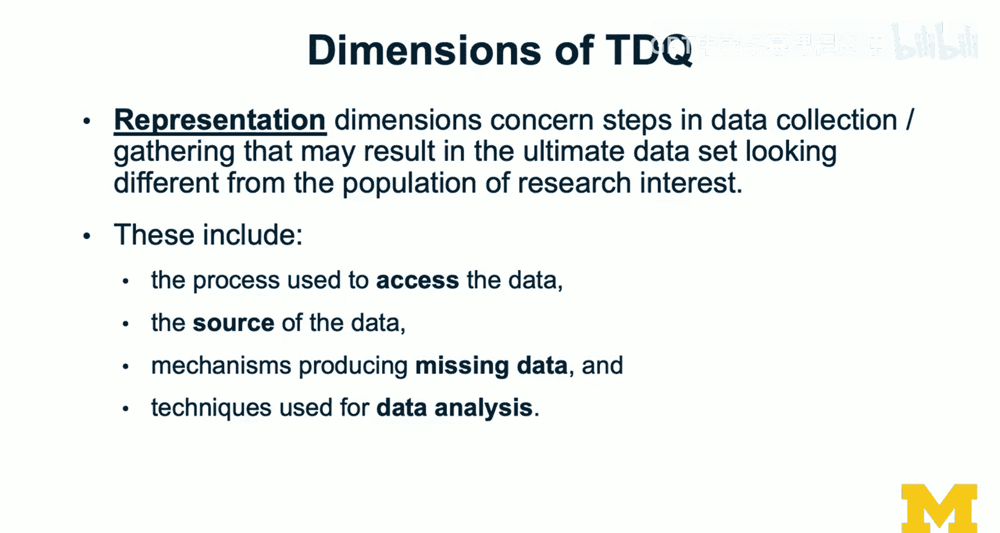
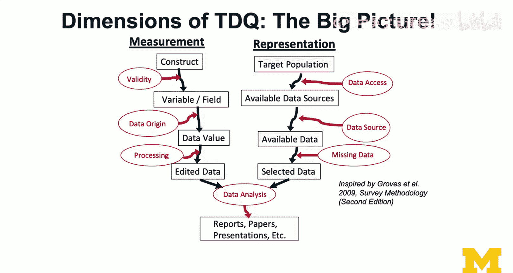
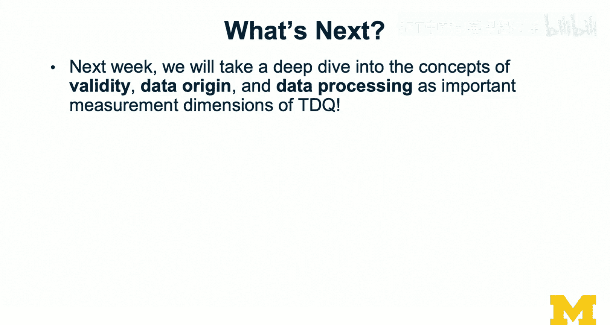

# 总体数据质量：P08：全数据质量框架解析 📊

在本节课中，我们将学习全数据质量框架。这是一个用于衡量和优化数据整体质量的科学框架，它从多个维度指导我们如何提升研究中所收集数据的质量。

## 什么是全数据质量？ 🤔

全数据质量指的是一个科学框架，用于衡量和优化你所收集数据的整体质量。我们考虑从多个不同维度来优化所收集数据的整体质量。本系列课程的结构正是基于全数据质量框架的这些不同维度。

该框架促使我们仔细思考，如何在给定的研究项目中最大化所收集数据的质量，以及如何清晰地衡量所收集数据的质量。

## 全数据质量框架的维度 📐

全数据质量的维度通常分为两大类：**测量维度**和**表征维度**。

### 测量维度

测量维度关注的是你希望分析的变量值的质量。这些维度包括：
*   **变量效度**：所关注的变量是否有效。
*   **数据来源**：变量值的原始出处。
*   **数据处理**：为分析准备变量时所使用的处理程序。

当我们考虑特定研究项目可访问数据的整体质量时，这些都是测量的不同维度。我们将花大量时间讨论这些测量维度。

### 表征维度

表征维度关注的是数据收集或数据采集过程中，可能导致最终数据集与研究兴趣总体看起来不同的步骤。这些维度包括：
*   **数据访问**：访问数据所使用的过程。
*   **数据源**：数据的来源。
*   **缺失数据**：可能导致数据缺失的机制。
*   **数据分析技术**：你最终用于分析所收集数据的技术。

我们再次强调，我们真正关注的是数据质量，但我们将数据分析技术也纳入了这个更大的全数据质量框架中。因为即使你在测量维度和表征维度上做得很好，如果在数据分析程序上马虎，也可能使你为优化质量所做的所有努力前功尽弃。因此，我们也将讨论适用于数据分析的技术。

然而，表征维度真正关注的是整个数据收集和采集过程中，可能导致最终数据分析结果偏离你试图讨论的总体的那些部分。

## 全数据质量框架全景图 🖼️

下图展示了我们将在本系列课程中深入探讨的全数据质量框架全景图。它直观地展示了整体TDQ框架的测量维度和表征维度。

这是框架的全貌。随着我们逐一关注图中用红圈标出的每个不同维度，我们会反复看到它。

在框架的测量维度一侧，我们有**效度**、**数据来源**和**处理**。在表征维度一侧，我们有**数据访问**、**数据源**、**缺失数据**，最后是结合两侧结果的**数据分析**。

### 测量维度详解

在典型的研究设计中，我们从感兴趣的理论**构念**开始，希望收集或采集关于它的数据。从理论构念到我们实际分析的**变量**，这个过程正是**效度**变得至关重要的地方。我们测量的是否是那个我们感兴趣的理论构念的有效度量？

然后，从我们正在处理的**变量**或**字段**到该特定变量或字段的**实际数据值**，这里我们考虑的是**数据来源**。我们感兴趣分析的变量或字段的数据值来自哪里？

接着，我们有了**数据值**。从作为研究一部分收集或采集到的数据值，到拥有**编辑后的数据**，这一步涉及我们用于创建电子数据集或为最终分析创建干净数据集的**处理程序**。这里我们关注处理过程中发生的事情，以确保我们从收集到的值转变为干净且准备好进行分析的编辑后数据。

这三个维度都指向测量。

### 表征维度详解

在全数据质量框架的右侧，我们再次看到表征维度。我们从可能感兴趣的**目标总体**开始。然后，我们考虑可用于从该目标总体收集或采集数据的**可用数据源**，这涉及到**数据访问**——在尝试从目标总体收集或采集数据时，我们可以访问哪些数据源？

一旦我们考虑了可用数据源并实际获得了我们想要处理的数据，这里我们就需要仔细思考**数据源**。数据究竟来自哪里？我们用于实际分析的可用数据是从哪里获得的？

一旦我们从已识别的某个数据源获得了可用数据，接下来我们考虑**缺失数据**的问题，或者说，只有选定的数据实际上可用于我们的分析。这就是全数据质量框架中我们真正担心的**缺失数据**维度，它关系到我们最终用于分析目的的选定数据。

最后，一旦我们从测量维度一侧获得了来自可用数据源选定数据的**编辑后数据**，两者结合就给出了我们最终将要处理的数据。这时，**数据分析**这第七个也是最后一个维度就发挥作用了——选择合适的技术，确保我们对结果数据进行高质量的分析。分析数据后，我们就能生成报告、论文、演示文稿或技术成果。无论我们最终想通过分析数据做什么，这都会导向我们基于数据分析与世界分享的成果。

你可以看到所有这些不同的步骤。本系列课程真正关注的就是思考如何优化所有这些早期维度的质量：效度、数据来源、处理、数据访问、数据源、缺失数据，最后是数据分析。我们将专注于优化所有这些不同维度的质量，以确保那些报告、论文和演示文稿的质量尽可能高。

## 总结与预告 📝

本节课我们一起学习了全数据质量框架，并简要讨论了其不同维度。这是一个从测量和表征两方面系统评估和提升数据质量的科学工具。

下一周，我们将深入探讨**效度**、**数据来源**和**数据处理**这三个重要的测量维度概念。期待在讨论效度时与大家再次相见。