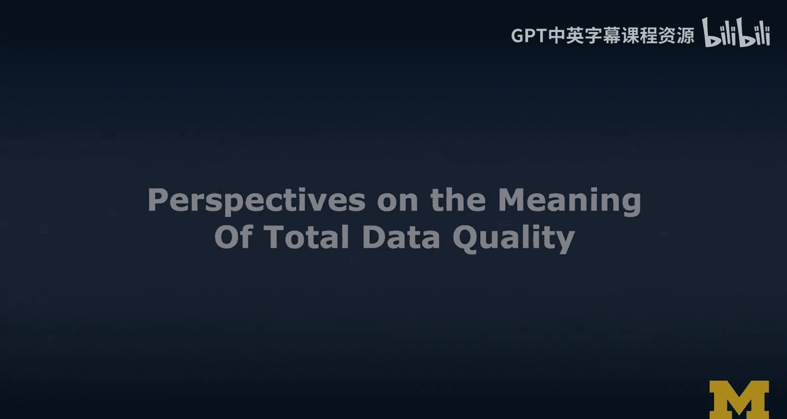
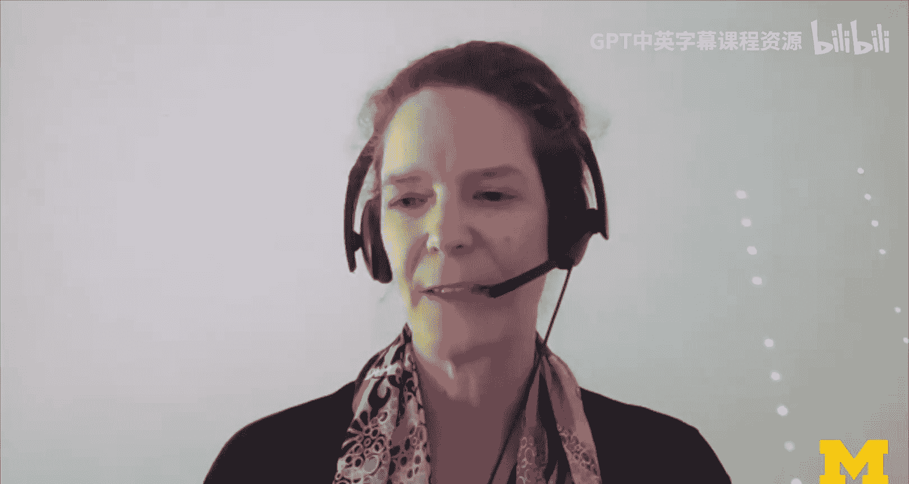

# 密歇根大学《总体数据质量（框架、度量、设计策略）total data quality》 p09 8_专家访谈：全面数据质量的多维解读.zh_en -BV1Jn4y1X7uS_p9-

Okay， well， hello everyone， welcomelcom today。 We're joined by three international experts in data science and survey methodology who are going to be providing their perspectives on this idea of a total data quality framework。

 So we're very happy to have Ashley Amaa with us today， Fca Croitder and then Adam E。

 So we're going to start with each of them introducing themselves。

 saying a little bit about their backgrounds， where they're working right now。

 a little bit about the kind of research that they conduct and then in the general panel session。

 we'll be asking them some questions about their thoughts and ideas related to total data quality and why it's so important for the kinds of studies and research that we're discussing as part of this specialization。

 So again， thank you to all three of you for joining us today。

 we've really been looking forward to this。 So why don't we just kind of go around starting with Ashley and again。

 say a little bit about your backgrounds and the kind of work that you do on a dayto- day basis so。😊。

Thanks Brady so i'm Ashley Amaa I am a senior survey Meologist at the Pew Research Center I have a PhD in survey methods from University of Maryland and I think from day to day I do a couple things I help design complex surveys for the center for various surveys or research teams and then I manage some data quality metrics for our primary data collection tool the American trends panel and then I also look at the big picture kind of where do we want to go in the future in terms of data collection and。

Research methods。Great。Okay， thanks， Ashley， why don't we go to Adam next？Hi everybody， I'm Adam E。

 I am an assistant professor of computer science over at Oberlin College over here I direct the social intelligence La so we do a lot of research on computational social science。

 especially finding ways to use machine learning and data science to help aid in survey analysis and using survey type data for my background I come from a computer science background。

 I got my PhD at the University of Nebraska， Lincoln。

 where I did my postdoc also in a sociology department which is where I sort of got involved with more survey research oriented things。

Great， okay， thanks， Adam， Fracco， let's turn to you。Sure。

 I'm a professor in the joint program in Ser methodology and co director at the Social Data Science Center at the University of Maryland。

And over in Germany， I'm professor Data science for the Social Sciences and Humanities at the Ludwig Maximills University in Munich。

Until recently， I I was part of a government organization too here in Germany。

 the Institute for Employ Research will circle back to that when we talk about projects probably later。

 But on the day to day basis， you know， certainly a lot of research。

 but having started out in sociology at some point before moving to civilian statistics。

 I still bring the passion to empower social scientists to have a seat at the table when we talk about data science。

 So， you know， I do think they are uniquely。😊，Situated to detect quality issues in data。

 And because they understand the data generating process。

 I do think that including them anytime we think about data collection on people is pretty important。

 Thanks to all of you。 And again。 Thank you again for joining today。

 we we're really looking forward to this discussion。 So I'll turn it over to Trent。😊，Thanks。

 thank you all so much for being here we're so excited to hear what you have to say so let's move the conversation forward and we're going to start with Ashley with this one so we really would like to know sort of what the phraseTo data quality means to you when you think about your work when you think about your research we'd love to hear that。

I guess I think about it in terms of an overall evaluation of data in terms of the bias。

 the variance of the reliability， and then CA att in a broader evaluation of timeliness。

 purpose of use costs， ethics， etc ceter， and then within that evaluation breaking that down by the different sources of potential introduction to bias。

 potential introduction of variance， etc cetera Great， Thank you， Ashley， Adam。

 would you like to sort of add to that。Yeah， so very similar thoughts for me as a data scientist。

 the first thing that comes to mind is sort of the quality of the outputs that I get out of models so when we're trying to model some real- world events or make predictions about something in the future。

 how accurate are are we accurate across the full spectrum so are we doing well in all possible cases or are we doing really well for like positives but not so well for negatives but also thinking about sort of what was the quality of data going into the models in the first place so is it did we have coverage of all the possible events that could occur and do we have enough representation of important things that will help us make predictions and stuff。

Fka anything to add Yeah I mean these guys covered the core parts but I do want to add one angle to it。

 I think to me data quality is not something that can be ascribed to a particular data set per se it's really a function of what question you want to answer you know so for certain research questions some data might be of great quality and then for a different question that data might be totally useless and I think that's often overlooked when I mean I think this course you're giving in thinking about a framework is great and people need these frameworks but it always needs to be tied to a research question。

Yep thanks Praka that's a great point so so more generally in this specialization we're making this distinction between design data so like the kinds of data that we might collect from design questionnaires and surveys large or small and then organic or gathered or found data and your views what are the unique defining characteristics of each type of data in your opinion so if we talk about this distinction between design data and gathered data or found data what are really the unique defining characteristics of that that kind of those two different types of data based on that broad classification and anybody can start by taking this on so。

Well， let me jump in and alter your question a little bit。

 I do think there's something they have in common you know so I mean theyre cool distinct and I think we mostly think in the differences but there's also one key thing they have in common and that is there are decisions that are made when we capture data and often I think we think about that more in the design data type because we create a questionnaire and we have to think about who's in the sample of whom do we collect the data。

😊。

But in the found data， there are traces that are left behind in some digital way， usually。

These decisions happen also， they just happen at a different point in time right we still decide what are we recording。

 what are we capturing， which integral role are we taking in， how are we generating the features。

You know， these decisions， and I think it's always important to bring them to light， you know。

 to have transparency and some record of what are the decisions that have been made。

Yep great So there are a lot of decisions that need to be made along the way in terms of where you're getting the data what you're going to do with the data and I like the idea for Raka how you always have to tie that back to the research question that you want to answer so and you know Ashley mentioned fitness for use that's another very important point here when thinking about this framework so yeah thank you for introducing that idea Adam Ashley do you want to add about your view on that distinction so I guess I would draw two differences the first is control and that by researcher control right we have we get to decide how we ask a question which questions get asked how frequently we collect the data how many data points that we get to create who has access to those data and that's all for design data and we have a lot less control over all of that when we think about found data。

And then the second thing I would say is informed consent when we whenever we does not have design data。

 the participant clearly knows that they're I hope participating and that they are willfully answering those questions where I found data they may not realize that those data could be used for research purposes or what have you and I think that's a big distinction it's another it's another excellent point cool thank you Adam I think you want to add to that so I think when I think about the difference between the two a lot of it comes down to decisions and control a lot like Fka and Ashley have mentioned here so for me it's about whether or not I had some myself or someone on the research team had some input into how the data was generated in the first place so even if it's not like survey or interview data where I'm directly I come up with a set of questions ahead of time I give those to people with you know either a set of response options or。

I allow for openended responses and those kinds of things。

 but even like organic data can still be design data even though it's not the typical kinds of survey data and things that we see in the social sciences so if I want to for say try to measure how much traffic there is in a metropolitan area I might design certain sensors to go across different major intersections and those sorts of things and so even though it's not the typical social science data that we collect we can still use it to answer social science questions and it's organic in the sense that it's happening as the real world is playing out around us but it's still designed in that I had a choice in where these things go and what ways I'm using to measure traffic and all those sorts of things and so I think when both decisions and control were mentioned there I think those are absolutely great points。

No that's great and we will be talking a lot in the specialization about this idea of kind of hybrid data where you bring together design data and organic data or found data to again best answer a research question that you're interested in so thanks Adam for bringing that up that's a great example you all raise a very interesting distinction so sort of around the found data versus the design data and part of this is I think having to do with the sort of curation process right I mean we are sort of curating information at some level trying to find out how to answer certain questions maybe it's through a sensor maybe it's through a question but I think we're seeing a much broader context now in which people are saying we need to curate these sources of information and there are different ways to do that So to that end I'd love to ask this question of the panelists here can you describe a sort of project or an instance in your own work where you've been curating these sort of found data sources and whether or not those sources were analyzed。

used independently of other sources or not we'd love to sort of hear some examples of that as Brady mentioned this hybrid sort of idea is coming to bear and we'd love to hear some examples I mentioned earlier the Institute forEmploy Research that worked at it's sort of you know if you're familiar with the US government system it's sort of similar to the Bureau of Labor Statistics research inside there。

And they work a lot with administrative data that come from Social Security administration notices。

 so to inform the welfare system of your employment benefits every day you employed somewhere and it's recorded and the amount of salary you got。

Also determining pension and any of that， so what is interesting when you work with these data that you know rich in the sense that they are available for everybody who ever worked。

 gainfully employed somewhere and for anyone who was in job training programs or of any of that sort we have data。

 they go all the way back to the 70s right long employment histories。

But these administrative data that are certainly organic because they're just recorded。

 they have real quality issues for entries that are not program relevant。

Things that don't contribute to these pieces of information， you know so salary is okay。

 but your nationality status might change over time and no one will think to update that or your education you do a little continuing education like folks taking the specialization and then eventually get another degree and that's not recorded because it has no impact and it happened to be on the form that someone fills out and so what happens in you know on the back end when these data are used and processed is that you know people acknowledge as's either missing data or more measurement error on those variables and this a temptation than to combine them with survey data that ask those specific questions in addition to make sure that the combined data product and has all the information needed。

That's a great example yeah I was just gonna to say that's an awesome example of how surveys can come to the rescue in some ways that's awesome Adam or Ashley you'd love to hear some examples some your own work so prior to working for the Pew research center I worked for RTI International and did some contract work for the EIA which is the energy information agency and they are very interested in residential energy consumption so how you're you know how you use your electricity。

 how you use your gas if you have propane if you have a fireplace that's heating your house etc and they're interested in that distribution of energy so how much is going to your heating。

 how much is going to your cooling as well as projecting energy usage for the future。

And they do that through the residential energy consumption survey， it's a survey。

 but one of the things that they have found is since they've moved to self-administered surveys。

 they rely on the respondent to tell them how large their house is， so it's 1。

500 square feet it's 10，000 square feet that has a massive impact on how much heating and cooling energy you use and people have no idea the answer。

So we've tried to use alternative data sources like Zillow。

 which for those that have ever looked for a house before。

 this is kind of a public real estate database。And they arguably have all residential addresses and they arguably have how many square feet your house is。

 and so we did a comparison to look at the coverage of that database to see whether or not they actually do in fact have all addresses and whether or not those square footage were accurate and while they have a ton of information。

It turns out that they don't have all of the data， especially for non- singlele family homes。

 and they have no information for mobile homes， because that wouldn't be something that you buy and sell on the real estate market。

And then they also don't define square footage the same way that the EIA does EIA cares about how much space you heat and cool。

It doesn't care about if you you know have it's not the same as assessed kind of tax assessed square footage。

 which is what Zillow cares about so we kind of did an evaluation of those different data sources how we might blend them and what the pros and cons were of using both。

's just another fantastic example and in the specialization we will be using examples of Zillow and other data sources like that and a lot of those issues will come up so thanks Ashsh for bringing that up that's excellent another great example so。

😊，I love the nod to coverage and the assessment of coverage。

 this is one of those things where I was thinking about earlier you know when we were talking about the total data quality it's interesting to sort of see these examples and sort of highlight some of the quality issues that are sort of coming to mind when you're thinking about navigating through these data sources Adam any examples from your work that you'd like to share Yeah so we've got a project ongoing going right now wherere the found data we're using is we're collecting a lot of tweets from Twitter trying to better understand the discourse around COVD-19 specifically within different geographic regions so focusing on one region what are the ways people are talking about COVID what keywords are they using what emojis are they using and how does that differ across different geographic regions and just yesterday in our research meeting we were talking about how to triangulate some of that with actual survey data as well so lots of survey organizations out there have been doing amazing work over the last year trying to understand people's opinions and behavior。

and beliefs about COviID and sort of how they're adapting as things go along and so we've been talking about how do we pull out information from geographic regions there that might better inform why discourse is happening on Twitter so if certain regions are more likely to mask up then that's going to change the way that they talk about masks in these geographic regions versus others if places are less likely to become vaccinated that might change the sentiment being used to discuss vaccines in coviID in general in different other geographic regions and so using that both to explain what we're observing and also help form some hypotheses and how we're going to analyze everything I think is going to be really important。

Thanks， those are all excellent examples。 so we'll build on that with some of these additional questions。

 but yeah that shows kind of the diversity of the types of projects that you work on where evaluation of data quality is so important。

 especially thinking about where the data is coming from and again what you're planning to do with it So all of those are great examples that are really providing a good basis for these additional questions that we have so you've each introduced you these kinds of recent projects that you've worked on and we're curious when you think and you can refer to the projects that you've already talked about or talk about other projects where you've undertaken an evaluation of the quality of a given data set or a set of estimates that you've produced or some other type of research product and we're curious what aspects of the total data quality framework were most relevant for that quality evaluation So when you think about your evaluation of the overall quality of one of the data sources again maybe that you've been talking about or maybe another one comes to mind。

What aspects of that framework， like what quality dimensions did you find to be most important when you were doing an evaluation of the quality of the data source that you were considering let's start with Fraca on this one。

Yeah， I think I'm not sure if theres this particular aspect that I thought was more important。

 but I can talk about what most important， but I can talk about how we went evaluating it。

 So I think similar to some of the things that。That Ashley was pointing out with that survey that she was involved in the energy consumption Sur。

 you know the starting point there was certainly is a survey right and at the Institute for Employment Research we also often particularly most recently。

 we did a study where the starting point was the survey we sampled a set of people who wanted to interview them。

But we then asked them to install an app on their phone so that we can。

Gathther organic data on the physical activity over the course of six months and everything they do with the phone and the larger research question behind is sort of long term effects of unemployment on health and activity and stress levels and things like that。

And what's useful there is that because we have such rich sampling frame。

The survey and in the background， the administrative data。

 we can really look at who owns the phone and who does not right and of those that do own a phone。

 how do those differ that plan on installing the app compared to those that don't and that helps us tremendously to detect possible coverage error or error through non-particip but also allows us then to help with adjustment。

Yeah， that's a great source。 So we'll talk about in one of the courses of the specialization。

 this notion of measuring data quality and in the presence of administrative records like Fracka is talking about if you have information on all the people that you're trying to collect data from and some decide to participate。

 So like Fracka was saying some will actually download the app and use it and some decide not to participate you still have information from those administrative records So you can do a comparison and see if there are systematic differences between the people who are participating the people who are not。

 So that's that's a great example of that kind of measurement of whether there's any bias introduced by differential participation in terms of who you're trying to measure。

 so thank you Froca it's a great example Ashley， would you like to think present an example。Sure。

 you know， for the Zillow and the Rex example I already mentioned。

 that's definitely coverage issues and specification issues for us。

 But I think that all of this really depends on what your goal is。 So in that scenario。

 we were trying to kind of replace some items but really enhance the data quality of the survey and blend these two sources I think another option。

 whenever you have organic data or found data is to answer entirely new questions And in those scenarios。

 you might be happy to just say I'm willing to accept any and all error because at least I get to say something there。

 And in that case， maybe those error components。are important to know but less of a deal breaker。

And then i think there are other scenarios where。The entire purpose of the big data or the organic data I should say。

 are to enhance the data quality of the survey and so one example that we're looking at right now is polls in general have been underestimating the Trump support and continue to underestimate Republican support and so we're looking at looking at the percent vote by precinct to help inform our sampling procedures for the American trends panel moving forward and I'm sure that there is there's definitely not any or I hope there's no measurement error in the distribution of the vote but there are some states where we don't have all of the precinct level information so we definitely have missing this。

And that will limit our ability to improve the sampling design。

 but that again is something that we're less concerned about in that situation because any additional information is good information So I think it really depends on your purpose。

 your research question and what other options you have I love this acknowledgement Ashley that sometimes we do things and we don't have the perfect data sets we don't have the perfect thing and part of the quality assessment I think it's a very。

 very enlightened view you I think is that we are improving the quality of the conversation by being able to at least forward some of these estimates even though the data sources themselves while we're gathering them we don't have control over all the aspects of them but one aspect of quality in general is to be able to acknowledge that and look at the contributions that these data sources can make and where they can make that I think that's a lovely idea No yeah absolutely fantastic this idea that。

We always have this continuous focus on quality improvement and those of you taking the specialization with business backgrounds I mean you've learned a lot about that but data is so important in our data rich society right now that whatever area of resource that we're working on we can have in the back of our mind okay with the sources of data that we have available what steps can we take you might not take the entire step forward and coming up with the highest possible quality that you would ever achieve but you're always thinking about how to use your existing sources of data to try to make improvements even if they're incremental and you know you don't have all the necessary information that's just a fantastic comment Ashley so thank you very much Adam any examples of that kind of quality evaluation from your own work so building on this conversation about thinking about whether you have the perfect data set so I thought I did for one project so the goal of the project was to try to automate sampling frame construction when you're trying to survey locations in a geographic area。

so imagine that you want to understand where windmills are inside of a country so we can estimate clean energy production and get a lot of useful information out of that and so I thought I had the perfect data source so the U。

 Department of agricultureg offers aerial images over the entire United States and so we picked the state of Iowa as a case study because Iowa per capita has some of the most windmills in the entire country and so I had complete coverage of the entire country with clear aerial images and thought this would work great and so we built up a data where we found all the windmills had students go through and actually hand trace where they were based off of a list that we had available and so we had images of windmills and then I did a simple random sample of the rest of the state thinking that that would give me a good representative example of non-winmill locations and then I could build a model that said given a new image is there a windmill in here yes or no so that eventually I could pass this model over the entire state find where。

Winmills were and be able to say that other locations don't have windmills。On paper， great idea。

 we trained it and it did pretty well。 our sensitivity was great so if there was a windmill there was with 90% or higher accuracy saying yes。

 there's a windmill in here but we had a lot of false positives and so I went back through and I actually had it scan a bunch of images and show me examples where it thought they were positive and what I found was it was highlighting a lot of images where there were roads especially households。

 but mostly roads and what I realized when I did the simple random sample of the entire state a state like Iowa this largely rural and farmland。

 I had lots and lots of great examples of farms not having windmills in them but I didn't have great coverage of other kinds of areas that are less common inside of a state and in particular what the model was learning was that all windmills have an access road to them so that people can go work on these windmills and connect things and all the。

Good work there and so what it found was not the shape of a windmill which I thought was going to be super distinctive and easy to find。

 but the number one feature it was identifying was whether there was a road in the image and so anytime I gave it an image that had a road it said there's a windmill here because this thing always accompanies a windmill and so we went back in later and we tried to do more of a clustering approach where we took all the images that don't have windmills in the state of Iowa and we tried to group them based off of similar characteristics hoping that more roads would end up close together more farmland would end up close together and then I could do a more directed sampling approach where I took a certain number from each category as opposed to a simple random sample so that no longer would the farmland be overrepresented in roads be underrepresented and we got better performance than that did help drag our false positive number down and so even if you started with the perfect data that has all the information we need we still had to be kind of careful about how you use that。

What specific information we grab and all those sorts of things so that was a really eye-opening experience for sure that's awesome that combines a lot of these ideas of machine learning and training a data set and understanding issues with the quality and like you mentioned the quality of the predictions that would be based on an algorithm like that so that's fantastic I love that example and Trent I know that you had worked on that a little bit too so that's a really really cool example thanks for sharing that we learned to build a classifier for finding roads instead of windmills labels are and outcomes are important I think this is the moral of the story for sure so speaking of that you know we've talked a lot about I mean this is just one example where data science methods are being infused to build sampling frames for example of these really interesting objects and data science is really impacting the world around we're seeing it in many fields from medicine to education to all sorts of things and so the question really is you know I sort of see this from my view is data science is really。

makingking inroads in a lot of fields and very few fields are actually making inroads in data science and I think as Falca mentioned earlier。

 the role of social science and survey research being able to maybe be a two-way conversation and so the question really is around while we acknowledge the data science is making these impacts we think that there are few fields that are impacting it in return so I'd like to sort of hear from your perspective what are some of the ways that you think that a focus on total data quality for example might help move the conversation forward in data science itself so Adam let's hear from you first Yeah I think this is a fantastic question and one of the things that I really love about working not just in data science but with people from other disciplines so that we can get this cross-poination of ideas and really improve everybody's research so as a data scientist the assumption is usually that somebody provides a data set for me to analyze and then I play with it and you find patterns。

 find interesting discoveries and then share that information back。

And so I don't have a lot of control over the collection of the data initially I just trust that it was done properly。

 and so for a lot of times in data science the idea of total data quality is more about did you pick the right model for this particular data set are you using the right evaluation metrics on it。

 so even like making predictions。Total accuracy is not always the right thing to pick because if I have class imbalance where say I'm trying to predict whether or not somebody is going to be diagnosed later with COVID and so there's been a lot of people with COVID but thankfully it hasn't been over half of the population yet and so the fewer cases I have the easier it is for my model to learn to simply say no all the time and miss all the yeses and so there we have to pick other evaluation metrics to really show to to highlight how well this model is actually learning and what it's finding and that sort of thing but again there's not that much about the original data collection process and I think a lot of work could be done there I think more data scientists need to be aware of sort of where the data is coming from and what collection processes were used。

 what kinds of information we have about it and those sorts of things and that's all going to be very relevant and so when I started working with computational social scientists and survey researchers this idea of the total survey。

Error framework and now the total error framework that includes big data are all things that I wouldn't have thought of before if I hadn't been working in this community。

 and so getting more conversations going between them I think is going to be very。

 very fruitful for data science。It's a really great perspective， Adam thanks for sharing Ashley。

 did you have any additional comments？I guess I would say two things N one is that I don't think this is a new issue right so when with the creation of the total survey error framework getting that to be picked up by sociologists and psychologists and education researchers。

 etc cea， is equally as challenging and so this is just a continuation or a shift in that。

The second thing I would say is that I think it's a twowe way street and we need to really recognize that so to Adam's point I think there's a lot about the underlying errors in the data sources that we can share with computer scientists and data scientists。

 but I also think that they are much more knowledgeable about some of these new analytic methods that we necessarily aren't super knowledgeable about。

 and I think a perfect example of that is text analytics and。

And knowing that those a lot of those types of analytics are derived for or created for analysis of books or newspaper articles。

 not tweets， and so when we try to apply those kind of methods on these very short text strings。

 we get a lot of errors that，Because they're violating the assumption of the analytic methods。

 and so I think there's a way in which we can share what we know。

 but we also need to be receptive to what they know。It's a really great point and in fact。

 these crosscols across the fields is sort of the spirit in which this specialization is trying to sort of reach out to people from all across the spectrum so that we can begin to craft a common language to facilitate this conversation。

 you know one thing I'm reminded of actually that you mentioned is there's lots of choices that analysts make in terms of tokenization or dictionaries that people use and all of those choices can contribute to error on the backend。

 and if we don't have a sort of running tally of those to Adam's point。

 what he does in his lab and analysis and what you do in your lab in terms of data curation。

 if we never speak a common language， we're going to miss sources of error in our evaluation of the quality overall。

 so I love this sort of perspective on both ends that's a really great point。Fracca。

 anything to add here？I think the important points we all mentioned。

 maybe a quick anecdote at the end of this topic is I spent a couple of years ago some time in the Bay Area talking to a lot of the data science。

 heavy use of data science companies and spent some time looking at Facebook。

I thought I'd go there and talk to them about data science and learn what we need to teach our students and then they was glad they wanted to talk to me but then it turns out they didn't wanted to talk to me about data science。

 they wanted to talk to me about survey science because they realize for a lot of questions they have they do need。

Other types of data and input and information and。I mean， you know a little known fact。

 I think that Facebook is probably one of the largest survey data collectors in the world。

 and so I do think the twoway Street is both on the methodologies。

 but also on the types of data and there's no need in my opinion to have sort of an artificial separation of the two。

Right great， thanks Franka。 yeah， collaboration is clearly so important in this area and again。

 kind of like Trent was saying having everybody speak a common language so that everybody's on the same page in terms of an overall quality evaluation。

 it's just so important and we're really trying to introduce that language for a wide variety of fields by you know putting the specialization together。

 So all these perspectives are just fantastic。 So thank you guys again for for sharing these points。

😊，So more broadly in this specialization， we're going to be talking about ideas and tools for measuring and maximizing data quality following this total data quality framework and thinking more about concrete tools that each of you have used in your work and in your research I'm wondering if you can provide us with some examples of the types of tools that you've used to either measure or maximize data quality and practice and you know when you think about some of the more innovative ideas and tools that you've heard about recently or that you've been able to apply in your own work are there particular tools that you've found really helpful or really valuable in trying to either measure or maximize data quality and you have you encountered challenges in using these tools or do you think that there are important areas and areas for development moving forward where you think more research could go into the tools that are used so we really wanted to get your perspectives on some of the more useful tools。

that you've encountered recently for trying to look at data quality and some of the challenges that have come up from using those tools so why don't we maybe start with Ashley and then we'll kind of go to Adam and then Fc in terms of thoughts on this idea I would reframe it a little bit and say that I wouldn't opt to maximize data quality。

 I would definitely opt to optimize it and that being again。

 because we can't we can't be perfect all of the time given limited timeline given limited budget。

The second thing I think is the most important is planning in advance。

 so knowing what your resources are， knowing what your research question is。

 I know that's kind of counterintuitive to a data scientist that starts with a data set and then finds out which research questions they can answer。

😡，And so in that case， I would say know your data set and know kind and bring in you know。

 test out a variety of research questions that may or may not be important。

I also think it's important to be flexible。 So any time we dig into any of these data sources。

 we're going to find errors or we're going to find that we don't have the data we need and being able to adapt to use a different analytic method that is。

Getts around some of those limitations or being able to refine the research objective so that we can maybe we can't speak to the general population。

 we can only speak to this specific population and being okay with that is really important and not a failure。

And then the last thing I would say is especially to the point where we are making all of these design decisions。

 especially with found data that we're not really familiar with the implications of whether that's how we train to find windmills or tokenization etc and being able to play with all of those assumptions and conduct those analysis in a variety of ways and hopefully come up with the same answer over and over again。

 I think that repetition and kind of sensitivity analysis is really important to kind of validate our findings you raise an excellent point it's the sort of typepe3 error problem right where we solve the wrong problem with the right data set you know I mean I think this idea of being able to be flexible in your mind about some things won't work and things don't force it to solve a problem that you're really not interested in just because the data are available I think this is really really a great point and sensitivity analysis too like we're going to talk about that as an example of a very。

tool trying different approaches and you know seeing if certain assumptions are violated you know do you arrive at a similar answer in terms of the data you're working with when you try these different approaches。

 seeing the sensitivity of your conclusions to different possible approaches and being flexible like Ashley said that's also very important rather than rigorously sticking to one possible approach like my way or the highway in this world it's really important to be flexible and have a wide open perspective to really do a careful evaluation of data quality So thanks to actually more great points Adam。

 say a little bit more about tools that you've used in practice recently Yeah so I think Ashley made some absolutely fantastic points and to kind of build on that from the data science perspective the idea of having limited time in order to do all these analyses and stuff I think I find myself often fighting that from the opposite end that as a computer scientist who has clusters available to me of multiple machines it's really easy to just fire。

a ton of experiments at the same time So given the same data。

 try 10 different methods with a whole bunch of different hyperparameter combinations and other things to find what is kind of the optimal model for actually seeing what's happening inside this data I can do that and then it's no time off for me I just wait for everything to be collected and then analyze it when it's done and those kinds of things but I worry sometimes that too much of that is going to introduce the chance of errors and analyzing it later on and so if I'm making that many experiments and doing that many comparisons between model types between sets of variables that I want to analyze and all those sorts of things I'm going to start having false positives pop up where statistically significantly speaking sure I found something but is it actually meaningfully there or is this just one of those random times where I found a positive result when there's not actually one and so。

Trying not to do too much with the data that's available I think is really important One other thing that comes to mind is that it's so hard to tell sometimes where the source of where the source of quality is coming from and where the source of error is coming from like did I pick the wrong kind of model for this and is that why my analysis isn't working or was there something wrong in the data set initially and so I think the idea of being patient and careful is really important like Ashley mentioned and thinking spending more time from the data science perspective with the data ahead of time don't just throw it at a whole bunch of models but really get a feel for what's happening in here do a bunch of you know simple statistics on it to see okay you know what are my types of variables how often are each of these values occurring in those sorts of things will help avoid a lot of the issues down the road and then you can have more directed analyses as opposed to the shotgun approach of try everything and the kitchen sink and see what works？

Nope that's great yes， so start simple keep it simple if possible but be open to other possibilities so yep outstanding fracca I'd like to add anything to that in terms of tools that you've used recently or interesting ideas that have come from your world Maybe it's in order just for a quick plug for right Ghani from Kane Mellon University he developed a nice open source biasas auditing toolkit called Equius and that's worth checking out。

Cool， okay， thank you， Trent。Yeah， so I wanted to say again thank you for all of these insights it's been extremely helpful and keeping in mind that the audience here is general and we have a bunch of learners that are really trying to access this total data quality sort of framework from many different perspectives I wanted to sort of ask each of you your thoughts on what kind of messages or takeaway or perspectives。

 do you think that learners should be mindful of when they're thinking about trying to apply this total data quality framework before they dive into their analyses sort of know Adam mentioned earlier that you know and Ashley too about having sort of some time and sort of thinking ahead about things but how would this total data quality sort of framework change your mind and how you might approach some of these analyses we'd love to hear your thoughts on that for the learners in our specialization。

So my advice for people would be listen to people involved in the data generating process when you get started。

It's so important。 So keep， keep communication going with the people that you're getting the data from。

 So you learn more about the data before you actually plow forward with different kinds of analyses。

 Yeah， that's it's a short but sweet and great point for guys， so。😊。

Yeah I'm always mindful of the fact that you know garbage in could be garbage out unless you can quantify the utility of the garbage so I think the expert sort of curation is still an important piece here and labeling sort of the outcome sort of what are you aiming these models at is also really important and many times it's the substantive experts who understand that more than the data scientists in cases so that's a really really great point but asking questions too so you know like Fracca said in that line of communication well how exactly was this variable formed or where did this field come from or you what was the process that you used to generate this particular data set so not just taking a data set as given as if you you know everything about it and it's ready to go but making sure that you understand the data and where they came from and you know taking the time to get that understanding down and ask some of these questions just so incredibly important before you dive into any kind of analysis so Adam。

Franca said it better than I could have， so I'm just going what she said see there's there's definite agreement here so yep。

Yep， Ashley。I agree。 I would also just say， make an informed choice。 It's okay that， you know。

 nothing's perfect， but you have to be able to justify the reason you made that choice and also think outside the box。

 there are so many data sources at this point， you may be really tied to one。

 But after doing some additional investigation， something else might come along and being able to think through what the implications are and and compare。

 I think is really helpful。 And the last is just keep reading。You know。

 likelihood is somebody else has used these data and they've published something on it somewhere。

 and that might mean that you don't need to recreate the wheel because there's code on GitHub。

 it might mean that somebody else has documented errors， it might mean a whole host of things。

 so definitely keep reading。Great all outstanding points and you know we're gonna be providing a lot of readings。

 pointing you to a lot of readings in the specialization to give you more background and kind of enrich what we're discussing in the different lectures and case studies and so forth。

 but that's another outstanding point Ashley is just try to do as much background reading as you can about the data that you're working with and try to find other examples of those data being used in practice and read a little bit more about how they use the data it's just a fantastic point and trying to again maximize your understanding of the data source before you dive into any kind of eventual analyses so outstanding outstanding perspective when point to that which is there's a growing trend in the data science literature now about sort of reproducibility and to Adam's point where we can run hundreds of models into Ashley's point about being intellectually curious and flexible and being able to make those choices and to Fracku's point about being able to get expert insights into the data and the generating process。

One thing that I think is also really important here as we've all highlighted is to take that reading that you're doing and to translate it into writing to be able to report things that you're learning along the way。

 even if it's not perfect because the only way we're going to be able to improve total quality of data from a total sort of perspective is that if we're all communicating on the similar language and being able to utilize things that we've learned along the way and we'll never know that if we don't report it right documentation of what you've learned like what you know about a data like things to be aware of moving forward for others who might want to use the data as well also incredibly valuable again think about tools for maximizing the overall quality of the work that's done on a given data that kind of documentation and communication so very important Fka did you want to add Yeah I want to make one last point in a tribute to last Le from Sweden who recently decea。

IThat is， you know。Don't think you have to fix every data set to be perfect， right？ I mean。

 that's there's sort of in the government stat world， this。Rightly so worry about over editing。

 know that you hunt down every problem and whatnot。It's often good， also to。Step back and she's like。

 okay， does it matter that someone is missing and you mentioned earlier that you're planning to work on simulation sensitivity sensitivity studies and the like in your specialization。

 but I often think of loss when I。You knowWhen I wrote。

 know sometimes for that particular research question， it might not matter。

 but you need to be aware of it so know。Yep， very true， very true。Okay， well I mean。

 these are all the questions that we had for all of you guys So thank you again for participating again I think these have been outstanding insights and perspectives that each you bring to the table I mean again。

 we're lucky to have experts like the three of you joining us to get some initial thoughts on these ideas so hopefully learners can can keep all these ideas and perspectives in the back of their minds moving forward Okay well on behalf of Trent then again。

 I want to really thank all of you for taking the time to join us for this discussion and again。

 we're really looking forward to hearing learners' reactions and thoughts about some of these different ideas and perspectives so thank you all again very much and thank you for joining us。

