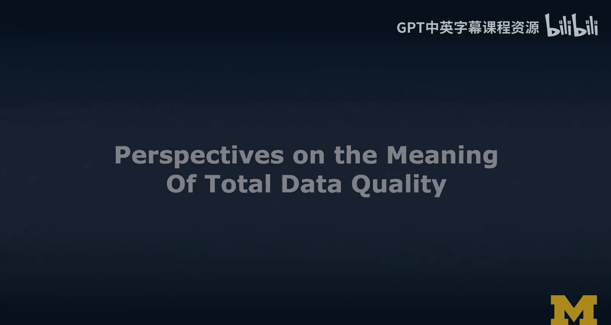
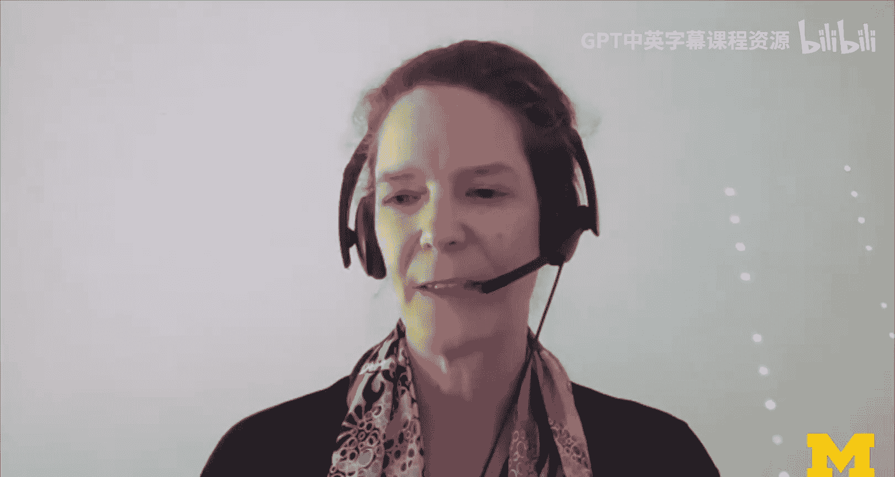

# 总体数据质量（框架、度量、设计策略）：P09：专家访谈：全面数据质量的多维解读

在本节课中，我们将聆听三位数据科学和调查方法学领域的国际专家，分享他们对“总体数据质量框架”这一概念的看法。他们将从各自的研究背景出发，探讨数据质量的重要性、不同类型数据的特性，以及在实践中评估和提升数据质量的方法与挑战。

## 专家介绍

我们很高兴邀请到三位专家：Ashley Amaya、Frauke Kreuter 和 Adam E。

首先，请每位专家简要介绍自己的背景、当前工作以及日常研究内容。

**Ashley Amaya**：我是皮尤研究中心的高级调查方法学家。我拥有马里兰大学的调查方法学博士学位。我的日常工作主要包括：为中心的不同调查或研究团队设计复杂的调查；为我们主要的数据收集工具“美国趋势小组”管理一些数据质量指标；同时，我也会着眼于未来，思考我们在数据收集和研究方法方面的发展方向。

**Adam E**：大家好，我是欧柏林学院的计算机科学助理教授。我负责指导社会智能实验室。我们主要从事计算社会科学研究，特别是探索如何利用机器学习和数据科学来辅助调查分析，以及利用调查类数据。我的背景是计算机科学，在內布拉斯加大学林肯分校获得博士学位，之后在社会学系做博士后，这让我更多地接触到调查研究领域。

**Frauke Kreuter**：我是马里兰大学调查方法学联合项目的教授，也是社会数据科学中心的联合主任。在德国，我是慕尼黑路德维希-马克西米利安大学的社会科学与人文数据科学教授。直到最近，我还在德国的一个政府机构——就业研究所工作。我的日常工作主要是研究。我最初学习社会学，后来转向调查统计，但我一直怀有让社会科学家在数据科学讨论中占有一席之地的热情。我认为他们对于理解数据生成过程、检测数据质量问题具有独特的优势。因此，在任何涉及收集人类数据的工作中，将他们纳入考虑是非常重要的。

## 总体数据质量的含义

上一节我们介绍了三位专家的背景，本节中我们来看看他们对“总体数据质量”这一核心概念的理解。

**Ashley Amaya**：我认为总体数据质量是对数据的整体评估，包括偏差、方差、可靠性，以及更广泛的评估维度，如及时性、使用目的、成本和伦理等。在这个评估框架内，还需要进一步分解不同来源可能引入的偏差和方差。

**Adam E**：我的想法很相似。作为一名数据科学家，我首先想到的是模型输出结果的质量。当我们试图对现实世界事件建模或对未来进行预测时，我们的准确性如何？我们是否在所有可能的情况下都表现良好，还是只在某些方面（如正例）表现好，而在其他方面（如负例）表现不佳？同时，我也要考虑输入模型的数据本身的质量：我们是否覆盖了所有可能发生的事件？对于帮助我们做出预测的重要事物，我们是否有足够的代表性？

**Frauke Kreuter**：他们两位已经涵盖了核心部分，但我想补充一个角度。对我来说，数据质量并非某个数据集固有的属性，它实际上取决于你想要回答的研究问题。对于某些研究问题，一些数据可能质量很高；但对于另一个不同的问题，同样的数据可能完全无用。我认为这一点在讨论数据质量框架时常常被忽视。框架固然重要，但它必须与具体的研究问题相结合。

## 设计数据与发现数据的区别

在上一节中，专家们定义了总体数据质量。本节我们将探讨数据收集的两种主要类型：设计数据和发现（或有机）数据，并分析它们的独特特征。

以下是专家们指出的关键区别与共同点：

*   **共同点（决策与透明度）**：Frauke Kreuter 指出，两者有一个关键共同点：在捕获数据时都涉及一系列决策。对于设计数据（如问卷调查），我们决定问什么问题、向谁收集数据。对于发现数据（如数字痕迹），这些决策同样存在，只是发生的时间点不同（例如，决定记录什么、捕获哪些特征）。重要的是要让这些决策透明化，并记录在案。
*   **区别一（研究者控制力）**：Ashley Amaya 认为第一个区别是研究者的控制力。对于设计数据，研究者可以决定如何提问、问哪些问题、数据收集频率、数据点数量以及谁可以访问数据。而对于发现数据，研究者对这些方面的控制力要小得多。
*   **区别二（知情同意）**：Ashley Amaya 指出的第二个区别是知情同意。在设计数据收集中，参与者清楚地知道他们正在参与研究并自愿回答问题。而在发现数据中，人们可能并未意识到他们的数据会被用于研究目的。
*   **区别三（数据生成过程的输入）**：Adam E 的视角聚焦于研究者是否对数据的生成过程有输入。即使是像交通传感器这样的有机数据，如果研究者决定了传感器的放置位置和测量方式，那么它仍然属于“设计”范畴，因为研究团队对数据的生成方式有控制权。关键在于决策和控制的程度。

## 数据整合项目实例

上一节我们区分了不同类型的数据，本节中我们通过具体案例来看看专家们如何在实践中整合或评估这些数据源。

**Frauke Kreuter 的案例（行政数据与调查数据整合）**：我曾工作的德国就业研究所使用来自社会保障部门的行政数据（记录每个人的就业和薪资信息）。这些数据虽然覆盖时间长、范围广，但对于与福利计划无关的信息（如国籍、后续教育），可能存在缺失或测量误差。为了解决这个问题，他们会将这些行政数据与专门的调查数据相结合，以确保合并后的数据产品包含所需的所有信息。

**Ashley Amaya 的案例（调查数据与房产数据对比）**：在为美国能源信息署工作时，我们通过“住宅能源消耗调查”收集数据。其中一个关键变量是房屋面积，但受访者往往不清楚。我们尝试使用 Zillow（一个公共房地产数据库）的数据作为替代来源。然而，评估发现 Zillow 的覆盖范围不全（例如缺少移动房屋数据），并且其对“平方英尺”的定义（基于房产税评估）与调查关心的“供暖制冷面积”定义不同。这个案例展示了在整合数据源前，评估其覆盖范围和指标定义一致性的重要性。

**Adam E 的案例（社交媒体数据与调查数据结合）**：我们正在进行的项目收集 Twitter 上关于 COVID-19 的推文，以分析不同地理区域的讨论话语。我们计划用现有的 COVID-19 相关调查数据（关于人们的观点、行为和信念）来辅助解释和验证在 Twitter 上观察到的现象。例如，如果某个地区戴口罩的意愿更高，这可能会影响该地区在 Twitter 上关于口罩的讨论情绪。这种结合有助于解释观察结果并形成分析假设。

## 数据质量评估的侧重点

在了解了具体项目后，我们来看看专家们在评估数据质量时，最关注总体框架中的哪些维度。

**Frauke Kreuter 的评估方法**：在一个结合调查、手机应用追踪和行政数据的研究中（研究长期失业对健康的影响），丰富的抽样框架（调查和行政数据）使我们能够精确分析手机拥有者、同意安装应用者与总体之间的差异。这极大地帮助我们发现并调整可能存在的覆盖误差或无参与误差。

**Ashley Amaya 的视角（取决于目标）**：数据质量评估的侧重点完全取决于项目目标。例如，在 Zillow 案例中，目标是“增强”调查数据质量，因此覆盖范围和指标定义（规范误差）是关键。而在另一些场景中，使用发现数据可能是为了回答全新的问题，此时我们可能愿意接受一定的误差，因为至少能获得一些见解。还有一种情况是利用发现数据（如选区投票数据）来改进调查的抽样设计，此时即使数据有部分缺失，任何额外信息也都是有益的。关键在于明确研究目的和问题。

**Adam E 的案例（“完美”数据中的陷阱）**：我们曾尝试利用美国农业部的航空图像，在爱荷华州自动识别风力发电机。我们拥有覆盖全州的“完美”图像数据，并训练了一个分类模型。模型在识别有风力发电机的图像时灵敏度很高，但误报率也很高。分析发现，模型主要学会了识别通往风力发电机的道路，而非风机本身。这是因为我们在抽取“非风机”样本进行训练时，采用了简单随机抽样，导致农田（无道路）样本过多，而包含道路的其他区域样本不足。后来我们改用聚类抽样，确保从不同景观类型（如农田、道路区域）中均衡取样，从而降低了误报率。这个例子说明，即使拥有看似完美的数据，在如何使用数据、如何构建训练集方面仍需非常谨慎。

## 数据科学与社会科学的相互影响

上一节我们探讨了具体的数据质量评估实践，本节我们将视野放宽，讨论数据科学与社会/调查科学这两个领域如何通过关注总体数据质量而相互促进。

**Adam E 的观点（数据科学需要吸收调查科学的理念）**：数据科学家通常假设提供的数据集是正确收集的，并更关注模型选择和评估指标。他们往往对原始数据的收集过程了解不足。总体调查误差框架以及扩展到包含大数据的总体误差框架，正是通过与调查研究人员合作才接触到的理念。让更多数据科学家意识到数据的来源、收集过程及相关信息至关重要，这能丰富数据科学的内涵。

**Ashley Amaya 的观点（双向学习）**：这是一条双向道路。一方面，我们可以将数据底层误差的知识分享给计算机科学家和数据科学家。另一方面，他们更精通一些新的分析方法（如文本分析），但这些方法最初可能是为分析书籍或报纸文章设计的，直接应用于推文等短文本可能会违反假设并产生误差。我们需要分享所知，同时也需要接纳他们的专业知识。

**Frauke Kreuter 的观点（合作与数据类型的融合）**：我曾与硅谷的数据科学公司交流，发现他们不仅想讨论数据科学，也想了解调查科学。例如，Facebook 可能是世界上最大的调查数据收集者之一。这表明双向交流不仅发生在方法论层面，也发生在数据类型层面。没有必要人为地将两者分离。

## 衡量与提升数据质量的工具与挑战

在讨论了跨领域合作后，我们回到实践层面，看看专家们使用了哪些具体工具来衡量或最大化数据质量，以及面临的挑战。

**Ashley Amaya 的建议（优化而非最大化，保持灵活）**：
*   **优化而非最大化**：在有限的时间和预算下，应追求数据质量的优化，而非不切实际的最大化。
*   **预先规划**：明确资源和研究问题。对于数据科学家，这意味着要深入了解数据集，并测试各种可能的研究问题。
*   **保持灵活**：在分析中发现问题时，能够调整分析方法或细化研究目标（例如，将结论限定于特定人群）。
*   **敏感性分析**：对于发现数据中的诸多设计决策（如模型训练、文本分词），应通过多种方式进行分析，并通过重复性和敏感性分析来验证研究结果。

**Adam E 的视角（避免“霰弹枪”式分析，深入理解数据）**：
*   **避免过度实验**：虽然计算资源允许同时运行大量模型和参数组合，但这可能增加发现虚假相关性（假阳性）的风险。
*   **耐心与细致**：在将数据投入复杂模型前，花时间深入了解数据，进行简单的统计描述，了解变量类型和取值分布，这有助于避免后续的许多问题。
*   **追溯误差来源**：当分析不理想时，需要仔细辨别是模型选择错误还是数据本身存在问题。

**Frauke Kreuter 的推荐工具**：可以关注卡内基梅隆大学 Rayid Ghani 团队开发的开源偏差审计工具包 **Aequitas**。

## 给学习者的建议

最后，我们请专家们为正在学习总体数据质量框架的学习者提供一些关键建议。

**Frauke Kreuter**：我的建议是，在开始分析时，**多与参与数据生成过程的人员交流**。了解数据的背景信息至关重要。

**Adam E**：我完全赞同 Frauke 的观点。**与数据提供者保持沟通**，在深入分析之前尽可能多地了解数据。

**Ashley Amaya**：
1.  **做出知情选择**：没有什么是完美的，但你必须能够为你所做的选择提供理由。
2.  **跳出思维定式**：现在数据源非常多，你可能专注于某一个，但经过调查，也许有其他更合适的来源。学会比较和思考其含义。
3.  **持续阅读**：很可能其他人已经使用过这些数据并发表了相关成果。这可能意味着你无需重复工作（例如，GitHub 上可能有代码），也可能意味着别人已经记录了数据中的错误。因此，持续阅读文献非常重要。

**补充要点（文档与沟通）**：除了阅读，将所学转化为**写作和文档**同样重要。记录下你对数据的了解、需要注意的事项，这不仅能帮助你自己，也能为后续使用该数据的人提供宝贵信息，从而从整体上提升数据工作的质量。

**Frauke Kreuter 的最后提醒（来自已故统计学家 Leslie Kish）**：**不要认为你必须修复每一个数据集使其完美**。在政府统计领域，存在“过度编辑”的担忧。有时，对于特定的研究问题，某些数据问题可能并不重要，但你需要意识到它们的存在。本课程中提到的模拟和敏感性分析正是用来评估这种影响的好工具。

## 总结

本节课中，我们一起学习了三位专家对总体数据质量框架的多维度解读。我们探讨了：
*   总体数据质量的含义及其与研究问题的紧密关联。
*   设计数据与发现数据在控制力、知情同意和生成过程上的区别与联系。
*   通过实际案例了解了如何整合不同数据源并评估其质量。
*   认识到在数据质量评估中，侧重点需根据研究目标灵活调整。
*   理解了数据科学与社会科学需要通过共同语言和框架进行双向学习与合作。
*   掌握了在实践中优化数据质量的一些关键策略和工具，如预先规划、敏感性分析、深入理解数据和保持沟通。
*   获得了给初学者的宝贵建议：与数据生成者交流、做出知情选择、持续阅读并做好文档记录。

希望这些见解能帮助你在未来的数据工作中，建立起全面、严谨的数据质量观。

