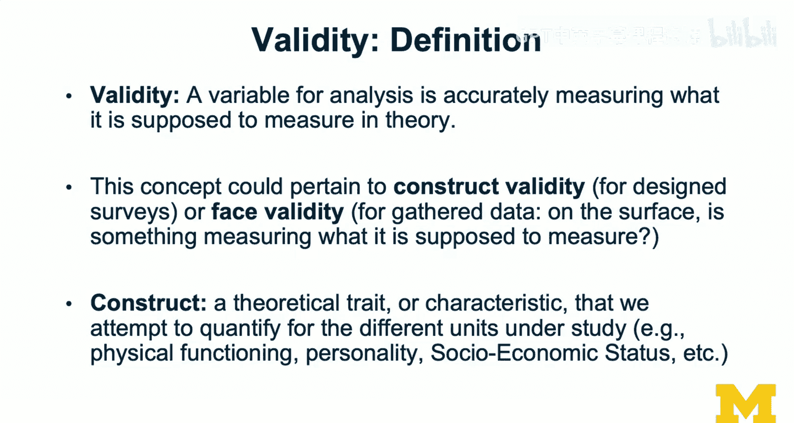
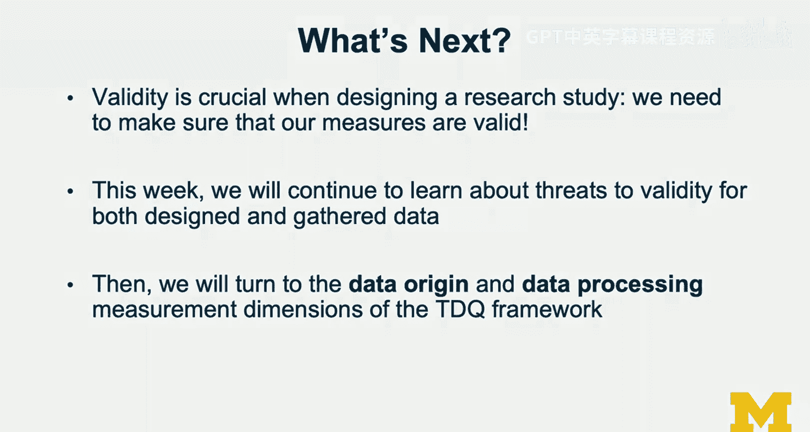

# 密歇根大学《总体数据质量（框架、度量、设计策略）total data quality》 p10 9_效度的定义与内涵.zh_en -BV1Jn4y1X7uS_p10-

Okay， hello， everyone。 Welcome to week2 of this first course。

 We're going to start off this week by giving a definition to validity as one of the key measurement dimensions of the total data quality framework。

 Okay， so let's revisit that big picture that we learned about last week in terms of the overall data quality total data quality framework。

 Again， we have the measurement dimensions and the representation dimensions。

 and we're going to start off this week talking about validity as one of the measurement dimensions。

 So you see， we've highlighted the validity dimension as where we're getting started with measurement。

 So again， we're starting with a theoretical construct。

 And then we're thinking about variables or fields that we'd like to measure which should be giving you valid measures of that particular construct。

 And so we'll talk about a definition of validity and what we need to think about in terms of validity as this first dimension。

😊。

Okay， so validity means that a variable for analysis is accurately measuring what it is supposed to be measuring in theory。

 so again， we have a theoretical construct that we like to measure and then we choose a variable to use to capture measures of that particular construct and the more valid a variable is。

 the more accurately it's measuring what it's supposed to be measuring in theory。

And this concept of validity could pertain to construct validity， for example， for design surveys。

 so are you coming up with a valid measure of a theoretical construct or it could represent face validity for gathered data。

 so in other words， on the surface is something measuring what it's supposed to be measuring in theory。

 if you're trying to gather data from existing sources。Now what do we mean by a construct。

 a construct is a theoretical trait or characteristic that we are attempting to quantify for the different units that we're trying to study。

 so possible examples of construct constructs could be physical functioning， personality。

 socioeconomic status， etc these are all theoretical constructs and we try to measure these constructs with different variables or fields depending on whether we're collecting data in the design data framework or we're gathering data from different existing sources。

The validity idea is whether or not the variables that we're actually working with are providing valid measures of the constructs that we're interested in。

 like physical functioning or personality， for example。 So here's an example with design data。

 Does a measure of socioeconomic status or S S derived from the other variables that are measured in a survey。

 for example， So something like household income， education， wealth。

 these could potentially combined to give you an overall measure of socioeconomic status。

 And the question that we're asking with validity is if we use these different measure collected in a survey like household income。

 education and wealth。 If we use these different measures and combine them in some way to come up with an overall measure of socioeconomic status。

 Are we getting an accurate measure of the construct that's known as someone's overall socioeconomic status。

 So in this picture， you can see that we have a circle with socioeconomic status inside it。

 we think of that as a latent variable or an。

Unmeasured variable， we don't know a person's socioeconomic status right away。

 We have to try to infer what their socioeconomic status is based on their responses to other survey questions in our design data collection and that latent measure of socioeconomic status that construct could be driving the values on household income and years of education and household wealth。

 That's why we have question marks here。 We're not sure how much of socioeconomic status is indicated by household income。

 socioeconomic status could be a very strong predictor of household income and household wealth。

 but maybe not as strong of a predictor of years of education the boxes that we're using those are our observed variables in the actual survey and we might be interested in using these observed variables to indicate a person's socioeconomic status but the relationship between these observed variables and the latent construct that we're trying to measure may not be exactly clear。

 we want to make sure that these are all valid indicators of socioeconomic status before you。

ussing them to define that particular construct。 So that's a survey example。

 What about the case of gathered data， So suppose that we were collecting data on tweets Does a qualitative analysis of the text that's gathered from a collection of tweets about mental health difficulties with the pandemic provide valid measures of the mental health of Twitter users with particular characteristics So again。

 the same kind of picture here， we have some latent unobserved measure of mental health that we're really interested in and we're deciding to measure that construct with certain information extracted from those existing tweets again in this kind of gathered data example where we're trying to make sense of existing data or organic data data that are generated organically。

 So， for example， somebody might tweet this pandemic really has me feeling blue I that a valid indicator of a person's mental health again。

 is mental health a good predictor。Of what they're actually going to tweet in terms of how they feel。

 Okay， So that's the question that we're really getting at here。

 If we're coding that particular tweet， this pandemic really has me feeling blue as an indicator of a person's mental health。

 saying that this person is struggling with mental health。 Is that， in fact， a valid indicator。 Okay。

 that's the question mark that we're trying to answer here。 And again， This is not design data。

 This is trying to make sense of data that we're gathering from existing sources， such as tweet。

So here's another example， this is a bar chart that just shows the number of CoVID-19 deaths in the first00 days in office of the past two presidents。

 so you see Joe Biden， he has over 8000 CoVID-19 deaths kind of attributed to his presidency in that first bar and then if you go to Donald Trump who Biden succeeded you can see that there are zero deaths in his first00 days in office so the question here is what's wrong with using the number of deaths attributed to CoVID-19 in the first hundred days of a presidency as a comparative measure of performance for the last two presidents。

 so if your research was aiming to compare the performance of the past two presidents and you decided to use this as a measure of their performance is that really a valid measure of performance。

 so our construct is the performance of these two presidents。

 the variable that we're choosing as a measure of that construct is number of CoVId-19 deaths in the first hundred days in office。

Is that really a valid measure of their performance or is that the context in which they're working。

 That's really the question。 So obviously， this is not a fair comparison of the performance of the past two presidents。

 because it's not really a direct measure of performance。

 And that's what we really might mean by validity。 Are we choosing variables or fields that provide valid measures of that theoretical construct in this case。

 performance that we're really interested in because by this measure of performance。

 it looks like Donald Trump was doing a whole lot better in his first 00 days that Joe Biden。

 But clearly， there's other factors that are driving this particular measure rather than just their performance。

Okay， so we've started with an initial definition of validity and some simple examples。

 validity is very crucial when designing a research study。

 we need to make sure that our measures are valid， they're valid measures of what it is that we're trying to measure in theory。

This week， we're going to continue to learn about threats to validity for both designed and gathered data。

 Then we'll turn to the data origin and data processing measurement dimensions of the total data quality framework。

 Thank you。

