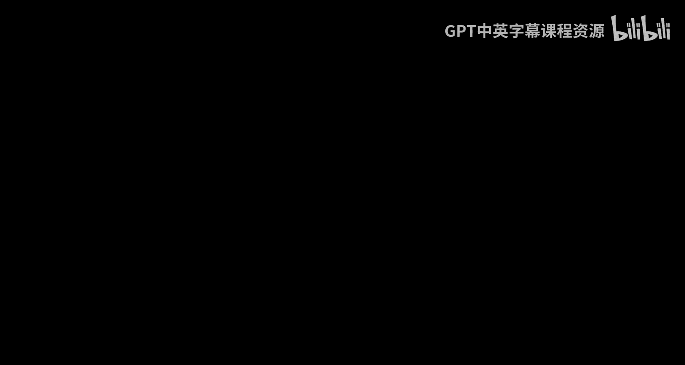
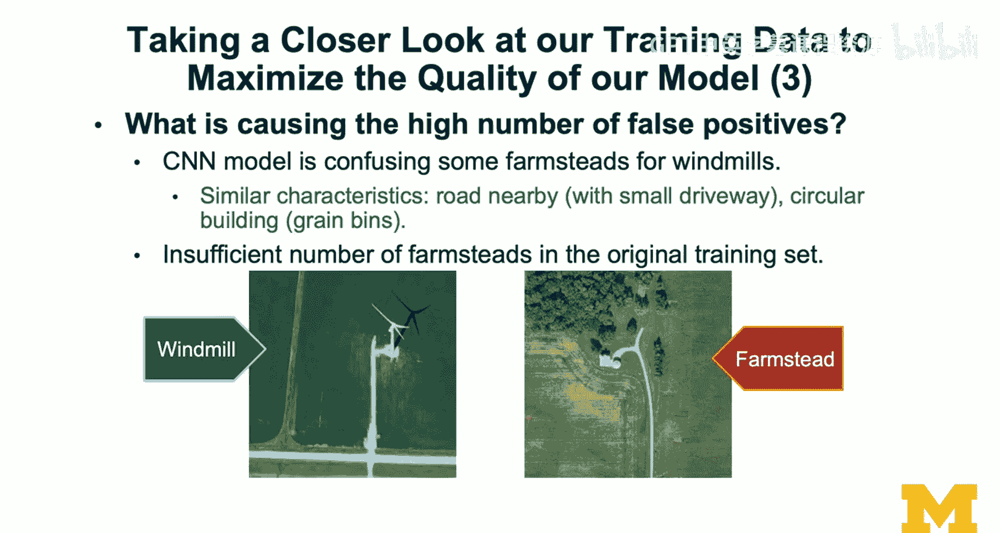
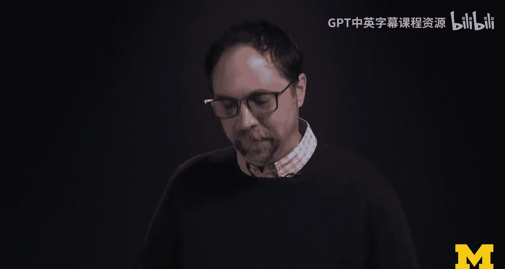
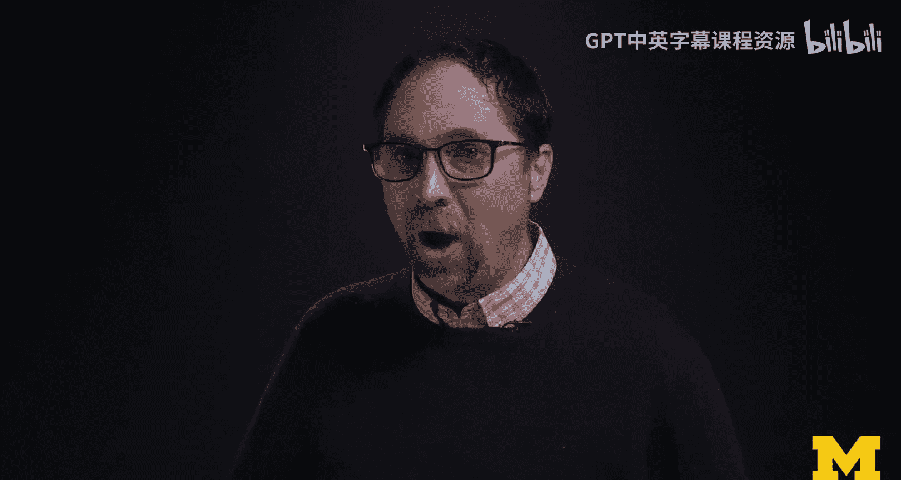
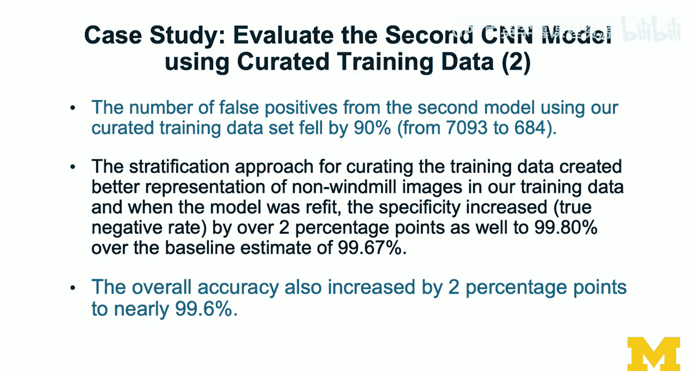
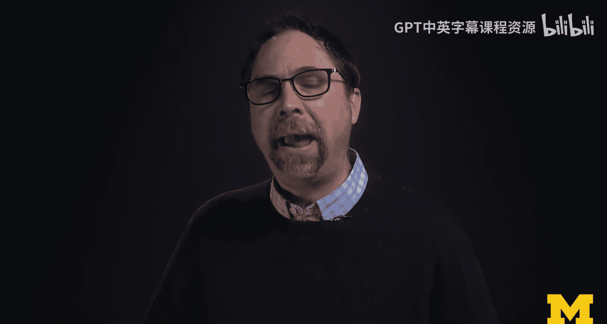
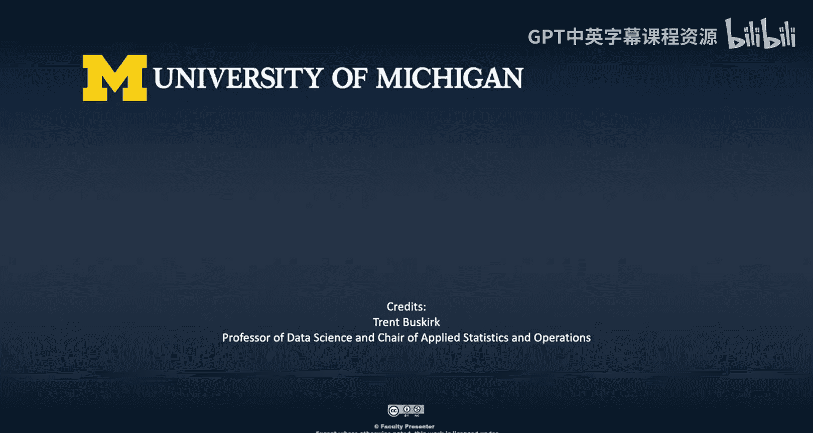

# 密歇根大学《总体数据质量（框架、度量、设计策略）total data quality》 p100 27_案例研究：视频图像数据分析质量优化实践.zh_en -BV1Jn4y1X7uS_p100-

Welcome to our case study in maximizing the quality of an analysis of video image data。

 I'm Trent Buskirk。 We're happy to have you In this example。

 we're going to talk about the work from E Buskirk and Fletcher at all in 2018 who used machine learning models to find the locations of windmills within satellite images gathered for the state of Iowa。

 The gathered data are I data collected from the US Department of Agriculture's National Agricultural Iry program。

 In total， there were 300，000 images without windmills and about 1900 images with windmills。😊。

The main task of the study was to apply a series of neural network models to generate sampling frames of non-traditional sampling units such as windmills based on satellite images。

 the windmill locations that were determined from the analysis would then be used to create a sampling frame of GPS coordinates that could be used for studies related to alternate energy consumption and production。

 for example。The windmill images that are depicted in this case study are available from the US windd turbine database provided by the US Geological Survey。

 as noted here。The analysis worked in several steps。 First， we found aerial images for the model。

 Then we prepared the images for modeling， and we used a training and a testing dataset set。

 We then learn how to identify locations by training a convolutional neural network model a CNN model for short and this involved optimizing several parameters in order to create a model that had the most accurate measures of locations of these windmills and finally。

 we evaluated the CNN's model performance using measures of accuracy。

 sensitivity and specificityEssential what we were looking for is the model to predict whether or not a given satellite image contained a windmill or not。

 So we had two actual outcomes that we were looking for。

 Did it have a windmill or did it not have a windmill and we were able to code these images to be able to tell whether or not it actually did have a windmill or it didn't。

 So using these human coded information we were able to create measures of model performance。😊。

We use a direct classification approach as well as a segmentation approach to create the model for windmill identification。

The direct classification relied on using a binary variable coded per image that specified whether or not the image contained a windmill。

 a simple binary statement。 Does this image have a windmill， Yes or no。

 Here is an example where we have an image with a windmill。

 Here is an example of an image with no windmill， The segmentation focused on identifying the location and the surrounding area of the windmill within the image。

 So we were actually looking for the location of the windmill。 So rather than ask the question。

 Do you have a windmill or not， We ask if there is a windmill， Where is it located。

 We were trying to generate a sampling frame for 10 counties in Iowa using this approach。

 The rule was to predict a windmill of at least 100 pixels。 say windmill in our overall model。

 In the end， our model had an accuracy that was quite high around 98 per cent。

 We also had a relatively high sensitivity rate or true。😊，Positive rate of 95 per cent。

 and a true false positive rate or specificity of about 98 per cent as well。 Overall。

 we only missed 95 of the actual windmills。 So we had coverage of nearly 100 per cent of the actual windmills were found by our algorithm。

However， we did have some misidentification。 Almost four times as many non windmills were actually predicted to be windmills。

 So if we used the predicted values to form our sampling frame。

 We had about four times as many non windmills in that sampling frame as there should have been。

 And so we had a high， false positive rate。 What's going on here。

 Why did we get the high number of false positives。

 The convolutional neural network model is confusing some farmsteads for windmills。

Similar characteristics。 There's a road nearby by with a small driveway。

 There's a circular building like a grain bin， there is also insufficient numbers of these farmsteads in our original training data set。

 So here's a picture of the windmill。 You can see the road leading up to it。

 You can also see the actual windmill device with a little bit of a shadow in the background。😊。

Here's an example of the farmstead。 You also see the long access road to the farmstead and a similar structure with a shadow behind it as well。

 And the algorithm is thinking that this farmstead is actually a windmill。 In the end。

 it turns out that our model actually was a model for predicting whether or not there was an access road。

 Not whether or not there was a windmill。 And the reason because we didn't have enough farmsteads and other non windmills to allow the algorithm to learn exactly what was a windmill and what was a farmstead。

 In essence， we had a representation problem in our training data。

 We didn't have adequate number of farmsteads or pictures that would show the algorithm。😊。

Anything other than a green landscape could be a non windmill。

 We explored methods in 2019 for improving these models by looking specifically at the representativeness of images and model performance。

 We stratified our data to ensure sufficient variation in both the windmill and non windmill images。

😊。

The relationship between performance and hyperparameter selection was also considered。

 and we also looked at the number of images needed for training。

Neurural networks are notoriously greedy。 They need large amounts of data in order to learn。

 So this was another factor that we wanted to consider。

 The number of false positives from our second model using our curated training data set fell by 90% cent from7 over 7000 to 684。

😊，The stratification approach for curating the training data created better representation of non windmill images in our training data。

 And when the model was refit using that new training data。

 the specificity increased by over 2 percentage points。 as well to 99。

8% over the baseline estimate of 99。67%。 Now， this may not seem like a large jump。 But overall。

 the baseline estimate was 99。67。 So we had to make sure that we were improving from there。😊。

This may not seem like a large jump。2 percentage points。 But remember。

 our overall accuracy measures from the original model were in the high 90s already。

 The overall accuracy also increased by two percentage points to nearly 99。6 over for the model。

 So this example shows you that by thinking about the contents of the training data and how representative that training data is with respect to the population。

 And in our case， we had lots of windmills。 Those look pretty similar。 We have lots of non windmills。

 and those don't all look similar。 It turns out that non windmill images can be grass。

 They can be a field with the barn， or they could be a field with the farmstead or some other combination。

In our training data， we did not have enough of the non grassy images for the algorithm to really learn differences between windmills and similar looking structures。

 Farmsteads。 But by increasing the representation in our training data and reffitting these models。

 we saw improvement。

This is the final video in our third course for the total data quality specialization。

 Congratulations， you've made it。 We are finished。😊。

On behalf of the lead instructors， Brady West， James Wagner， Jinsak Kim， and myself。

 I would like to thank you for participating in our course and the specialization。

Here's to taking these concepts you've learned out into your own work to identify， measure。

 and maximize the quality of your designed and gathered data。

If you have feedback on this course or any others in this specialization。

 consider filling out the end of the course survey again。

 it has been our pleasure to have you through these three courses in our specialization。

 We thank you for being here。 And we really hope that this information helps you on your journey to research using design and gathered data。

 Thank you for coming。😊。

