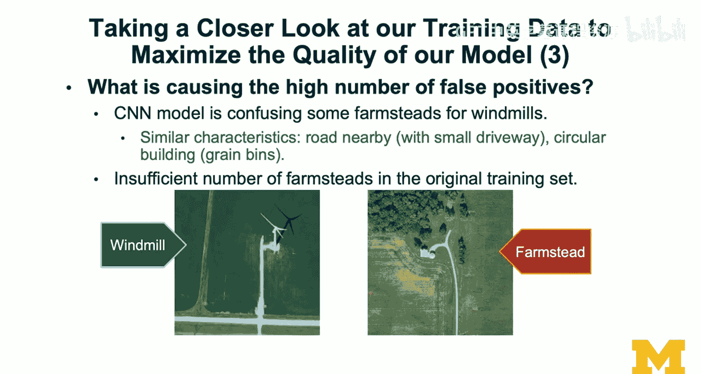
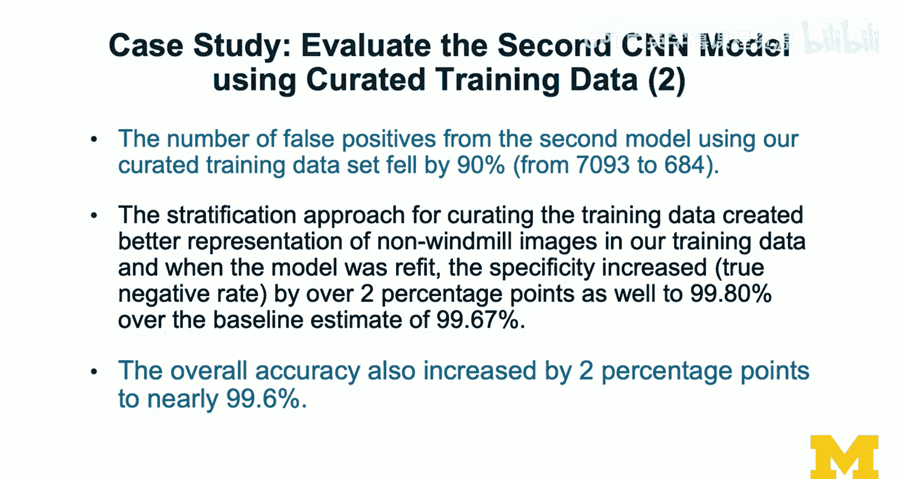

# 总体数据质量：3.27：案例研究：视频图像数据分析质量优化实践 🎬

在本节课中，我们将通过一个具体的案例研究，学习如何最大化视频图像数据分析的质量。我们将探讨一个利用机器学习模型从卫星图像中识别风车位置的项目，并重点关注数据质量，特别是训练数据的代表性，如何直接影响模型的性能。

## 概述

本案例研究基于E. Buskirk和Fletcher等人2018年的工作。研究目标是应用一系列神经网络模型，基于卫星图像生成非传统抽样单元（如风车）的抽样框。分析得出的风车位置将被用于创建GPS坐标抽样框，以支持替代能源消耗和生产等相关研究。

使用的数据来自美国农业部国家农业影像计划，总计包含约30万张无风车图像和1900张有风车图像。

## 分析步骤

整个分析过程遵循了以下几个关键步骤：

1.  **寻找模型所需的航拍图像**。
2.  **为建模准备图像**，并划分训练集和测试集。
3.  **训练一个卷积神经网络模型**来学习识别风车位置，这涉及优化多个参数以创建最准确的模型。
4.  **使用准确率、敏感性和特异性等指标评估CNN模型的性能**。

我们的核心目标是让模型预测给定的卫星图像是否包含风车。因此，我们关注两种实际结果：图像有风车或没有风车。通过人工编码这些图像，我们能够创建衡量模型性能的指标。

## 建模方法

我们采用了两种方法来创建风车识别模型：直接分类法和分割法。

*   **直接分类法**：为每张图像使用一个二元变量进行编码，指明该图像是否包含风车。这是一个简单的二元判断：这张图有风车吗？是或否。
*   **分割法**：专注于识别图像中风车的位置及其周围区域。我们不仅问“是否有风车”，更问“如果有，它位于哪里”。

我们尝试使用这种方法为爱荷华州的10个县生成抽样框。规则是预测至少100像素的风车为有效风车。

## 初始模型结果与问题

最终，我们的初始模型取得了相当高的**准确率**，约为 **98%**。同时，**敏感性**（真阳性率）也相对较高，为 **95%**，**特异性**（真阴性率）同样约为 **98%**。总体而言，我们只漏掉了95个实际存在的风车，算法几乎覆盖了100%的真实风车。

然而，我们存在一些误识别。**被预测为风车的非风车物体数量几乎是实际风车数量的四倍**。这意味着，如果我们使用预测值来构建抽样框，该抽样框中包含的非风车数量将是应有数量的四倍左右，即存在**高假阳性率**。

## 问题根源分析

为什么会出现如此高的假阳性率？卷积神经网络模型将一些**农庄误认为风车**。它们具有相似的特征：附近都有道路和小型车道；都有圆形建筑（如谷仓）；并且，在我们的原始训练数据集中，这类农庄图像的数量**不足**。

最终结果表明，我们的模型实际上变成了一个预测“是否存在通道”的模型，而非“是否存在风车”的模型。原因在于我们没有足够的农庄和其他非风车图像来让算法准确学习风车和农庄之间的区别。本质上，我们的训练数据存在**代表性问题**。我们没有足够数量的农庄或其他非风车图片（例如非绿色景观）来向算法展示“非风车”可以是什么样子。

## 模型优化与改进

在2019年，我们探索了通过特别关注图像的代表性和模型性能来改进这些模型的方法。

我们对数据进行了**分层**，以确保风车和非风车图像都具有足够的变化性。我们还考虑了**性能与超参数选择之间的关系**，并研究了**训练所需的图像数量**（神经网络通常需要大量数据来学习）。

使用我们精心策划的训练数据集后，第二个模型的**假阳性数量从7000多个下降到684个，减少了90%**。

通过分层方法策划训练数据，使非风车图像在训练数据中得到了更好的代表性。当使用新的训练数据重新拟合模型时，**特异性提高了超过2个百分点，达到99.8%**（基线估计为99.67%）。同时，**整体准确率也提高了两个百分点，达到近99.6%**。

这个例子表明，通过思考训练数据的内容及其相对于总体的代表性，我们可以显著提升模型性能。在我们的案例中，风车图像看起来都很相似，而非风车图像则千差万别（可能是草地、带谷仓的田野、带农庄的田野等组合）。在最初的训练数据中，我们没有足够的非草地图像让算法真正学会区分风车和外观相似的结构（如农庄）。但通过增加训练数据的代表性并重新拟合模型，我们看到了性能的改善。

## 总结

本节课中，我们一起学习了一个通过优化训练数据质量来提升图像分析模型性能的完整案例。我们了解到，即使模型初始准确率很高，**训练数据的代表性和全面性**对于控制误报率、提升模型在实际应用中的可靠性至关重要。通过有策略地分层和扩充训练数据集，我们成功地将假阳性率大幅降低，从而获得了更高质量的分析结果和更可靠的抽样框。这强调了在数据驱动的项目中，精心设计和评估数据质量是成功的关键。