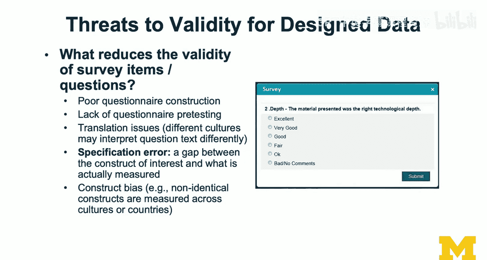
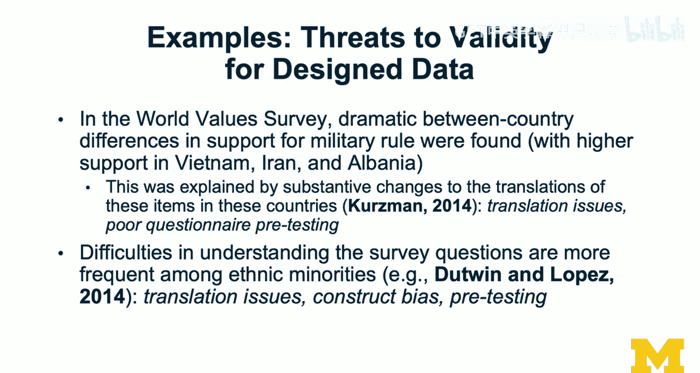
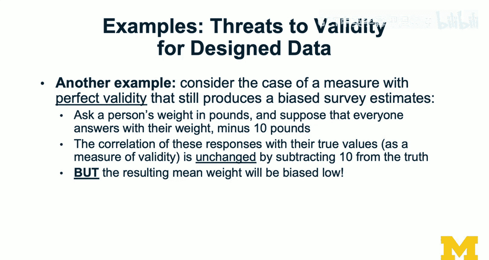
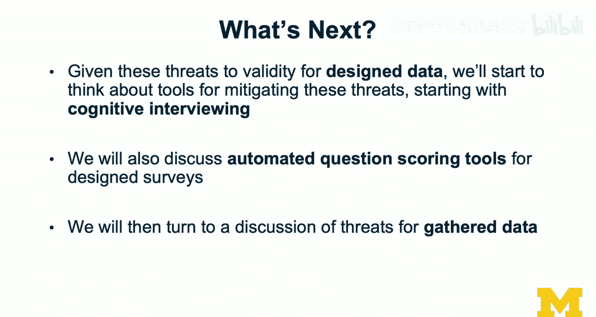

# 密歇根大学《总体数据质量（框架、度量、设计策略）total data quality》 p11 10_设计型数据效度威胁因素.zh_en -BV1Jn4y1X7uS_p11-

Okay， hello everyone， Now that we've defined the concept of validity。

 we're going to be talking in this lecture about threats to validity specifically for design data collections。

Okay， so let's get back to the big picture of the total data quality framework again our focus right now is on the validity dimension among all the different measurement dimensions。

 so we're thinking about a theoretical construct and then we're thinking of what variables。

 what questions， what fields we could use in order to measure that particular construct and we want to make sure that those variables。

 those fields， those questions are going to provide valid measures of the theoretical construct that we're interested in so now we're thinking about threats to validity in terms of going from our construct to our variable of interest。

So let's think about some threats to validity for design data and the question here really is what reduces the validity of survey items or questions。

 so in particular our focus right now is on design data collections like we talked about last week in terms of our web survey in our survey monkey example。

 we want to see what is it necessarily that poses a risk to the validity of survey items or survey questions。

And here's just a list of some of these possible threats that we might be worried about。

 First of all， poor questionnaire construction。 So， you know， we have spelling errors。

 We have phrases that are difficult to comprehend。 response options。

 which don't make a whole lot of sense。 you know， here's an example on the right hand side of a survey question that was not very well designed。

 So you can see that the question isn't really even a question。 It just says depth。

 the material presented was the right technological depth。

 And at first glance you'd think the answers to this kind of question would be like strongly agree。

 agree neutral， maybe disagree， strongly disagree。 but you can see that the choices of response options。

 don't really match with the actual question itself。 So depth。

 the material presented was the right technological depth。 excellent， Very good good。

 there's an inconsistency in terms of the response options and the actual question being asked。

 So if a persons been invited。

To a web survey。 and they see a question like this。

 They're immediately going to be turned off and say this doesn't make any sense。

 I'm no longer interested in taking this web survey。 These questions don't mean anything。

 And that's a serious risk to design data collections。

 So we have to be very careful and make sure that questions are carefully worded and the response options make sense。

 and questionnaire pretesting is also very important to make sure that these issues don't emerge。

 So we want to make sure that we carefully pretest our questionnaires before we actually put them out in the real world and out in the wild。

 as we might say， where people are going to be responding to these questions from all walks of life。

Translation issues could also be a serious threat to validity where different cultures may interpret question text differently。

 We'll come back to that issue here in a second Specation error more specifically is a gap between the theoretical construct of interest and what it is that we're actually measuring so this is an error that that can emerge in designing questions where you have a theoretical construct mindme but what you're actually measuring via a poorly worded question or poor response options is different from your construct interest and specification error is very closely related to validity we want to make sure that the questions that we're specifying are in fact capturing our theoretical constructs of interest。

Construct bias is also a potential threat to validity where you could be looking at non identical constructs that are measured across cultures or countries。

 so these constructs may mean different things to different cultures or different countries。

 all of these are threats to the validity of survey items。So here's some examples。

 one example is that questions related to euthanasia。

Posposed a challenge in several countries such as Ethiopia， for example。

 where the entire concept of euthanasia doesn't even exist。

 And this is a reference here is the World value survey in 2005。

 This is an example of specification error where you're interested in a theoretical construct。

 This idea of euthanasia， maybe how people feel about it or an experience with it。

 But in that particular country， that particular culture， the entire concept doesn't even exist。

 So we have this mismatch between our theoretical construct and the question that we're asking。

 which is not really getting at any kind of meaningful construct。 Another example。

 the interpretation of filial piety， which is behavior is associated with being a good son or a good daughter。

 that interpretation of that concept differs between Western societies and Chinese society。

 And again， here's another citation where you can see more of a description of what was met here。

 And some of the threats that emerged in this particular。

Their study included translation issues where interpreting that particular term you know meant something different in Western societies and Chinese society and also construct bias okay。

 thinking about this theoretical construct and whether people from different cultures are going to be interpreting it the same way when they respond to that survey question so that too could pose a threat to the validity of that particular question depending on what the culture in which we're asking that question and there's more details in that 1997 reference here。

Some additional examples in the World Value surveyve there were dramatic between country differences found in support for military rule。

 and in general， there was higher support found in Vietnam。

 Iran and Albania and this was explained by substantive changes that were made to the translations of these items in these different countries and there's a reference there by Kurrsman in 2014 that talks about this in more detail this was due to translation issues and also poor questionnaire pretesting。

 So again， very important if you make any kinds of changes to the way that items are being asked that you carefully pretest those questionnaires and make sure that respondents in your country of interest can understand everything。

There have also been difficulties in understanding survey questions that are more often reported among ethnic minorities and this is an article by Dtwin and Lopez in 2014 here again。

 translation issues can emerge problems with construct bias and also problems with pretesting so a lot of these threats to validity can come up in multiple different context and these articles will have a complete reference list available at the end of the course where you can see all these different articles to which we're referring these talk about all of these issues that can arise in more detail and these threats to validity again make the responses to the survey questions that are being asked less valid and that ultimately has an effect on the quality of any estimates based on the surveys that you're reporting。

Here's another example， suppose that you have a survey measure with perfect validity。

It can still produce a bias surveyve estimate， so for example。

 suppose that you ask a question about a person's weight in pounds and suppose that everyone answers with their weight only minus 10 pounds so maybe there was something weird about the way the question that was worded or how exactly that question was asking individuals to report their weight。

 but everybody responds 10 pounds less than what their actual weight is。

The correlation of these responses with their true values as a measure of the validity of this particular question won't be changed by simply subtracting 10 from everybody's observation。

 You're going to get the same correlation of those reports-10 with the true values of their survey weight。

 because we subtracted 10 from everybody。 So everybody's on kind of the same footing。

 they're just reporting of value that's 10 less than it should be。

 So a common measure of validity is to look at the correlation of the survey responses with the true values for that variable of interest。

 that correlation is going to be the same。 even if everybody subtracts 10 from the truth。

 But when you go to compute and estimate based on all those survey reports。

 The resulting mean weight， say if you are interested in calculating the average weight in some population。

 that resulting mean weight is going to be biased low。

 So this is a case where when we get to analysis， there's going to be some analytic error。

 and the way that the survey question was worded。

It seems like it's providing a valid measure of weight given that correlation。

 but the overall analysis is going to be affected because everyone was reporting biased responses relative to what the true value should have been。

 so this gets back to the idea of questionnaire pretesting and making sure that everybody's interpreting the question correctly。

 and they're reporting their actual weight， not the weight minus 10 pounds。

Okay， so what's next in terms of our discussion of validity now。

 given that we've talked about threats to validity for design data。

 we'll start to think about tools for how to mitigate these threats。

 starting with a technique known as cognitive interviewing so this is a very important form of pretesting survey questions and making sure that survey questions can be understood by a variety of different people and again some of these threats are mitigated。

We're also going to discuss automated question scoring tools for design surveys。

 so we're going to look at something called the Sur quality Preor and we'll do a demonstration of that online again as a tool for assessing the overall quality of survey questions。

 taking their text and the response options into account。

And then we'll turn to a discussion of threats for gathered data。

 so so far we've been talking about threads for survey questions in design data collections。

 we'll also turn to a discussion of threats to validity for gathered data。

Okay， thank you。

