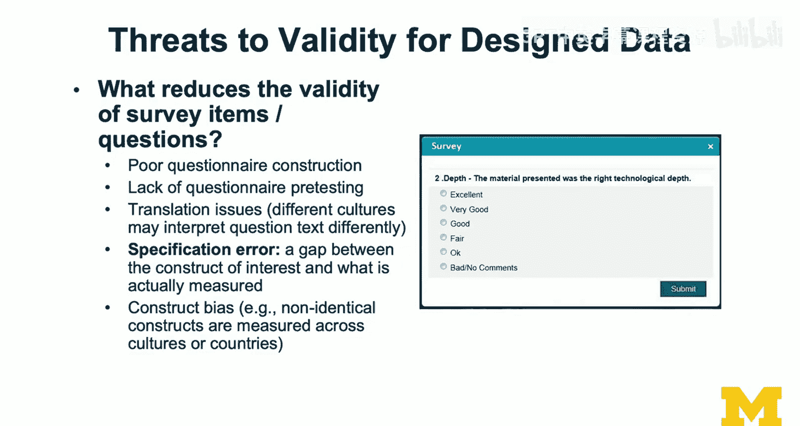
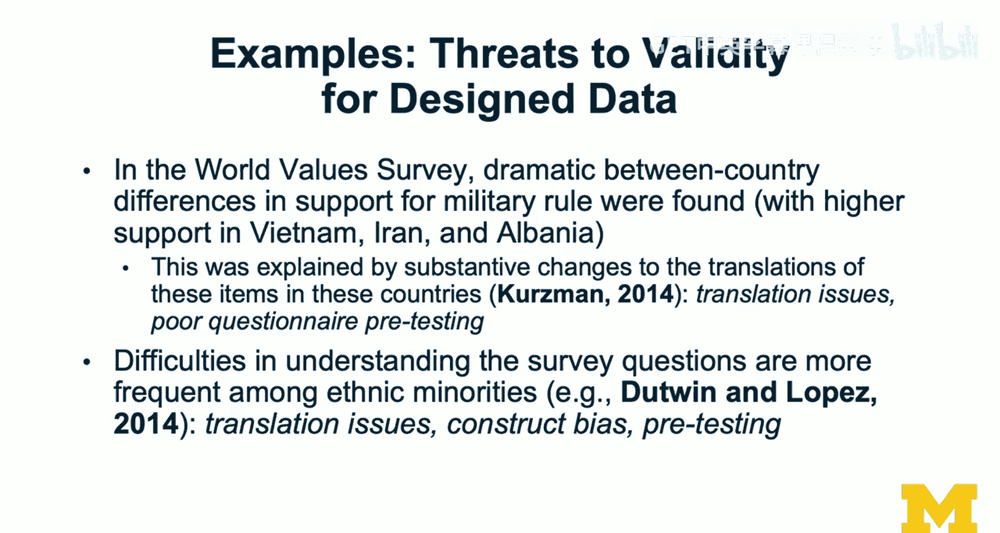
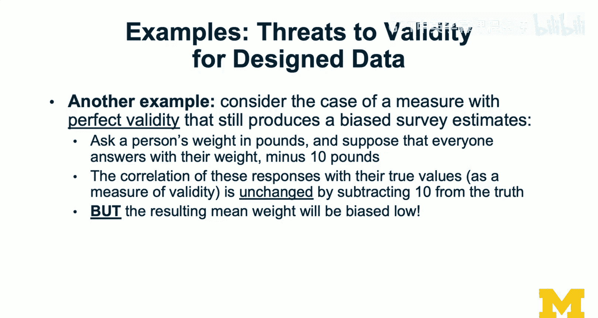
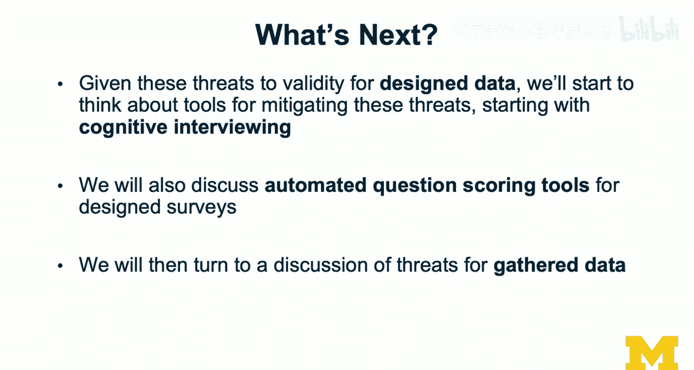

# 总体数据质量（框架、度量、设计策略）：10：设计型数据效度威胁因素 📉


在本节课中，我们将学习设计型数据（如调查问卷）的效度概念，并重点探讨可能威胁其效度的各种因素。我们将了解这些威胁如何影响数据质量，以及它们在实际调查中的具体表现。

上一节我们定义了效度的概念，本节中我们来看看在设计数据收集过程中，哪些因素会威胁到效度。我们的焦点是，如何确保用于测量理论构念的调查问题或变量能够提供有效的度量。

## 效度威胁因素概述



效度威胁指的是那些会降低调查问题或项目有效性的因素。对于设计型数据收集（例如上周讨论的网络调查），我们需要识别并理解这些风险。

以下是几种主要的设计型数据效度威胁：

**1. 问卷构建不当**
这包括拼写错误、难以理解的措辞，以及不合理的回答选项。一个设计不佳的问题会立即让受访者失去兴趣，从而严重影响数据收集的有效性。问卷预测试至关重要，能确保在实际发布前发现并修正这些问题。


**2. 翻译问题**
在不同文化背景下，对问题文本的解读可能存在差异，这构成了严重的效度威胁。翻译不当可能导致问题含义被曲解。

**3. 设定误差**
这是指我们感兴趣的理论构念与实际测量内容之间的差距。当问题措辞不当或回答选项设计不佳时，我们测量的内容可能与目标构念不符。设定误差与效度紧密相关。

**4. 构念偏差**
在不同文化或国家中，被测量的可能并非完全相同的构念。同一个概念对不同文化背景的人可能意味着不同的事物。

## 效度威胁实例分析

这些威胁在实际调查中如何体现？让我们看几个具体例子。

**实例一：安乐死概念**
在2005年世界价值观调查中，关于“安乐死”的问题在埃塞俄比亚等国家遇到了挑战，因为“安乐死”这个概念在当地文化中根本不存在。这体现了**设定误差**：我们感兴趣的理论构念（对安乐死的看法）与在当地语境下提出的问题之间出现了不匹配。

**实例二：孝道解读**
“孝道”（filial piety）这一概念在西方社会与中国社会的解读存在差异。相关研究（1997年）指出，这涉及到**翻译问题**和**构念偏差**。不同文化背景的受访者对同一调查问题的理解可能不同，从而威胁到该问题的效度。

**实例三：军事统治支持度**
世界价值观调查发现，对“军事统治”的支持度在国家间存在巨大差异，在越南、伊朗和阿尔巴尼亚等地支持率更高。Kurrsman（2014年）的研究指出，这主要是由于不同国家在翻译调查项目时做出了实质性修改，且缺乏充分的问卷预测试。

**实例四：少数民族理解困难**
研究（Dtwin & Lopez, 2014）表明，少数民族更常报告难以理解调查问题。这同样涉及翻译问题、构念偏差和预测试不足。这些威胁会在多种情境下出现，削弱调查回应的效度，并最终影响基于这些调查的任何估计值的质量。

## 一个关于效度与估计偏差的微妙案例

假设有一个测量体重的调查问题具有完美的效度，但它仍然可能产生有偏差的调查估计值。

例如，假设你询问一个人的体重（磅），而每个人回答的都比真实体重少10磅。也许是因为问题的措辞方式奇怪。用调查回应与真实值之间的相关性来衡量该问题的效度，不会因为每个人的观测值都减去10而改变。

**公式**：`Correlation(报告体重 - 10, 真实体重) = Correlation(报告体重, 真实体重)`

相关性保持不变。但是，当你基于所有这些调查报告计算估计值（比如计算某个人群的平均体重）时，得到的平均体重将会**偏低**。




**代码示例（概念性）**：
```python
# 假设真实体重
true_weights = [150, 160, 170, 180]
# 每个人报告时都少报10磅
reported_weights = [w - 10 for w in true_weights] # [140, 150, 160, 170]

# 计算相关性（效度度量）—— 仍为1（完美相关）
correlation = compute_correlation(reported_weights, true_weights) # ~1.0

# 计算平均值（估计值）
mean_true = sum(true_weights) / len(true_weights) # 165.0
mean_reported = sum(reported_weights) / len(reported_weights) # 155.0
# 报告的平均值存在偏差：155.0 vs 165.0
```

这个案例说明，即使一个调查问题在相关性意义上提供了有效的测量，整体的分析仍可能因为所有人都报告了有偏差的数值而受到影响。这再次强调了问卷预测试的重要性，以确保每个人都能正确理解问题并报告真实数值。

## 后续内容预告



既然我们已经讨论了设计型数据的效度威胁，接下来我们将开始探讨如何缓解这些威胁的工具和方法。


首先，我们将介绍一种称为**认知访谈**的技术。这是一种非常重要的调查问题预测试形式，能确保各种不同背景的人都能理解调查问题，从而缓解部分威胁。

其次，我们将讨论用于设计调查的**自动化问题评分工具**。我们将在线演示一个名为“调查质量预测器”的工具，它通过分析问题文本和回答选项来评估调查问题的整体质量。

最后，我们将转向讨论**采集型数据的效度威胁**。目前我们主要关注设计型数据收集中调查问题的威胁，后续也将探讨采集型数据面临的效度挑战。




本节课中我们一起学习了设计型数据效度面临的主要威胁，包括问卷构建不当、翻译问题、设定误差和构念偏差，并通过实例分析了它们的影响。我们还探讨了即使效度指标良好，调查估计值仍可能出现偏差的微妙情况。理解这些威胁是确保高质量数据收集的第一步。