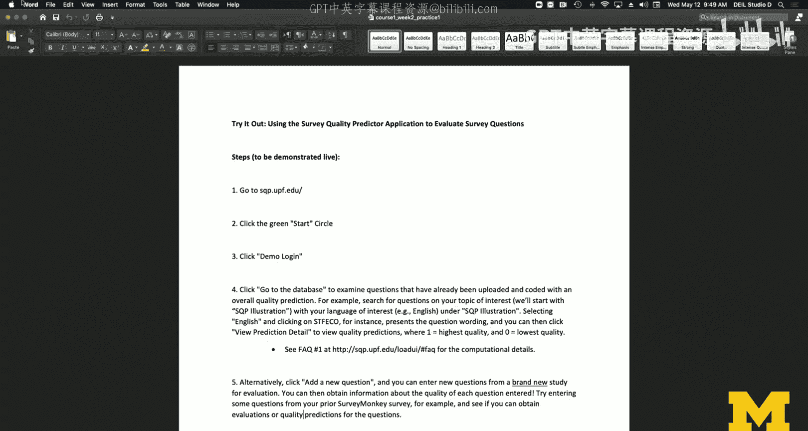
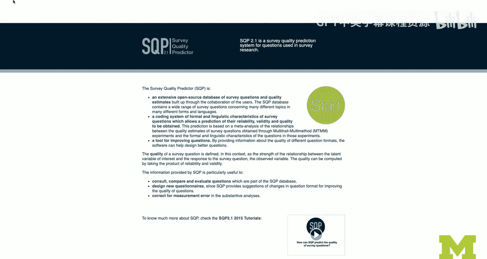
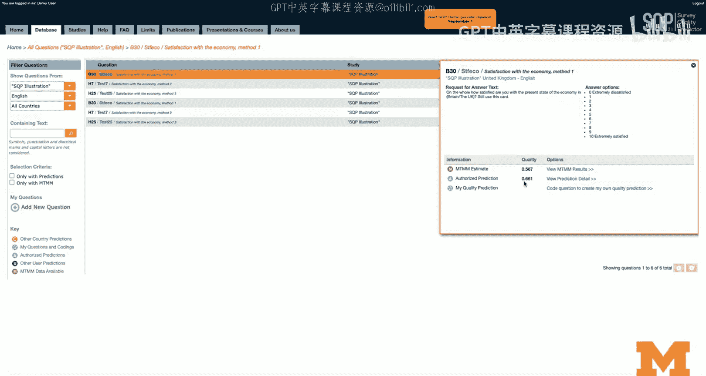
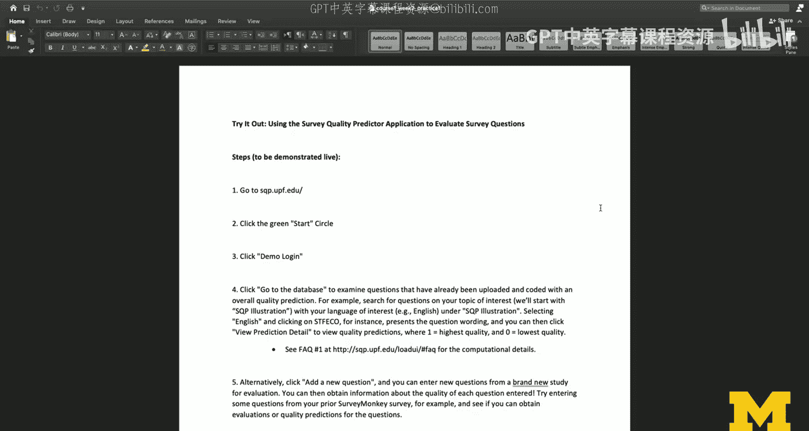
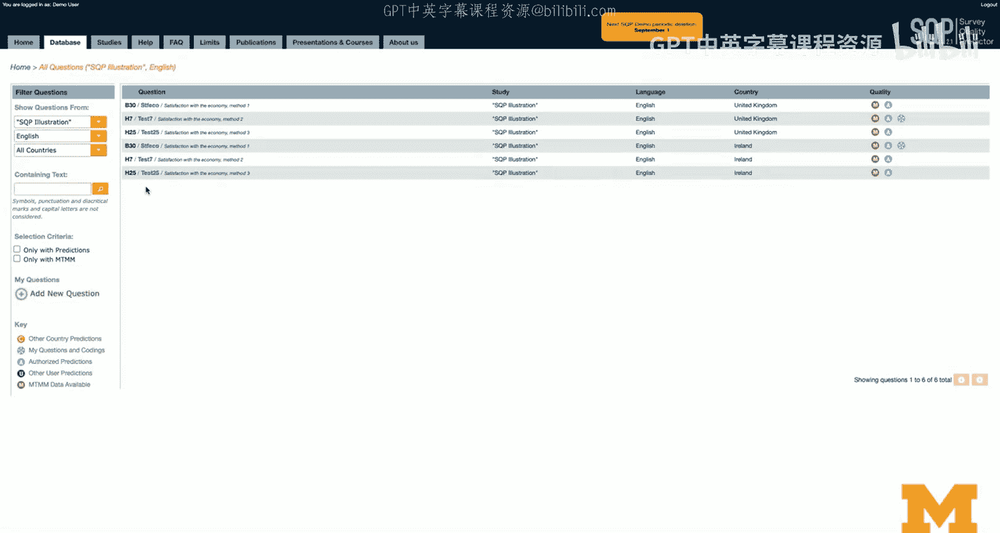
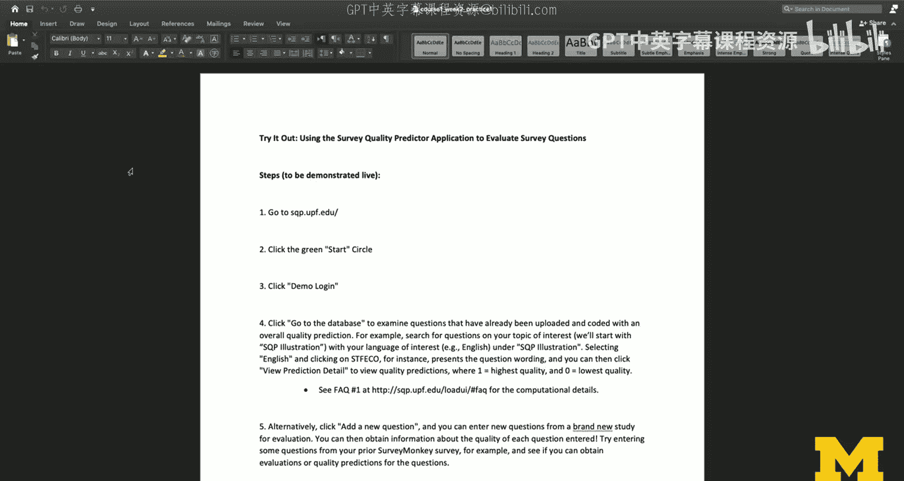

# 密歇根大学《总体数据质量（框架、度量、设计策略）total data quality》 p13 12_实践演练：使用调查质量预测器应用程序.zh_en -BV1Jn4y1X7uS_p13-

Okay， hello everyone， so in this demonstration we're going to illustrate something called the Sur quality Preor application and this is an online tool that can be used to evaluate the overall quality of survey questions and again。

 this is in the realm of validity to make sure that the questions that we're asking in a given survey makes sense and will provide valid measurements of what it is that we're theoretically interested in。

Okay， so we're going go to this online tool here and just demonstrate some features of the tool。

 And this is the word document that's been provided along with this particular demonstration。

 So again， we can just walk through these steps to really to get a sense of how this tool works。

 So the first thing to do is go to S QP for Surve qualitypreor that UF。 Eu forward slash。

And so I've included that particular web link here and you see this this brings up the home page for the survey quality predictor SQP 2。

1 is a survey quality prediction system for questions used in survey research Okay so very important to look at reliability。

 validity and quality of the different survey questions that you're using and this is one of several possible tools that one could use to really get a sense of the overall quality of the questions that have been written。

 So when you go to this particular website， you can then click on the green Start button to get started with with the tool here。

Okay， now you have different options here， you could add questions to their overall database of questions that they maintain。

 you could download particular information or questions from the database that they maintain at this particular website we're going to choose the option as it says in the Word document to go to the database just to look around a little bit and see how this works。

So this is a database of overall survey questions that have been created in a variety of different languages in a variety of different countries。

 and each of these questions has been scored based on statistical models that evaluate the overall quality of the questions and make predictions in terms of the overall validity and quality of the questions that have been written So many things we can play around with。

 we're just going to choose the first overall option here for SQP illustration just to illustrate some of these ideas。

 you can see this extensive list of languages here that you could look through to find you know what type of language you'd like to see for a given question I'm going to actually scroll to English here。

It's for purposes of the demonstration。And you can see there's a small number of questions that pop up here under this SQP illustration category。

 We could choose different categories of questions if we wanted to。 So just for illustration。

 after we click English， we'll click on this very first question。

 which is measuring measuring satisfaction with the economy。

 So I'm going to click on the link for this particular question。

 and you can see that this pulls up a window that provides some details about the question。

 the text of the particular question。 the different answer options。 and most importantly。

 down at the bottom of this window you can see what's called an emptymm estimates we'll be talking about what that means in the course。

 and then also an authorized prediction of the overall quality of this particular question。

 So that's what's really cool about this database is that these questions have all been scored in terms of their overall quality。

 And as we say in the word document， you can you can go to the additional link here to see computational details。

 But essentially in terms of those predictions。

A value of one would mean that that question is of the highest possible quality and a value of 0 would mean that that question is of the lowest quality。

 So these predictions are going to be on a scale of 00 to 1， where again。

 these predictions have been based on prior statistical models evaluating the overall question text and the number of responses provided。

 So you'll see these types of scores for each of the different questions and that allows you to pick the questions in the database that you feel have the highest quality and are also getting at the essential concepts that you want to measure。

So very useful feature there in terms of having these scores available。

 and you can view details at these different links if you'd like to for a given question。

 Another option is that you could add a new question to the database so you see this green link here on the left-hand side add new question I can click on that particular option here。

 and then you can see you can add details about the particular study， the language。

 the text of the question， the different response options and so forth。

 So all of these I'm not going to go through that detail right now。

 but you could add your own survey question to the database and then have it scored and have it retained in the database for others to look at。

 So that's also a very nice feature here。 and that you can add new material to this database and they keep this database active for other researchers to use。

 So for example， in your prior in our prior survey monkeykey example where you design your own web survey you could take one of the questions that you asked in that particular survey。

 added to this database， get it scored and evaluate the overall quality。

Of that particular question considering its text and the different response options。

 So this is a nice example of an online tool free to use that you can use to evaluate the overall quality of different questions and identifying some different existing questions in their database that have already been scored in terms of their overall quality。

 So again， you can see there's a science behind this in terms of developing these questions evaluating the ability of response is to comprehend them。

 making sure the response options are clear and this survey quality predictor application allows us to assign a score of these different questions and evaluate different questions based on their overall quality。

 So this is an important step when you're assessing the validity of the questions that you're asking in a given design data collection and this is one of several useful tools that are available for evaluating the overall quality of the surveys。

Okay， so thank you， play around with this a little bit and we'll continue to talk about issues related to validity。

 but this will give you a chance to explore one of these online tools for assessing the quality of survey questions。

