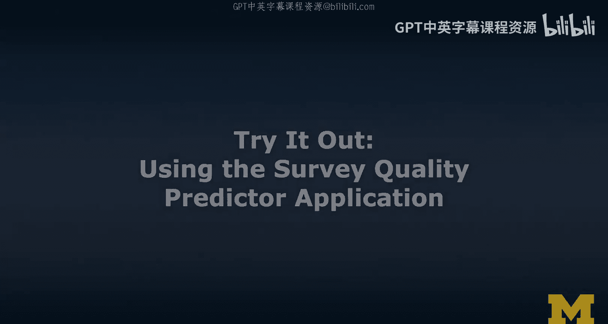
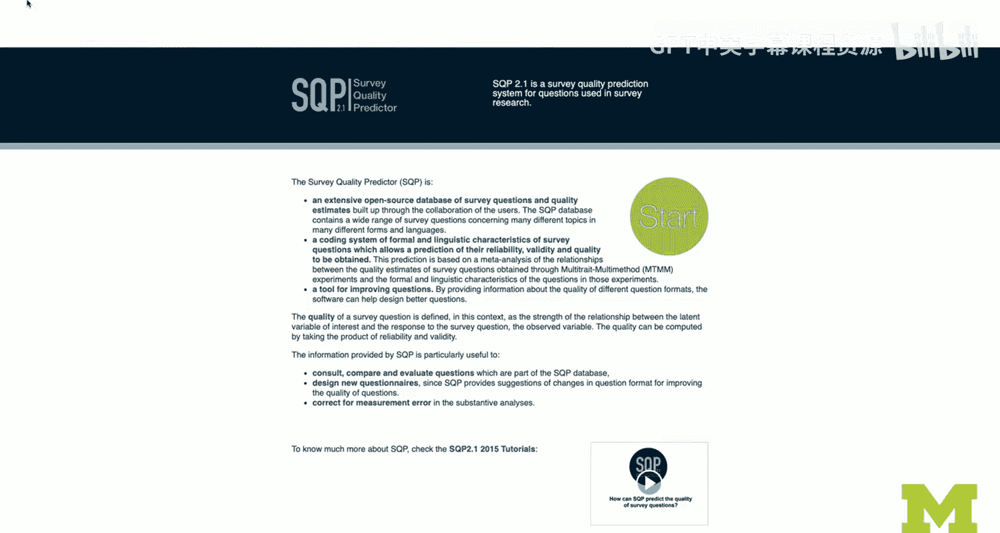
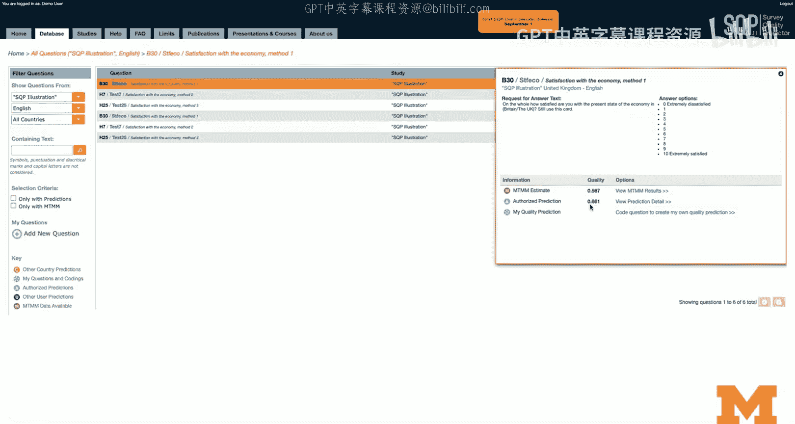
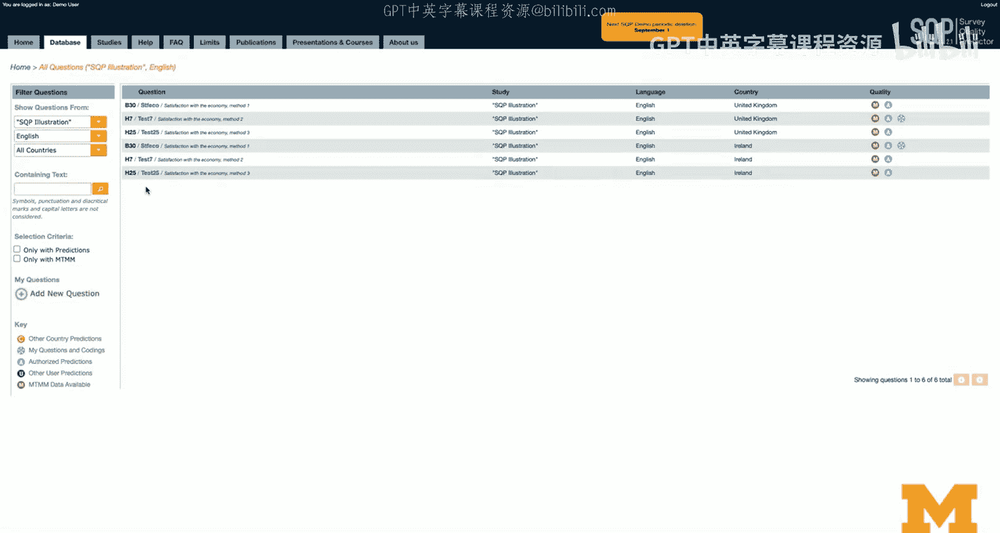

# 总体数据质量（框架、度量、设计策略）：12：实践演练：使用调查质量预测器应用程序 📊

在本节课中，我们将学习如何使用一个名为“调查质量预测器”的在线工具。这个工具可以帮助我们评估调查问卷中问题的整体质量，确保我们所提的问题能够有效测量我们理论上感兴趣的概念，这属于**效度**评估的范畴。

## 访问工具与界面介绍

首先，我们需要访问调查质量预测器的网站。其网址是 `SQP.uf.eu`。打开网站后，你会看到其主页，上面介绍了SQP 2.1是一个用于调查研究的问题质量预测系统。评估你所使用调查问题的**信度**、**效度**和**质量**非常重要，而这是众多可用工具中的一个，能帮助你了解所编写问题的整体质量。

点击绿色的“开始”按钮，即可启动这个工具。

## 探索问题数据库

进入工具后，你会看到几个选项。你可以向他们的总问题数据库添加新问题，也可以从他们维护的数据库中下载特定信息或问题。根据演示文档，我们将选择进入数据库进行浏览，以了解其工作原理。

这个数据库包含了来自不同国家、使用不同语言创建的各种调查问题。每个问题都基于统计模型进行了评分，这些模型评估了问题的整体质量，并对所编写问题的整体**效度**和**质量**进行了预测。数据库功能丰富，我们选择第一个“SQP演示”类别来了解基本概念。

在语言列表中，我们选择“英语”以便演示。你会看到在这个“SQP演示”类别下弹出少量问题。我们也可以选择其他问题类别。为了演示，在点击“英语”后，我们选择列表中的第一个问题：“测量对经济的满意度”。

点击该问题的链接后，会弹出一个窗口，提供该问题的详细信息，包括问题文本、不同的答案选项。最重要的是，在窗口底部，你可以看到所谓的“估计值”以及对该问题整体质量的**授权预测**。这正是该数据库的亮点：所有问题都根据其整体质量进行了评分。

## 理解质量评分

正如演示文档中所说，你可以点击附加链接查看计算细节。但本质上，这些预测评分基于先前的统计模型，这些模型评估了问题文本和提供的回答选项数量。

**质量预测值**的范围在0到1之间：
*   **`预测值 = 1`** 表示该问题具有最高可能的质量。
*   **`预测值 = 0`** 表示该问题质量最低。

每个问题都会有这类评分，这使你可以从数据库中选择那些你认为质量最高、且能触及你想要测量的核心概念的问题。能够获取这些评分是一个非常实用的功能。

## 向数据库添加新问题

另一个选项是向数据库添加新问题。在页面左侧，你可以看到一个绿色的“添加新问题”链接。点击该选项后，你可以填写关于特定研究、语言、问题文本、不同回答选项等详细信息。

虽然我们现在不深入演示每个细节，但你可以将自己的调查问题添加到数据库中，然后获得评分，并保留在数据库中供其他人查看。这是一个非常好的功能，你可以向这个数据库添加新材料，他们也会保持数据库的活跃性供其他研究人员使用。

例如，在我们之前使用SurveyMonkey设计网络调查的练习中，你可以将你在该调查中提出的某个问题，添加到这个数据库，获得评分，并评估该问题（考虑其文本和不同回答选项）的整体质量。

## 总结与工具意义

本节课中，我们一起学习了一个可以免费使用的在线工具示例，你可以用它来评估不同问题的整体质量，并识别其数据库中那些已被评分的现有问题。

这背后存在一门科学：开发这些问题、评估回答者理解它们的能力、确保回答选项清晰。而这个调查质量预测器应用程序允许我们为这些问题分配分数，并根据其整体质量进行评估。

当你评估在特定数据收集中所提问题的**效度**时，这是一个重要的步骤。这是现有众多用于评估调查整体质量的有用工具之一。

你可以多尝试使用这个工具。我们后续将继续讨论与效度相关的问题，但这将给你一个机会去探索这些用于评估调查问题质量的在线工具之一。