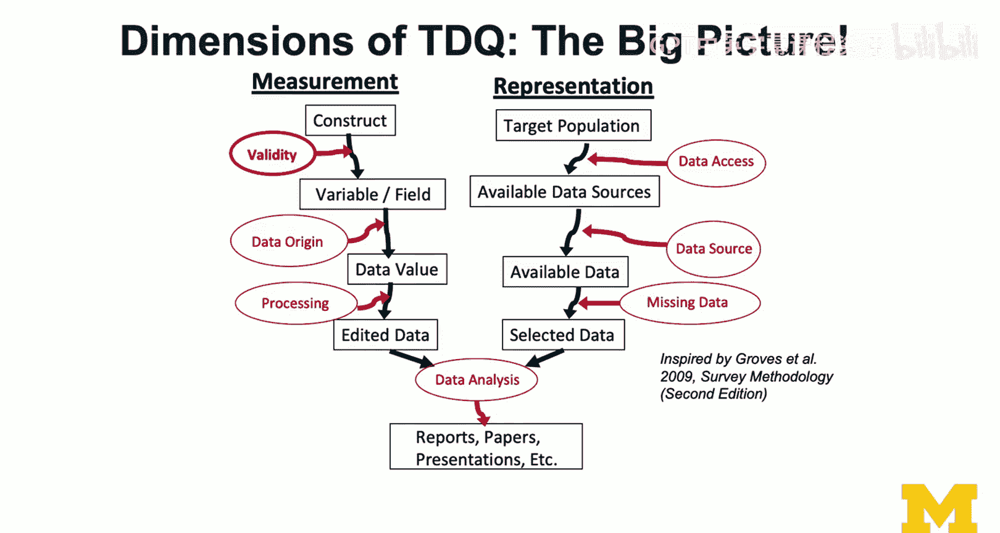
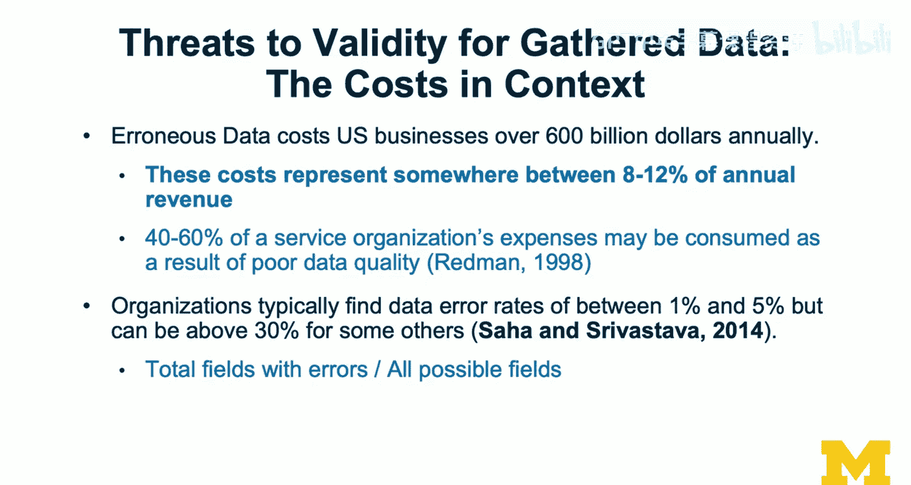
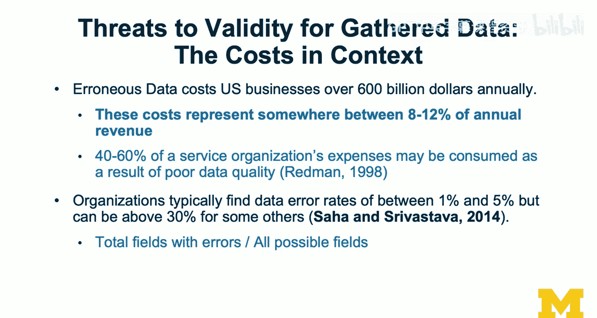
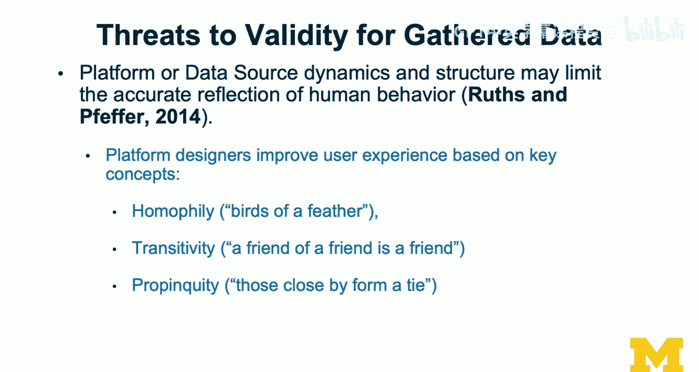
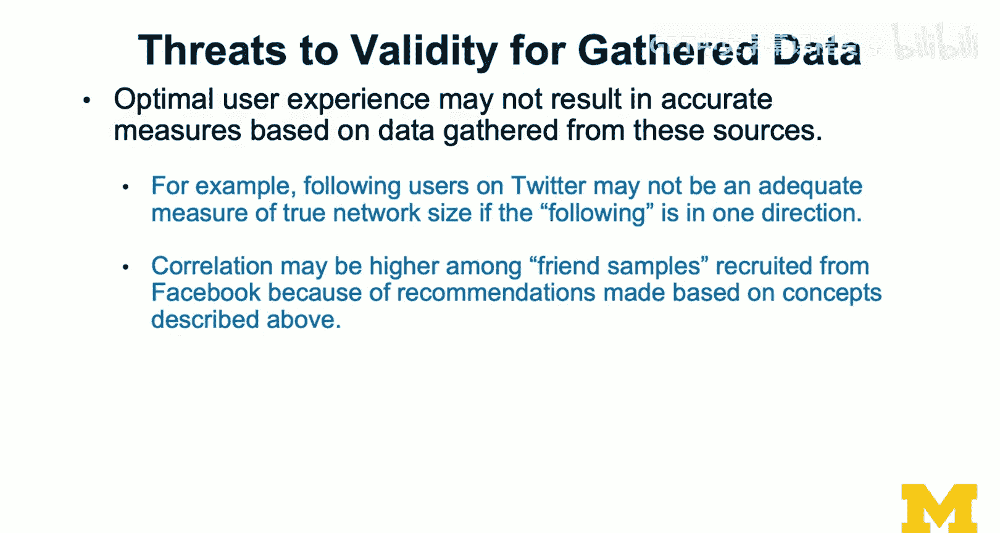
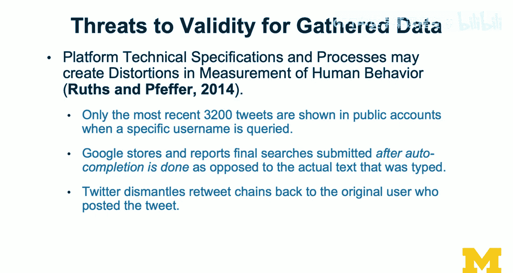
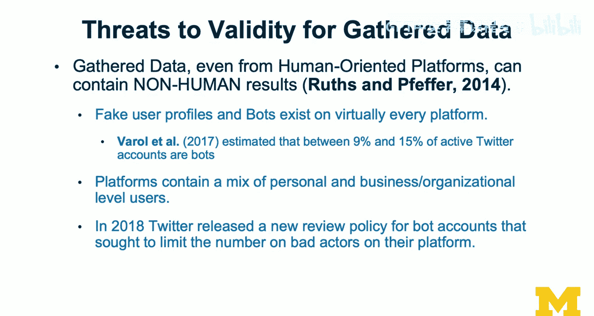
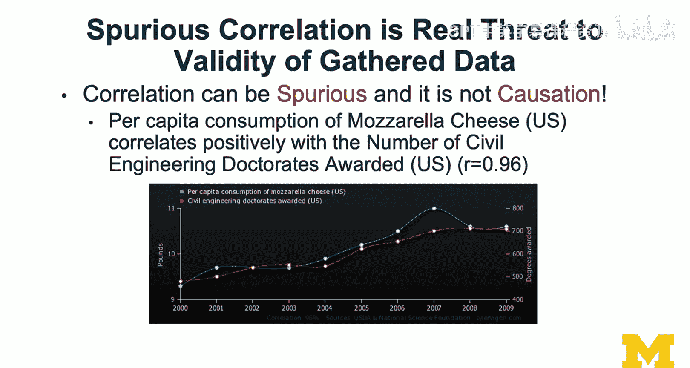
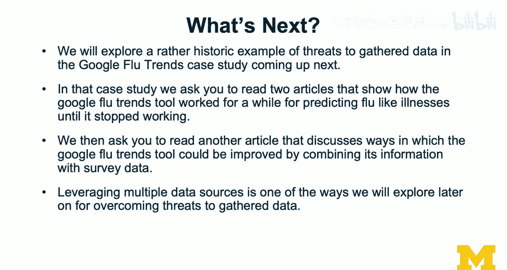
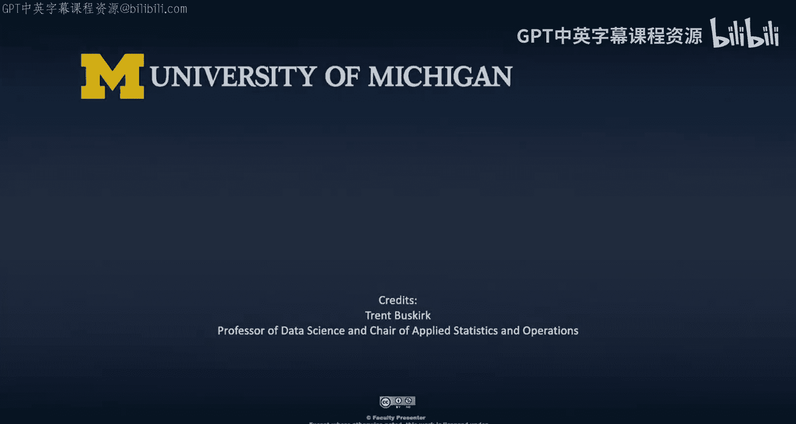

# 密歇根大学《总体数据质量（框架、度量、设计策略）total data quality》 p14 13_采集型数据效度威胁因素.zh_en -BV1Jn4y1X7uS_p14-

Hello， welcome back to the course， I'm Tmp Uskirk and today we're going to talk about threats to validity for gathered data。

 we've already sort of defined what gathered data and design data are and we're going to talk through some threats to the validity of that kind of data today。

So just to make sure that we're all on the same page。

 we've already talked about the dimensions of total data quality here。

 and so we're going to keep referring to this picture throughout the sequence of courses。

 but where we are right now is on the measurement side of the picture and we're going to be talking about the validity piece so in between the construct and variable and field elements of measurement is really this validity element that we're going to be talking about and specifically we're going to be talking about things that can threaten the validity of gather data。

And remember， gathered data are those data that are generated from web sources， social media data。

 big data， those kinds of things， just to keep that in the back of your mind。

So the interesting part about some sort of why would we care about the threats for gathered data in the first place。

 I mean some people can argue that big data are opportunistic， we get and receive this data。

 we find this data we're going to use this data and so on why do we care about the quality why would we care about the validity of such data。

 there's nothing we can do about it， we're sourcing it from somewhere else。

 and that there is something to that point in the sense that we didn't design that data for research purposes。

 but we want to use that data for research purposes， but here's the thing erroneous data。

 this is such an interesting sort of study that sort of dates back 20 years or so。

 and it's kind of an old study but you can imagine the sort of the power of this information even in the current day。

 erroneous data costs US businesses over $600 billion annually there was an estimate that basically represents that these costs。

are somewhere between 8 and 12% of the revenue strain and 40% to 60% of a service organization's expenses may be consumed as a result of poor data quality Can you imagine using data that are not valid to make decisions for your company only to realize that that decision wasn't correct because the data was misinforming you this is a really interesting aspect of business operations but imagine porting that into the research arena for data that you don't necessarily understand the origin or why it was created in the first place。

 these threats to quality can really derail research studies if we don't start to understand or at least begin to think through some of the threats that this kind of quality measure or validity could present to us。

Organizations typically find data error rates between 1 and 5% but they can be as high as 30% for some other kinds of data sources and organizations and this is really a metric that simply is the quotient of the total fields that they might be working with with errors in them over all the possible fields that they might care about so this is a study from 2014 looking at potential error rates in these kind of data。

 so while it does seem like the error rates may not be something we can do anything about。

 they do occur at some level and we should be aware of them and think about ways to evaluate them and potentially solve this problem for our research purposes。

The platform or the data source dynamics and the structure of the platform may limit the accurate reflection of human behavior this is one of the primary threats for the validity of gather data according to Ruths and Ffer from 2014 Now what I mean by a platform is something like Twitter LinkedIn Facebook or a data source might be something like transactional data that you get from a meter or sensor that's connected to a cash register in a store so these are really sources of places where we might acquire gather data or how the gather data may be generated or the repositories that sort of store them。

But the platform designers， that's the whole goal of platform designers like Twitter and Facebook are to improve the user experience。

 I mean， who wants a bad Facebook， right， Nobody wants to be on Facebook if it isn't enjoyable or if there isn't something informative about it。

 this is the whole job of these platform designers。

 And so they improve the user experience based on really three main ideas。 homophily。

 which is otherwise said birds of a feather flock together， transitivity。

 a friend of a friend is a friend， maybe and propinquity， those close by form a tie。

 So there is a geographic element to it， there is a similarity element to it。

 and then there is this sort of transitivity that if I know you and you know someone else then I know someone else。

 and you can see this actually coming to pass when you get recommendations from Facebook。

 for example， of people that you don't know but they're tangential to your friend network。

 this is exactly。😊。

How these platforms can generate information or give suggestions to you about how to grow the networks If as researchers。

 we are using that kind of data to study networks， for example。

 we should care about how those platforms are curating and generating those networks because potentially that could be a threat to the validity of the kind of questions or the data that we're going to gather and then the data that we use for the purposes of our research。

 we may have to think more wholeheartedly about whether or not there are errors or threats to the quality in that data that could。

Impact my ability to use them for research purposes。

I'm going to talk about these three sort of design elements as they relate to threats to validity for gathered data because I think they're really。

 really important for us to think through， not necessarily for their sources of error outright。

 but because they help us to begin to understand how to think through more logically about gathered data in the first place。

 I mean today we have Facebook， but tomorrow we may have handbook or we may have PoL page。

 we don't know what's coming in the future and big data is ever evolving。

 but the point of this I think a part of the point of this this course is to really help you understand how to think through some of these issues even though Facebook may be different tomorrow than it is today。

 the concepts， though， I think are helpful in thinking through how to use data that you might source from these kinds of repositories。

So think about this， the optimal user experience may not result in accurate measures based on data gathered from these sources。

 For example， following users on Twitter may not be an adequate measure of true network size if the following is only in one direction。

 so if I follow a bunch of people and you look at my follow if you look at who I follow and think that that's an estimate of my network size。

 it may be an overestimate if a lot of those people don't follow me back so there is this directional element to it that might actually threaten the validity of using that kind of data for a network analysis because we're assuming too much。

Correlation may be higher among friends samples recruited from Facebook because of recommendations made based on concepts of similarity across those friends。

 if Facebook picks up on some similarity measure like we're all in Taekwondo and you wanted to study whether or not we all have a BmiI that's in a reasonable range Well if I'm connected to only my friends through the Taekwondo network。

 we might be physically active in our BMs might be lower than average。

 So the point here is that some of these platform specific curation techniques or at least concepts for curation may actually create correlations or inadeququacies in the kind of data that we're trying to gather and use and it might threaten the validity of their use for a particular purpose。

The technical specifications of a platform and the processes that are used in that platform may also create distortions in measurement of human behavior。

 A couple of examples here， only the most recent 3200 tweets are shown in public accounts on Twitter when a specific username is queried。

 so if you're trying to understand how someone might have been talking about the pandemic for example。

 their perception of COVId， their perception of COVID might have changed over the last year。

 but I might only have  my most recent 3200 tweets might be me having a really bad spell with hating COVId。

 and the prior 3200 tweets， which you couldn't get by a simple query might have been me putting on my smiley face about being happy about the way things were with COVID and so by only being able to access the most recent 3200 tweets may limit the perception that you have of my opinion。

About COVID currently。Google stores and reports， final searches submitted after auto completion is done as opposed to the actual text that was typed。

 so when you're thinking about how people access COVID or what kind of keywords people used to search for COVID。

 you're going to get theversions of those search terms that were autocomplet or corrected from Google or they were suggested and then people clicked on there。

 so if you're trying to get a sense of maybe search terms that you might want to include as possible misspellings or slang terms that people may use for COVID on the street that are not necessarily picked up by Google's autocomp methodologies。

 then you might miss some of those things in your research as well。

And Twitter dismantles retweet chains back to the original user who posted the tweetet so for example。

 if you're trying to figure out the geographic location of a retweet。

 it is taken back to the location of the original tweeter so if I'm trying to understand some sort of geographical opinion based on retweets I am not able to look at the geography of the retweet I'm only able to ascribe to that retweet。

 the geography of the original tweeter so this gives me some sort of threat to the validity of that measure with respect to geographic specificity these are all things that are related to the way these platforms make decisions about how to store represent and allow you to query data。

Gathered data even from human oriented platforms can also contain non-human results if you care about a study that's looking at human opinion about a certain topic on Twitter。

 you might actually get an opinion from a bot， and so this may or may not be considered eligible for your study。

 the ineligibility of bots， even though you cannot detect that initially may create some threats to the validity of the data that you gather because you're looking at a mix of bot data and human data。

 and you may only want to study human data。Vral and colleagues in 2017 estimated that between 9 and 15% of active Twitter accounts are bots。

Now some of these bots are nefarious， but other bots are considered white bots or friendly bots。

 if you use a bot to get traffic information or weather information on Twitter。

 those are considered friendly bots and Twitter will likely not eliminate those kind of bots from the ecosystem in fact in 2018。

 Twitter released a new review policy for bot accounts that sought to limit the number of bad actors。

 but it doesn't eliminate all bots completely as I mentioned just now。

Here's an interesting slide that looks at very， very popular contemporary Twitter users that you might recognize from popular press。

 Justin Bieber， Lady Gaga， Katie Perry， and the list goes on now the question that was asked here is is the number of Twitter followers a valid measure of interest。

 popularity support or engagement and we looked at these very very popular Twitter users and we classified or this particular slide classifies that users as either fake inactive or good。

 so that would be the human users， the fake would be the bots for example。

 and you can see that the percentage of bots who are following these particular list of users varies between somewhere between 5 and 15% as we already mentioned so again。

 if your study was of interest you had an interest in studying human populations。

 you may not be interested in getting the bots？Come along for the ride。

And again we have to think about the fact that when you're collecting or using gather data in some cases。

 big data， you have lots and lots of variables that come along in those data sets， for example。

 and you may actually have relationships between some of those variables but those relationships may not be caus correlation certainly is not causation as we know over and over again from all of our mantras and research methods but correlation can also be spurious and it doesn't necessarily represent a useful finding for research purposes。

 here's an example， the per capita consumption of mozzarella cheese in the US correlates positively with the number of civil engineering doctorates awarded and the correlation recorded here is 0。

96 and you can see from the plot this is a really strong correlation as a social scientists I'm having a party over this correlation it's really really。

Strong， this is also my most cheesy slide that you're going to see from me。

 so I apologize for that here， but the point of the matter is these two things。

 mozzarella cheese consumption and number of civil engineering doctorates，May likely not be related。

 but when we're putting together lots and lots of data sources from different， different areas。

 it is not uncommon to get to find these kinds of things spuriously。 that， in fact。

 we find these things happen together， but they may not necessarily be related。 Again。

 these are all threats to using big data sources in terms of the validity that we might experience。

Just want to talk a little bit about what's coming so that you're aware of what's ahead in the next segment of the course。

 we're going to explore a historic example of threats to gather data in the Google F trendsrends case study in that case study we're going to ask you to read a couple of articles that show how the Google F trendsrends tool worked for predicting flulike illnesses and then we're going to ask you to read another article that discusses the ways in which the Google F trendsrends tool could be improved by combining information from the gather data sources to design data sources specifically survey data and we're going to talk about this throughout this course that when we get to this the ability to leverage multiple data sources is one of the ways that we can overcome threats to gather data particularly around validity。

 Thanks a lot for joining us until next time。 be well。

