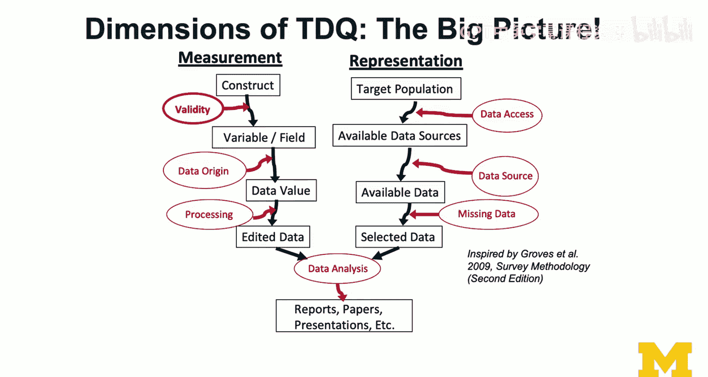
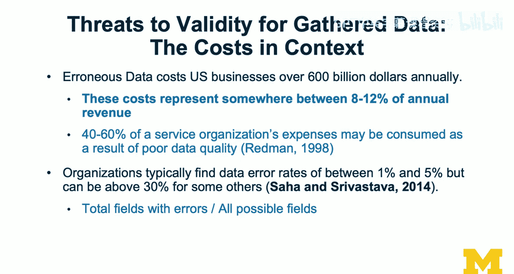
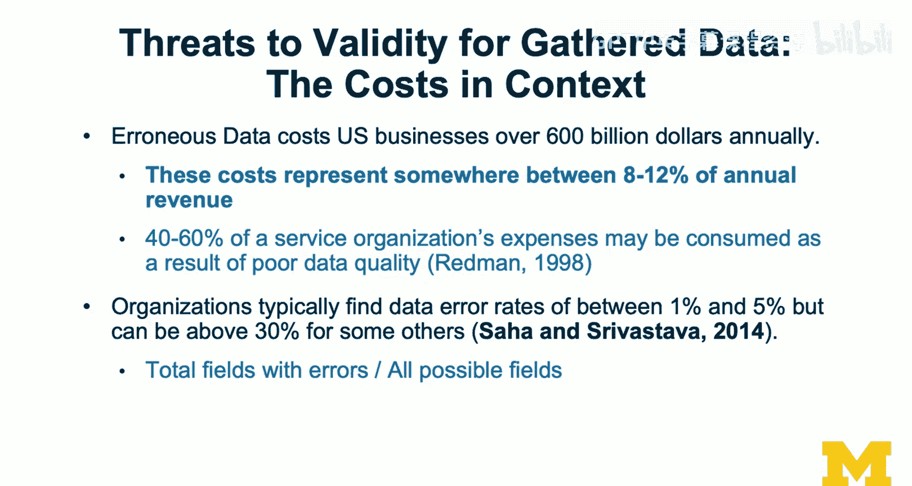
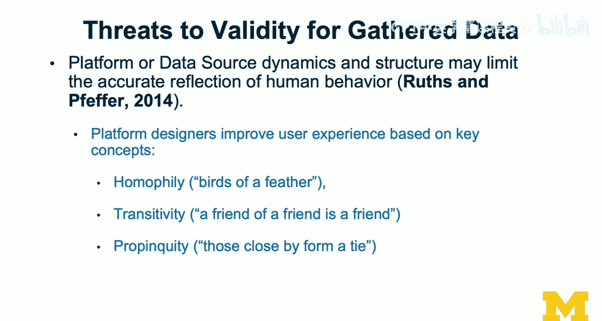
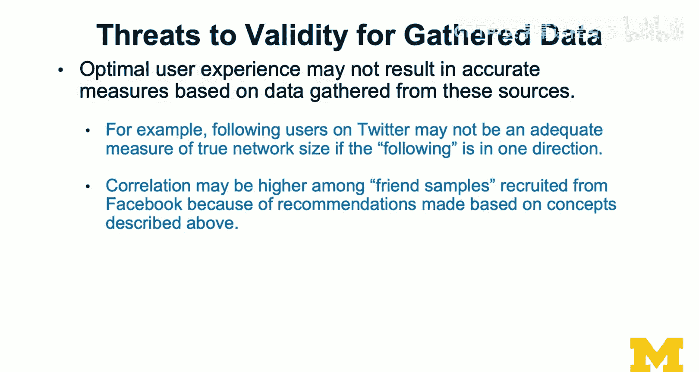
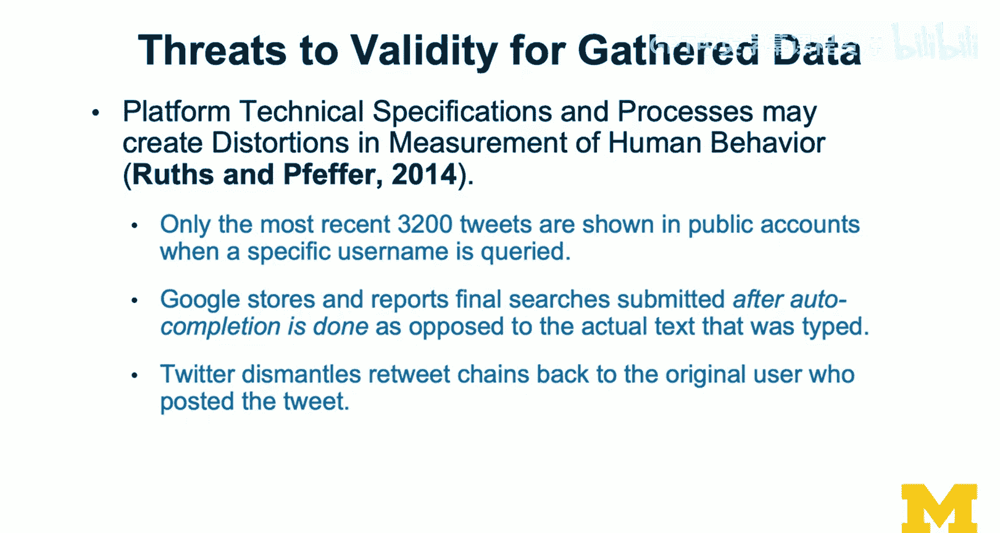
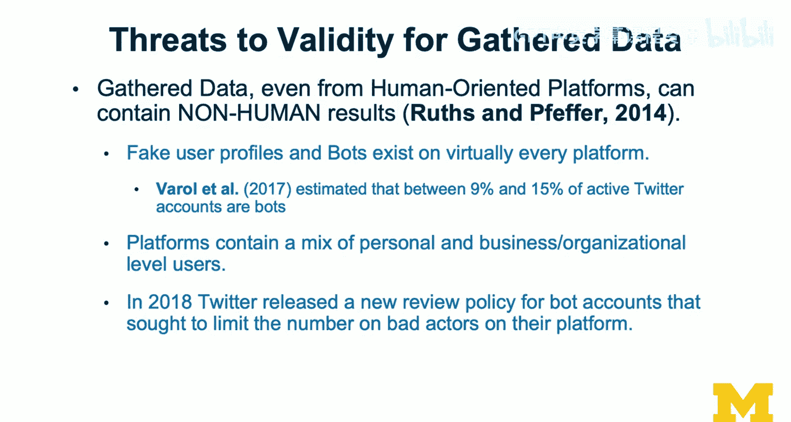
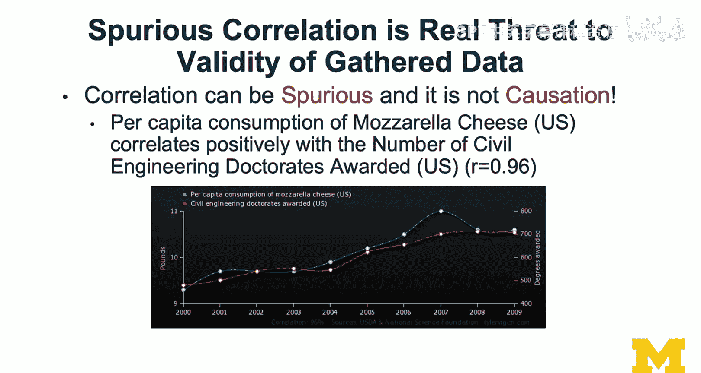
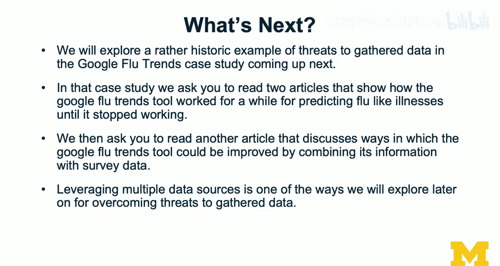

# 总体数据质量：13：采集型数据效度威胁因素 📊

在本节课中，我们将要学习采集型数据（如网络、社交媒体、大数据等）在效度方面可能面临的威胁。理解这些威胁对于确保我们基于此类数据的研究和决策的可靠性至关重要。

## 概述与背景

上一节我们定义了采集型数据和设计型数据。本节中，我们来看看可能威胁采集型数据效度的具体因素。效度是衡量数据能否准确反映我们想要研究的构念的关键维度。

## 为何关注采集型数据的质量？

有些人认为大数据是机会主义的，我们只是获取和使用它，无法控制其质量。然而，低质量的数据会带来严重后果。一项研究表明，错误数据每年给美国企业造成超过 **6000亿美元** 的损失。这些成本约占企业收入的 **8% 到 12%**，而服务组织 **40% 到 60%** 的支出可能源于数据质量低下。在研究中，如果我们不理解数据的来源和生成原因，其质量威胁可能会彻底破坏研究。

组织通常发现数据错误率在 **1% 到 5%** 之间，但对于某些数据源和组织，错误率可能高达 **30%**。错误率计算公式如下：

`错误率 = (包含错误的字段总数) / (所有相关字段总数)`

虽然我们可能无法直接影响这些错误率，但必须意识到它们的存在，并思考评估和缓解的方法。

## 平台动态与结构限制

根据Ruths和Pfeffer（2014）的研究，平台或数据源的动态及其结构可能限制对人类行为的准确反映，这是采集型数据效度的主要威胁之一。

“平台”指的是如Twitter、LinkedIn、Facebook等社交媒体，或来自商店收银机传感器等的交易数据源。平台设计者的核心目标是改善用户体验，他们主要基于三个概念来实现：

以下是平台设计者改善用户体验所依据的三个核心概念：
*   **同质性**：物以类聚，人以群分。
*   **传递性**：朋友的朋友也是朋友。
*   **邻近性**：地理位置相近的人容易建立联系。

然而，对于研究者而言，**最优的用户体验可能无法产生基于这些来源数据的准确测量**。例如：
*   在Twitter上关注他人可能无法准确衡量真实的社交网络规模，因为关注关系可能是单向的。
*   从Facebook招募的样本中，朋友之间的相关性可能更高，因为平台的推荐机制基于相似性概念。如果我们研究BMI，而我的社交网络主要由跆拳道爱好者组成，那么样本的BMI可能普遍低于平均水平，这不具有代表性。

## 技术规范与流程造成的扭曲

平台的技术规范和内部流程也可能导致对人类行为测量的扭曲。

以下是几个具体的技术限制例子：
*   **Twitter的查询限制**：公开查询特定用户名时，只显示最近的3200条推文。这可能限制研究者对用户长期观点变化的完整理解。
*   **谷歌的搜索报告**：谷歌存储和报告的是自动补全后提交的最终搜索词，而非用户实际输入的文本。这可能导致研究者错过一些未被自动补全收录的拼写错误或俚语。
*   **Twitter的转发链处理**：Twitter将转发链追溯回原始发布者。如果研究基于转发的地理位置分析观点，将只能获得原始发布者的地理位置，而非转发者的，这威胁了地理特异性测量的效度。

## 非人类结果与虚假账户

即使是以人为导向的平台，采集的数据也可能包含非人类产生的结果。例如，研究Twitter上人类对某话题的看法时，可能会收集到机器人账户的“观点”。

Varol等人（2017）估计，**9% 到 15%** 的活跃Twitter账户是机器人。虽然有些是恶意的，但也有一些是提供交通、天气信息的“友好”机器人。Twitter的政策旨在限制不良行为者，但并未完全消除所有机器人。

如果研究只关注人类观点，那么混入的机器人数据就会对数据效度构成威胁。例如，对Justin Bieber、Lady Gaga等知名用户的分析显示，关注者中机器人占比在5%到15%之间波动。

## 虚假相关性的挑战

采集型数据集通常包含大量变量，变量之间可能显示出相关性，但这种相关性可能是虚假的，并不代表有实际意义的研究发现。

一个著名的例子是：**美国人均马苏里拉奶酪消费量与土木工程博士学位授予数量之间存在高达0.96的正相关**。虽然从图表上看相关性极强，但这两者很可能并无实际关联。当我们将来自不同领域的大量数据源放在一起时，很容易偶然发现此类虚假相关性。这也是使用大数据源时需要注意的效度威胁。

## 下节预告与总结

本节课中，我们一起学习了采集型数据效度面临的主要威胁，包括平台设计限制、技术规范扭曲、非人类数据混入以及虚假相关性等。

在下一节课程中，我们将通过一个历史案例——**Google流感趋势（Google Flu Trends）案例研究**，来深入探讨采集型数据的效度威胁。我们将分析该工具如何预测流感类疾病，以及如何通过结合采集型数据（如搜索趋势）和设计型数据（如调查数据）来改进预测，从而克服效度威胁。综合利用多种数据源是提升采集型数据有效性的关键策略之一。