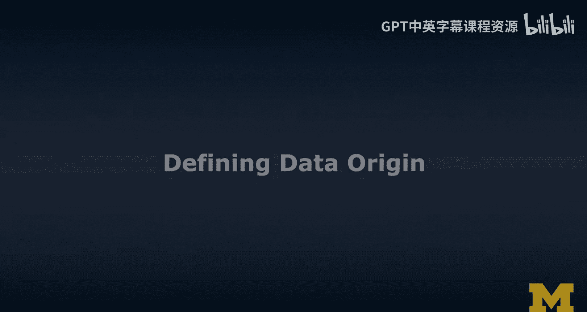
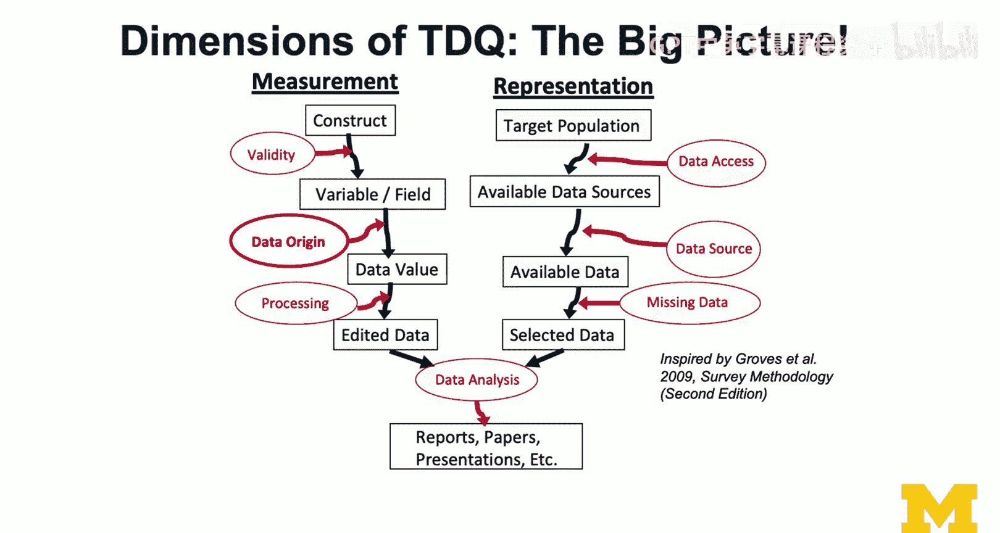
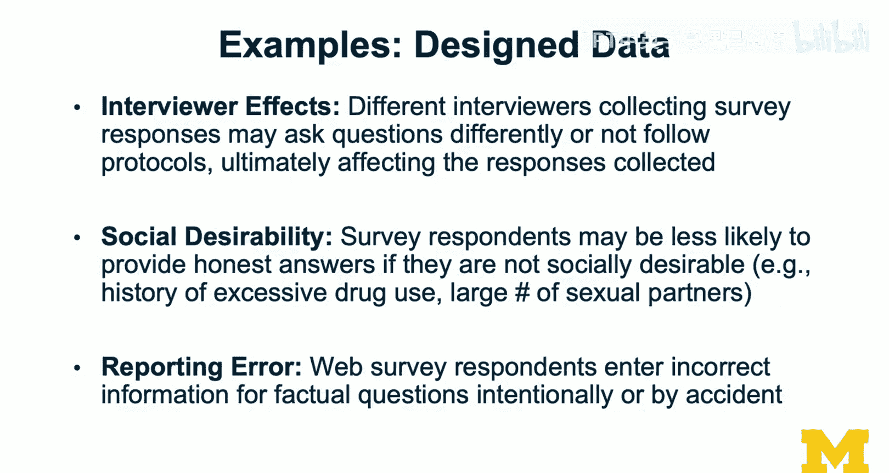
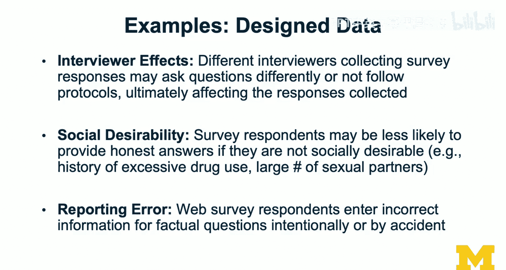
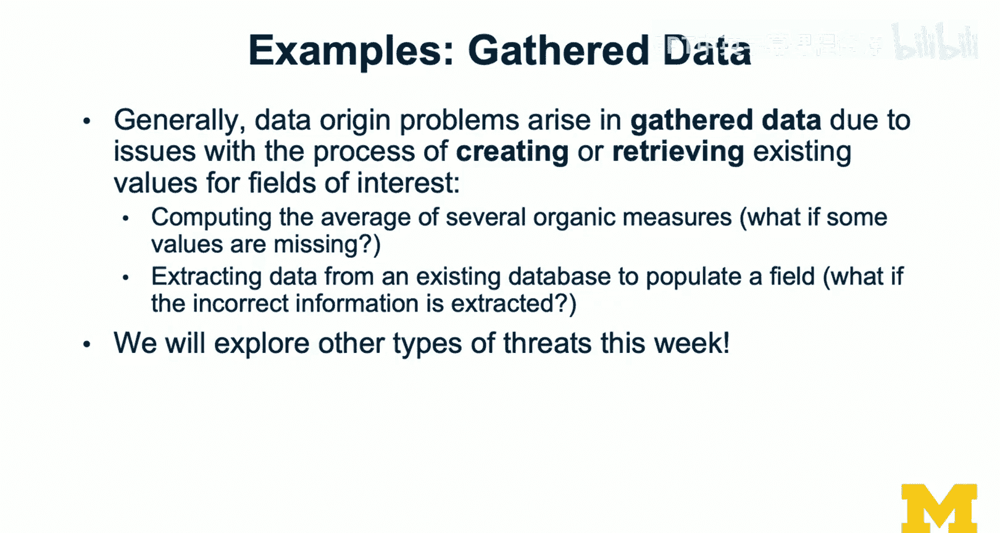
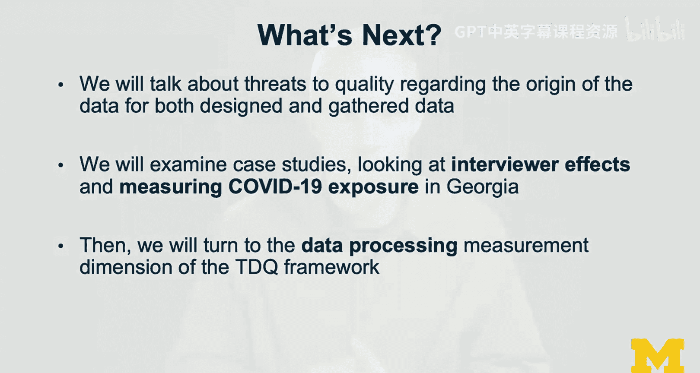

# 密歇根大学《总体数据质量（框架、度量、设计策略）total data quality》 p15 14_数据溯源的定义与范畴.zh_en -BV1Jn4y1X7uS_p15-

Okay， hello everyone， now we're switching to a second measurement dimension in terms of the total data quality framework。

 so now we're going to shift our attention to data origin as our second measurement dimension and provide a definition of what we mean by data origin among all the different measurement dimensions。

Okay， so let's revisit our big picture of the total data quality framework thus far。

 we've been discussing validity， which was remember that going from that theoretical construct to the questions。

 the variables or the fields that we're interested in now we're shifting our attention to data origin and that's where we go from a variable or a field or a question that we're interested in and getting the data for that particular variable or that particular question or that particular field。

 this is what we mean by data origin， So where do the data come from on the variables or the fields or the questions that we're interested in and what are potential threats to quality in terms of where the data are originating yielding the values that we're ultimately going to use for our research。

 So that's where we're shifting our focus now。

So let's provide a definition for data origin data origin refers to how the individual values or data points for a given variable or field or either recorded or captured or gathered or computed or represented for the units of analysis so quite simply where did the data come from on that particular variable or field or question could have come from a variety of different mechanisms but what exactly was the nature of the origin of that data and can we be assured that the origin was as high quality as possible in terms of our overall measurement dimensions。

Furthermore， were there any errors in the process that ultimately produced the value for the variable that were ultimately going to be analyzed。

 So that's our concern in terms of total data quality is。Thinking about the data origin。

 were there any errors that emerged in the process of getting those data values。

 either from a survey question or from the variable or field of interest？

So here are some examples thinking about the design data context。

 one common issue or threat in terms of data origin for design data is interviewer effects。

 so this is the idea that different interviewers who are collecting survey responses may ask questions differently or they may not follow protocols exactly and this ultimately affects the nature of the response is collected。

 so one interviewer may consistently ask a question incorrectly。

 another interviewer may ask that question correctly。

 and the first interviewer may collect bias responses as a result of that process and this variability between different survey interviewers in terms of what they're collecting is what we refer to as interviewer effects。

Social desirability is another issue with data origin in terms of the measurement process。

 so survey respondents may be less likely to provide honest answers if these answers are not socially desirable so for example。

 a history of excessive drug use if they're asked a question about the drug use in their lifetime or having a large number of sexual partners if they're asked a sensitive question about how many sexual partners they've had。

 say in the past year in this case， survey respondents may filter their true responses and provide a response that is not entirely truthful when they're asked a very sensitive question because they want to look better in the eyes of the interviewer and that's a problem with data origin there's a problem with the process that's generating the data that we're ultimately collecting because the survey respondent is filtering the response in their mind there's a problem at the origin of the data。

 the response to that particular question。

Another example is reporting error， so web survey respondents， for example。

 may enter incorrect information for factual questions either intentionally or by accident。

 maybe they're going through the survey too quickly or they're not looking up documents or records and they're just answering off the top of their head。

 that may be a problem with the origin of the data。

 okay they're not processing the questions entirely and ultimately what they're responding to the questions the values that they're providing with in response to the questions are not entirely accurate。

 So again， a problem with the origin of the data where their survey respondents enter incorrect information and they could be doing this intentionally just to skew the survey results or they might just do it by accident without thinking carefully。

Here are some examples in the gathered data framework generally in this framework。

 data origin problems arise due to issues with the process of either creating or retrieving existing values for fields of interest so for instance。

 computing the average of several organic measures in a given organic data source So for example。

 if we were taking the average of several different measures to create a new variable of interest。

 what if some of the values on the fields that are being average are in fact missing what do we do in that case does it make sense to still compute the average for a given case in our data set。

 if some of those values that are being used as inputs to the average or missing。

Also extracting data from an existing database to populate a field。

 So what if we accidentally extract the incorrect information to populate a field in the data that we're interested in so we're hitting an existing database。

 We're pulling information from that database， but we're actually pulling an incorrect observation from that database to populate the field that we're working with again。

 that would be a problem with the origin of the data on that particular field that we're populating So we want to make sure that we're extracting the correct information from an existing database。

And we're going to continue to explore other types of threats in terms of data origin this week。

So what's next we're going to talk more about threats to quality regarding the origin of the data for both designed and gathered data。

 we're also going to look at some case studies in particular。

 looking at interview effects and measuring COVID-19 exposures in the state of Georgia and then we're going to turn to the data processing measurement dimension of the total data quality framework so the next dimension in terms of the overall measurement process that we're thinking about in terms of overall measurement quality Thank you。

