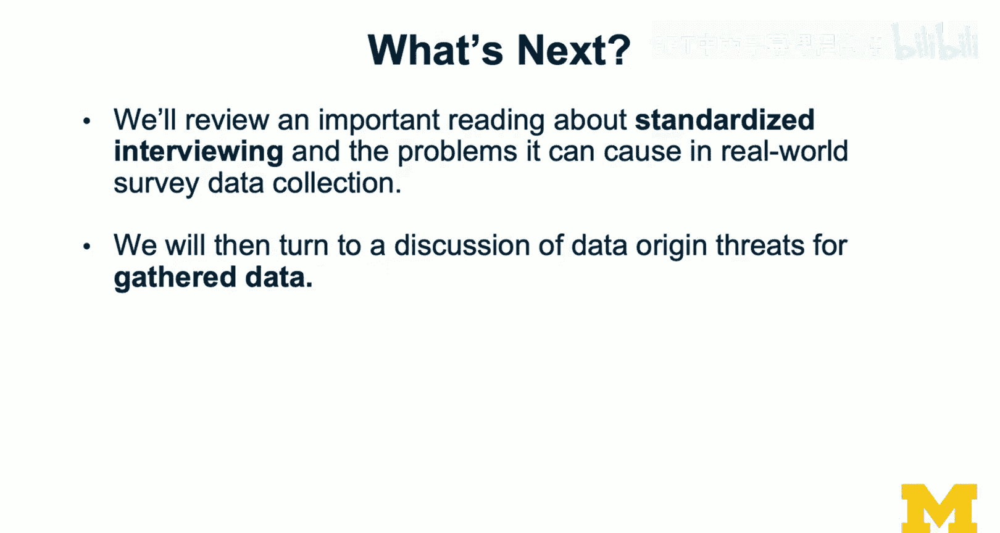

# 密歇根大学《总体数据质量（框架、度量、设计策略）total data quality》 p16 15_设计型数据溯源威胁因素.zh_en -BV1Jn4y1X7uS_p16-

Okay， well， hello， everyone。 Now that we have defined the data origin dimension of total data quality。

 we're going to talk about some data origin threats for design data in particular。

 So we'll be discussing threats for both design data and gather data。

 but we're going to start with some data origin threats specifically for design data collections。

 So let's revisit our big picture。 at this point， we've talked about validity as one of the key measurement dimensions。

 again， going from a construct of theoretical interest to an actual variable or field that's measuring that construct。

 And now again， we're talking about data origin， which is where the data comes from for a particular variable or field。

 and we're going to proceed in this lecture。Talking about specific threats in design data collections。

 threats to the quality in terms of data origin。So some data origin threats for design data。

 One important area is difficulties with the iterative psychological process of answering a survey question。

 So with design data， where're often designing questionnaires to collect survey information from the populations that were interested in and whenever you ask a person a survey question internally。

 they go through a psychological process of understanding the question。

 trying to come up with a response to that question and then communicating the response。

 whether it's in a web survey or a mail survey or if they're talking to an interviewer。

 So initially there's comprehension of the question meaning。

 then there's retrieval of the requested information。

 possibly from the respondent's memory and then there's editing of the retrieved information prior to responding to the survey question。

 and at any stage of this overall process， there could be breakdowns in the process that can lead to poor survey responses。

 one source of possible breakdowns in this。is what are called interviewer effects。

And in interviewer administer data collections， interviewers have varying effects on the responses collected。

 and these effects can add both bias and variance to survey estimates。

 So these effects may arise due to observable characteristics of the interviewer who's conducting the interview。

 They could arise due to behaviors of the interviewer。

 like maybe they're going off script and they're trying to they're trying to start conversations that go off on tangents or they're reacting in different ways to the ways that respondents are answering questions。

 Either way， variability among interviewers in the way that they ask and record survey questions can lead to effects on the response is collected。

 So depending on how an interviewer is acting a given survey respondent may choose more often to edit their responses。

 they may not be comfortable sharing particular responses with that particular interviewer or they may have comprehension difficulties for the survey questions if the interviewer struggles with asking the questions clearly。

 So those different parts of the response process can。

depending on the actions of the interviewer during the survey interview。

Some additional threats to design data include incorrect data aggregation or variable computation。

 usually this refers to the computation of new scales based on survey responses or aggregate variables based on the survey data。

 but this is where the variables that are ultimately created for analysis that contain the data of interest are not created correctly due to an error encoding or a combination of incorrect variables or some problem along those lines。

An additional threat for design data is what are known as mode effects。 So in survey data collection。

 there may be different modes of data collections。 so you could have face to face interviewing。

 You could have telephone interviewing， you could have people responding to surveys on the web like we talked about with our survey monkey example。

 you could have mail questionnaires where people respond by by mail with responses to survey questions。

 People may choose to answer surveys on their smartphones or other mobile devices or their tablets。

 These different modes of data collection may introduce different responseing behavior。

 And ultimately， this can affect the response distributions on variables of interest。 For example。

 if a person's using a smartphone， and it's difficult to scroll through that survey on their smartphone。

 they may miss particular response options or they may have a hard time fully responding to survey questions depending on how easy it is to answer the survey on their smartphone。

 So different modes of data collection can introduce different effects on the response collected。

 and we already talked about interviewer effects as something that。

It happens in face to face and telephone surveys。An additional threat has to do with questionnaire design problems。

 So this includes poorly worded questions， which affect the comprehension of the survey respondents。

 confusing or overly complex questions in a particular questionnaire。

 Po or incorrect response options to the questions in the questionnaire。

 or potentially the questions looking different on different devices。

 So that can affect the way that a respondent interprets the question depending on what device they're using。

 So in survey design， it's often very important to make sure that questions look the same across the different ways in which the survey might be completed again。

 like smartphones or web or mail or if an interviewer is asking the questions。

So questionnaire design is critically important for data origin as well to make sure that we minimize threats at the data origin dimension。

And then also， we have to worry about poor respondent behavior。

 So respondents might do what's called a satising， which is where basically they give minimal cognitive effort in responding to the survey questions。

 They don't think that hard about the responses。 They say the first thing that comes to mind just because they're trying to get through the survey pretty quickly。

 There could also be acquiescence where they choose to agree in general to statements that are provided again。

 as a means of getting through the survey pretty quickly。

 or they might be speeding through the survey in a web survey。

 They're answering questions too quickly。 They're not giving appropriate thought to the different questions。

 That's where comprehension and retrieval may both suffer because the respondents not giving enough thought to the questions that are being asked。

 So that's another important threat to the quality of design data as well。

 from a data origin perspective。So here' are some examples of data origin threats from the literature。

 Andy Pcheev and colleagues in a 2010 article talked about under reportingporting of abortion in the National Survey of Family Gth。

 and so in general， in surveys on sensitive content like have you ever had an abortion in your life respondents will tend to underre sensitive behaviors。

 especially when an interviewer is present， they want to provide socially desirable responses that make them look good in the eyes of the interviewer。

 and this can certainly lead to poor data origin because of editing or other issues that arise when respondents are thinking about how to respond to sensitive survey questions like as in the case of abortion。

I worked with some colleagues in 2018 to see how interviewers affect responses when using different types of interviewing techniques and in this week's reading。

 you're going to see a paper by such men in Jordan that talks about how awkward survey interviewing can be if standardized interviewing is used to ask the particular questions So we looked at whether a more flexible conversational style of interviewers asking questions would ultimately produce higher quality responses and whether or not that more conversational style introduces more variability across interviewers depending on how they carry out that conversational style so we found in general that conversational interviewing can actually improve survey responses and doesn't introduce that many interviewer effects in terms of different interviewers acting differently so there's definitely some promise in the use of that technique for increasing the quality of the survey responses again from a data origin perspective。

I also worked with my colleague Annaise Bloom to look at interviewer characteristics。

 skills and behaviors that can affect survey reports in different ways。

 so again observable features of the interviewers， skills of the interviewers in asking questions and then different behaviors that the interviewers are using and seeing how those can affect the survey measures that are collected on variables of interest so interviewers can play a very important role in design data collection。

 I'm making sure that at the data origin dimension there's high quality in terms of the responses provided。

Some additional examples， Adrians et all and Crorader et all in 2010 here they looked at validation of survey reports using administrative data and found that this produces evidence of response bias so when you try to validate survey reports using administrative data sources you can find that there is evidence of response bias if the administrative data are treated as a gold standard so again that could be respondents editing their responses or having a problem with retrieving factual information when they might be responding to complicated survey questions Fca Croer and colleagues also looked at evidence of misreporting of poor outcomes and college student surveys so if you ask a college student have they ever failed a class or have they ever engaged in risky behavior on campus they will tend to misreport incidents of these outcomes and again that study looked at official administrative records on things like grades and found that students do tend to missreport when asked about very sensitive outcomes in terms of their college experience。

going back to the response process。This could be editing of sensitive information and a lack of willingness to share that sensitive information with a survey interviewer and again that's an example of a data origin problem。

Kristen Olson in the 2006 paper found that there can be complex relationships between the tendency to respond to a survey request and reporting error。

 and these errors can also be specific to a survey statistic that you're interested in or the variable that you're interested in looking at。

 So whether or not people respond and whether or not they have error in the reports that they provide there can be complex relationships between these choices and the choice to provided a correct value in the survey response or an incorrect value and these errors vary across different types of variables。

 So there's a vast， vast literature in this area。 Again。

 all these papers that werere citing are going to be available in the references at the end of this first course on the total data quality framework and you can look into them for more details。

Okay， so what's next in our study of the data origin dimension。

 we're going to review an important reading about standardized interviewing by suchman and Jordan and the problems that this type of interviewing technique can cause in real world design survey data collections We're then going to turn to a discussion of data origin threats forga data and see what differs in that regard with respect to design data。

Okay， thank you。

