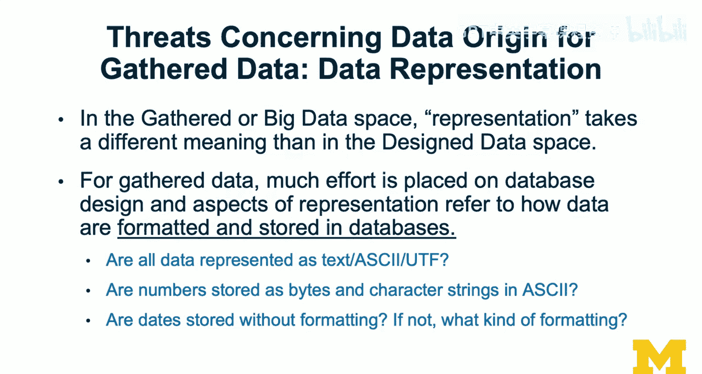
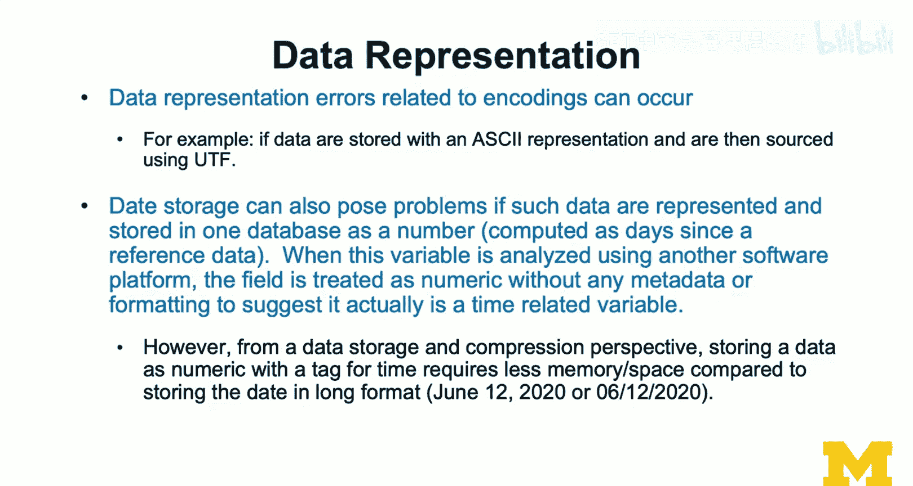
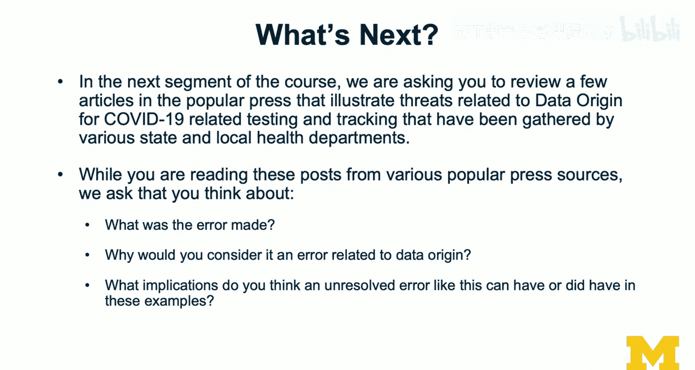
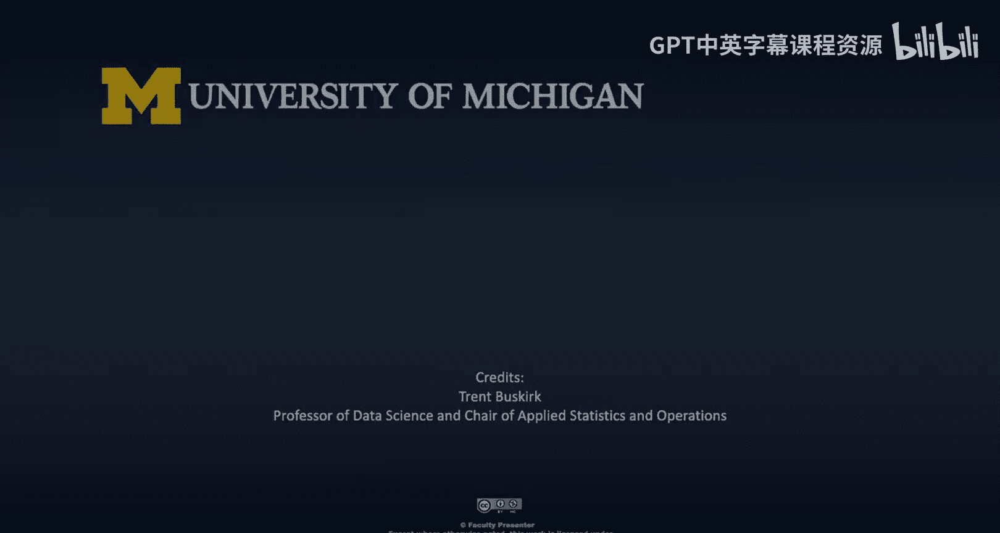

# 密歇根大学《总体数据质量（框架、度量、设计策略）total data quality》 p17 16_采集型数据溯源威胁因素.zh_en -BV1Jn4y1X7uS_p17-

Hello， welcome back。 We're going to talk about threats from data origins for gather data。

 I'm Trim Busker。 I'm happy to have you back。 Let's get started。😊。

It's really important to keep in mind the definitions that we're talking about when we go through all of these different threats and dimensions of data quality。

 and there are some nuances between the design data aspect and the gathered data aspect。

 and we're going to try to point those out whenever we can and whenever they exist。 General speaking。

 the definitions are consistent between design and gathered data。

 But the nature of those data are different。 And so there are some nuances that we'll cover。

 Here's an example of that。In general， data origin refers to questions about how were individual values or data points for a given variable。

 recorded， captured， gathered， computed or represented。 So a lot of words there。

 But the main takeaway is， were there any errors in the process that ultimately produce the value for the variable that we have to use for our analyses。

In design data， we've seen things like interviewer effects， social desirability， reporting errors。

 etc in the survey responses。In gather data， we don't have that sort of survey response or that human element in response。

 but what we do have is issues with the process of creating or retrieving the values for the fields of interest。

 We're going to go through several examples of threats here to help make this more clear。

It's also important to know where we are on the dimensions of total data quality。

 so where data origin falls on the measurement side in between the variable field and data valued portions。

Some of the main threats concerning data origin for gathered data concern things like incorrect data。

 aggregation or variable computation。Reporting are recording errors in administrative data。

And mixing of units of measurement or missing units of measurement。 For example。

 one scrapes0illow and gets lot size data， but any unit less than one is in acres where most of the lots are measured in square foot in square feet。

If you look at this resulting data， you might get a large range that is something like 0。

01 all the way up to 100，000， and you might think that that's referring to square footage because most of the lots are measured in square feet。

However， this might screw up the range of data that you would otherwise expect to be somewhere in the thousand square foot range and above。

 for example。Technology and processing related threats also exist。 These are around instrumentation。

 error。What happens to the sensors when you're recording information， for example。

 variation in technology as it relates to recording or tracking information such as location。

 Are we using Wi Fi signals to get GPS location， Are we using cellular signals， for example。

Annotator， translator and transrir error when working with organic。

 qualitative data to record that information into the repositories。

Additional manifestations of errors also occur。 errors in consistency resulting from the lack of metadata regarding variable definitions or the meanings of recorded information。

The missing units information is a really important example of this。

 where I don't know if a lot was recorded in acres or square footage。

Errors in consistency when combining information across multiple sources。

There's county level data test results across multiple health systems using different diagnostic tests or screening criteria may be combined into a single test results category。

 but within that category we might be talking about different tests。

 we might be talking about antigen antibody tests and also the regular COVID tests， for example。

 all recorded as COVID tests in a single column of data。

This could create more variability than we might be expecting from a single column of data when we get to the analysis phase。

 for example。We also might have temporal validity issues related to data that are recorded at different time points for various fields in a data set。

And also data integrity issues around representation of information that is not consistent over time or across sources。

 we alluded to that a little bit in the consistency comment earlier。

Data representation is another threat concerning data origin for gathered data Now this is a little bit confusing because in the design data we talk about representation in general to be population representation and we have a representation side of our total dimension。

 total data quality dimension， but in the gathered data or big database space representation takes on a slightly different meaning than we had it for the design database space let me clarify for gathered data。

 much of the effort is placed on database design and the aspects of representation referred to how data are formatted and stored in databases。

 So when I say representation for gathered data or data representation for gathered data。

 I'm really referring to how these data are formatted and stored in databases so that when we access them were。

Going to get this kind of data。So the questions about， are all the data represented as text。

 ASI or UTF format， for example， are numbers stored as bytes or character strings in ASII。

 Are dates stored with or without formatting if they have formatting what kind of formatting。

Let's talk a little bit more about data representation for gathered data because this is slightly different than in the designed data space。

Data representation errors related to encodings can occur。 For example。

 if I have data stored with an ASI representation， and then I source that data using UTF。

Conversion errors can occur， and those are data representation errors that I'm talking about。

Data storage can also pose problems if such data are represented and stored in one database as a number computed。

 say， for example， as the days since a reference date。

When this variable is analyzed using another software platform。

 the field is treated as numeric without any additional metadata to suggest that it's a time related variable。

However， from a data storage and compression perspective。

 storing a storing data as numeric with a tag for time requires less memory or space compared to storing it in long format in long date format。

 so it takes less information and less memory to store data as a number compressed。

But with additional metadata to translate it into its date format。

 then to actually store all the dates as June 12， 2020 or the format that you see here。

So the way that the data are stored and represented in the data file can impact overall memory。

And in storage requirements or size requirements， but it can pose threats to data quality if we're not able to translate that information appropriately。

Let's take a few moments to look at some examples for data origin threats， for gather data。

Wouts and colleagues in 2017 looked at how cost estimates for particular products were impacted by both human and machine errors。

They were trying to estimate how expensive it was to make particular products。

 And they found that when they were tracking both the labor and the machinery that was required to compute total cost estimates。

Errors in time sheets and the machine errors themselves created issues with their overall cost estimates。

Miishra and colleagues in 2016 reported on how noisy human labels created problems for models that were trying to classify images。

This is essentially a rate in reliability and validity issue that we see in the design data space。

 as well。There was also some recent evidence of annotator bias in studies that used crowdsourcing for natural language processing。

Especially when these studies used too few annotators to generate the training data。

 they found biases existed when they tried to apply those models to data outside of the training data sets。

This is very similar to the problem that we have with interviewer effects in design survey data with human interviewers。

Let's talk a little bit about what's coming up next。In the next segment。

 we're going to be asking you to review a few articles in the popular press that illustrate threats related to data origin for Covid 19 related testing and tracking that were gathered by various state and local health departments。

 While you're reading these posts， we'd like to ask you to think about the following。

What were the errors that were made。Why would you consider it an error related to data origin？

And what implications do you think an unresolved error like this can have or did have in these examples？

Until next time， Thanks a lot for joining us。

