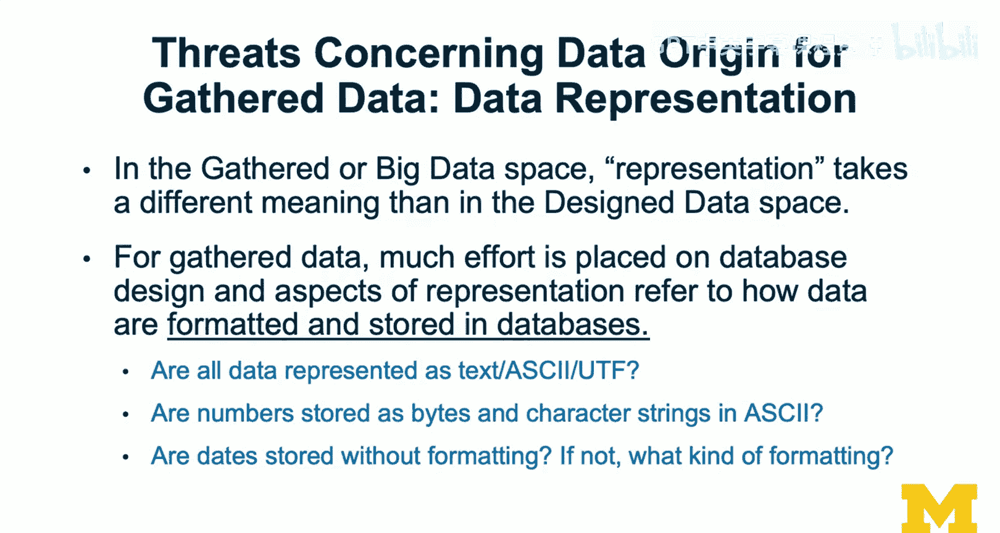
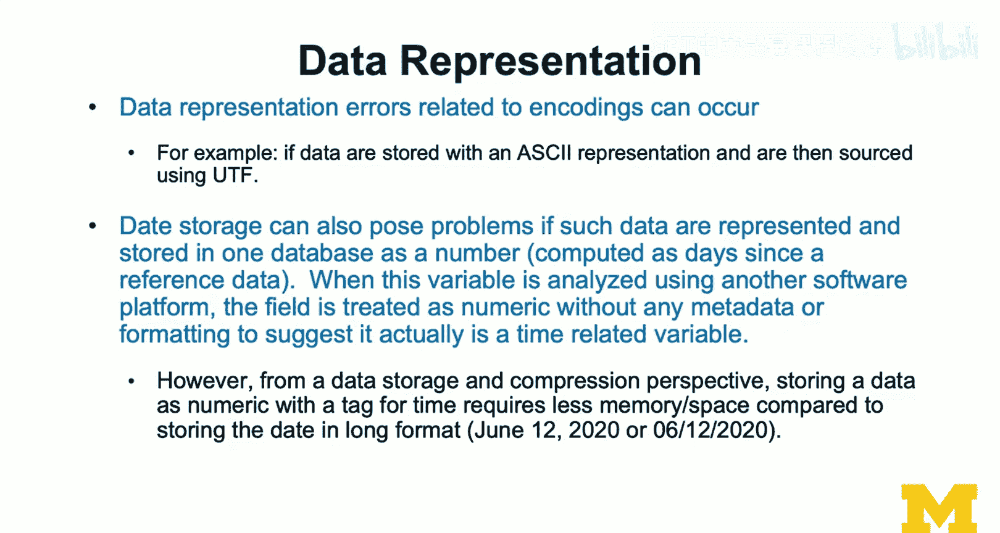
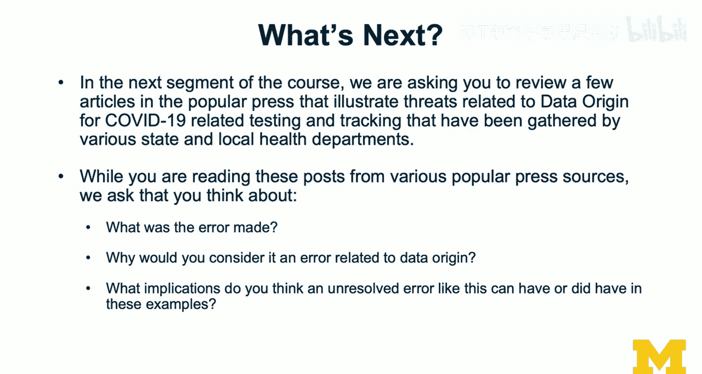

# 总体数据质量：16：采集型数据溯源威胁因素 📊

在本节课中，我们将学习采集型数据在数据溯源维度上面临的主要威胁。数据溯源关注数据值是如何被记录、捕获、计算或表示的。我们将探讨这些威胁的具体表现，并通过实例理解它们对数据分析的影响。

---

在深入探讨具体威胁之前，需要明确数据溯源的定义。当我们讨论数据质量的各个维度和威胁时，牢记定义至关重要。设计型数据和采集型数据在数据溯源方面存在一些细微差别，我们将尽可能指出这些差异。

总体而言，数据溯源涉及的问题是：针对给定变量的各个数值或数据点，是如何被记录、捕获、收集、计算或表示的。核心要点在于，最终生成我们用于分析的变量值的过程中，是否存在任何错误。

在设计型数据中，我们见过诸如访问员效应、社会期望偏差、报告错误等存在于调查响应中的问题。而在采集型数据中，虽然没有那种调查响应或人为响应因素，但我们面临的是为感兴趣字段创建或检索数值的过程中的问题。

了解数据溯源在总体数据质量维度中的位置也很重要。它在测量侧，介于变量字段和数据值部分之间。

---

以下是采集型数据在数据溯源方面的一些主要威胁：

*   **数据聚合或变量计算错误**：在汇总或计算数据时出现错误。
*   **行政数据中的报告或记录错误**：在行政记录过程中产生的错误。
*   **计量单位混淆或缺失**：例如，抓取土地面积数据时，小于1的数值单位是英亩，而大部分地块是以平方英尺计量的。这会导致数据范围异常，可能被误认为是平方英尺。

技术处理相关的威胁同样存在：

*   **仪器误差**：传感器在记录信息时出现的问题。
*   **技术差异**：与记录或跟踪信息（如位置）相关的技术差异。例如，是使用Wi-Fi信号还是蜂窝信号来获取GPS定位。
*   **标注者、翻译者和转录者错误**：在处理有机的定性数据并将其记录到存储库时产生的错误。

错误的其它表现形式还包括：

*   **因缺乏元数据导致的**一致性错误**：缺少关于变量定义或记录信息含义的元数据。缺少单位信息就是一个重要例子。
*   **跨多源合并信息时的**一致性错误**：例如，将使用不同诊断测试或筛查标准的多个卫生系统的县级检测结果合并到单一的“检测结果”类别中。该类别可能包含抗原/抗体检测和常规COVID检测，这会在分析阶段引入超出预期的变异性。
*   **与时间有效性相关的问题**：数据集中不同字段在不同时间点记录所引发的问题。
*   **与数据完整性相关的问题**：信息表示方式随时间或来源不一致。我们在之前的一致性评论中略有提及。

---

上一节我们介绍了数据溯源的一般性威胁，本节中我们来看看一个需要特别说明的概念：**数据表示**。

数据表示是采集型数据溯源的另一个威胁。这可能有点令人困惑，因为在设计型数据中，我们通常将“表示”理解为总体代表性，并且在总体数据质量维度中有一个“代表性”侧面。然而，在采集型数据或大型数据库领域，“表示”的含义与设计型数据库空间略有不同。

让我澄清一下：对于采集型数据，许多工作集中在数据库设计上，而“表示”方面指的是数据在数据库中的格式化和存储方式。因此，当我说采集型数据的表示或数据表示时，我指的是这些数据在数据库中如何被格式化和存储，以便我们访问时能得到特定类型的数据。

相关问题包括：所有数据是否都以文本、ASCII或UTF格式表示？数字是作为字节还是ASCII字符串存储？日期存储时是否带有格式？如果有格式，是哪种格式？

---

让我们更详细地讨论采集型数据的数据表示，因为这与设计型数据空间略有不同。

与编码相关的数据表示错误可能发生。例如，如果数据以ASCII表示形式存储，而我使用UTF编码来读取这些数据，就可能发生转换错误，这就是我所说的数据表示错误。

数据存储也可能带来问题。例如，假设数据在一个数据库中被表示和存储为一个计算出的数字，比如自某个参考日期以来的天数。当使用另一个软件平台分析此变量时，该字段被当作纯数字处理，没有任何额外的元数据表明它是一个与时间相关的变量。

然而，从数据存储和压缩的角度来看，将数据存储为带有时间标签的数字，相比以长日期格式存储，所需的内存或空间更少。因此，以压缩数字形式存储数据所需的信息和内存更少，但需要额外的元数据将其转换回日期格式。

---

数据在数据文件中的存储和表示方式会影响总体内存和存储或大小要求。但如果我们无法恰当地转换这些信息，它就可能对数据质量构成威胁。

让我们花点时间看一些采集型数据溯源威胁的例子。

*   Wouts及其同事在2017年研究了特定产品的成本估算如何受到人为和机器错误的影响。他们发现，在追踪计算总成本估算所需的劳动力和机器时，时间表上的错误和机器自身的错误给他们的总体成本估算带来了问题。
*   Mishra及其同事在2016年报告了嘈杂的人工标签如何给试图分类图像的模型带来问题。这本质上也是我们在设计型数据空间中看到的信度和效度问题。
*   最近还有一些证据表明，在使用众包进行自然语言处理的研究中存在标注者偏差。特别是当这些研究使用过少的标注者来生成训练数据时，他们发现将这些模型应用于训练数据集之外的数据时存在偏差。这与设计型调查数据中人类访问员带来的访问员效应问题非常相似。

---

在下一节中，我们将要求您回顾一些大众媒体上的文章，这些文章说明了由各州和地方卫生部门收集的、与Covid-19检测和追踪相关的数据溯源威胁。在阅读这些文章时，请思考以下问题：出现了哪些错误？为什么你会认为这是与数据溯源相关的错误？你认为此类未解决的错误可能或已经在这些例子中产生了什么影响？

---

本节课中，我们一起学习了采集型数据在数据溯源维度面临的主要威胁。我们明确了数据溯源的定义，区分了其与设计型数据的细微差别，并详细探讨了包括数据计算错误、单位混淆、技术误差、一致性问题和数据表示错误在内的多种威胁。理解这些威胁是确保后续数据分析可靠性的重要基础。