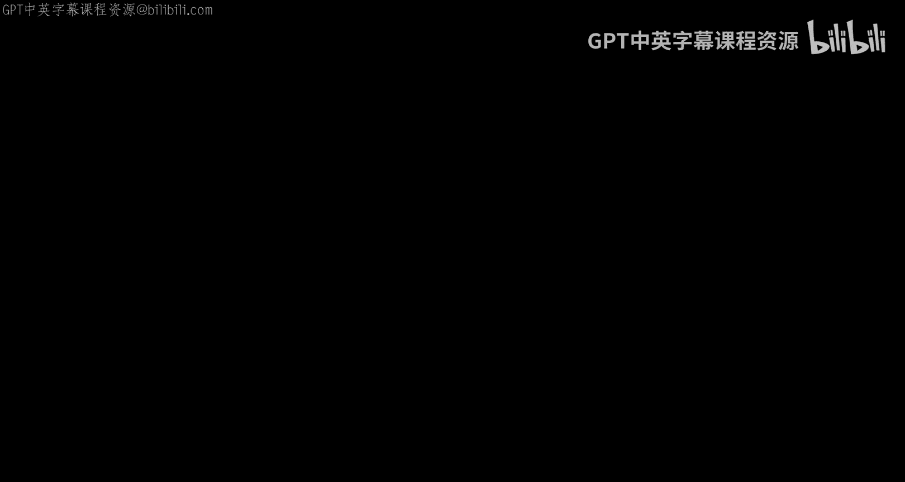
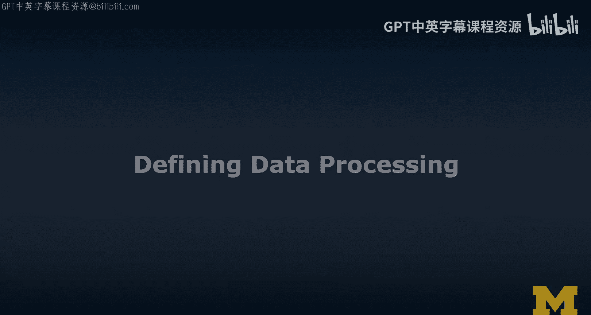
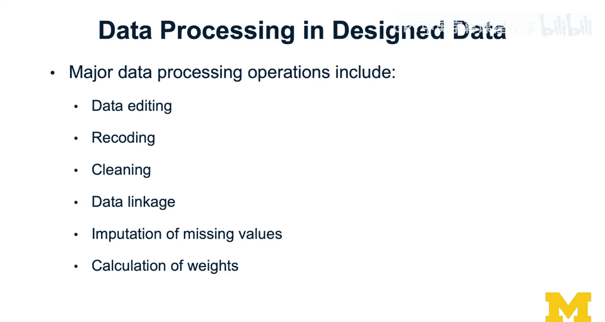
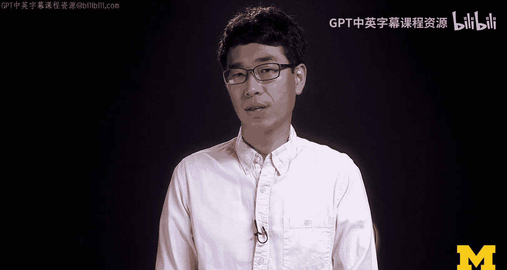
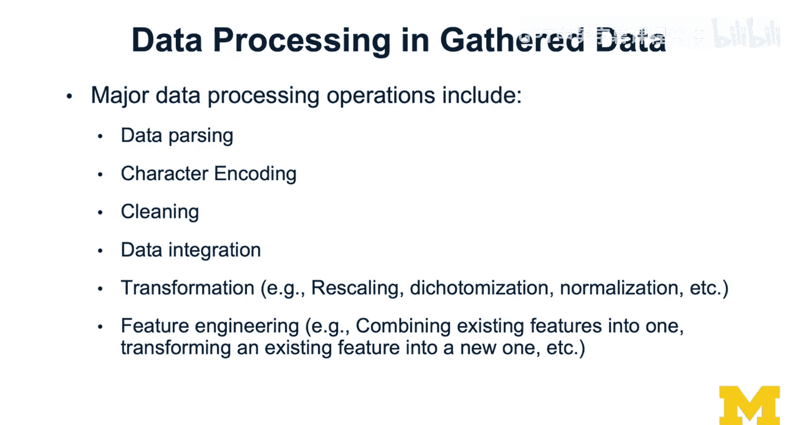
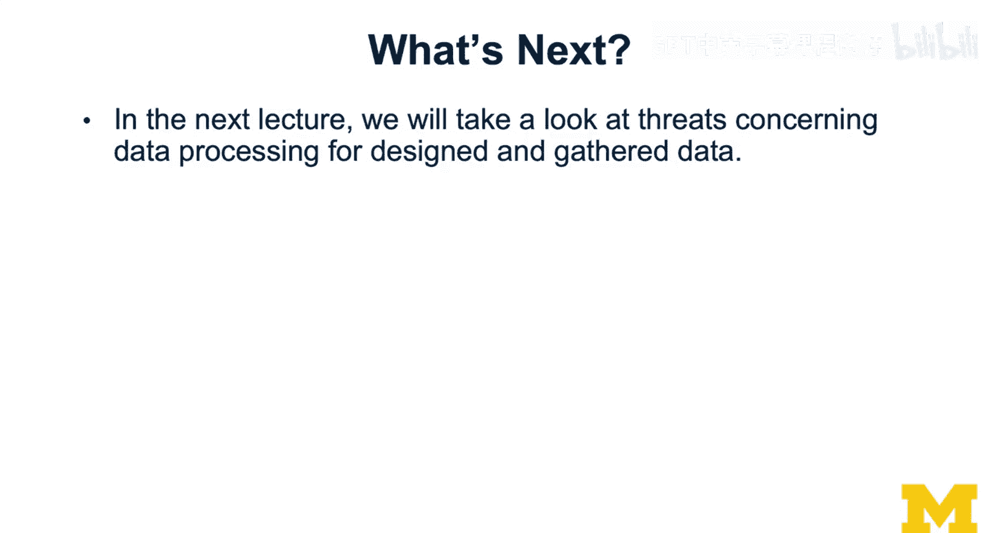
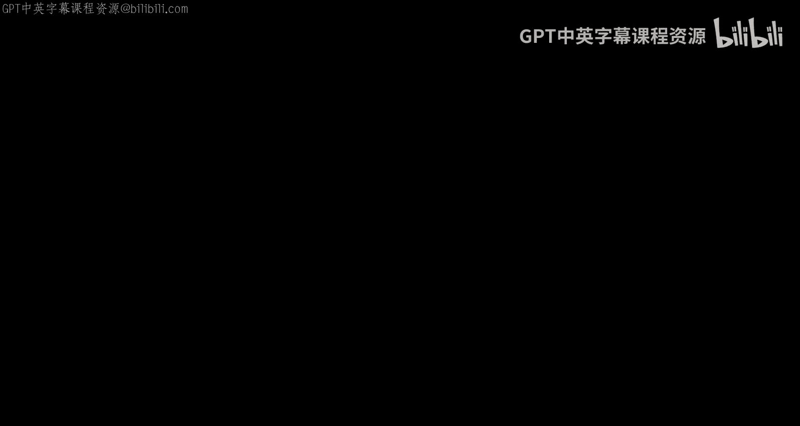

# 密歇根大学《总体数据质量（框架、度量、设计策略）total data quality》 p18 17_数据处理的定义与流程.zh_en -BV1Jn4y1X7uS_p18-

Hello everyone， I am Jinse Kimim in this lecture you will learn about definition of data processing。

First， let's revisit the big picture。

In previous sections， you have looked into validity and data origin。

 Now we are going to look at data processing。In data processing， we take in data values， edit them。

 and produce edited data， which will be used for data analysis。

That is the third measurement dimension of the total data quality framework。First。

 let's give you a definition of data processing。Data processing is a series of operations to collect。

 convert and manipulate data into formats that are usable for extraction of meaningful information in a broad sense we could include data analysis as a typepo data processing that is because in a data analysis stage you might merge and convert data values to conduct analysis。

 but usually data processing refers to the early stage between data collection and data analysis In addition。

 you might you might have heard data preprocesing in computer and information science data preprocessing is a term used interchangeably with data processing。

Data processing for design data includes data editing， recording， cleaning。

 data linkage when you merge different data sources。

 imputation of missing values that is prediction of missing values in design data sets and calculation of weights or variables which are used to make statements about large population。

 these are types of data processing for design data。

For gather data， in the other hand， data processing can include data parsing， character encoding。

 cleaning， data integration， transformation， which could include rescaling。

 deccarbonomization and normalization and feature engineering。

 which is computing new variables from existing variables in the gather data。

These are several types of data processing that might occur for gather data。

Now you learn the definition of examples of data processing in designed and gathered data in the next lecture we will take a look at threads concerning data processing for designed and gather data。

