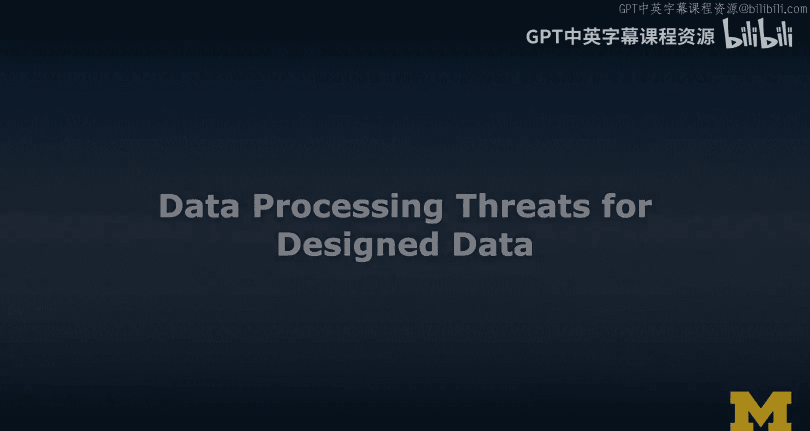
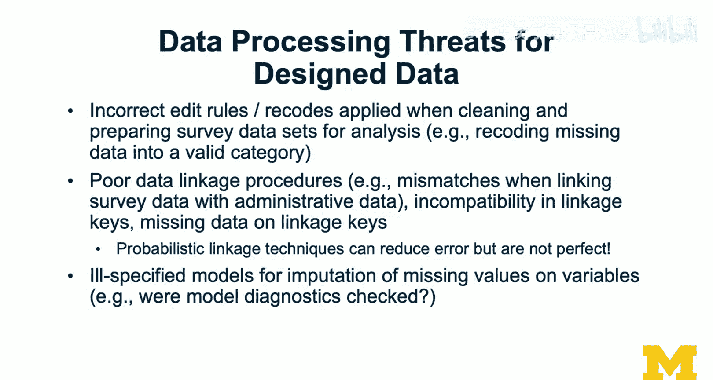
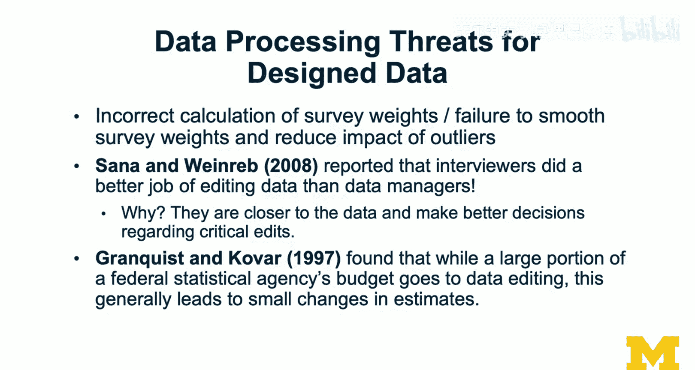
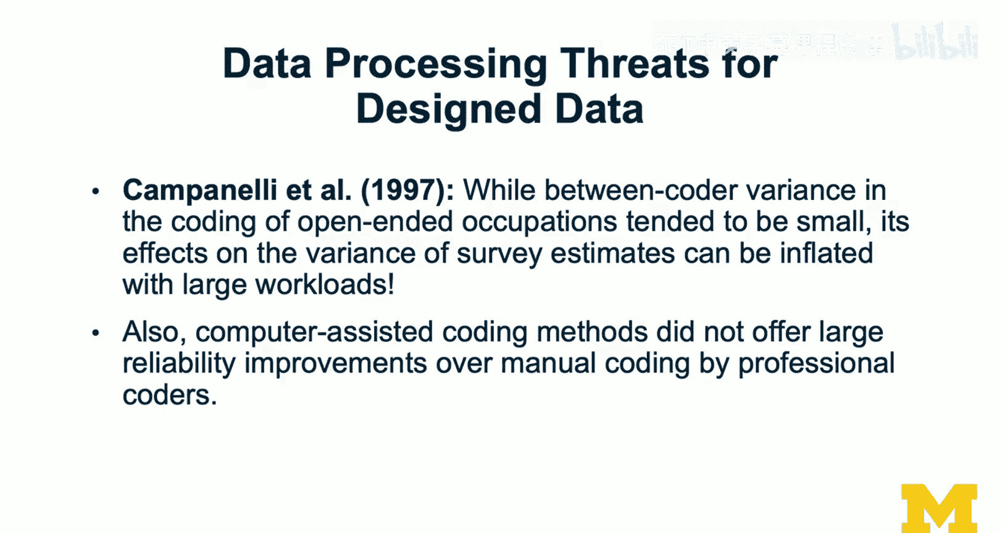
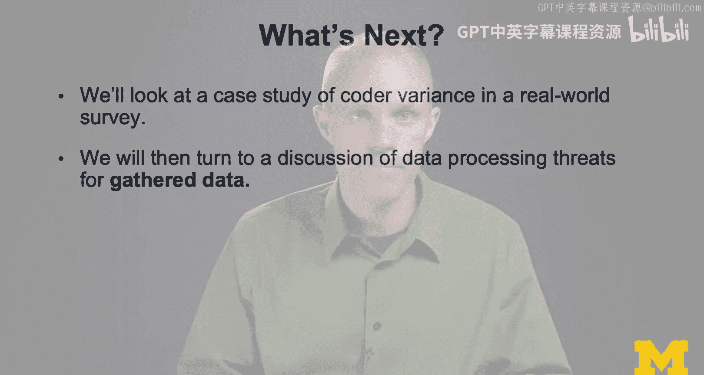
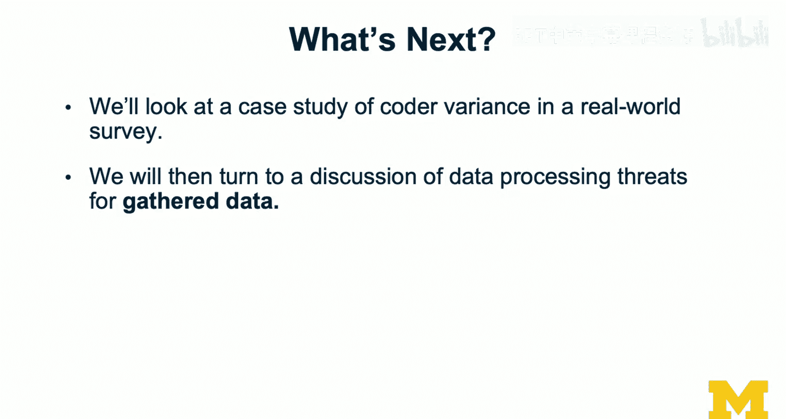

# 密歇根大学《总体数据质量（框架、度量、设计策略）total data quality》 p19 18_设计型数据处理威胁因素.zh_en -BV1Jn4y1X7uS_p19-

Okay， hellello everyone， now that we've discussed a definition for what we mean by data processing and where it fits in the overall total data quality framework in this lecture we're going to be discussing some data processing threats specifically for design data。

Okay， so back to revisit our big picture of the total data quality framework now we're talking about that that transition from the data values that we actually collect in our study used to populate our variables fields of interest going from those data values to the actual edited data that we're ultimately going to be using for analysis so the step of processing the data that we've collected and cleaning them up for the purposes of eventual analysis。

 so this is the third measurement dimension that we're focusing on in terms of the total data quality framework。

So what are some data processing threats for design data first of all。

 incorrect editing rules or recodes might be applied when cleaning and preparing survey data sets for analysis so for example。

 you might recode missing data into a valid category strictly by accident we're missing values on the variables of interest that we collected via the code that we're using to clean the data may be incorrectly replaced by valid values because we're not careful in the code that's being used to edit and recode the data。

We could also run into poor data linkage procedures where， for example。

 there might be mismatches when you link your survey data that you've collected with administrative data that you wanted to tie to the survey responses。

There could also be incompatibility in linkage keys。

 so if there are ID variables in different data sets that you're using to link together。

 maybe they're not in the same format or maybe they have a different number of characters or something like that or there could be missing data on the linkage keys where again the linkage keys or variables that are being used to merge different data sets together so one data might have a valid value for a given case on this linkage key。

 but the second data set that you're using to merge to the original data might have a missing value for that particular ID and so we're unable to perform the linkage。

In these settings， probabilistic linkage techniques can be used to join dataset sets together。

 but these are not perfect and they can introduce error as well as these other linkage problems。

 so these are techniques that we'll talk more about forting around these processing issues。

 but they can still reduce error and entirely they're not entirely perfect。Furthermore。

 we could have ill-specified models for what's called imputation of missing values on variables of interest。

 So imputation is a method that's used to predict what the values of variables with missing data should be as opposed to just accepting a missing value on that variable。

 So if we're using statistical models to develop predict predictions of what these missing values should be。

 We have to make sure that those models make sense that they provide a good fit to the observed data and that they're going to be likely to produce actual predictions for those cases that had missing values on the variables of interest。

 We want to make sure that we're using good models to try to predict those missing values。 So again。

 this is all part of the process of cleaning a data that we've collected， fixing missing data。

 linking data sets together， recoding variables， these are all processing steps and we have to be careful with all these threats when we're ultimately cleaning that data。

Some additional examples， incorrect calculation of survey weights or failure to smooth survey weights and reduce the impact of unusual survey weights。

 so in design data collections， especially with large national probability samples。

 we often have to worry about survey weights for overall analysis and when data producers are creating these survey data sets for the public to work with。

 they tend to provide survey weights so that people can do weighted analyses and we'll talk more about this when we get to analysis。

 but the data producer needs to be very careful when they're processing these survey weights and make sure that they're being computed correctly so that they serve their intended purpose。

This article by Sanna and Weinreb in 2008 found that interviewers actually do a better job of editing survey responses than data managers Now why might that be the case because the interviewers are closer to the data collection。

 They're the ones out in the field collecting the actual data and they may make better decisions regarding critical edits to responses so they might hear a rather unusual response from a survey respondent。

 they have to make that fit into one of the different response categories that are available they may do a better job of that kind of editing data than data managers on the back end who are ultimately responsible for processing the data so many surveys allow the interviewers to make edits when they're recording their responses to survey questions。

For this particular reason。

Grantquist and Kovar in this 1997 article also found that while a large portion of a federal statistical agency's budget goes to these data editing steps。

 this generally leads to small changes in estimates。

 so there's a lot of time and attention spent on data editing as there should be。

 but overall in terms of the estimates that we're interested in generally a lot of changes in processing don't lead to substantial changes in the overall survey estimates that we would be reporting。

 So data processing there can be some threats for design data。

 but generally they tend to be less impactful than some of the other measurement dimensions that we've been talking about。

This other article by Pam Campanelian colleagues in 1997 found that while between coder variants in the coding of open ended occupations tended to be rather small。

 so this is related to the idea of interviewer variants that we were talking about previously where different people may be coding open ended responses to surveys and producing numeric values that we can ultimately analyze。

The effects of this between coder variant on the variability of our survey estimates content to be inflated if those coders are given very large workloads。

 so if different coders are tending to code openend occupations， for example。

 differently and those coders are given extreme workloads。

 the impact of that variability between coders and how they ultimately do their coding of the open-end responses content to be inflated。

 so we have to manage the workloads of people tasked with coding these kinds of open-end responses to prevent this between coder variant from having a bigger impact。

Also， they found that computer assisted coding methods do not offer large reliability improvements。

Over manual coding by professional coders。 So if we try to offer or if we try to invest resources into kind of automated computer assisted coding processes as opposed to using human coders to do the coding of open ended survey responses。

 we don't really get huge improvements。 So if there's a lot of programming required to do that。

 it may be better just to go ahead and use human coders to go through that process as it is。

Okay， so what's next in our discussion of processing first of all。

 we're going to look at a case study of between coder variants in a real world survey。

 so we'll illustrate what we mean by this notion of between code variants when human beings are being tasked with coding open ended survey responses we're then going to turn our discussion to data processing threats specifically for gathered data。

Okay， thank you。

