# 密歇根大学《总体数据质量（框架、度量、设计策略）total data quality》 p20 19_案例研究：编码者间差异性分析.zh_en -BV1Jn4y1X7uS_p20-

Okay well welcome everybody in this example what we're going to do is think about what we referred to as between coder variants as a quality issue when we think about taking open-ended data and assigning either numeric codes or qualitative labels to that open-ended data and we could be thinking about assigning codes to open-ended text that might be provided in a survey or might be available and gathered data。

 we could also think about the process of coming up with labels for images as a form of data and we're going to see two examples of how we go about doing that today and our focus is really going to be on thinking about this notion of between coder variants。

 the idea that if two different trained coders are looking at the same set of open-ended text or they're looking at the same images。

 there's a possibility that they could vary in terms of the numeric code or the label that they。

signed to that particular piece of information and that's where we're getting data from in this case to analyze ultimately for a research study that we might be interested in working on so this is an important part of the overall quality processing and processing this kind of openended data so what we're going to do in in this little case study here is we've invited two students to come and serve as example coders for a couple pieces of information that we're going to provide to each of them we're going to have the students come on and introduce themselves and then they're going to be tasked with coding some open-ended text responses about occupations and they're going to be tasked with coding some images that we've selected and see what labels they would assign to each of these different images now one type of coding system that's used a lot in different types of data collections is one that assigns numeric codes to open-ended occupations that people。

Describe in particular research studies and so what i'm going to put up on the screen right now in a second here is。

What's called the standard occupational Class manual and this is a federal document that's produced by the Office of Management and Budget of the US and what this manual does is it assigns numeric codes or classifications to different possible occupations so you can see up here on the screen。

 some examples， management occupations， business and financial operations occupations。

 life physical and social science occupations and so when we have designed data collections like surveys or you might be looking at gathered data where you have a list of open-end descriptions of occupations and important process task might be to assign these open-ended occupations。

 to these different codes for the purposes of eventual data analysis and that's what our first exercise in this session is going to look at is that process of asking different human coders to assign these numeric codes。

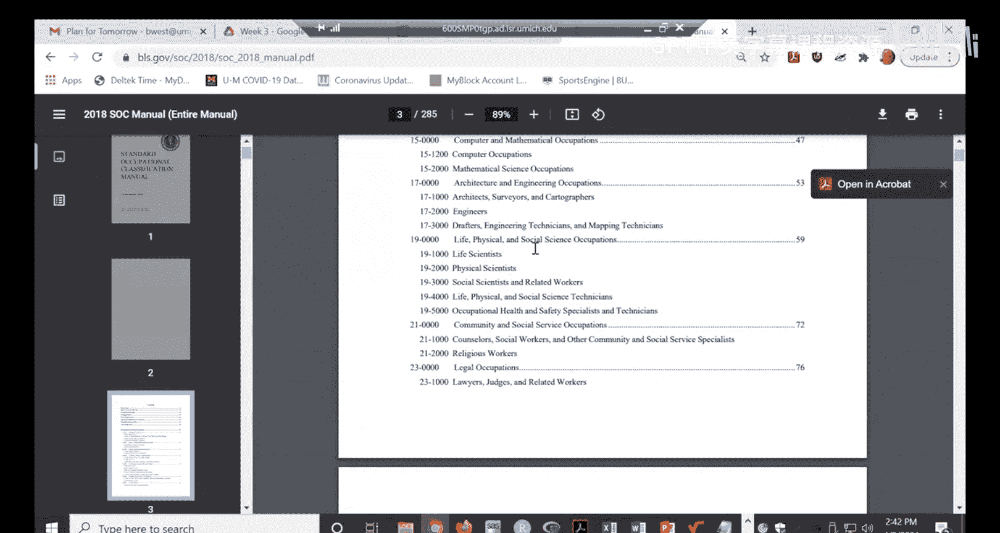

To sets of open ended information。Okay， so we'll refer back to this this overall coding document。

 but this is just one example of a typical set of numeric codes that might be applied to this kind of open ended text data。

 okay。Okay， so we're going to start by bringing Irene Ong who's a student of James and mine in the Michigan program and Survey methodology。

 we're going to start by inviting Irene into the session。

 so Irene if you want to turn on your camera。Okay， welcome， Irene， thank you for joining us today。

 so maybe we could start just by if you could say a little bit about yourself。

 your background and your current status as a doctoral student。

 our program we'll get to know you a little bit。Yeah hi i'm Irene I am a current PhD student in the survey methodology program I'm in my fourth year my dissertation is about responding driven sampling and I'm really excited to be。

Doing this coding。Great， thank you so thank you Irian for joining us Okay。

 so what we're going to do as this illustration of between code variant。

 I'm going to put up on the screen a hypothetical survey response say in a design data collection where we've asked a survey respondent to provide an open-ended description of their current job in text and then Irene's been asked to take a look at that classification manual for occupations that we were just showing on the screen a couple minutes ago and Irene's going to look through that and try to choose the code that she thinks is most appropriate for that openended text occupation that I'm going to throw up on the screen okay so I'm going to share here one hypothetical response so we're going to go through two of these responses for each each of our students in this session so the hypothetical openended text response in this case is the survey respondent has said that they are。

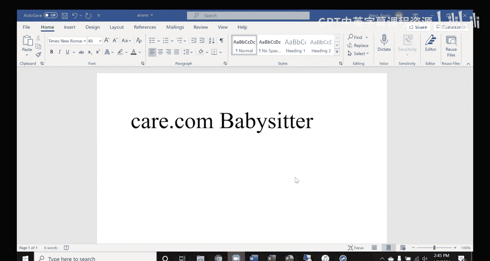

Babysitter for care。com and so again the task Irene is to go through that that manual and then think of what code you would ultimately select to classify that occupation Okay I'm going to go to the manual now and take a look at the codes。

嗯。Doesn't seem like the front ones。嗯。Guess。It doesn't seem like healthcare。

 maybe healthcare practitioner。Probably。The healthcare support occupations that seems like a correct category。

3 one。1，100311100 Okay so in a in a hypothetical coding operation what Irene would do is probably enter this into a form or a document that would eventually become part of a larger data set where these openended survey responses have been coded into these categories and though those categories is what we would ultimately use for analysis so I'm going to record Irene's code here and will come back to her her choices later Okay。

 so the second set of open endeded text is mechanical engineer at Ford。

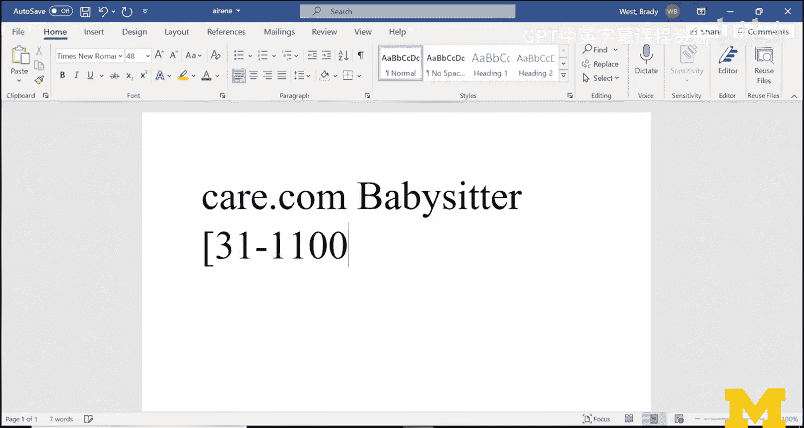

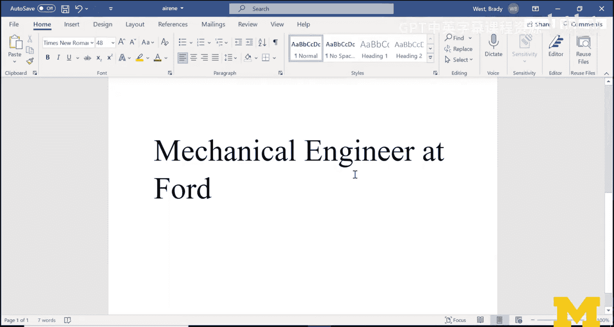

All right， let's take a look at that。This is not management， not business。

Not computer and mathematical。Well， it's right there， architecture and engineering occupations。

 probably 17-2000。

There's 20，0，0 Okay， excellent Okay， so I'm going to save this particular set of codes as Irene's document and then we're going reset these codes for our second student Okay。

 so Irene， thank you we're going to come back and revisit your selections after we've had Robert enter his particular codes。

 Okay， so Irene， if you could turn off your camera and then Robert， if you want to join here。

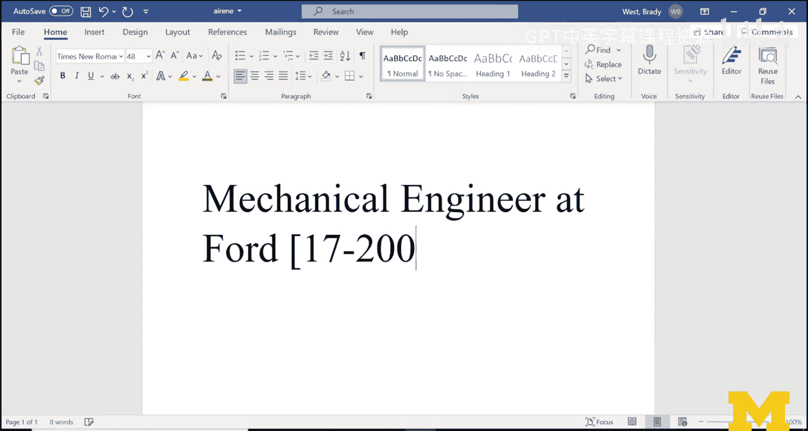

Okay， hi， Robert， I'm going to reset the document here and then save this updated document。

Under your choices。Okay， great。Okay， so Robert， if you'd like to say a little bit about yourself。

 your background and your current status as a student in our program。

 that would be good to allow us to get to know you as well。

Hi I'm Robert， I am a first year graduate student in the master's program here at Michigan and then I work with some of the professors here on some other projects within the Institute。

Great thanks Robert， okay so again， just as a reminder here。

 we're going to provide you with two sets of open ended text and we're going to ask you to scroll through that occupation classification manual and think about the choices that you would make for each of these sets of tech so we're going to start with this first choice which was care。

com babysitter。So if you look through that manual， which code would you choose to ultimately assign to that occupation？

One， let me open it up honestly a screen。The first one is kind of sightency。We个。

Maybe educational that could possibly be one or maybe the healthcare。

Healthcare could possibly be on as well。But。呃。Community and social service let's go 211000 because it's counselors。

 social workers and other community and social service specialists。

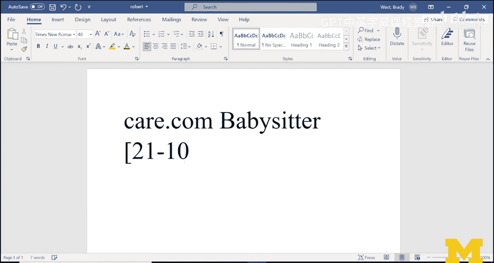

Okay， great yeah that sounds reasonable so so again you can see for some of these kinds of openend text。

 even if you have a welldefined coding system like the one that we were looking at that Robert and Irene have been looking at there still may be some open-end responses that people provide which are difficult and somewhat ambiguous to assign to one of these codes and that can be a source of the kind of between code variant that we're worried about as a threat to data quality in this particular aspect of of the coding okay okay thanks Robert let's go to the next one the next openend response is mechanical engineer at Ford so how would you how would you code that one。

😊。

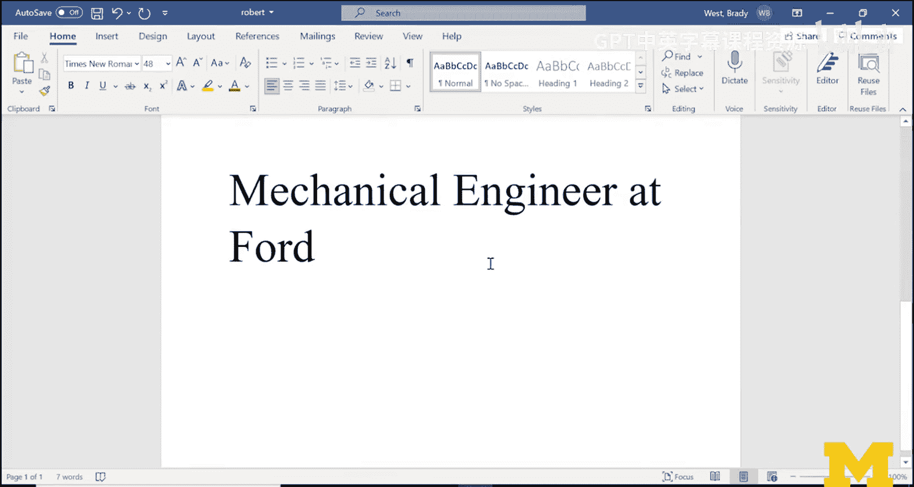

下。There is right off of that in architect and engineering operation so that may be it。

 but then a little bit further down there's a design that could also be it if they're designing something lets see what else。

Get into them the constructions and stuff。嗯。Let's go with the。

The 172000 engineers because it's the closest to resemble it appears the exact match Okay。

 so we'll go with with 172000 okay great。Okay thank you very much so so in this typical kind of operation then you can see that Robert and Irene have provided their codes on each of these openend responses and if you think of taking this up to scale if you have a big survey data collection or you have a big set of gathered data where you have to assign these kinds of quantitative codes to each of these different openend responses you can see how this becomes a bit of a large job and their individuals who do this kind of processing as a part of their careers and these individuals have to be welltrained to make sense of these different sets of open-ended text and a standard quality control procedure is to have some of these responses be coded by multiple individuals and as part of that process if there's a discrepancy between the codes assigned to a given open-end response if we're forming a final data set that's eventually going to be used for analysis。

 we want to have some kind of meaning of the minds or discussion or validation part of the。

where we can sit down go over those potential discrepancies and then think about what the ultimate choice should be Okay so that's what the next step here is going to be is we're going to bring Robert and Irene both back at the same time I'm going to open both documents here。

And so that we have them available and then we'll talk about kind of the rationale for choosing each of these different codes and what would ultimately be assigned as kind of a final code in the data set that we'd be producing for the ultimate analysis that a research team might be interested in okay so Robert and Irene if you'd like to turn your cameras back on So now typically that those codes would be done independently know so that Robert and Irene might be you know entering these codes into a system at different points of the day or different days or whatever the case may be but they would be doing this separately from each other in this case for purposes of illustration we're having them kind of do this one after another but hypothetically in independent fashion but what we would do now with the data is go through each of their numeric codes find the discrepancies and then institute some type of process to resolve those discrepancies So if we look at the two documents here Irene chose 311100 and Irene again can you。

Remind us what that what that label was in text so 311100 is home health and personal care aids。

 nursing assistance， orderlies and psychiatric aids。Seeing assistance。😔，Orderlies。

And psychiatry aids and psychia aids okay I always put it etc for now okay and so Irenes Irene selected this code and if we look at Robert's document Robert you selected 211000。

 can you remind us what that code was？Yeah， that is counselors。

 social workers and other community and social service specialists。Okay。

 so if we think about a babysitter， you can see that both of these choices of codes are perfectly reasonable and so the job of kind of a third partyy I don't know litigators the right word but somebody who can make a decision about this discrepancy somebody who with pretty solid knowledge of these particular occupations would at this point need to come in and work with Robert and Irene to make a decision about what that final code would be so you know we might look at these definitions and say well what is a babysitter really doing are they a social worker are they a social service specialist are they a counselor they're probably not fitting these different kinds of occupations where presumably you'd have to have some kind of training or degree to play a role in this kind of occupation if we look back at Irene's particular choice these are home health and personal care aids assistance orderlies it seems like the notion of a babysitter might fit a little bit more into the category。

That Irene selected， even though Robert's choice was perfectly reasonable and this is where somebody with subject matter knowledge has to step in and say okay I think that in this particular case we'd probably choose 311100 as being a slightly better fit for them saying that they were a care co babysitter given the description of this particular occupation and you know sometimes it might take a little bit of discussion to resolve these kinds of discrepancies but we need an independent thirdparty individual to come in and ultimately make a decision about what the most appropriate code would be so in this case you know this was a tricky one because they said they were a babysitter if we move on to the second code where the respondent said that they were a mechanical engineer at Ford here we have in these documents let's take a look Robert selected 172000 and Irene also selected 17-2000 so in this case they assigned these。

codes that were in perfect agreement with each other and in that particular case。

 then we would say no need for any kind of resolution of any kind of discrepancy here。

 we would enter that 172000 as the final code for that individual survey respondent in the data set and in doing this。

 we make sure that we're assign the highest quality possible code to the overall to the overall data okay sorry my okay so this was an example of coding openended text okay so you can see how in some cases if coders tend to have different views on what certain terms mean they might systematically assign babysitter to this particular code whereas another coder with a different view of what it means to be a babysitter they might assign a different code whenever they come across that that kind of definition and so that introduces this notion of what we might call between coder variant based on your your kind of view your。

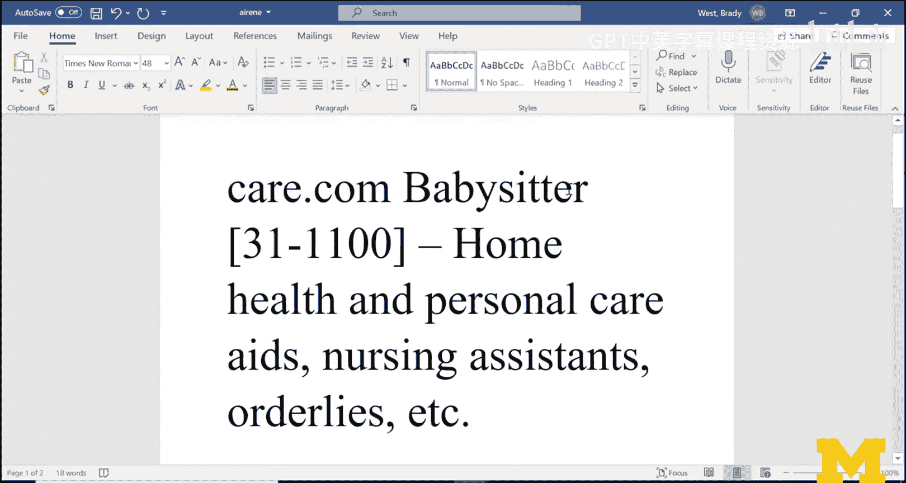

traininging， your view of how the world works， you might have a certain set of definitions or features in mind when you see certain terms and that plays a role in the codes that you ultimately assign and the more that coders vary in terms of how they assign codes to different types of identities or characteristics or whatever the case may be the more the variability that there is between coders the less reliable the data are especially if there's only one person coding a particular response and we don't have an open-ended text response coded by multiple people so that between code variance can become an issue and when we're thinking about the overall quality of this processing step we need to think about how we might resolve that between code variants and try to introduce more quality in the overall process and so this has provided an example of how you might do this for open-ended text okay okay so Rob and Ireen thank you very much we're gonna to shift gears a little bit now and turn to coding of images。

 so I'm going to invite Dr。 Wagner。Back on the screen and James is going to walk you guys through this process again except this time looking at data in the form of images and thinking about how the coding process would work so i'll turn it over to James。

Thanks Brady， so to start I think you know we can say that the process is somewhat similar。

 we're taking a lot of information。In condensing it down we want to put a label on an image and Brady was showing this example where we're taking a lot of words people can say a lot of things when they describe their occupation and converting it into a code that we can then use for another analysis purpose and so coding images often has that same flavor now we could say it's also highly context dependent so let's say。

I'm showing you pictures of zebras， I might show you thousands of different pictures of zebras and I might be interested in more than just the fact that there's a zebra in the image right it might be that we want to know more about what the zebra is doing。

What's the background where are they are they in the zoo are they in the wild or are they on the plains in the Savannah are they somewhere else right so there may be situations where it's highly context dependent on the labeling we're going to ignore that for now we're just going to say what's the very what's the main focus in this image。

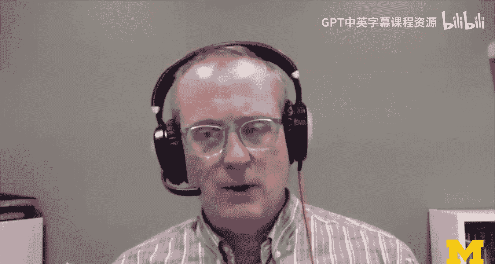

But I have a couple of images I'm going to show you guys and we'll really run through the same procedure。

 I'll bring one of you in， I'll show you the image。

 I'll have you provide a short label for what's the main thing within that image。

And then the other person will come into do the same thing and we'll take a look at what similarities and differences you guys apply in your labeling of those images okay。

 so if you guys can maybe we can start with Irene。I'm going to share a first image with you now again。

😔，Depending upon the context in which this coding is being done。

 there may be different things that are important to the investigator that they ask you to code I'm not asking you to code with the background here looks like this is a rock in the background I want you to tell me what's the main thing within this image。

Well， like it looks like a bug， but。I guess。If I do name the bug。Maybe a cricket， I don't know。

I guess it looks like cricket。Okay， good， thank you。Now the next image。😔，嗯。Okay。

 here's the second image， Irene。What do you think the main thing to observe about this image is？嗯。

The main thing above this image。Guess it looks like。It's doinging something sort of a sport。嗯。

If I have tocode the sport for that。Looks like he's throwing something。

 so I'm guessing it's maybe throwing the ball， maybe。A picture for baseball。Okay， thank you。

So you can leave for a minute， we'll have Robert come in。Robert， welcome。So again。

 our focus here is what's the main thing about this image if we were going to give a simple label。

How would we label this image？😔，嗯。Probably it should just say a bug。

If you're wanting something a little more descriptive。I think it's a grasshopper。

 does that grasshopper green bugs， say grasshopper？All right， great， thank you。

 I've got one other image that we would。Like a label4。What do you think this？

The main thing we're seeing in this image。Like someone exercising or playing a game。

 I'm going to say with the background with the blue sticks。

 I'm guessing he's probably playing cricket or something or。A variation of it。Great， all right。

 thank you。So I'm going to stop sharing that image。 I've got。

Somewhat similar to Brady， I've got this。😔。

Coing scheme。So Irene and Robert， if you want to join me。Irene， you said this was a cricket。えう。

Robert。Like you said this was a grasshopper。And I read this image。You said。

 was likely someone playing baseball？And Robert， you said。

Noticing the blue sticks in the background I said， this must be cricket。

So let's take a look at this first image。😊，You know， to many people。

 the difference between a cricket and a grasshopper might be elusive。

 in fact they had to look it up to sort of know。And my understanding of the difference wasn't completely correct。

I think like like you， Robert， I saw green and I started to think cricket， in fact， that's not。

An identifying feature of a grasshopper versus a cricket。In this case。

 this is actually a cricket and one way in which you can tell that is that。TheyHave long antennai。

 Crickets have long antennai， typicallyy is the same length as the body or almost the same length as the body。

 And so。This is a cricket， not a grasshopper。That's hard to know unless you're actually somebody who。

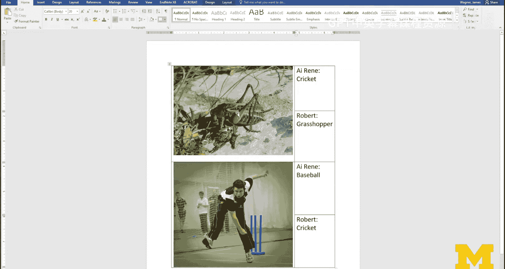

Who studies crickets and grasshoppers or pays attention to crickets and grasshoppers very careful attention。

 so it's possible to see why one would make that mistake， in fact。

 I probably would have guess grasshopper myself based on my experience。

So you can see how that sort of the mislabeling can occur now it might be that if we were concerned with less general information or if we needed less general information。

 it might not matter the difference between a cricket and a grasshopper。

But if we're going through millions of images and we're trying to understand the difference between crickets and grasshoppers。

 certainly mislabeling some of those objects could create issues for a classification algorithm。

 right a machine learning algorithm could be。Inefficient if it is learning from images that aren't correctly labeled。

So that human labeling then can create some issues for a machine learning algorithm that's going to be focused on images。

All right， so the second image， Irene， I think you said baseball。

 what made you think baseball in this instance？Yeah， he's throwing a ball。

 it looks like it kind of looks like a。Pture throwing a ball in baseball。

 maybe not very good at sports。Yeah， so there aren't a lot of clues in the image。To me。

 it looks a little familiar like， well， this is where kids practice baseball。

 there's netting so that they can throw the ball in a safe environment。嗯。

It looks a little bit like he's pitching。Could be that he's just throwing the ball and now he's watching whether or not he's throwing a strike or a ball that feels a little bit like baseball to me。

 but but Robert you picked up on some other clues in the picture what what was that？Yeah。

 I just looked at the blue sticks in the back。Maybe it's just something that was left out。

 but it looks familiar from cricket seeing photos and videos of people playing that。

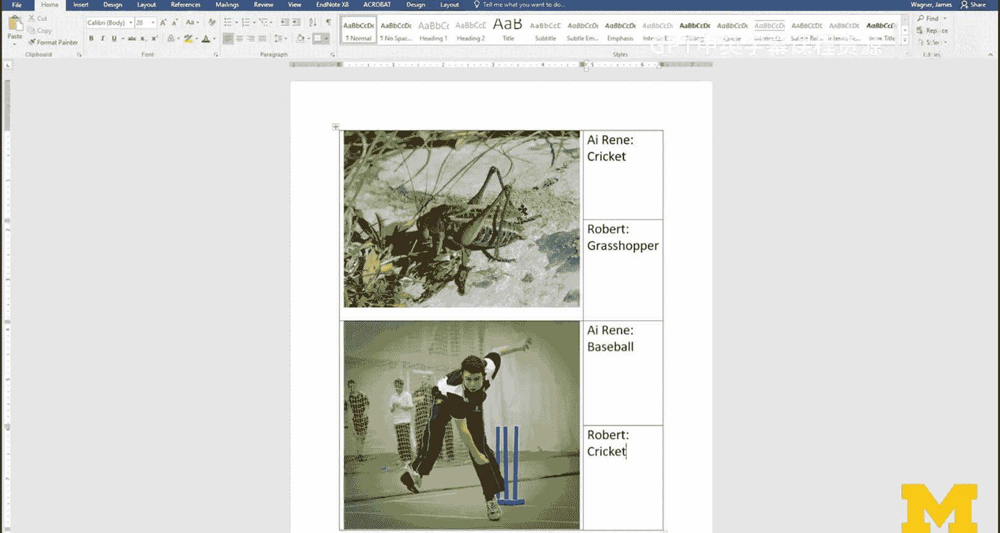

Yeah so I think that's right that's correct and that you for somebody who doesn't know a lot about sports myself。

 somebody had to help me identify what was happening in this picture and it turns out that that is a part of the game of cricket and so seeing that information would help us to label。

Now I think you can see how mislabeling can occur in this in this type of image as well right so if somebody's not familiar with cricket putting the appropriate label onto the picture can be difficult。

 even for somebody who is difficult there's not a lot of visual cues and somebody has to。

Kind of use of。Some acuity to try and get the right label onto that image。Now again。

 in different contexts that may not matter too much。

 the difference between baseball and cricket may not matter much if I'm just interested in is some kind of sports or athletics。

 the difference may not matter very much。In other contexts。

 it might matter if I want to know how many images of cricket there are。In Twitter last week。

It might matter， I might be confused by images that have some form of baseball within them。

And so having the correct label can be important right and getting the correct label can be incorrect now as Brady pointed out before。

 one of the things that can be done to improve labeling is to have verification of the labeling and it doesn't need to be done on every image。

 you know you can get a sense of how accurate your labels are from having more than one person label。

Even just a sample of images， it can be helpful to understand the rates at which mislabels occur and understanding then what's the probability that you might mislabel some picture？

😔，But that's the exercise and I just want to say thanks guys for helping us out with this I'm gonna to stop sharing now so thanks Robert and Irene I mean this has been great and and again this has been a perfect example of what happens during this process and kind of the thinking that goes into this and again why it's important again if if you think about taking this to scale you know suppose that Irene is being asked to code a bunch of images of people playing sports and if a lot of those images are examples of cricket but she's not that familiar with the game of cricket and some of the equipment that might be used and so forth she might consistently code all of those images as baseball and that again is what we mean by this between coder variants。

 Irene is much more likely to interpret that as baseball and will have a higher proportion of baseball codes then a different coder who has a little bit more experience and has watch cricket on TV or whatever the case may be who would have a higher proportion of those images coded as playing cricket and that's that kind of between code。

That we need to worry about as part of the data processing step that's a threat to data processing quality and we need to think about ways to resolve that like having this independent third party validation of any kind of discrepancies so so again thank you Robert and Ireen very much for joining us this has been a huge help and and this has made it clear some of these ideas that we're talking about so so thank you again for your time today。

