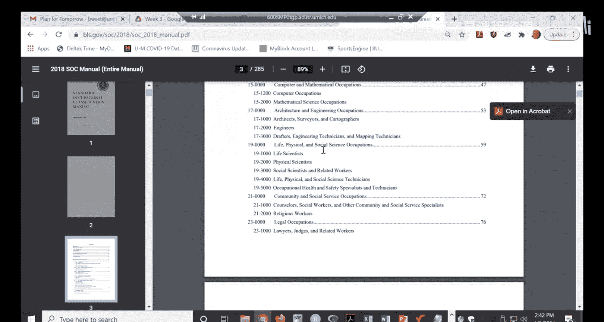
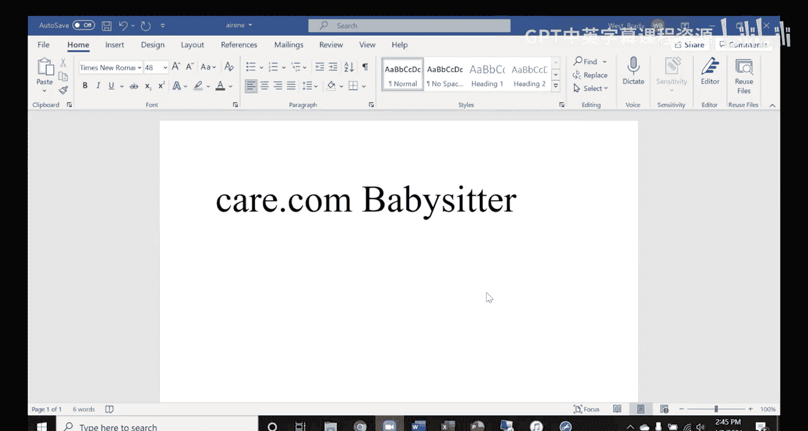
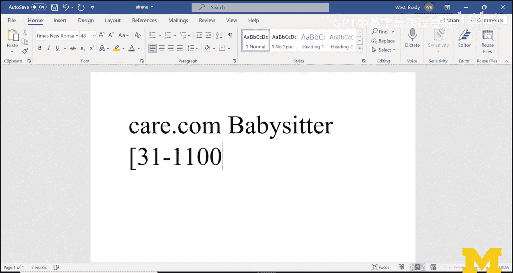
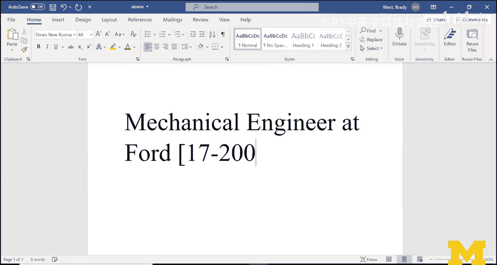
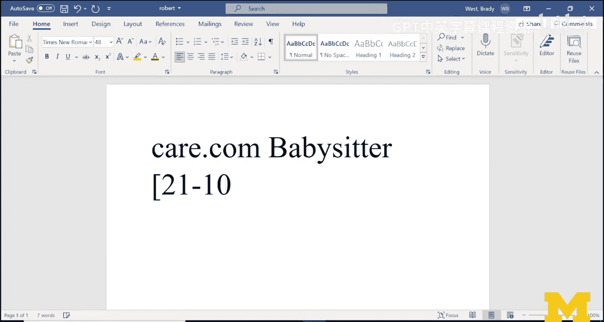
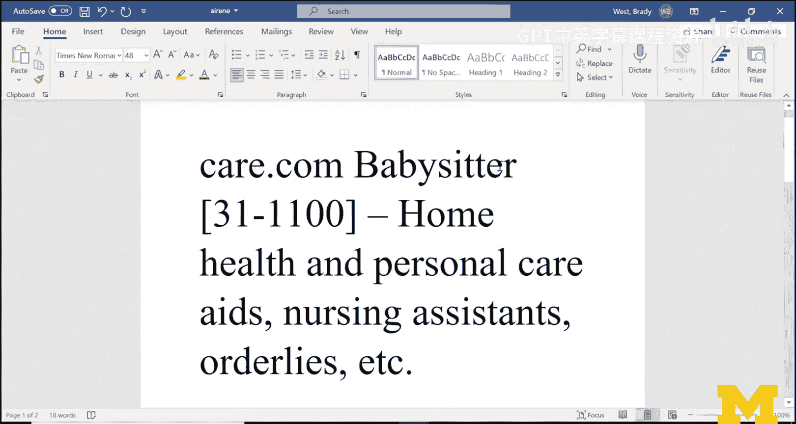
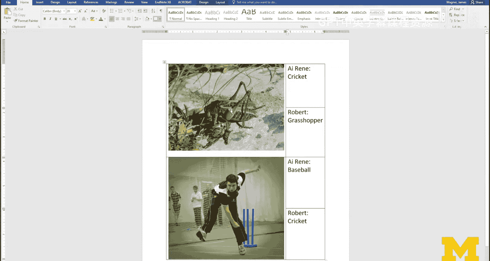
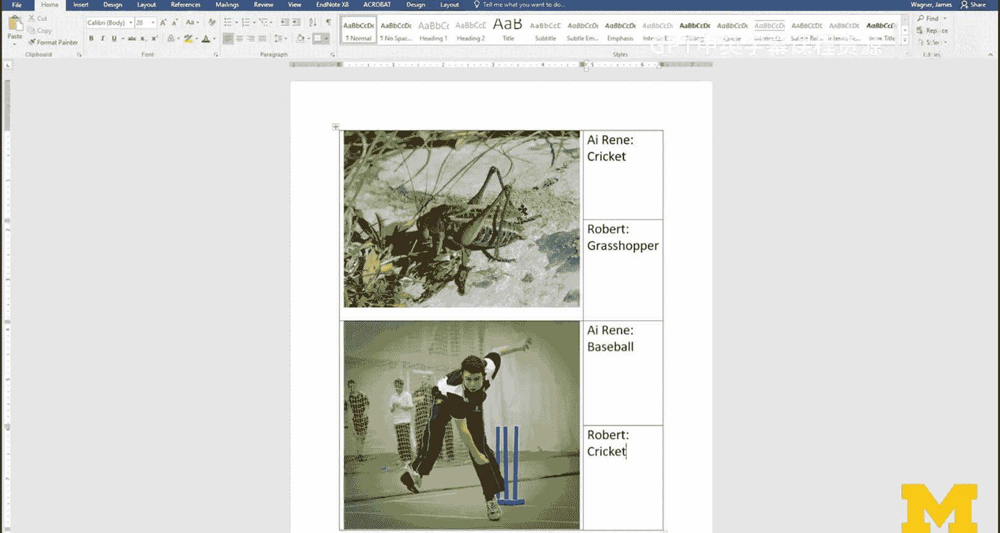

# 总体数据质量（框架、度量、设计策略）：19：案例研究：编码者间差异性分析 🧑‍💻

在本节课中，我们将通过一个具体的案例研究，来探讨在处理开放式数据时，**编码者间差异性**如何成为一个重要的数据质量问题。我们将看到，当不同的编码员为同一段文本或同一张图像分配代码或标签时，他们可能会做出不同的选择。理解并管理这种差异，对于确保最终用于分析的数据集的质量至关重要。

## 概述：什么是编码者间差异性？

当我们收集到开放式数据（例如，调查中受访者自由填写的职业描述，或是一组需要标注的图像）时，一个常见的后续步骤是将其转换为结构化的代码或标签，以便进行定量分析。这个过程通常由经过训练的人员（编码员）手动完成。

**编码者间差异性** 指的是，不同的编码员在查看相同的信息时，可能会为其分配不同的代码或标签。这种差异可能源于编码员对概念的不同理解、个人经验或对编码指南的解读。如果这种差异过大且未被妥善处理，就会威胁到数据的可靠性和整体质量。

接下来，我们将通过两个具体的练习来观察这种现象：一是为开放式职业描述分配数字代码，二是为图像分配描述性标签。

## 练习一：为开放式职业描述编码

在这个练习中，我们将使用美国行政管理和预算局制定的 **《标准职业分类手册》**。该手册为各种职业分配了数字代码。例如：
*   **管理类职业**
*   **商业和金融运营类职业**
*   **生命、物理和社会科学类职业**

我们的任务是：邀请两位编码员（Irene 和 Robert），根据手册为给定的开放式职业描述选择最合适的数字代码。

以下是他们需要编码的两段描述：
1.  “Care.com 的保姆”
2.  “福特公司的机械工程师”

我们将分别记录他们的选择，然后进行比较。

### 编码员 Irene 的选择

Irene 是调查方法学专业的四年级博士生。

*   **对于“Care.com 的保姆”**：Irene 查阅手册后，选择了代码 **31-1100**，对应的标签是“家庭健康和个人护理助理、护理助理、护理员及精神病助理”。
*   **对于“福特公司的机械工程师”**：Irene 选择了代码 **17-2000**，对应的标签是“建筑与工程类职业”。

### 编码员 Robert 的选择

Robert 是同项目的一年级硕士生。

*   **对于“Care.com 的保姆”**：Robert 选择了代码 **21-1000**，对应的标签是“咨询师、社会工作者及其他社区和社会服务专家”。
*   **对于“福特公司的机械工程师”**：Robert 同样选择了代码 **17-2000**。

### 比较与解决差异

现在，我们来比较两位编码员的结果：

1.  **“福特公司的机械工程师”**：两位编码员都选择了 **17-2000**。这被称为 **完全一致**。在这种情况下，无需进一步处理，可以直接将该代码作为最终结果录入数据集。
2.  **“Care.com 的保姆”**：Irene 选择了 **31-1100**，而 Robert 选择了 **21-1000**。这出现了 **差异**。

面对差异，标准的质量控制流程是引入一个具有相关领域知识的第三方（或资深编码员）来进行裁决。裁决者会审视双方的代码选择及其定义。

*   Robert 的选择（21-1000）侧重于“社会服务”，通常需要一定的专业培训或学位。
*   Irene 的选择（31-1100）更侧重于“个人护理和协助”。

裁决者可能会认为，“保姆”的工作内容更贴近“个人护理”，因此 **31-1100** 是更合适的选择。通过这种讨论和裁决过程，我们为有争议的条目确定了最终的高质量代码。

这个例子表明，即使有明确的编码手册，对某些开放式描述的解读仍可能存在主观性，从而导致编码者间差异。

## 练习二：为图像分配标签

接下来，我们看看在图像标注中如何出现类似的问题。这个过程在训练机器学习模型时尤为常见，因为模型需要大量准确标注的图像来学习。

在这个练习中，编码员的任务是观察图像，并用一个简短的标签描述图像中的**主要内容**。

### 编码过程

我们向 Irene 和 Robert 展示了以下两张图像：

**图像 A**：一只昆虫的特写。
**图像 B**：一个人在做投掷动作的运动场景。

他们分别给出了以下标签：

*   **Irene 的标签**：
    *   图像 A: “蟋蟀”
    *   图像 B: “棒球”
*   **Robert 的标签**：
    *   图像 A: “蚱蜢”
    *   图像 B: “板球”

### 分析差异

1.  **图像 A（昆虫）**：Irene 认为是“蟋蟀”，Robert 认为是“蚱蜢”。经过专家确认，该昆虫实际上是**蟋蟀**（一个关键特征是触角长度与身体相近）。这个差异源于编码员对昆虫形态学细节的不同知识或关注点。
2.  **图像 B（运动）**：Irene 认为是“棒球”，Robert 注意到背景中的蓝色三柱门，认为是“板球”。经确认，这是一张**板球**运动的图片。这个差异源于编码员对不同运动项目及其装备的熟悉程度。

### 差异的影响与处理

图像标注的差异会直接影响下游任务的质量。例如，如果我们用这些标签来训练一个识别“板球”图像的机器学习模型，那么被错误标注为“棒球”的图像就会成为噪声数据，降低模型的准确率。

为了减少这种差异并提高标注质量，可以采取以下策略：
*   **多人标注与验证**：让多个编码员独立标注同一批图像（或一个样本），然后比较结果。
*   **计算一致性指标**：使用如 **Cohen‘s Kappa** 等统计量来衡量编码员间的一致性程度。
    *   `Kappa = (P_o - P_e) / (1 - P_e)`，其中 `P_o` 是观察到的同意比例，`P_e` 是期望的随机同意比例。
*   **制定详细的标注指南**：明确标注规则（例如，“主要物体”如何定义？背景信息是否需要考虑？）。
*   **仲裁与讨论**：对于存在分歧的标注，由专家或资深标注员进行最终裁定。

## 总结

在本节课中，我们一起学习了 **编码者间差异性** 这一关键的数据质量问题。

*   我们首先了解了，在将开放式文本（如职业描述）或非结构化数据（如图像）转换为可分析代码或标签的过程中，不同的编码员可能做出不同的判断。
*   通过两个生动的案例，我们观察到这种差异如何在实际操作中产生：一个是对“保姆”职业的代码分配存在分歧，另一个是对昆虫种类和运动项目的图像标签判断不同。
*   我们探讨了处理这种差异的标准流程：**独立编码 -> 比较结果 -> 识别差异 -> 引入第三方仲裁**。对于完全一致的条目，可以直接采纳；对于存在差异的条目，则需要通过讨论或专家裁决来确定最终的高质量代码。
*   最后，我们认识到，管理编码者间差异对于确保数据可靠性、以及基于这些数据进行的任何后续分析（包括机器学习模型训练）的准确性都至关重要。

通过实施严格的质量控制措施，如多人编码、一致性度量和清晰的仲裁流程，我们可以显著降低编码者间差异性带来的风险，从而提升整体数据质量。