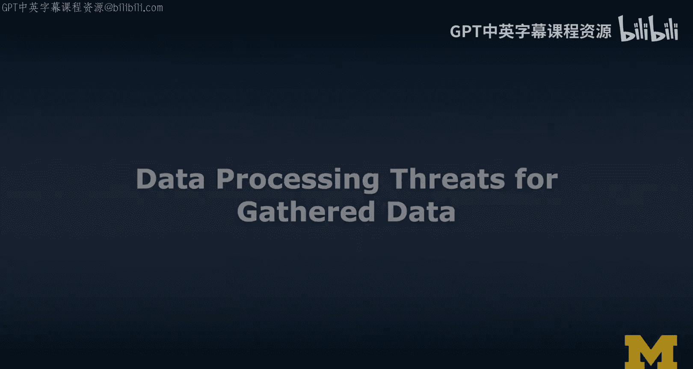
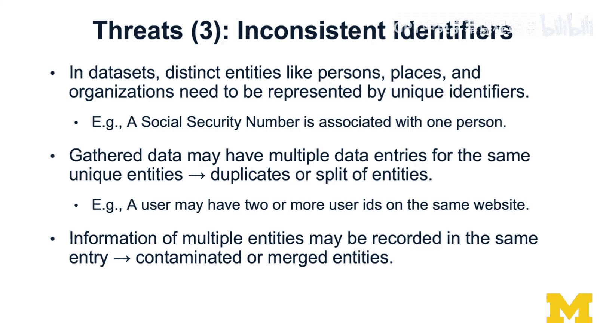
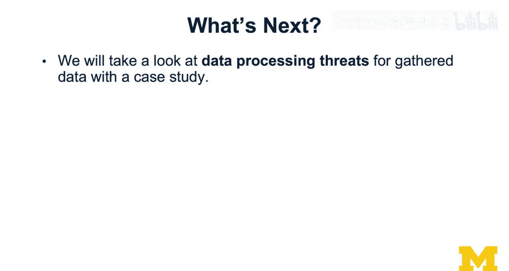

# 密歇根大学《总体数据质量（框架、度量、设计策略）total data quality》 p21 20_采集型数据处理威胁因素.zh_en -BV1Jn4y1X7uS_p21-

Yeah。We have looked into data processing threads and examples for design data。

Now it's time to turn our attention to data processing threads for gather data。

In the big picture of total data quality framework。

 we are now looking into the details of data processing。Here's the first thread， passing errors。

Design data are usually recorded in tables with rows and columns In contrast gather data might be stored in machine readable formats like HTML。

 JN and XML， such formats are preferred by data providers because they enable gather data to be used across different computing methods。

Passing is a data processing step to convert such machine readable data into human readable formats like tables with rows and columns。

 as you could see in the Excel spreadsheet。During the passing， errors can occur。For example。

 information can be lost because users might lack skills and experiences in passing or maybe choose wrong par。

These errors can also occur because data providers share machine readable data with missing text or wrong field names。

Another type of error that occurs during data processing for gather data are encoding errors。

Ger data might contain characters and symbols from diverse cultures and languages。

They need to be converted into standard character formats before analysis。

This is called character encoding。Data scientists often prefer converting those characters using American standard code for information interchange。

 also called ASI in short。Text the editors and what processing tools may not support a certain type of encoding。

This could make some characters appear as strange symbols。

 as shown in the example where Ive appears with the euro currency symbol。For data analysis。

 distinct entities like persons， places and organizations need to be represented by unique identifiers。

 for example， a Social security number needs to be associated with one person。

Gathered data might not include unique identifiers for entities。In other words。

 gathered data may have multiple data entries for the same unique entities。

 creating duplicates or splits of entities。This can occur because a user might have two or more user IDs on the same website and information about the user IDs are recorded in G data without consolidating them。

Other case of identifyentifier your errors is that information of multiple entities may be recorded in the same entry。

 creating contaminated or mergeed entities。

This can occur because two or more people use the same user ID on our website。For example。

 family members can share the same account on Amazon。

com and their activities might be recorded as one user's shopping activities。

Other common threads for gather data include input errors that occur due to inconsistency。

 typos or invalid values。For example， dates might be recorded in different formats like they followed by month and to visit year or they followed by month and full visit year。

 meanwhile， the same date information can be recorded in full visit year followed by month and day。

Also outdated or contradicted information can occur frequently in gather data， for example。

 our user might record his or her birthday as February 18， 1980。But type current age as 45。

 although it should be 40 as of 2020。Other errors that are often found in gathered data processing include missing values。

 outliers and irregular cardinality here， irregular cardinality means feature information mislabelled with categorical value。

 for example， in gather data， the gender of users might be coded into， for example。

 one for female and two for male， these numbers are used for categorical values but might be analyzed as cardinal values without proper processing。

Many of the aforementioned threads are not specific to gather data， for example。

 missing values are also found in design data， but the problem is that they can be more serious in gather data than design data why。

This is because cause of scale。 In other words， the largest scale needs of gathered data can up our ability to properly detect data quality problems。

That is because there can be too many variables and instances to scan Also unknown errors are undetectable if they are not properly defined before data processing。

We will take a look at data processing threads for gather data with a case study。

