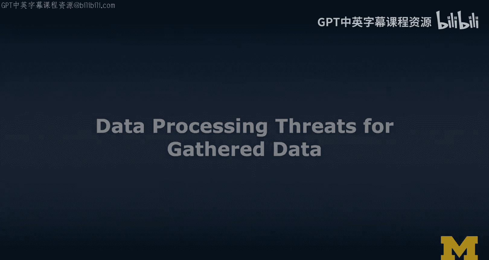
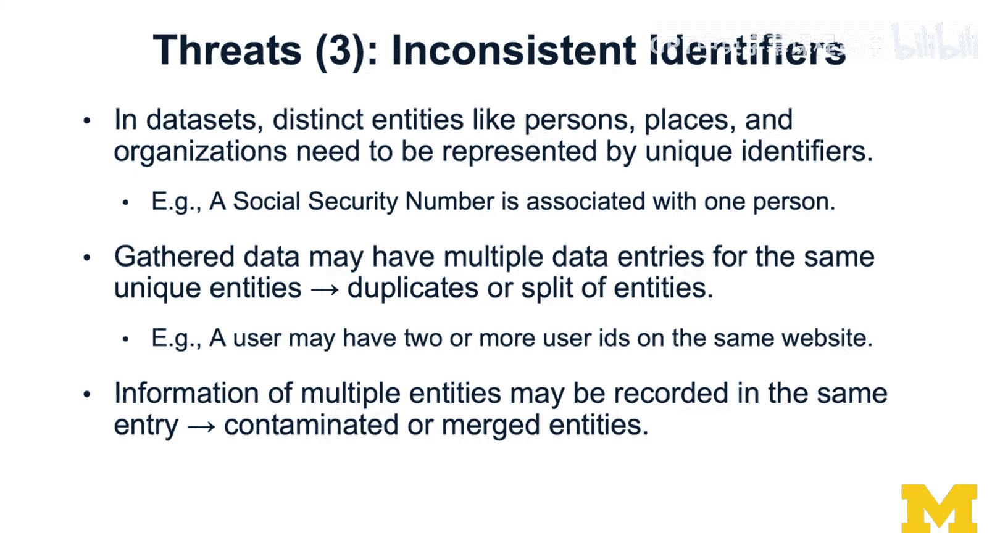
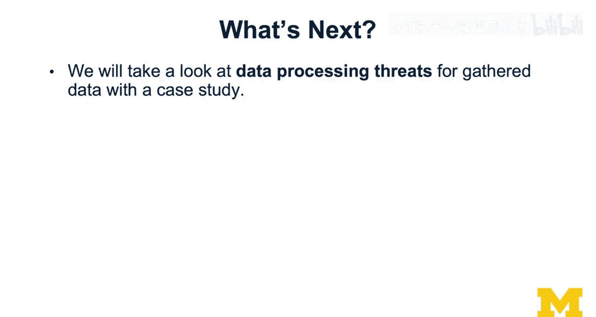

# 总体数据质量（框架、度量、设计策略）：2.1：采集型数据处理威胁因素 🔍

在本节课中，我们将要学习采集型数据在数据处理阶段可能面临的各种威胁因素。上一节我们介绍了设计型数据的处理威胁，本节中我们来看看采集型数据特有的挑战。

## 概述

在总体数据质量框架中，数据处理是关键环节。采集型数据通常以机器可读的格式（如HTML、JSON、XML）存储，需要经过解析等步骤才能转换为适合分析的表格形式。在这个过程中，多种错误可能发生，影响最终的数据质量。

## 解析错误

解析是将机器可读数据转换为人类可读表格（如Excel电子表格）的数据处理步骤。在解析过程中可能发生错误。

以下是解析错误的常见原因：

*   **用户技能不足**：用户可能因缺乏解析技能和经验而选择错误的解析器，导致信息丢失。
*   **数据源问题**：数据提供者共享的机器可读数据本身可能包含缺失的文本或错误的字段名。

## 编码错误

采集型数据可能包含来自不同文化和语言的字符与符号。在分析前，它们需要被转换为标准的字符格式，这个过程称为字符编码。数据科学家通常偏好使用**美国信息交换标准代码（ASCII）**进行转换。

文本编辑器和文字处理工具可能不支持某些编码类型。这会导致部分字符显示为奇怪的符号，例如在示例中，“I’ve”与欧元货币符号一起出现异常。

## 标识符错误

为了数据分析，不同的实体（如个人、地点、组织）需要用唯一的标识符来表示。例如，一个社会保障号应只关联一个人。

采集型数据可能不包含实体的唯一标识符。换句话说，采集型数据可能为同一个实体记录了多个数据条目，从而产生重复或分裂的实体。

以下是标识符错误的两种情况：

*   **实体分裂**：这可能发生，因为一个用户可能在同一个网站上拥有两个或更多的用户ID，而关于这些用户ID的信息被记录在采集数据中，却没有被整合。
*   **实体合并**：另一种标识符错误是，多个实体的信息可能被记录在同一个条目中，从而产生被污染或合并的实体。这可能发生，因为两个或更多人在我们的网站上使用同一个用户ID。例如，家庭成员可以在Amazon.com上共享同一个账户，他们的活动可能被记录为一个用户的购物活动。

## 其他常见威胁

采集型数据的其他常见威胁包括因不一致、拼写错误或无效值而产生的输入错误。

以下是输入错误的例子：

*   **日期格式不一致**：日期可能以不同格式记录，例如“日-月-两位数年”或“日-月-四位数年”，同时，相同的日期信息也可能被记录为“四位数年-月-日”。
*   **信息过时或矛盾**：过时或矛盾的信息可能频繁出现在采集数据中。例如，用户可能记录其生日为1980年2月18日，但输入当前年龄为45岁，尽管截至2020年应为40岁。

采集型数据处理中经常发现的其他错误还包括缺失值、异常值和**不规则基数性**。这里，不规则基数性是指特征信息被错误地标记为分类值。例如，在采集数据中，用户的性别可能被编码为“1代表女性，2代表男性”，这些数字本应用于分类值，但若未经适当处理，可能在分析中被当作基数值处理。

## 威胁的严重性

上述许多威胁并非采集型数据所独有，例如缺失值在设计型数据中也会出现。但问题在于，它们在采集型数据中可能比在设计型数据中更为严重。

原因在于**规模**。换句话说，采集型数据的大规模特性可能超出我们正确检测数据质量问题的能力。这是因为可能存在太多的变量和实例需要扫描。此外，如果在数据处理前没有正确定义，未知错误是无法被检测到的。

我们将在后续的案例研究中，进一步审视采集型数据的处理威胁。

## 总结

本节课中我们一起学习了采集型数据在数据处理阶段面临的主要威胁因素，包括解析错误、编码错误、标识符错误（实体分裂与合并）、输入错误（如格式不一致、信息矛盾）以及缺失值、异常值和不规则基数性等问题。理解这些威胁是设计有效数据质量保障策略的第一步。