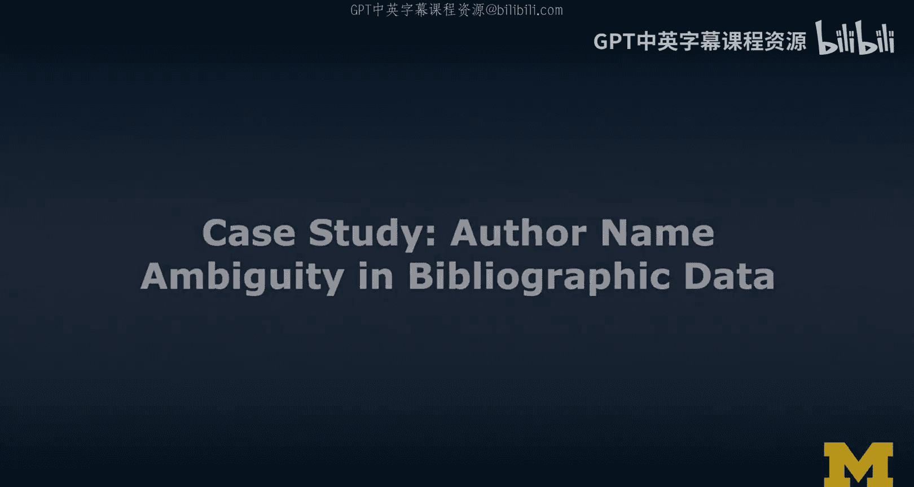
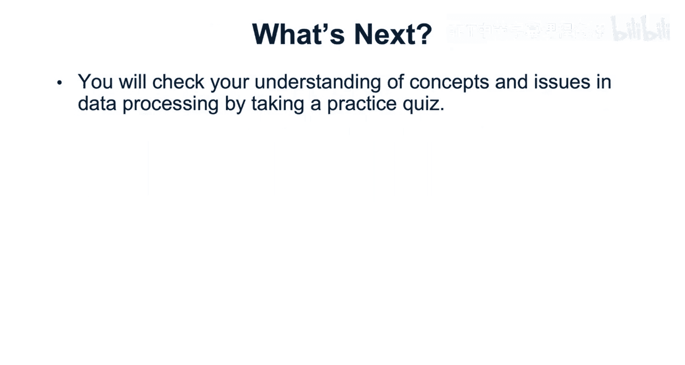
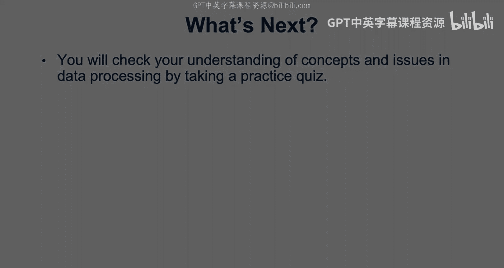

# 密歇根大学《总体数据质量（框架、度量、设计策略）total data quality》 p22 21_案例研究：文献数据中的作者名歧义问题.zh_en -BV1Jn4y1X7uS_p22-

。In this lecture， we will learn more about data processing threads with an example of author name ambiguity in biblliographic data。

Peopleegic data contain metadata about publications。Publication metadata include authorname， title。

 publication ear， venue， and keywords。Several large scale bibliographic data are publicly available for research and commercial uses。

For example， the world's largest digital library PM， publishes monthly its baseline database。

 Madeline in XML， that contains millions of publication records in biomedicine。

Researchers and companies have gathered and analyzed bibliographic data to understand patterns and structures of research production and collaboration and develop academic intelligence services based on them。

In using bibliographicpic data， several data quality issues cannot arise。First。

 P data are often released in XML format。We need to pass them properly。

Names of authors and affiliations may be recorded in many languages。

 so we need to properly encode characters。Information can be missing。

 as often with affiliation information。Dupliclic echos can be found。

 which are common in bibliographic data。The data may contain millions of publication records。

 making Earth hard to find processing errors hidden in the scale。Most seriously。

 author names are unlikely to be distinguished because bibliographic data tend not to contain identifiers of authors。

Regarding the identifier issue， let's take a look at the meline as an example。

Like many other open publication records， Madeline does not contain identifiers for unique authors。

 so data users rely on name strings to decide identities of authors。

But the problem in using name strings is that author names can be ambiguous。

Two names spelled in the same string can refer to the same author。Which is homony problem。

For example， there are more than 300 unique wave wangs in Madeine。

And another problem is CNNon in problem。Authors may use name variants。For example， M。 Newman。

 Mark Newman， Mark E。 Newman and MEJ Newman can refer to professor at the University of Michigan Department of Physics。

How have we addressed the name ambiguity problem in gathered publication data。

All few scholars and practitioners have used algorithmic methods to assign unique identifiers to author names in Madedeline。

But the dominant practice is to use a simple heuristic， according to the method。

 two or more name strings that match on all phone name initials and full surname are assumed to represent the same author。

 For example， M E Newman and Mark E Newman refer to the same author。

Sometimes the first full name initial and full surname is used。According to this method， M Newman。

 Mark Newman and ME EJ Newman are all referring to the same author。

This simple but widely used method has produced inaccurate identifiers of authors in publication records。

The inaccurate item ofifiers can distort our understanding of research production gained from the gathered data。

For example， you can often find thousands of J1ang。

This is why Chinese names dominate the most productive author list。

Another example of side effects of inaccurate identifiers is that patterns of research collaboration have been poorly modeled。

Studies found that research collaboration follows a physical law like pattern。

Research states that a few scholars have disproportionately large number of collaborators。

 while most others have a very few。Recent study on data quality in gathered publication data showed that the found patterns were observed mainly because of entities are merged into artifactual authors who are misrepresented to have a huge number of collaborators。

He also research paper that provides us details about the ambiguity problem in publication records。

The article demonstrates how inaccurate identification of auto namess in a large scale B group data can lead us to faulty understanding of research production and collaboration patterns。

Our practicequiz will help you check your understanding of concepts and issues in data processing。

