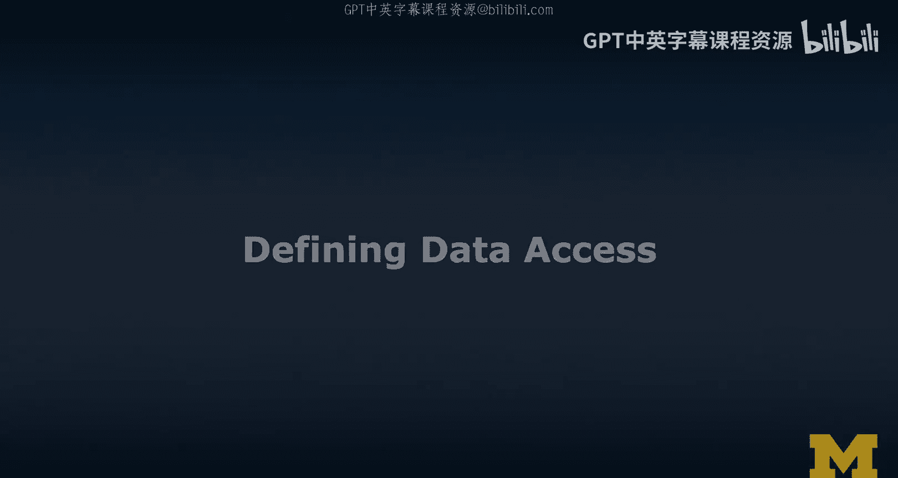
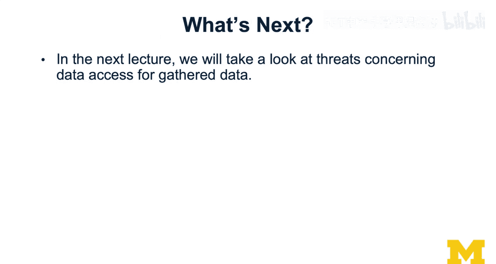
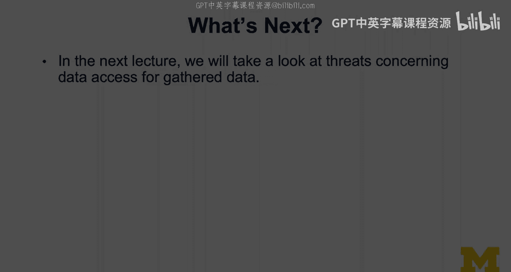
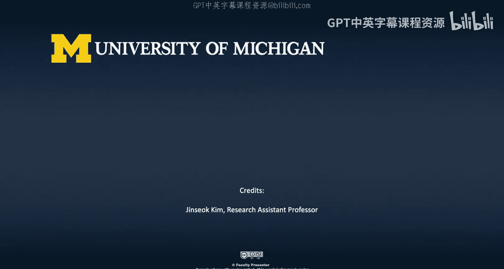

# 密歇根大学《总体数据质量（框架、度量、设计策略）total data quality》 p23 22_数据访问的定义标准.zh_en -BV1Jn4y1X7uS_p23-

Now we are moving from measurement side to representation side of data quality。For data analysis。

 we want to obtain information that represents the population of interest。

Data access is the first aspect we need to take a look at for this representation side。

What do we mean by data access data access refers to the methods。

 approaches or tools to retrieve information from various data sources。

Data access can have different meanings for designed and gather data。First。

 let's take a look at the meaning of data access for design data。

The data access in design data is a sampling frame here a sampling frame is a set of materials or procedures that are used to select a sample。

 so in accessing design data， we prefer frames that give every eligible unit or nonzero probability of being selected。

 especially when we work with probability samples。Our non probability sampling frame is also a frame。

 but that is not a frame under which the sampling is controlled by the sampler。Forge data。

 data access means the methods or procedures used for acquiring information。

These acquired data might be stored as structure data with rows and columns in a table format。

Sendending structure data， which you have table like format， but cells may be lists or text。

And unstructured data without organized rows and columns， but typically full of mess text data。

Here are some examples of data access for gather data。

Data might be purchased from a third party seller or reseller。

Or data can be gathered manually by code and paste from data sources。

Another popular method to gather data is to use web scraping。

 which collects information from web pages using tools in R or Python。Also。

 we can access data using an application programming interface， which is called API in short。

In the next lecture， we will take a look at threats concerning data access for gather data。

