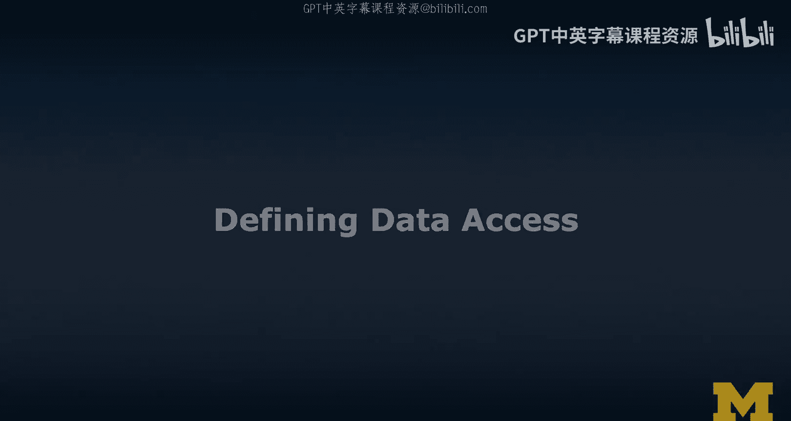
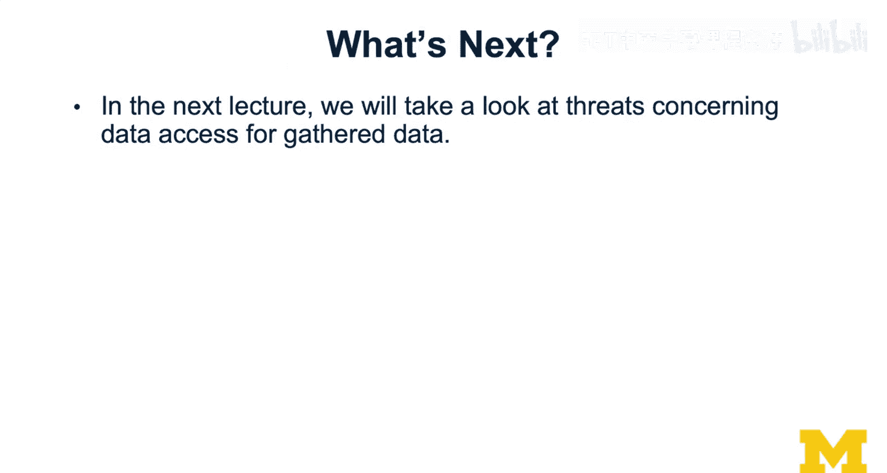
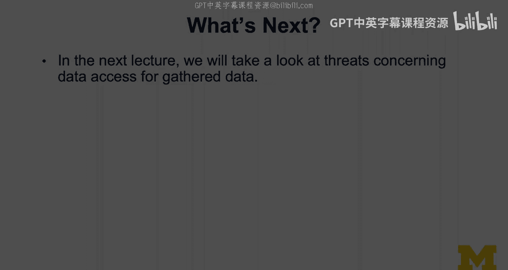

总体数据质量：23：数据访问的定义标准 📊

在本节课中，我们将从数据质量的“度量”侧转向“表征”侧。为了进行数据分析，我们希望获取能代表目标总体的信息。数据访问是我们在表征侧需要考察的第一个方面。

现在，我们从数据质量的“度量”侧转向“表征”侧。为了进行数据分析，我们希望获取能代表目标总体的信息。数据访问是我们在表征侧需要考察的第一个方面。

那么，数据访问具体指什么呢？数据访问指的是从各种数据源检索信息的方法、途径或工具。对于“设计数据”和“采集数据”，数据访问具有不同的含义。首先，我们来看看数据访问在“设计数据”中的含义。

在“设计数据”中，数据访问指的是一个“抽样框”。这里的抽样框是一套用于选取样本的材料或程序。因此，在访问设计数据时，我们更倾向于使用能为每个符合条件的单元提供非零被选概率的抽样框，尤其是在处理概率样本时。非概率抽样框也是一种框，但在此类框下，抽样过程不受抽样者控制。

上一节我们介绍了设计数据中的数据访问，本节中我们来看看“采集数据”中的数据访问。对于采集数据，数据访问指的是用于获取信息的方法或程序。

这些获取的数据可能以结构化数据的形式存储，即具有行和列的表格格式。也可能是半结构化数据，它们具有类似表格的格式，但单元格内可能是列表或文本。还有非结构化数据，它们没有组织好的行和列，通常包含大量杂乱的文本数据。

以下是采集数据中数据访问的一些例子：

*   数据可能从第三方销售商或经销商处购买。
*   数据可以通过从数据源手动复制和粘贴来收集。
*   另一种流行的数据采集方法是使用网络爬虫，通过R或Python中的工具从网页收集信息。
*   此外，我们还可以使用应用程序编程接口（简称API）来访问数据。

在下一讲中，我们将探讨与采集数据的数据访问相关的威胁。

本节课中，我们一起学习了数据访问的定义及其在不同数据情境下的含义。我们了解到，对于设计数据，数据访问的核心是抽样框；对于采集数据，则涉及从购买、手动收集到网络爬虫和API调用等多种获取方法。理解这些是评估数据表征质量的第一步。