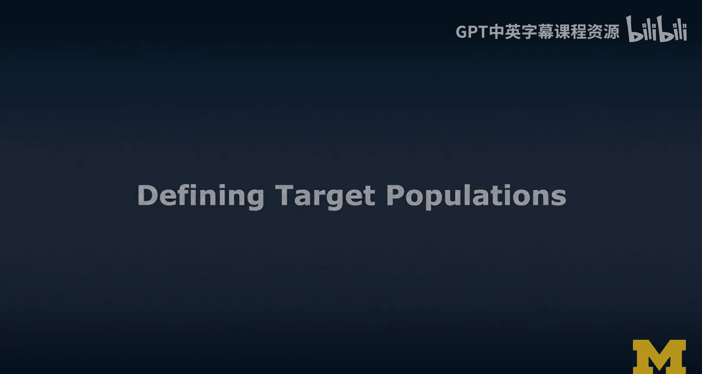
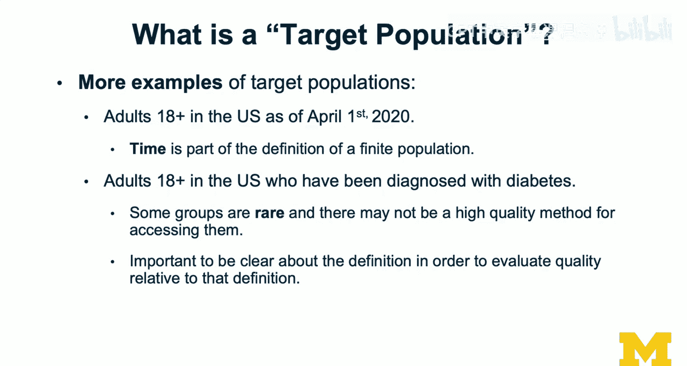

# 密歇根大学《总体数据质量（框架、度量、设计策略）total data quality》 p24 23_目标群体的界定方法.zh_en -BV1Jn4y1X7uS_p24-

Welcome， today we're going to be talking about target populations and how do we define those target populations？

But first， let's take a look at the overview of our dimensions of total data quality。

 We're on the representation side， and we're going to be talking about data access errors。

 And in to do that， we need to talk about what is a target population so that we can talk about how that target population relates to the available data sources。

 That's where the data access problems occur。 So we need to start with a clear definition of what a target population is。

So what is a target population， Well， the definition we're providing here is the finite population。

 which is the target of your inference or prediction。

So inferences when we're trying to describe that population， we want to describe its characteristics。

 and we also want to put some measure of uncertainty on that description。Prediction。

 on the other hand， means that we want to predict some characteristic of that target population。

 We may want to predict for cases that have not yet been observed。

We want to guess what class a case may belong to， right we want to make a prediction based on the information that we have。

The target should relate to the goals of the research。

 so that one goal might be describing a population or subpopulation of persons。 For example。

 a target population might be all adults living in the US on April 1。

That tells us who's in the target population。 Now， we could do a survey。

 and we could ask persons questions about their personal income， for example。

 and then we could report a mean， and we could use that as always way to infer about that whole target population。

 What's the mean personal income of that target population。

Another example comes from the Twitter analysis of Twitter Twitter data。

 So characterizing what is trending on Twitter during a two week span might be another target population。

 Okay， so the target population is all tweets made between some two week span。

 In this example between June 16 and June 30。 Now， we might not analyze all of the Twitter tweets available from that time period。

 We might only analyze some subset of them。 but that's our target population。

 And it's important to start from an understanding and a precise definition of what that target population is。

One aspect that's often ignored in a definition of a target population is time。

 Time is a key aspect of the definition of a target population。 Why， well。

 because populations change over time。 So do inferences from last year's data apply to this year。

Another way to ask the same question， do opinions or behaviours change more frequently than annually。

 Do they change daily or weekly， If so， does data from last week or even yesterday apply to the population to day。

Now， sampling from human populations。 What is the time frame of that sampling， For example。

 when wereing survey data， we may say that eligibility is determined at the point of first contact。

 The first time we talk to someone within a household。 and the field period is limited in time。

 So that gives us a time frame for our target population。Another example from Twitter data。

 When were the tweets drawn， from which dates and times were they extracted。

 When we think about that sampling， we need to think about the time element。

 I've got some or maybe even all data from Twitter for some period of time。

What dates were those are important to think about？

It's important to start with a clear definition of the target population。

 and comparing the data source to the target population is an important evaluation step。

So some examples of target populations might include the population of Twitter users。

 okay persons who have Twitter accounts。While other research might want to use Twitter data to draw inferences about the population of US adults age 18 and older。

 those are two very different populations。Twitter users are a subset of the whole population。

Whereas the other is to say we want to use Twitter data to talk about all persons in the United States。

 and that may be a source of errors in our analysis if the Twitter population doesn't well match the target population。

 doesn't well represent the target population。So a clear definition is important for the latter purpose。

 Twitter seems ill suited because it doesn't include the whole population。

 doesn't cover the whole population。So not everyone would have some chance to be included in whatever prediction or estimation procedures I'm going to use。

Starting from a clear definition puts us on a good footing。

No more examples of target populations include adults，18 years of age in the US， as of April 1，2020。

In fact， this definition does include time as a part of the definition of a finite population。

Another example of a target population might include adults。

18 years of age and older in the US who have been diagnosed with diabetes。Now， some groups。

 some target populations are rare， and there may not be a high quality method for accessing them。

 for example， persons with diabetes might be a relatively rare condition。

 and it's more difficult to develop a data source that's going to allow us to access that population。

But it's important still to be clear about the definition in order to evaluate the quality of our procedures for gathering data relative to that definition。

