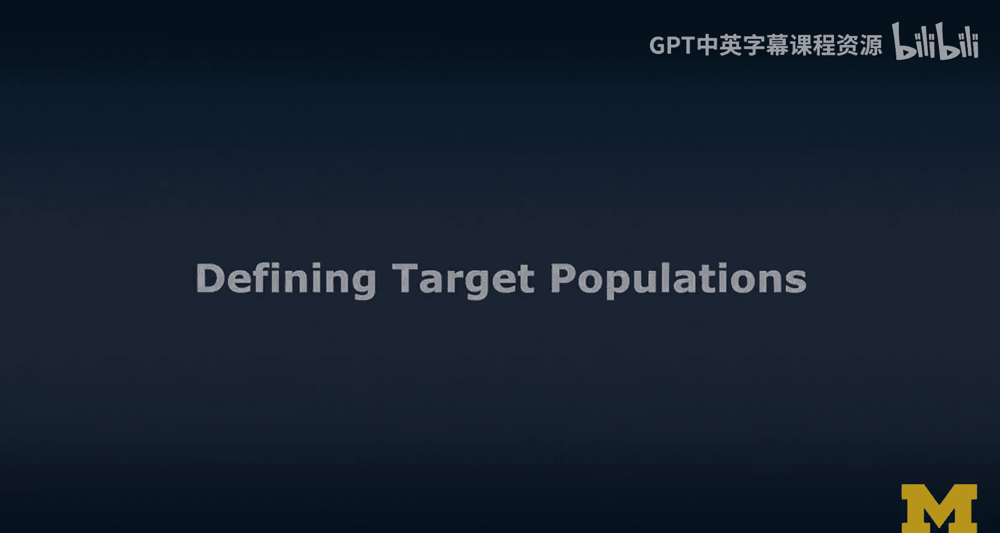
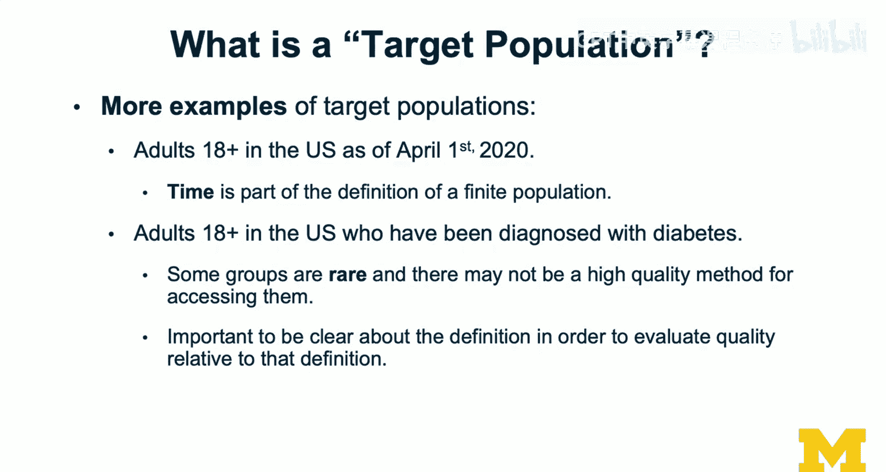

# 总体数据质量：第24讲：目标群体的界定方法 🎯

在本节课中，我们将学习如何清晰、准确地定义“目标群体”。这是评估数据质量、特别是数据可及性错误的关键第一步。一个定义明确的目标群体是进行有效推断和预测的基础。

上一节我们介绍了总体数据质量的维度框架，现在我们聚焦于“表征”维度下的数据可及性错误。要理解这类错误，首先必须明确什么是目标群体，以及它如何与可用的数据源相关联。

## 什么是目标群体？🤔

目标群体，或称**有限总体**，是指你的推断或预测所针对的对象集合。

*   **推断**：指我们试图描述该群体的特征，并对这种描述附上不确定性的度量。
*   **预测**：指我们想要预测该目标群体的某些特征，例如预测尚未观测到的个案情况，或根据已有信息猜测某个个案可能属于的类别。

目标群体的定义应与研究目标紧密相关。例如：
*   一个研究目标可能是描述某个人口群体或子群体。例如，目标群体可以是“所有在4月1日居住在美国的成年人”。通过调查他们的个人收入，我们可以推断整个目标群体的平均个人收入。
*   另一个例子来自对推特数据的分析。目标群体可以是“6月16日至6月30日期间发布的所有推文”。我们可能只分析其中的一个子集，但明确的目标群体定义是分析的起点。

## 时间维度的重要性 ⏰

在定义目标群体时，时间是一个常被忽略但至关重要的方面。因为群体会随时间变化。

我们需要思考：
*   去年的数据推断是否适用于今年？
*   观点或行为的变化频率是否高于每年一次？是否会每日或每周变化？如果是，上周甚至昨天的数据是否适用于今天的群体？

在从人类群体中抽样时，必须明确时间框架。例如：
*   在调查数据中，我们可能规定“资格在首次接触时确定”，并且现场调查时间有限，这便定义了目标群体的时间范围。
*   在推特数据中，我们需要明确：推文是在何时抽取的？它们是从哪些日期和时间提取的？

## 明确定义的价值与实例 💎

从清晰的目标群体定义出发，并将其与数据源进行比较，是一个重要的评估步骤。

以下是目标群体定义不匹配可能导致问题的例子：
*   研究一的目标群体是“推特用户”。
*   研究二想利用推特数据来推断“美国18岁及以上成年人口”的特征。

这是两个截然不同的群体。推特用户只是整体人口的一个子集。如果推特用户群体不能很好地代表美国全体成年人，那么使用推特数据来推断后者就会产生误差。对于后一个目标，推特数据可能并不合适，因为它并未覆盖全体人口，并非每个人都有机会被纳入分析。

因此，清晰的定义为我们奠定了良好的基础。

更多目标群体的定义实例包括：
*   **`目标群体 = {x | x 为 2020年4月1日 年满18岁及以上的美国成年人}`**
    *   这个定义明确将时间作为有限总体定义的一部分。
*   **`目标群体 = {x | x 为 美国成年人，且已被诊断为糖尿病患者}`**
    *   有些目标群体可能比较罕见（如特定疾病患者），获取高质量数据源可能更困难。但即便如此，明确的定义对于评估我们收集数据的方法相对于该定义的质量仍然至关重要。

---

本节课中，我们一起学习了目标群体的核心概念及其界定方法。我们明确了目标群体是推断和预测的对象，其定义必须清晰、精确，并特别强调了**时间维度**在定义中的关键作用。通过比较数据源与目标群体的匹配程度，我们可以初步评估数据可及性方面可能存在的误差。记住，一切高质量的数据分析都应从一个明确定义的目标群体开始。