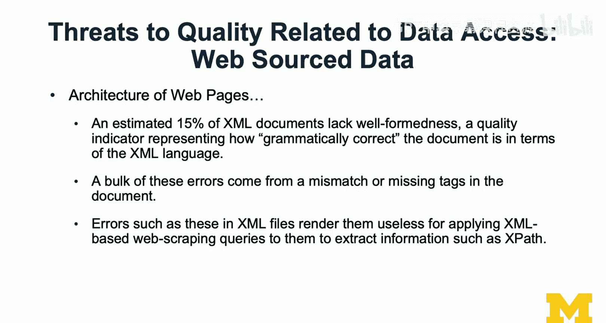
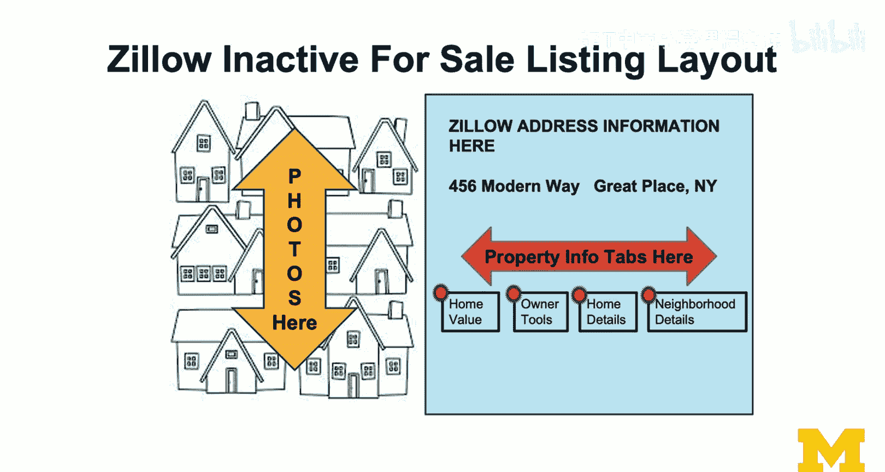
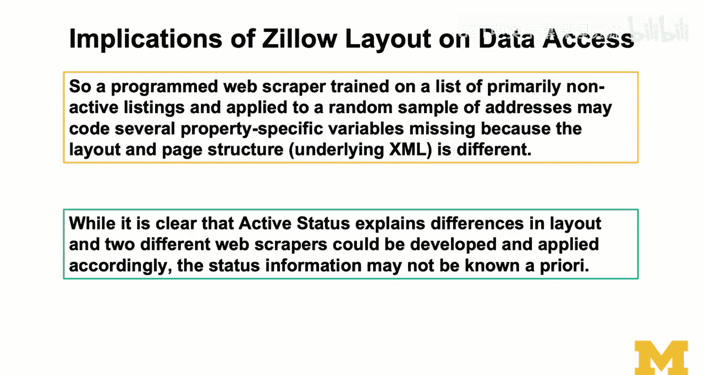
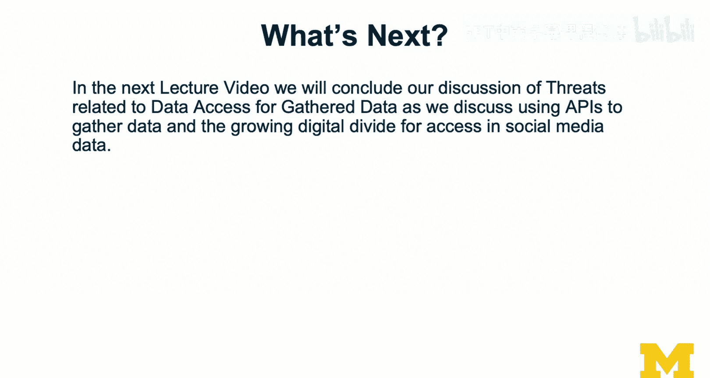

# 密歇根大学《总体数据质量（框架、度量、设计策略）total data quality》 p25 24_采集型数据访问威胁因素（第一部分-共两部分）.zh_en -BV1Jn4y1X7uS_p25-

Thanks for joining us Wee back We're going to talk today about data access threats for Ga data and this is a twopart lecture so we're going to talk about the first part today again I'm Tmp Buskirk。

 thanks a lot for coming back so just to remind you sort of where we are again on this framework we have the measurement side and we have the representation side and where we are going to focus our attention today is on the representation side specifically around data access。

So there are a couple of threats for quality that are related to data access as we've already talked about what data access is。

 but one of those things is around websourced data in particular。

 and it involves how web pages are actually created or the architecture of those pages So if you're trying to use web scraping methods for example。

 to obtain information from the internet for open data sources such as Wikipedia or other places on the web for which there might be data you're interested in using the webage usually uses some kind of structure called extensible markup language or XML you might have heard of that in your studies already。

 but this is a markup language that defines a set of rules to basically create or encode or organize documents online that can be both human readable and machine readable and it's estimated that about 60% of web pages that exist on the internet are created using。

This particular kind of markup language。Now， this is important because about 15% or so of these XML documents lack what we call wellformness。

 That's basically a really fancy way to say that it's a quality indicator for representing how grammatically correct a document is in terms of the X ML language。

 Now， why does that even matter。 if the page isn't grammatically correct and you try to scrape it。

 your webscraer may encounter errors， if it encounters errors and it's not able to extract the information that you were anticipating it extracting。

 then you will have complications in the data that you've been able to gather and that is a data access issue because if you were to try to reproduce this in gathering this particular kind of data。

 you would generate likely you would generate similar errors。

 and your gathered data would not be what you would expect it to be。

 So this is a very important piece， especially if you are trying to。

Autommate the process of data capture， data processing and then data analysis。

 You may not know that you have missing this， for example， and where it's coming from。

 You might just think that information isn't available。

 but it could very well be that it's not available because the web page when you were scraping it thought it was going to the place where you were going to gather information。

 but it ended up going to the wrong part of the web page， for example。

 because of this grammatically incorrect a stature。

 So estimated about 15% of documents on the web have this problem。

 And so this is a real issue to consider in why web scraping may not work or generate fields that you were otherwise expecting。

There's also this about how web pagess are formatted and the content therein web sources may display similar information in different formats depending on other variables that might be known you that might not be known to researchers at the time that you designed your webscraper so give you an example Zillow。

com optimizes the display of properties depending on their status so when you go to the web page of an active for sale or for rent property you're going to see a different web page architecture than if you go to Zillow。

com for an address that is not an active property a property that is not currently for sale or rent it has a different layout I'm going to show you an example of this in a minute。

But the reason why this is important is because if you design only a single web scraper and you use as your prototype or wire framing exercise。

 an active listing and you understand how the web page is organized and you apply that webscraer to an inactive listing。

 you may actually generate missingness in your webcraer。

 because not because the web page wasn't well formed， but because it's structured differently。

 so where you were thinking there would be a field for data。

 there isn't because the web page is designed differently。This is a mock up of a zillow。

 the zillow co webpage for an active listing that is currently for sale or rent。 Now。

 I can't show you the actual zillow。 co webpage here for obvious copyright reasons。

 But you can imagine if you go to Zillow co you can see for yourself。

 But this is an abstract mockup of what the web page looks like Basically on the left side。

 you're going to see some photos of the property。 And on the right side。

 you're going to see information about the property， including the address。

 and then you're going to see some tabs relative to information about the house。 In this case。

 you're going to see an overview tab of facts and features tab， a home value tab， etc ceter。

 the facts and features tab will contain information about the house itself like the square footage。

 the number of bedrooms it has etc cetera。 that might be of interest for you to gather when you're looking at particular information about housing units。

 for example， or households。This is an example of a mockup of an inactive listing from Zillow。

 And again， this is an abstraction of what you might see if you were to go to Zillow co。 Now。

 on the left， you're going to see photos again。 But on the right。

 I want to draw your attention to the property info tabs。 The property info tabs are there as well。

 But these tabs are different than the prior active listing tabs。

 here you see tabs for home value owner tools， home details， et cetera。 Now。

 under the home details tab， you're going to find information about the property。

 including the square footage， the number of bedrooms， etc cetera。

 So the same information is included on this particular webp page。

 but it's not found in the same place or under the same label as what you found for the Zillow active listing webp pages。

 This is an important consideration when you're thinking about developing a webscraper to gather this information。

😊。

So a couple of reasons why this is important if you programmed a webscraer that you trained only on listings active listings。

 then when you go to apply that to a website or a webage listing from Zillo that is inactive。

 it is likely going to generate missing data on the facts and features。

 information that you were looking for because there is no facts and features path on the inactive listing webp pages。

 so that's going to generate missing data on things like number of bedrooms， square footage， etc。Now。

 one way to get around this problem is to generate two different web scrapers。

 one that's trained on the active listings and one that's trained on the inactive listings。

 And then you run those two scrapers on every property that you encounter The reason why you would do that is because we don't necessarily know a priori which listings from a random sample of addresses。

 let's say are active in which listings are inactive。

 So without that prior information I can't sort to which scraper those properties would go。

 So I would just run both of them on the whole list。

 This is one possible solution there are others we're going to talk about solutions to how to solve some of these threats to data quality in particular data access in course number2。

 This is a small foreshadowing of things that we might talk about then。

I'd like to conclude with a little bit of a foreshadowing on what's next in the lecture that's going to follow this one。

 We're going to conclude our discussion on threats related to data access for gather data。

 We're going to be talking about using APIs to gather data and also talking about the growing digital divide for access and social media data。

 I'll describe what I mean by digital divide。 It might not be what you think。

 So come back next time and we'll talk more about that。

