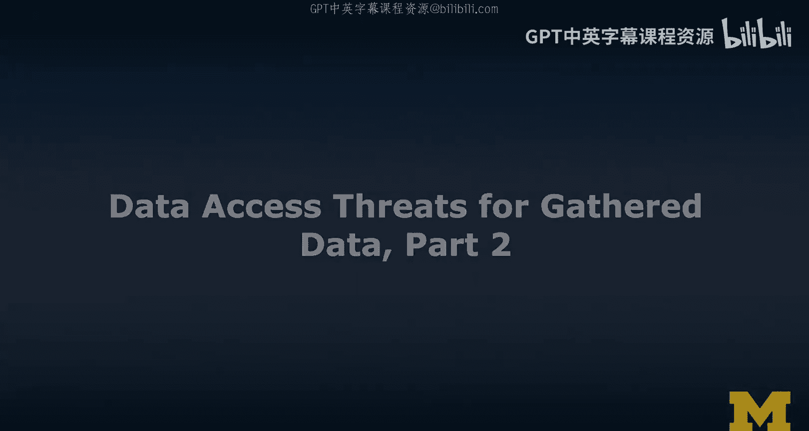
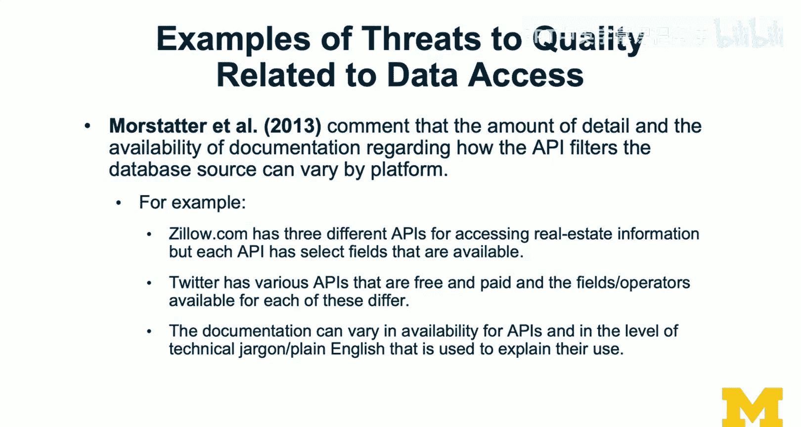
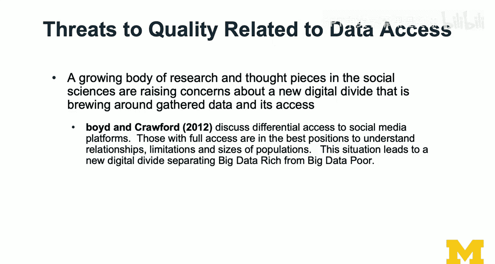
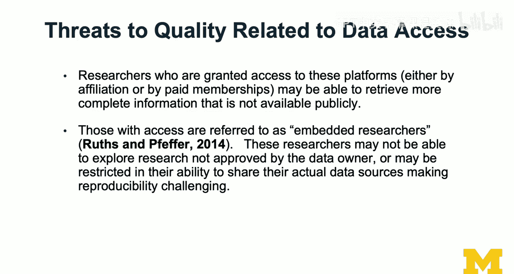
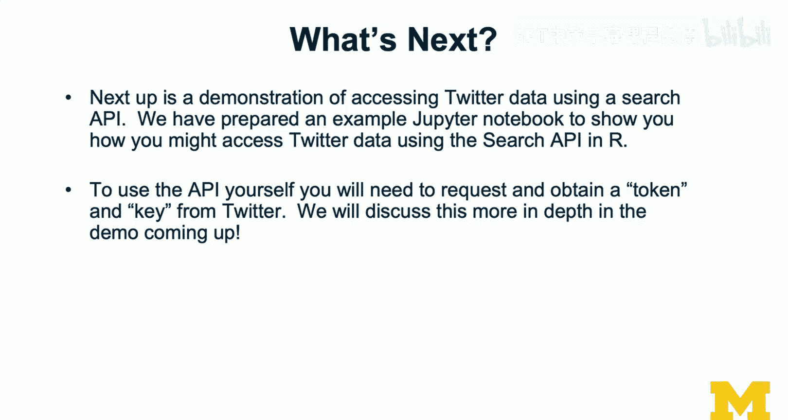
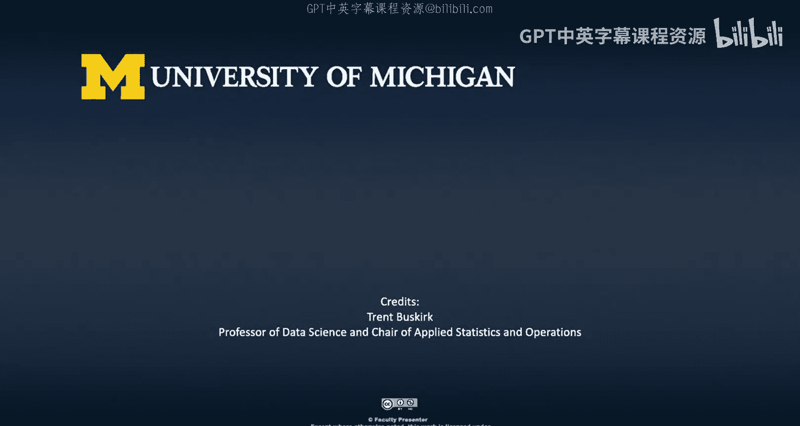

# 密歇根大学《总体数据质量（框架、度量、设计策略）total data quality》 p26 25_采集型数据访问威胁因素（第二部分-共两部分）.zh_en -BV1Jn4y1X7uS_p26-

Hello， welcome back。 Trent Buskirk。 We are going to talk about data access threats for gather data。

 and this is the second part of this discussion。

So I just want to remind you last time we talked about data access and what that really means。

 but just as a refresher， data access refers to the methods or approaches or tools that you use to retrieve information from various sources。

So for gather data， we think about data access as being able to sort of be accomplished using a couple of different methods web scraping is one application programming interfaces otherwise known as APIs is another。

 and then of course there are vendors and upstream data sources like apps and sensors and other kinds of peripherals that allow you to get information as well。

 we're going to talk a little bit about all of these things here。

Just to keep you abreast of sort of where we fall in our dimension framework， again。

 we're on the representation side of the framework and we're in between the target population and the available data sources。

 this is where the data access is actually occurring so today we're going to be talking about some threats to the data access piece。

So again， some of the main things I think about when I think about threats to quality related to data access are around the platforms and their corresponding APIs。

 these different platforms depending on where you go to access the data that you care about using an API。

 for example， they set terms of use and declarations about the underlying quality of data are often referred to as as is。

 here's an example。Zillow provides the Zillow API， the Zillow data and the Zillow brandon links。

 as is with all faults and as available。 These are terms that they actually include in their terms of use。

 And so again， as the user， it's always on you to beware of some of the inadquacies。

 some of the data quality issues that might be in errant in the data that you are about to to acquire through these Apis。

 Again， these are things that you should be aware of and these are obvious threats that we may not be able to fully understand because the terms of use and the available information that is provided by these sources is relatively limited and some。

 in some cases， proprietary， but it is available for you to know as a risk。

 So these are things to look for in the terms of use documents。

Dononzalez and Valon and colleagues in 2012 concluded that there is a strong indication that Twitter returns tweets from those users who are more centrally located in the network of the search API compared to the streaming API。

 So in addition to these sort of terms of use and as is conditions。

 there are also variations in what you might get， if you use different kinds of APIs to access presumably the same corpus of information。

The Twitter data collected from the same set of hashtags can be different。

 depending on the access choices of the Twitter search， the Twitter streaming API or the fire hose。

 and this has been shown by a couple of different references as we've indicated here， for example。

 the top 100 hashtags had a majority of them overlapped versus the random random top 100 or random set of hashtags。

 where most of them overlapped。 So again， the point here is that you're going to get a large consistency in the results by using these different search mechanisms or different APIs。

 which is sort of what we would expect。 but you won't get the exact same results every time as as has been indicated by several of the sources here。

 So if you're looking for something that's going to be completely reproducible even。

In the same platform like Twitter， for example， using different API mechanisms or different tools that they have for access can produce slightly different results。

 even if you're using two different tools to access the same corpus with the same search terms。

 So these are things that are important to realize that if you access the data using one version of the API and your colleague uses another and everything else is equal。

 there's no particular guarantee that your data will the the sourced data will be exactly the same。

More Seutter and colleagues in 2013 offer some additional comments about this about the availability of documentation regarding how the APIpis work。

 There are varying levels of documentation that are available， and that varies by platform。 So。

 for example， Zillow dot com has three different APIs for accessing real estate information。

 but each of the APIs has different fields that are available for selection。Twitter has various APIs。

 as we've already mentioned， the streaming API， the search API and the fire hose that vary from the free version to the paid version。

 And what differs in those APIs is the amount of fields or the operators that you can use for your particular filtering tasks or the particular search tasks。

 And， of course， the documentation can vary in the availability for the Apis。

 And they are often written in technical jargon and plain English is often not the typical way that Apis are described。

 So there are different variations in terms of the level of information that's available。

 as well as the kind of results that might be might be had by using these different APIs。

 So these are things to consider that are not necessarily in your control as the user。

 but you can be aware of them going into the use of these tools。

There's also a growing body of research that talks about this new digital divide。

 We foreshadow this discussion a little bit in the last video， but Boyd and Crawford in 2012。

 discussed differential access to social media platforms。

 And so when you hear the word digital divide， you might think， oh。

 people that have internet and those who don't or people who have access to particular connectedness and those who don't。

 But in fact， this digital divide， according to Boydden Crawford。

 really refers to differential access to social media platforms。

Those who have full access to these digital social media platforms are in the best positions to understand the relationships between variables that you might care about and the relative populations that you're trying to study。

But those who do not have full access to these platforms may actually be data big data poor in that they are not able to fully understand the relationships between all the variables that might be available and the full population。

 So there are these things called embedded researchers who have specific relationships with social media platforms that allow them to have access to even deeper filters with a larger set of variables that could be used for data gathering。

 So this actually creates quite an interesting dilemma for research purposes and for reproducibility of research。

So some of these， you could have access that is granted to these platforms by your affiliation。

 so perhaps your university or your corporation has a relationship with a social media。

 data provider or a paid membership through maybe an API access， for example， or a fire hose access。

Those who have access are referred to， like I mentioned earlier， embedded researchers。

 that's really the formal term for it。 And those these researchers may not be able to explore research。

 not approved by the data owner， or may be restricted in their ability to share what they've actually learned from these data sources。

 making these these results， the reproducibility of these results challenging。 So again。

 the threat to quality here， in my opinion， is around the reproducibility。

 It's also around the reporting that would allow us to get the context in which we could actually properly vet the research。

 the results and the overall data that is presented。

Another threat to data access for gather data is around the platform limits that are set by particular platforms themselves。

 So one of the things that we could think about is there are limits with respect to the embeddedness of a researcher。

 So how far can the researcher go in terms of retrieving information from the platform。

 That's one kind of threat。 But a more broad threat has to do with any old researcher whether they're embedded or not。

 trying to get data from a particular platform。 If you're trying to use APIs。 for example。

 from Twitter， there is a limit for the number of queries that one can make with a Twitter search API。

 Let's look at a particular example here， Twitter calls these things rate limits and they govern the amount of information that can actually be retrieved for a given account。

 So， for example， using the Twitter search API to retrieve tweets。 There is a limit of。

A total of 450 query requests per 15 minute time interval。

 This rate limit actually is set by Twitter， and it can change at any time。

 It can actually be more liberal。 In other words， allowing you to have more queries in a smaller amount of time。

 or it can be more restrictive to have fewer queries in a smaller amount of time or a larger amount of time。

 These are set by Twitter， and they're governed by the platform owner。

 We don't have control over that as users。 Liits can also be placed They can also vary by the type of information being retrieved。

 You can have different limits for the number， for the queries seeking user information versus seeking the number of tweets。

 We'll talk about that in just a second。Twitter also limits the number of tweets archived per user to 3200。

 This is a hard and fast rule that Twitter has specified in order to help keep the amount of information that is required for storage to be relatively manageable。

 but this limit may impact the completeness of a data set or the expected sample yield that you would expect when you are querying Twitter。

The limit may impact the choice of access method as well。

 if you are really interested in trying to maximize the yield of tweets。

 as opposed to maximizing the yield of， say， tweets in a particular key word。It also。

 we also have to think about how this limit may impact the quality of a given study in terms of its reproducibility。

 because remember， the 3200 tweets is a cumulative total that is a running tally。

 And so as people continue to contribute to Twitter。 and as the timeline moves on。

 your ability to look at a particular user going back in time may be limited if that user is posting heavy amounts of tweets as they continually use Twitter。

 Once they reach that 3200 cap。 That's the lens that you have to look at those that particular user's archived information。

Let me show you an example of how this might impact things in this particular graphic shows the cumulative number of tweets for a user called Go Blue。

 So this is the cumulative number of tweets。 And you can see the timeline。 So obviously， in 2019。

 this user had accumulated 6400 tweets that he had posted to Twitter。

The most recent 3200 tweets are available publicly for access using the API。

If I had a study that wanted to go back to 2016 and look at what people were saying in 2016 on Twitter publicly。

And I were to query this particular user。 Go Blue would not be included at all in the returned results from the Twitter API because in he had no tweets that were available in 2016 because his most 3200 recent tweets had occurred after 2016。

 So using the Twitter API， I have a lens into his most recent3200 tweets。

 None of those would have occurred in the year 2016。

 And so I would not be able to figure out what this particular user was saying in 2016 using the Twitter search API as it normally is used because this person had tweeted quite a lot after 2016。

 And that was what the lens would allow me to see。 So these limits can actually impact the completeness of my dataset sets that I'm getting and could impact the way that I would learn about these particular users over。

Time。To give you a heads up for what's next， we're going to demonstrate accessing Twitter data using the search API as we've talked about a little bit here。

 we've prepared an example for a Jupyter notebook to show you how you might use how you might access Twitter data using the search API using the R software package to use the API yourself。

 You're going to need to request and obtain a token and a key from Twitter。

 We're going to discuss that in more detail in the demonstration coming up。 so stay tuned。

 Thanks for joining us。

