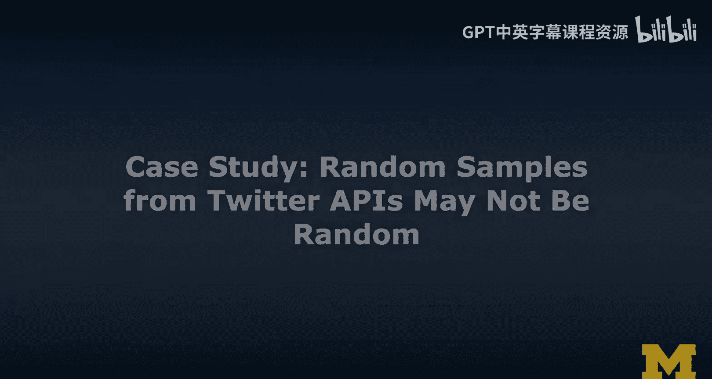
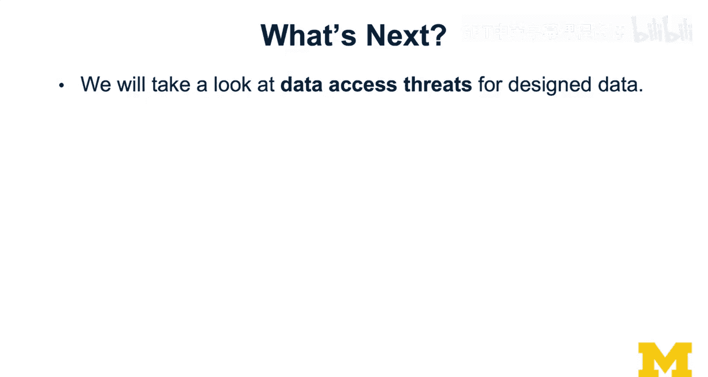

# 密歇根大学《总体数据质量（框架、度量、设计策略）total data quality》 p27 26_案例研究：Twitter API随机抽样的非随机性问题.zh_en -BV1Jn4y1X7uS_p27-

In this lecture， we will take a look at one of the data access threads with an example of Twitter data collected through application programming interface or API insured。

Twita data has been widely used to model social media user FEP behaviors and information dissemination on social networks。

Data about user profiles and activities on Twitter are available for download through Twitter APIs。

There are three types of APIs to collect Twitter data， free streaming or search API， premium API。

 and enterprise level API。Free streaming or search API is free。

 but comes with limits on the amount of tweets and data instances that can be collected。

Premium API costs money but provide more large scale data than free APIs。

Enterprise level API often requires the payment of substantial amount money。

 but guarantees access to the rich source of Twitter data。Usually。

 many research universities have access to the 10% random sample of the real time Twitter。

 which is called Deccahose API。There is also FireHt API。

 which allows users to access all the tweets in near real time。In many cases， however。

 only your sample of Twitter data is available， even if you have a full access to Twitter data， size。

 information types and time span of gathered Twitter data can vary depending on the choices of APIs you use。

 for example， such API versus streaming API。A caveat here is that Twitter does not disclose details about how random samples of tweets are created。

 so a question naturally arises。Our sample Twitter data representative。If not。

 then how can we know that research that binds together Twitter data is reliable？

Several studies have attempted to answer the question。

In a 2014 study by Gonalez Ballen and colleagues， researchers gathered three sample Twitter data sets through search and streaming APIs。

Search API collects a sample of tweets dating back to seven days。

 while streaming API gathers up to 1% of all tweets on a real time basis。

After Twitter data are gathered， they compared whether Twitter users in the gathered datasets are similar or different。

First， here's a basic concept to understand their findings。In network analysis of Twitter users。

 our Twitter user is said to be central if she or he is mentioned more often or retweeted more times in the flow of communication。

The key findings of the study is that smaller samples are not a random subset of the larger samples。

 specifically smaller samples do not represent well the activities of users who are not central in the re to it and mentioned networks。

According to the study， mentioned networks are more biased because users who mentioned very often are not necessarily active in retweeting。

Another study by most data and colleagues conducted similar comparisons in 2013 they gathered Twitter data using a fire host streaming API and a streaming API。

As mentioned before， FireHt streaming API allows access to 100% of all public tweets。

They compare the correlations of top topics first between the two data sets and then between the streaming API sample data and the 100 random samples of the fireHse data。

According to the study， sample data from a streaming API estimated well popular topics with high frequency of hashtags from the fireHse data。

 but not so much for unpopular topics。Streaming API sometimes produced negative correlational popular topics with the FireHse data。

 while top topics in random samples were highly correlated with the FireHse data。

These findings indicate that streaming API may produce data that do not represent the population of the Twitter users and their activities。

We will take a look at at data access threads for design data。

