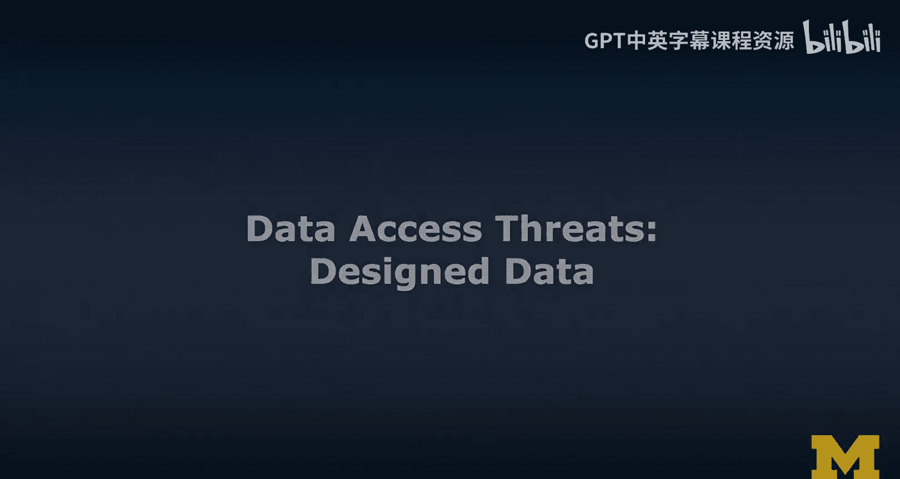
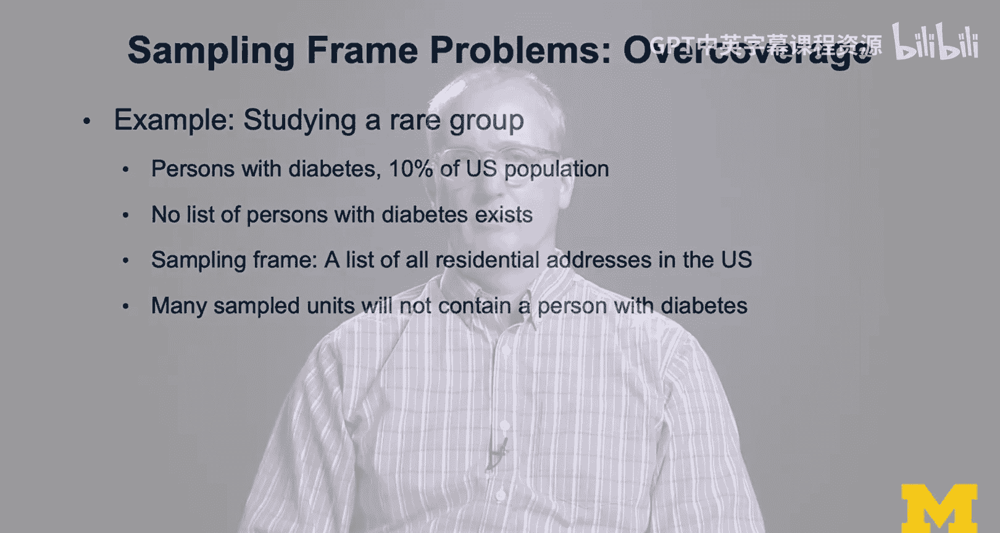
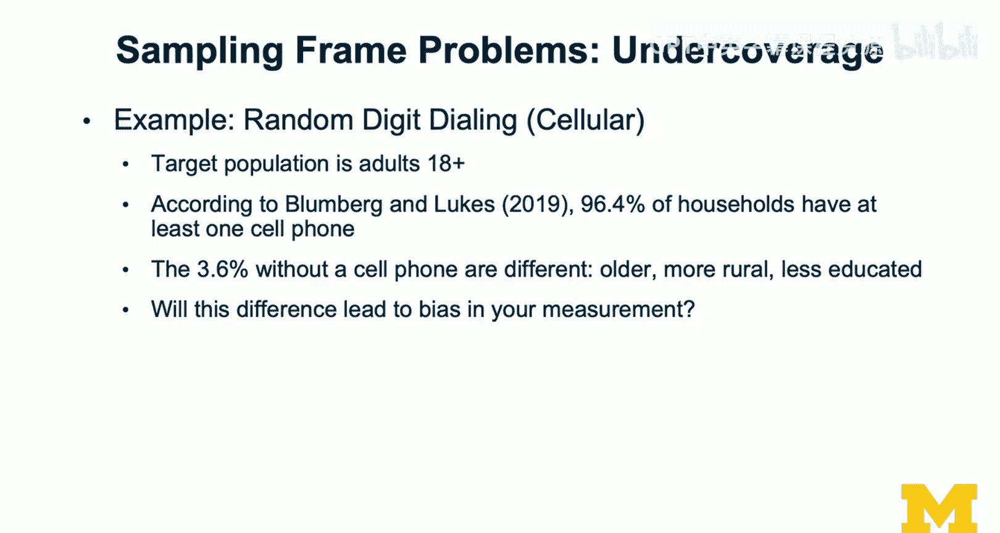

# 密歇根大学《总体数据质量（框架、度量、设计策略）total data quality》 p28 27_设计型数据访问威胁因素.zh_en -BV1Jn4y1X7uS_p28-

Welcome， today we're going to talk about data access threats to designed data。

And here's just a reminder of the overall picture of the total data quality framework。

We're going to be focusing on that relationship between the target population and available data sources。

 the area known as data access。And specifically， how that relates to design data。

Researchers collecting design data access the population through a sampling frame。

A sampling frame is a set of materials or processes through which the population is accessed。 So。

 for example， a set of materials might be a list of persons。

Let's say my target population are students at the University of Michigan。

 I might have a list of all students at the University of Michigan。

 and I can sample directly from that list。That's an example of a sampling frame that is a set of materials。

On the other hand， I might be interested in a population for which there is not a list of all eligible units。

In that case， I might have to design a sampling frame that is a process。For example。

 there's a process known as random digit dialing that would allow me to access telephone numbers。

If I know basic features of the telephone system， including which kinds of phone numbers are assigned to housing units。

 which kinds of phone numbers are cellular or mobile and which kinds of phone numbers are landline。

Then I can construct a sample of phone numbers by randomly generating those phone numbers。

That's an example of a process， a sampling frame that is a process that will allow me to access my target population。

Now， sampling frames are often imperfect， and there's four main issues。The first is over coverage。

 When I have units on my sampling frame。That are not part of my target population。Under coverage。

 when I have units that are not on the sampling frame that are part of my target population。

Dupplication and clustering。I'm going to spend most of the time looking at overcover and undercover。

Overcover is that when a sampling frame includes ineligible units。

 and this is mainly a cost issue because I need to identify eligible persons。

 I may have to spend time。Contacting and screening。

 identifying whether or not a person or establishment is eligible in order to identify my sample of eligible units。

Think about an example where I'm studying a rare group。Persons with diabetes， for example。 Now。

 persons with diabetes are about 10 per cent of the US population。 Now， there is no sampling frame。

 That's a list of person with diabetes。 So I'm going to have to find some way to sample persons with diabetes。

 One idea might be to sample a list of all residential addresses in the United States。

I have already said that only 10 per cent of persons have diabetes。 If I'm sampling addresses。

 a large proportion of those addresses will not contain a person who has diabetes。

Many sampled units will be ineligible。 They'll be over covered。

They're not part of my target population， and it may be expensive to identify the units that do contain an eligible person。

The other kind of problem is under coverage。 Fme does not include all of the eligible units。Now。

 this can be a problem that leads to a possible bias。

 Are the undercover units different than the covered units， And in this figure。

 you can see that represented because the eligible population。

 that large yellow circle is larger than the sampling frame。

 There are units in the eligible population that are not included with that sampling frame。

Here's an example of potential undercover。 We talked a moment ago about random digit dialing。 Now。

 I know enough information about the sampling frame that I can determine which numbers are likely to be cellular and which are likely to be landlined。

 and I can generate a sample of cellular phone numbers。Now， let's say my target population is adults。

18 years of age and older。According to Bom Bloomberg and Lukes， who run a large face to face survey。

 about 96% of households have at least one cell phone。

If I'm using a sampling frame that allows me to access persons with cell phones。

 there are still about 4% of households that I will not be able to access。

And we know from the survey that Bloomberg and Luke's conduct。

That the persons in those 4 per cent of households are also older， more rural and less educated。

 And that might matter for the things that I'm measuring。

 that under coverage might lead me to have a biased picture of my target population。

It's possible， and I'll need to assess that risk when I'm looking at the potential quality of a survey based on this sampling frame。

