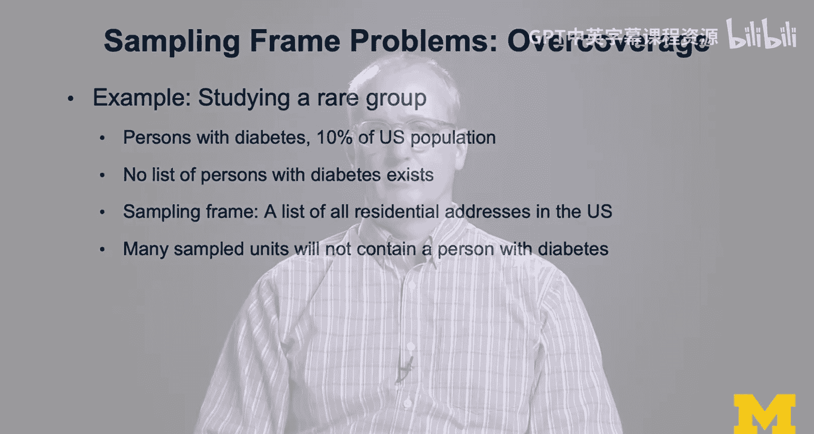
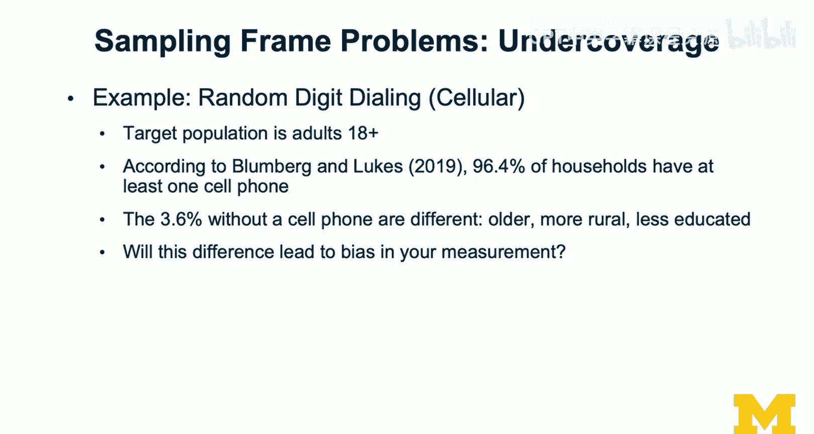

# 总体数据质量：2.7：设计型数据访问威胁因素 🔍

在本节课中，我们将学习设计型数据访问过程中可能遇到的威胁因素，特别是抽样框的覆盖问题。我们将探讨抽样框的定义、其不完美的表现，以及由此产生的覆盖误差如何影响数据质量。

---

## 总体框架回顾

上一节我们介绍了总体数据质量框架。本节中，我们将聚焦于目标总体与可用数据源之间的关系，即“数据访问”环节，并具体探讨其与设计型数据的关系。

## 抽样框的定义

研究人员通过抽样框来访问总体以收集设计型数据。抽样框是一套用于访问总体的材料或流程。

以下是两种抽样框的示例：

*   **材料型抽样框**：例如一份人员名单。假设我的目标总体是密歇根大学的学生，我可以拥有一份所有学生的名单，并直接从中抽样。
*   **流程型抽样框**：当目标总体没有现成的合格单元名单时，可能需要设计一个流程。例如，**随机数字拨号** 就是一种流程。如果了解电话系统的基本特征（如哪些号码分配给住宅、哪些是手机号、哪些是座机号），我就可以通过随机生成电话号码来构建一个样本，从而访问我的目标总体。

## 抽样框的主要问题

抽样框通常并不完美，主要存在四个问题。我们将重点探讨覆盖过度和覆盖不足。

以下是抽样框的四个主要问题：

1.  **覆盖过度**：抽样框中包含了不属于目标总体的单元。
2.  **覆盖不足**：属于目标总体的单元未被包含在抽样框中。
3.  **重复**：同一单元在抽样框中出现多次。
4.  **聚类**：单元在抽样框中的分布不均匀，形成集群。

### 覆盖过度

覆盖过度是指抽样框中包含了不合格的单元。这主要是一个成本问题，因为我需要识别合格对象，可能需要花费时间进行联系、筛选，以确定一个人或机构是否合格，从而识别出我的合格样本单元。

考虑一个研究罕见群体的例子，例如糖尿病患者。在美国，糖尿病患者约占人口的10%。目前没有现成的糖尿病患者名单作为抽样框。一个想法是从美国所有住宅地址的名单中抽样。由于只有10%的人患有糖尿病，那么抽样的大量地址中将不包含糖尿病患者。许多被抽样的单元将是不合格的，即被过度覆盖。识别出包含合格人员的单元可能成本高昂。

### 覆盖不足

覆盖不足是指抽样框未能包含所有合格单元。这可能导致潜在的偏差问题：那些未被覆盖的单元与已被覆盖的单元是否存在差异？

在下图中，可以看到合格总体（大的黄色圆圈）大于抽样框，意味着合格总体中有单元未被包含在抽样框内。

这是一个潜在覆盖不足的例子。我们之前提到了随机数字拨号。假设我掌握了足够的信息，可以区分哪些号码可能是手机号，哪些可能是座机号，并且可以生成一个手机号码样本。现在，假设我的目标总体是18岁及以上的成年人。

根据进行大型面对面调查的Bom Bloomberg和Lukes的数据，约96%的家庭至少拥有一部手机。如果我使用一个能访问手机用户的抽样框，仍然有大约4%的家庭无法访问。我们从Bloomberg和Lukes进行的调查中得知，这4%家庭中的人通常年龄更大、居住地更偏远、教育程度更低。这对于我所测量的内容可能很重要，这种覆盖不足可能导致我对目标总体的描绘产生偏差。

这是可能的。在评估基于此抽样框的调查的潜在质量时，我需要评估这种风险。

---

## 总结

本节课中，我们一起学习了设计型数据访问的核心概念——抽样框，并深入探讨了其不完美性带来的主要威胁：覆盖过度与覆盖不足。覆盖过度会增加研究成本，而覆盖不足则可能引入偏差，影响数据对总体的代表性。理解这些威胁是设计高质量数据收集方案、评估数据可信度的关键一步。

