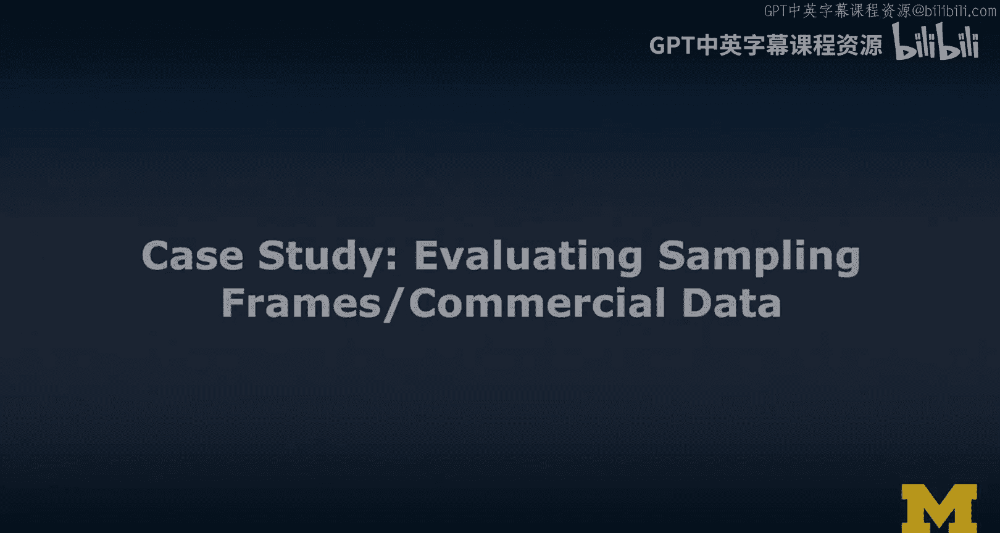
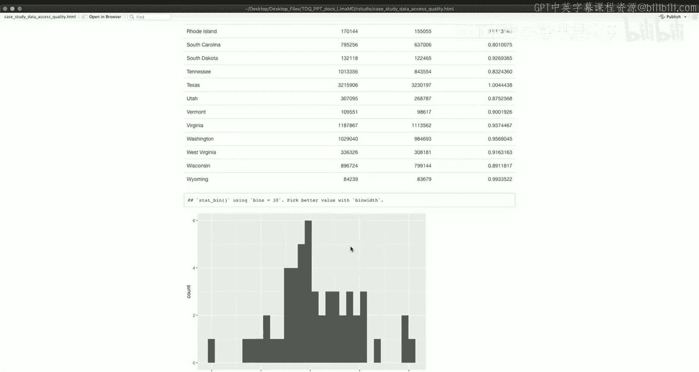
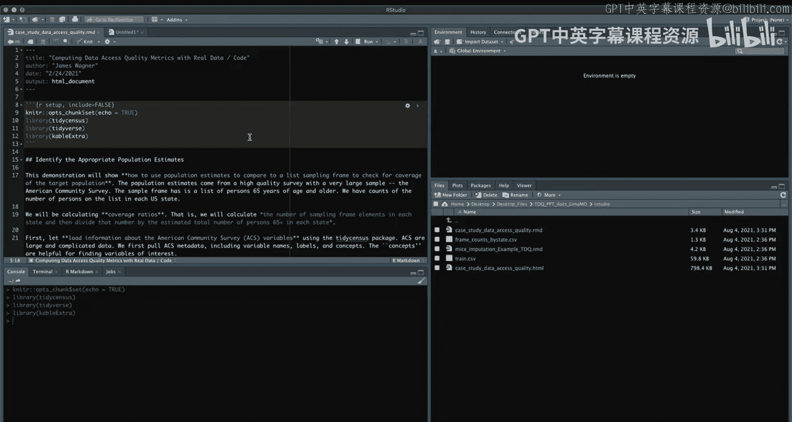
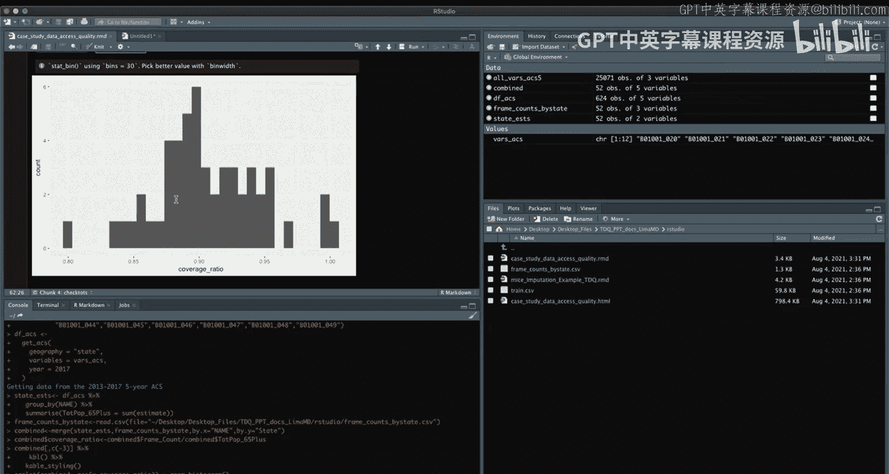
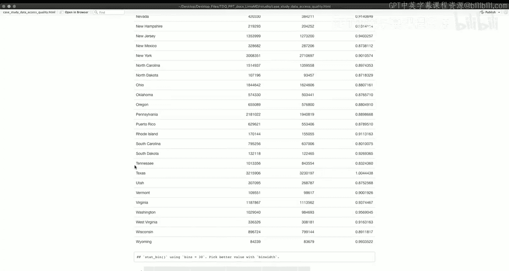

# 密歇根大学《总体数据质量（框架、度量、设计策略）total data quality》 p29 28_案例研究：商业数据抽样框架评估.zh_en -BV1Jn4y1X7uS_p29-

Welcome today we're going to talk about computing data access， quality metrics。

 and we're going to use real data and real code to do this Now first I'm going to give you kind of an overview we're going to walk through the final report that we're going to be generating today and then after we've looked at that report we're going to go to the program and take a look at the steps that you'll need to take in order to complete this demonstration project for yourself。

So we want to identify the appropriate population estimates to compare to our sampling frame。Now。

 our idea here is that we're going to use those population estimates as kind of a benchmark。

 we're going to say that's our target population， and we're going to count the number of cases or elements we have on our sampling frame to compare to that population。

If the number of elements on our sampling frame， our list is smaller than the population。

 it implies that theres some coverage error that we don't have all of the cases in our population on our sampling frame。

But we'll talk about that in more detail when we get to the final report。

What we're going to be calculating are called coverage ratios。

 and that's simply the number of sampling frame elements in each state in our case。

 and I'll tell you more about the case when we get to it and then divide that number by the estimated total number of persons 65 years of age and older in each state。

And as I said a moment ago， if that ratio is less than one。

 then I think that my sampling frame does not have complete coverage of my population。Now。

 the method isn't perfect。 It might be that there are duplicates on my list。

 It might be that I have some ineligible units on my list。

 That is cases that aren't really part of the population， but they made it onto my list somehow。

And so I might find that some of these coverage ratios are actually greater than one。Again。

 indicating that the frame is imperfect in some ways。

 but we're going to use it generally to say do I have adequate coverage。

 do I have a very large proportion of the population on my sampling frame？

Now the first step in doing this is to load that benchmark information that I talked about a moment ago。

 that benchmark information comes from something known as the American Community Survey。

The American Community Survey is a very large survey that interviews about  three million households each year。

And it's that survey， which allows us to estimate population totals by state。

And it's a very accurate survey with very high response rates。

 so it's a very good but not perfect instrument or benchmark for us to use。

So when we get to the code， I'll show you how do we load that information from that American Community Survey and how do I identify the data elements from that survey that we're interested。

 the variables of interest。So once we。Identify which variables of our interest or of interest to us。

 then we pull those variables into our program and we'll be using R to do the analysis。

 and then we can compare those to counts from our sampling frame。

That's going to give us those coverage ratios I talked about once we've taken our sampling frame totals by state。

 we can take the benchmark ACS counts of eligible persons by state and we can compare them to create that coverage ratio。

The last thing you see in the report are those coverage ratios。 So I have in this first row。

 for example， the state of Alabama。The AC C S says there are 762。

Thouous32 persons over the age of 65 in Alabama。My sampling frame has 706853 persons。

The coverage ratio therefore， is about 93%。And I'm going to do this for each state to say。

 how good is the coverage in each of these states。 And if you look。

 you'll see many of these are in the range of 087 to 094。But I did notice one here。

 Texas that's slightly over one。So that could be that state where。

My sampling frame has many duplicates or many ineligible persons， persons who are not。

Older than the age of 65， for example。And finally， we'll create this histogram that shows us the distribution of those coverage ratios so I can look at instead of looking。

 counting and reading them all， which is difficult。

 I can look at this picture to see how good is the coverage ratios。

 There's one that's the lowest one is about 08。And there's this one that we identified over one。

 but other than that， it looks like they're all centered around 0。

8 or the distribution centers around 0。89 or 0。9 or so。

So let's take a look at the program that generated this report。

I'm using an interface to the R program known as R Studio。

 and it allows me to create these R marked down compileilable reports that we were just looking at。

And that's what I'm using here， I've created a program。It's available on the course site。

 case study data access quality。RMD that's the name of the program。

 and the header gives the title Comping data access quality metrics with real data and code。My name。

The date when we wrote this program and where the output should be routed to。

 I want it routed to an HTML document that we were just looking at， the one we were just looking at。

Now in R， I'm going to need some packages。It's an open source code。

 I need some packages that are going to support the analysis that I'm going to do。

 And so here are those packages。 The first one I'm going to make note of is called tiy census。 Now。

 that's the one that allows us to get access to the American community Surve data through an API。

One of the things in the background you'll need is a key。

 All you have to do is go to the census website。Log in and they will give you a key so that you can access census data。

So that's running in the background， that's a step that you'll need to take in order to run this code for yourself。

Now， one of the nice things about these files is that I can run pieces of code， these RMD files。

 I don't have to just generate that final report， so I'm going to run that chunk of code and see what happens。

Not too much， just loading the packages that I need for the analysis。Now。

 the first thing to do as I said earlier is to say what variables do I need If I want to count the ages of persons。

 I'm going to need variables that have age。 So here I'm using some of those tidy census functions to access information about the A C S data set。

 I'm not accessing yet。 the A C S directly， it's a very large data set。 Remember。

 I said every year they interview 3 million households。

And if I'm looking at more than one year， I might be looking at 15 million households。

 so there's a lot of data。And there's a lot of variables。 The ACS， I think。

 is about a 15 page survey。 So there's a lot of variables。 I don't want all of them。

 I only want the ones that I need， so I'm going to look for those variables that include information about age。

Remember， I was most interested in knowing。Persons 65 and older。 That's the category I'm looking for。

 So I'm going to access metadata about the A C S variable by running this chunk of code。

 It's going to give me the 2017。ACS 5 year data set。

I want tables and variables associated with sex by age。 I want the information about those variables。

 Again。 I'm not yet asking for the data。 I'm just asking for a part of the code book， if you will。

So I'll run that section of code。It takes a minute because it's actually going to the census website and it's pulling the list。

 here they are。Now， you might begin to appreciate why I wanted to do this because the variables in that ACS data set actually have names that don't look very meaningful。

The estimate total is B 0，1，0，0，1。 underscore 0，0，1， not a very informative name。

 But if I use these functions， I can look for concepts like sex by age that are going to be the variables that are interest to me。

The next step is to pull the variables of interest。 So here， I've listed out those variables。

 I took the I took the previous list。I'm only showing first 10 of 49 rows。

I found that age groups that were of interest to me notice that this is in。4。😔，3。😔。

These are different categories of ages。 I wanted 65 plus。

 so I'm pulling those variables that give me those age groups。

 the counts of persons in each of those age groups。And I want them by state。

So I'm asking for state level estimates， and I'm going to store that information。

 I'm going to summarize those age groups into a variable that I'm calling tote pop underscore 65 plus。

 and that's counts of persons。65 years of age and older by state。 Okay。

 so let's run that chunk of code。Getting data from the 2013 to 2017， Five year AC S， big data set。

Didn't take too long。 I'm pleased with that result。

Now the next step I want to calculate and report coverage ratios。

First thing I need to do is get frame counts。Well， I'm going to provide those for you。

 I'm going to provide a file that has counts of how many persons are on my sampling frame in each state。

And then I'm going to merge that with the information I just took from the ACS。

Then I can calculate my coverage ratios。And then I'm going to report it in a table that I think looks nice。

And I'm going to report it in a plot。The histogram that I showed you a moment ago。

 and I showed you this。I should do this table， as well。So let's run that code and see what happens。

All right， so the table is long。I think its， think it's stored in this object。

 I'll go back to the H to show you what the table looks like to remind you。

 But here's that graph that shows the distribution of the coverage ratios for each of the 50 states。

 And again， it looks like 6 states are at about 0。9 coverage ratio。 And generally。

 it looks like almost all of the states are above 0。83 on the coverage ratios。

One state very close to one， one state a little higher than one。Okay。Let's go back to the report。

To look at the table。Now， if I wanted， I could take more time to format this table to make it look nicer give the columns nice labels。

I don't think I actually need this many decimal places in my coverage ratio。

 so I could do some work to make this table look better。

 but it's given me the essential information I want。 I want。 I now know。

What the coverage ratios are for each of these states。

 And I can start to explore whether I might be concerned that my sampling frame isn't adequately representing the population。

 at least in some states。

So that's the code， that's the results， and that's one approach to measuring data access quality。

