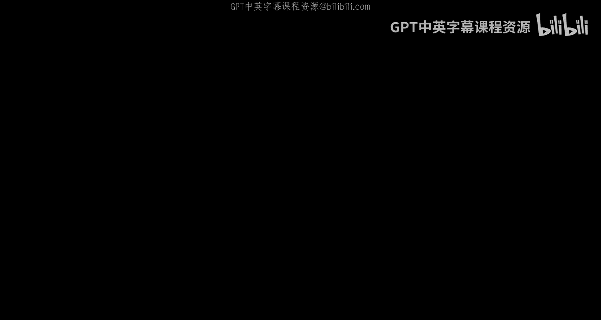
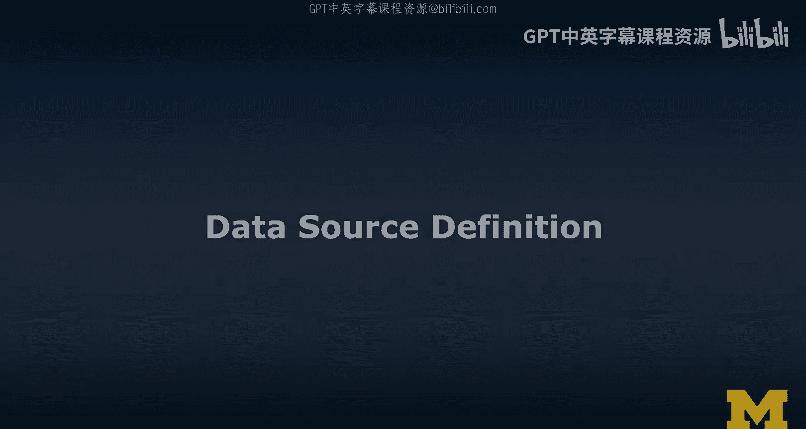
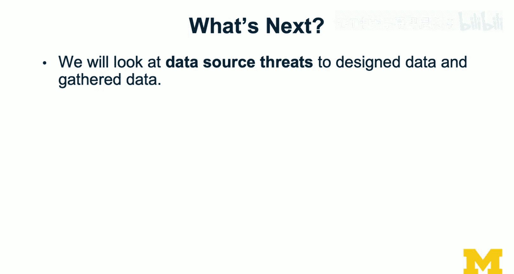

# 密歇根大学《总体数据质量（框架、度量、设计策略）total data quality》 p30 29_数据源的定义标准.zh_en -BV1Jn4y1X7uS_p30-

Welcome， today we're going to start talking about data source。

 and we're going to start with a definition of data source。

NowFirst let's have a reminder of the dimensions of total data quality， the big picture。

 we've been talking about representation errors， and we just finished talking about data access errors and now we're talking about data source errors we're going to start with a definition。

 but as you can see from this picture we're going to look at the relationship between available data sources and the available data that we end up using and we're going to talk about what errors can be created in this step in the representation process。

But let's start with a data source definition and we're going to start with a definition that will apply to design data。

Data source error in design data is the result of sampling from a population。

We sample for a variety of reasons， but mainly in order to reduce costs。

 design data will often sample from the target population and then measure just the sample。

Might be very expensive to collect data on the whole population in the US。

 there's a census of the entire population， but there's only one census because it's very expensive to do。

 And it's only done once every 10 years。Most of the time we do a survey where we first draw a sample from the population。

Now， this process of sampling actually introduces error。And that error is known as sampling error。

Now， this kind of error is expected and known， and， in fact。

 it's well understood and can be mostly predicted ahead of time。 That is。

 when I set my sample size for my sampling， I know what kind of sampling error I should expect when I finally get my data in hand。

There's a whole subfield of statistics devoted to accurately estimating and even predicting sampling error。

To help us design samples for future data collections。But also， as I said。

 to help us estimate sampling error。I will look at this in more detail later。

 but many different kinds of sampling designs call for different estimation strategies。

 And so it's important to be aware of is the estimation strategy I'm using appropriate for the sample design of the data that I am analyzing。

Sampling error is often reported as the variance or standard error of a statistic。

So we can quantify the error that is introduced through sampling for gathered data。

 data source errors result from sampling data。As with design data。

 the sample can be drawn from a source that is a set of materials。 For example。

 a corpus of images or a process。 And here we mention Twitter。

 And think of it as a process in this sense that Twitter is something that's evolving that's constantly happening。

 that's changing over time。Right now， as I speak， people are issuing tweets。To Morrow， presumably。

 people will continue issuing tweets。 I can't sample from to Morrow's tweets， but in the future。

 I'll be able to look back retrospectively and sample from points in time in that process。

 we call Twitter。Errors can result for gather data from this sampling or selection process。

Now in some situations with gathered data， there is no sampling， we have all the data。

You might think of an analysis of Medicare。Is a kind of situation where there is no sampling。

 Medicare gathers all of the records from medical procedures。

 visits to medical facilities by patients over the age of 65。

 It gathers all of those data together in essential database and analyzing that database might be thought of as the whole population。

 If your population is persons over the age of 6065 receiving medical care。

So there's no sampling I'm simply analyzing all the data。Now， in other situations。

 sampling does occur。 For example， if I want to analyze Twitter data， if I want to。

Draw a sample of tweets。 I need to use key words to define which type of tweets I want。

 And I have to specify the time period that I'm looking at。

And we'll find out later that that definition of keywords and even time can be important for my results。

 So I might get different sets of tweets， depending upon which keywords I use。

And you may be surprised to find that the。Results can be quite sensitive to the specification of those keywords。

Another example of sampling， which you may not have thought of before， is a corpus of labeled images。

All right， so people want labeled images for their machine learning procedures。

 somebody selects those images and labels them。That's a sample of all images。 Now。

 if they're taken from the internet， then it's a sample of all images available on the Internet。

How that sample is selected。Which images are eligible to be selected。

 Is there a bias in the procedure that samples those images that might lead the corpus to take our machine learning algorithms down the wrong path to lead us to the wrong kind of predictions for new cases that aren't well represented in the corpus。

It's a problem we'll learn more about in future lectures。

The other thing that I'll mention here is that gathered data often contained designed elements。

 We were just talking about labeling images so。Often， when machine learning is needed。

 we'll need some kind of training data。For example， a corpus of labeled images。

And they contain labels that may be generated by human beings。 That is human beings review images。

 and they decide what's in the image。 They give it a label。 Then the training data。

 train models that are used to label new data。Okay， so that's the machine learning process。

As I noted a moment ago， the selection of the training data can have an important impact on the results。

If the corpus of images that are selected and labeled。Do not well represent the target population。

 Then our machine learning models may introduce a kind of bias into our predictions。So what's next。

 we'll look at data source threats to design and gather data。

