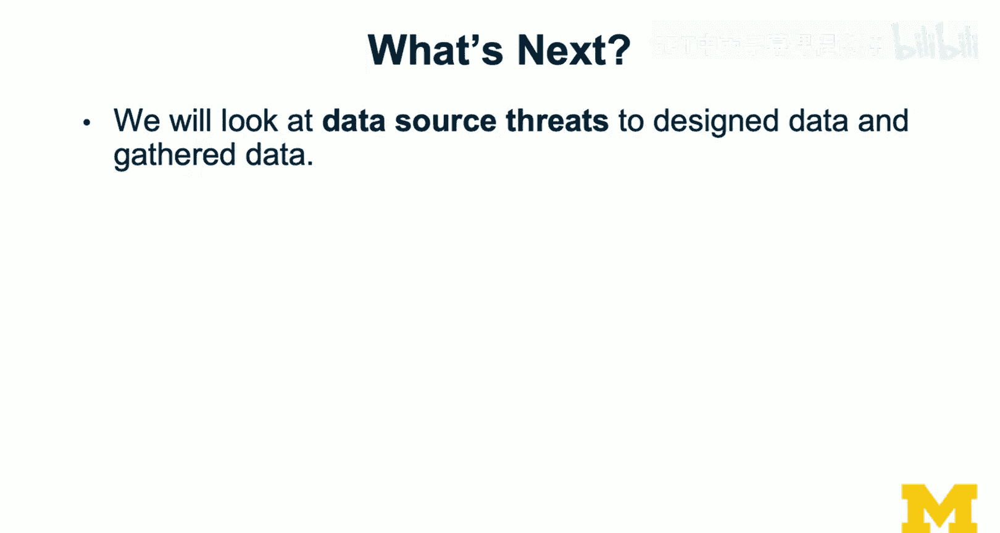

# 总体数据质量（框架、度量、设计策略）：第29节：数据源的定义标准 📊

在本节课中，我们将开始探讨数据源，并首先明确其定义。我们将了解数据源在总体数据质量框架中的位置，以及从数据源到可用数据的过程中可能引入的误差。

## 总体数据质量维度回顾

上一节我们讨论了数据访问误差，现在我们将焦点转向数据源误差。首先，让我们回顾一下总体数据质量的整体框架。如下图所示，我们将审视可用数据源与我们最终使用的可用数据之间的关系，并探讨在数据表示过程的这一步骤中可能产生的误差。

## 数据源的定义

本节中，我们来看看数据源的定义。我们将从一个适用于设计数据的定义开始。

在**设计数据**中，数据源误差是**从总体中抽样**的结果。我们进行抽样有多种原因，但主要是为了降低成本。设计数据通常会从目标总体中抽取样本，然后仅对样本进行测量。

在美国，对整个总体进行普查（如人口普查）成本非常高，因此每十年才进行一次。大多数时候，我们通过调查来收集数据，首先从总体中抽取一个样本。

这个抽样过程实际上会引入误差，这种误差被称为**抽样误差**。这种误差是可预期且已知的，事实上，它被充分理解，并且大多可以在抽样前进行预测。也就是说，当我设定样本量时，我就知道最终拿到数据时应该预期何种程度的抽样误差。

统计学有一个完整的分支致力于准确估计甚至预测抽样误差，以帮助我们为未来的数据收集设计样本，同时也帮助我们估计抽样误差。抽样误差通常以统计量的**方差**或**标准误**来报告。

**公式**：`抽样误差 ≈ 标准误(SE) = σ / √n`，其中 σ 是总体标准差，n 是样本量。

因此，我们可以量化通过抽样为设计数据引入的误差。

## 采集数据的数据源误差

对于**采集数据**，数据源误差同样源于数据抽样。与设计数据类似，样本可以从一组材料（例如图像语料库）或一个过程中抽取。这里我们以Twitter为例，将其视为一个不断演变、持续发生、随时间变化的过程。

我无法从未来的推文中抽样，但将来我可以回顾性地从Twitter这个过程的特定时间点进行抽样。从这个抽样或选择过程中，采集数据也可能产生误差。

在某些采集数据的情况下，不存在抽样，我们拥有全部数据。例如，分析美国医疗保险（Medicare）数据时，如果目标总体是65岁以上接受医疗护理的人群，那么分析其全部记录数据库可以被视为分析了整个总体，不存在抽样。

在其他情况下，抽样确实会发生。例如，如果我想分析Twitter数据，我需要使用关键词来定义我想要哪类推文，并指定观察的时间段。我们稍后会了解到，关键词甚至时间的定义对我的结果可能至关重要。根据使用的关键词不同，我可能会得到不同的推文集合，结果可能对这些关键词的设定非常敏感。

另一个您可能未曾想到的抽样例子是**带标签的图像语料库**。人们需要带标签的图像来进行机器学习，有人会选取并标记这些图像。这就是所有图像的一个样本。如果这些图像取自互联网，那么它就是互联网上所有可用图像的一个样本。

样本是如何被选择的？哪些图像有资格被选中？选取这些图像的过程中是否存在偏差，可能导致语料库将我们的机器学习算法引向错误的方向，从而对那些在语料库中代表性不足的新案例做出错误的预测？我们将在后续课程中更多地了解这个问题。

## 采集数据中的设计元素

这里需要提及的另一点是，采集数据通常包含**设计元素**。我们刚才提到了图像标记。通常，当需要机器学习时，我们需要某种训练数据，例如一个带标签的图像语料库。这些标签可能由人类生成，即人类审查图像并决定图像内容，然后为其赋予标签。接着，训练数据用于训练模型，这些模型再被用来标记新数据。

正如刚才提到的，训练数据的选择可能对结果产生重要影响。如果被选中并标记的图像语料库不能很好地代表目标总体，那么我们的机器学习模型可能会在预测中引入一种偏差。

## 数据源对设计和采集数据的威胁

接下来，我们将探讨数据源对设计和采集数据构成的威胁。

## 总结

本节课中，我们一起学习了数据源的定义及其在数据质量框架中的角色。我们明确了设计数据中的数据源误差主要源于抽样，并可用统计方法（如标准误）进行量化和预测。对于采集数据，误差同样可能来自抽样过程，例如从动态过程（如Twitter）或静态集合（如图像库）中选取样本。我们还认识到，即使是采集数据，也可能包含人为设计元素（如数据标记），其样本选择偏差可能影响后续分析（如机器学习）的准确性。理解数据源及其潜在误差，是评估和提升总体数据质量的重要基础。