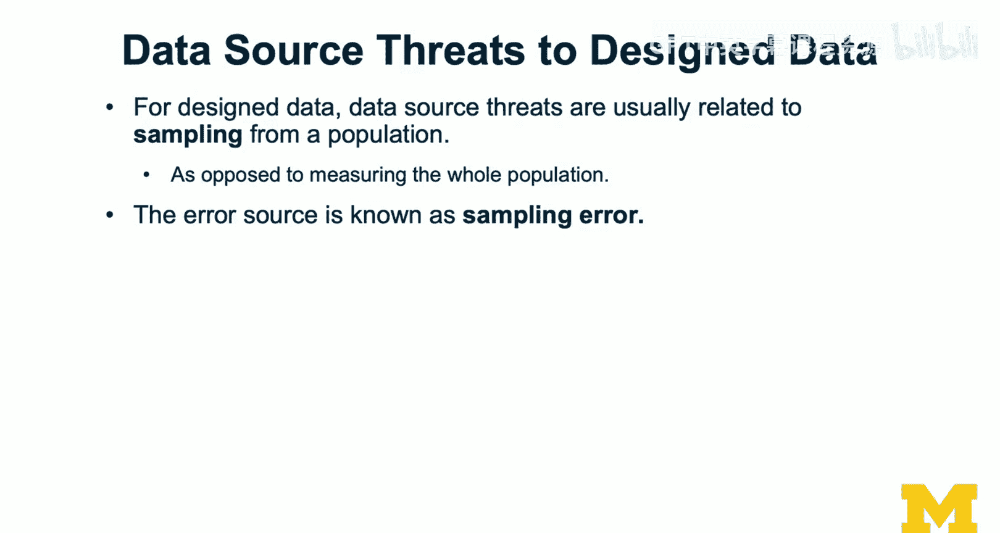
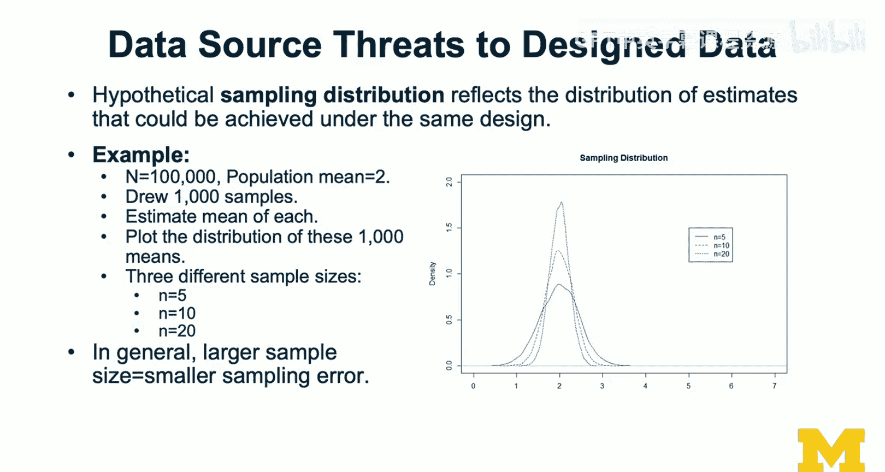
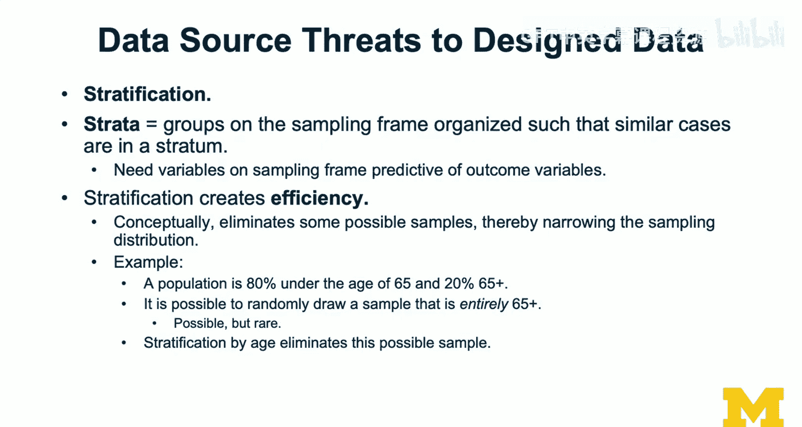
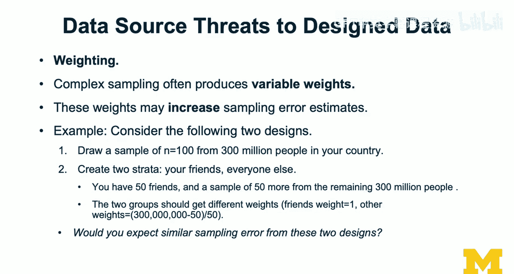
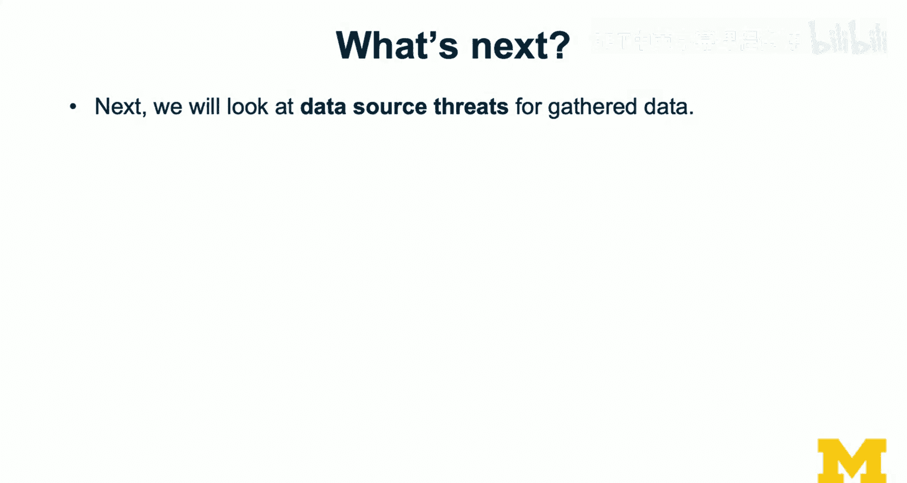
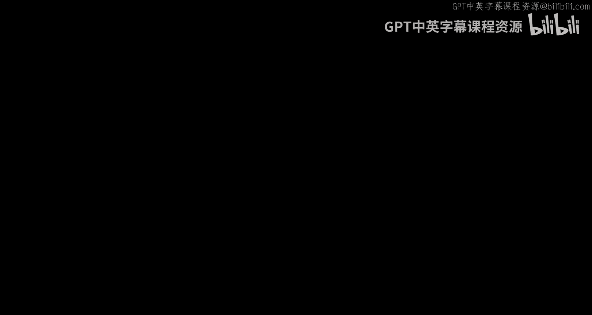

# 密歇根大学《总体数据质量（框架、度量、设计策略）total data quality》 p31 30_设计型数据源威胁因素.zh_en -BV1Jn4y1X7uS_p31-

Hello， welcome back today we're going to talk about data source threats to designed data。

Let's take a look at the big picture to remind ourselves where we are。

 so we've been talking about representation errors and remember we talked about what is a target population。

We talked about available data sources and how available data sources may not match our target population。

Now we're going to focus on that next step that data source errors where we have available data sources in design data。

 typically a sampling frame， and we're going to draw a sample from that sampling frame to create the available data。

 Now in that step， data source errors can occur， and that's what we're going to talk about today。

For design data， data source threats are usually related to sampling from a population as opposed to measuring the whole population。

 Now， why would I want a sample。Often we draw samples because it's costly or too costly to measure the whole population。

If you think of the United States， sampling the whole population would be incredibly difficult and costly。

In fact， the only survey that actually attempts to do that is the US Census。

 the decennial census it's only performed once every 10 years。In most other situations。

 we're going to want to draw a sample because it's going to be too costly or too difficult to interview the whole population。

Now， when I draw a sample from a population， this introduces an error source known as sampling error。

 and we'll spend a few minutes talking about sampling error。

Sampling error is based on a hypothetical sampling distribution that reflects the distribution of estimates that could be achieved under the same design。

 What does that mean。Well， I've made a little simulation study to help us think about what that means。

 what is the sampling distribution， and what does it mean that the sampling error reflects the distribution of estimates that could be achieved under the same design。

For my little simulation study， I generated a population of 100，000 units。

And that population had a mean of two。To what I don't know。

 Let's say it's the price of a cup of coffee。 Maybe the average price of a cup of coffee is $2。

 If I went to 100000 coffee shops， that would be the average price。

Some shops might have a cost of $75。 Some might be $3， but the average price is $2。

Then I drew 1000 samples from that population of 100000。And I drew three different sample sizes。

 One was a very small sample size of 5。Another was a sample size of 10。

 and the third had a sample size of 20， so larger。Then I took the average of each sample that I drew。

 so I drew a sample of five。Took the average， kept it。Then I went back to that population of 100，000。

 I drew a sample of five。Calculated the average of those five， and I kept it。

 and I did that same process a thousand times to see what the sampling distribution would look like。

 That's what I've drawn in that figure on the right。

I have one distribution for each of the three different sample sizes that I used。

If you look at the blue line， that's the sample size of five。The red line。

 the dashed line is the sample size of 10。And the black line is a sample size of 20。Each point。

 each time I did a draw， I got a different estimate of the mean。

 and this represents the distribution of those 1000 samples that I drew。 Now。

 what we want to notice about this。

All of these distributions have the same mean around two。 that's the population mean。

 that's the good news。 So the sampling is unbiased。

The bad news is that the different sample sizes produces different。

Wideness is width of that distribution。So the smaller sample size of five has the widest distribution。

And the largest sample size of 20 has the narrowest distribution。

And that's a kind of a representation that sampling error I was talking about。

So when I draw a small sample， I'm going to have a relatively large sampling error。

And when I draw a large sample， I'm going to have a relatively small sampling error。

 so that's one nice thing about sampling， I can control the size of the sampling error by setting the sample size。

I hope that。Hypothetical simulation helped you understand that concept of a sampling distribution。

A sampling theory is actually a well developed subfield within statistics。

There are sampling statisticians who study methods for estimating sampling error。

And they have a well developed set of theory and methods that will allow us to estimate sampling error very accurately。

I'm not going to go through in detail all of the available methods。

 but I am going to look at several sample design features that have an impact on sampling error。

 The three most important design features are clustering， stratification and waiting。

And I'll spend a moment talking about each of these features。

The thing to remember is that each of these features has an impact on sampling error。

They can increase or decrease sampling error depending upon how they're used and implemented in your sample design。

First， let's talk about clustering。So it's often cheaper to sample clusters。

 The classic example is quality control in the cigarette factory。 All right。

 so if you want to inspect cigarettes and see， are you' producing quality cigarettes。

You can't just sample a single cigarette， you have to sample the whole pack right once you've opened the pack。

 you can't close it up and resell it， so it's simpler to look at a cluster of those cigarettes and evaluate their quality。

And that's often true for human populations as well。Many times we want to survey persons。

And we find persons through households。 We have an address of a housing unit。

 and several people may live there， and the people that live in that household are a cluster。 Okay。

 so we have to deal with clusters because they create correlated measurements。

Units within clusters may have correlated measurements， now why is that？

They may have some relationship just being close together has caused their measurements to be correlated。

 If you think people who live together develop similar opinions， for example。

 that may be one mechanism by which these correlated measurements are created。

 or it might be that people who have similar characteristics tend to come together。

 just like the old saying， birds of a feather flock together。

 So persons who have similar opinions or behaviors may find each other in the population and form。

Units that are correlated。 You could think of families that share similar opinions， similar diets。

 similar behaviors。 They may have correlated measurements because of these sheer relationships。Now。

 these correlations reduce the information in the sample relative to simple random sampling。

That's because those correlations mean there's less overall information。 If I measure， for instance。

 one person within a family。I may not get much more information about the opinions of persons in that household by interviewing all of the persons。

 And so that clustering can reduce the effectiveness of our sample。

 It can increase our sampling error。Sttratification is a second in feature that has an impact on sampling error。

This one often can reduce sampling error。So what are Strrata Strrata our groups on the sampling frame organize such that similar cases are in a stratum。

Sounds simple， in practice it's often hard to do because we need variables on the sampling frame that are predictive of the outcome variables that we plan to measure。

It's often difficult to find good predictors on sampling frames that are predictive of outcome variables。

Think for example of the RDD sampling frame that we were speaking about last time。That RDD frame。

Doesn't have very much information at all about the persons who may be associated with telephone numbers and predicting the outcome variables from that information。

Isn't going to be very easy。But if we do have those variables。

 if we do have something to create strata。Then stratification creates efficiency。

Conceptually you can think of stratification as a strategy for eliminating some possible samples。

Thereby narrowing the sampling distribution。Okay。For example。

 let's say a population is 80% under the age of 65 and 20% 65 and older。

It's possible to randomly draw a sample that is entirely 65 and older。It's possible。But it's rare。

If you drew that sample， you might think it' suspect。 In fact， it's one of many possible samples。

 None of the samples that I could draw under simple random sampling are more likely。

But this one would be relatively rare。Sttraatification by age in this example would eliminate that possible sample。

 it would eliminate the possibility of drawing a sample that's entirely 65 years of age and older。

And in doing so， by eliminating those bad samples， if you will， it narrows the sampling distribution。

So this is the way in which strraatification creates efficiency， in other words。

 stratification generally reduces sampling error。We like stratification。

The third feature that I'll talk about today is waiting。

Complex sampling often produces variable weights right so people housing units。

 areas can be selected differentially， some units may have higher probabilities of selection than others remember we talked about duplication earlier。

If there are more than one instance of the same unit on a sampling frame。

Those units have a higher probability of being selected。So for example。

 if most persons have only one instance on a sampling frame， but some person has two instances。

 if they have a duplicate record on the sampling frame。

 that person would have twice the chance of being selected compared to any other person on the sampling frame。

Now， duplication is only one reason that variable weights can occur， there are many others。

These weights may increase sampling error estimates。

 so let's think about that conceptually for a second。Let's consider the following two designs。

 One of them will make great use of weights， and the other will not。The first hypothetical sample。

 a draw sample of 100 from 300 million people in your country。Random， simple， random sample。

 Let's say I have a very good sampling frame。 I have a list of persons。 I draw a sample of 100。

 from 300 million。Now think of an alternative sample design， one where I create two stta。

All of your friends are in one stratum， and everybody else is in the other stratum。

Let's say you have 50 friends， maybe you have more， maybe you have less。

 but let's just say for the purposes of this hypothetical example that you have 50 friends。

So I'm going to draw all 50 friends that you have into the sample。

Their probability of selection is one。 Each of those persons will certainly be included in my sample。

 And then I'm going to draw a sample of 50 more persons from the remaining 300 million persons。

Now those persons have a much different probability of being selected。

The two groups should get different weights， right， The friends get a weight of one。 That is。

 they represent themselves and themselves only。The other persons get about 300 million divided by 50 as a weight。

And you can see the very vast differences in the weights just from these calculations。

 your friends get a very small weight， and the 50 other persons get a very large weight。Now。

 would you expect similar sampling error from these two designs？

I think not。 I think my estimates。From the first sample of 100 people randomly drawn from the whole population are likely to have less sampling error。

Now， that's not a theoretical argument， that's not a mathematical proof of why variable weights can lead to increases in sampling error。

 It's just a conceptual argument， but I think it gives you some sense of why this is the case。

In general， variability and weights can increase sampling error。

What's next， next we'll look at data source threats for gathered data。

