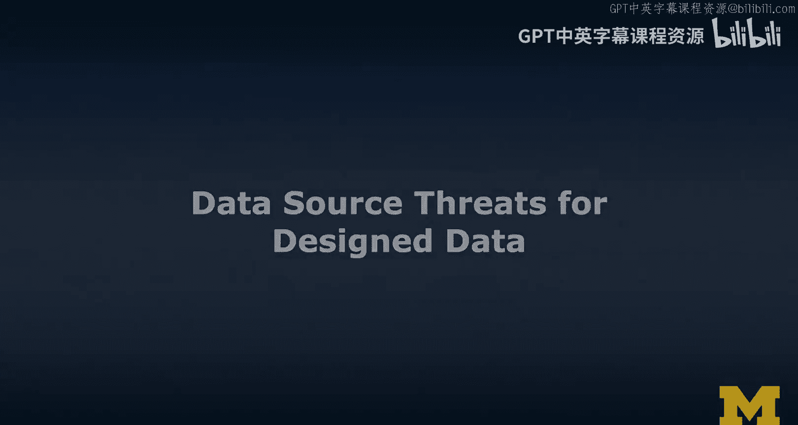
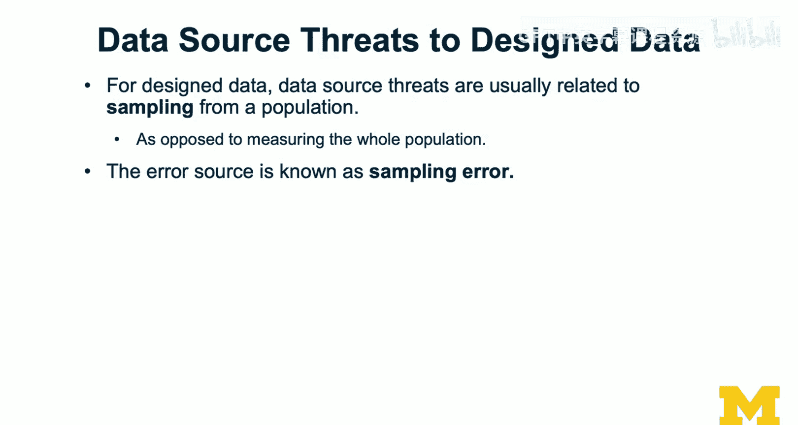
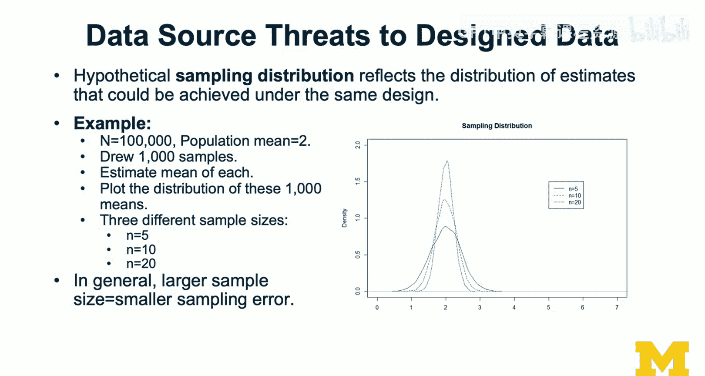
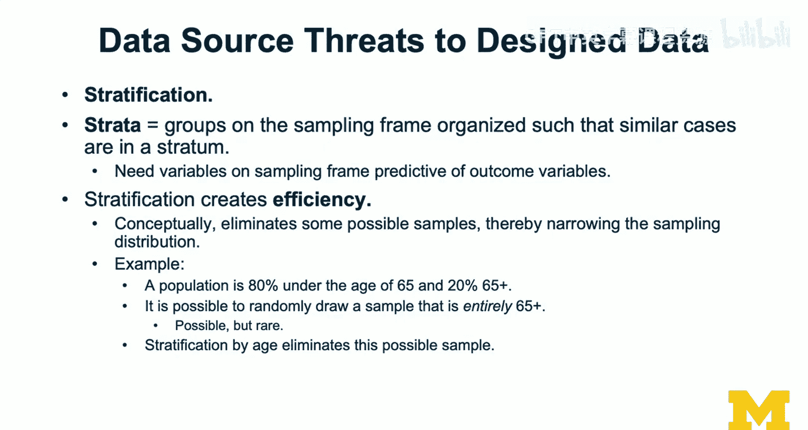
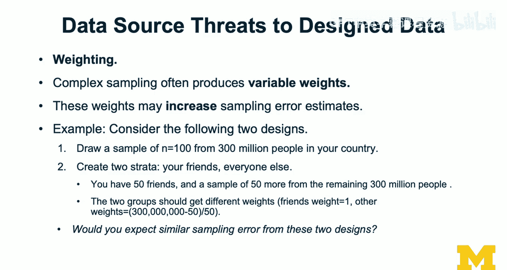
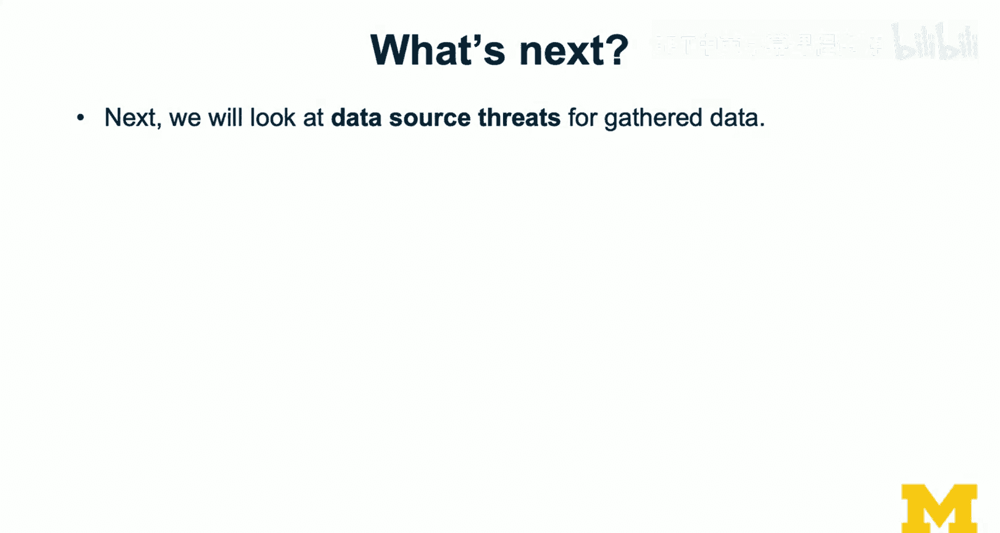

# 总体数据质量：第30章：设计型数据源威胁因素 📊

在本节课中，我们将学习设计型数据源面临的威胁因素。我们将重点讨论从总体中抽取样本时可能引入的误差，特别是抽样误差，并探讨影响抽样误差大小的三个关键设计特征：聚类、分层和加权。

## 课程概览与回顾

上一节我们讨论了可用数据源与目标总体不匹配的问题。本节中，我们来看看下一步：当我们拥有设计型数据源（通常是一个抽样框），并从中抽取样本来创建可用数据时，可能发生的数据源错误。

对于设计型数据，数据源威胁通常与从总体中抽样有关，而不是测量整个总体。

## 为何需要抽样？

我们通常进行抽样，是因为测量整个总体的成本过高或过于困难。

以美国为例，对整个人口进行抽样将极其困难和昂贵。

事实上，唯一试图这样做的调查是美国十年一次的人口普查。在大多数其他情况下，我们都会选择抽取样本，因为采访整个人口成本太高或难度太大。

## 抽样误差简介

当从总体中抽取样本时，会引入一个称为**抽样误差**的误差源。

抽样误差基于一个假设的**抽样分布**，它反映了在相同设计下可能获得的各种估计值的分布。

为了帮助理解这个概念，我们来看一个模拟研究。

我生成了一个包含10万个单元的总体，其均值为2（例如，一杯咖啡的平均价格为2美元）。然后，我从这个总体中抽取了1000个样本，并使用了三种不同的样本量：5、10和20。对于每个抽取的样本，我都计算了其平均值，并重复此过程1000次，以观察抽样分布的形状。

在右侧的图表中，蓝色线代表样本量为5的分布，红色虚线代表样本量为10，黑色线代表样本量为20。每个点代表一次抽样得到的均值估计。

从图中我们可以注意到：所有这些分布的中心都围绕在总体均值2附近，这是好消息，说明抽样是无偏的。但坏消息是，不同的样本量导致了分布宽度的不同。样本量最小的5具有最宽的分布，而样本量最大的20具有最窄的分布。这正是抽样误差的一种体现。

因此，当我抽取一个小样本时，将会有相对较大的抽样误差；而抽取一个大样本时，则会有相对较小的抽样误差。这是抽样的一个优点：我可以通过设定样本量来控制抽样误差的大小。

## 影响抽样误差的设计特征

抽样理论是统计学中一个发展成熟的子领域。抽样统计学家研究估计抽样误差的方法，并有一套完善的理论和方法让我们能够非常准确地估计抽样误差。

我不会详细介绍所有可用方法，但会探讨几个对抽样误差有影响的样本设计特征。其中最重要的三个设计特征是：**聚类**、**分层**和**加权**。每个特征都会影响抽样误差，根据它们在样本设计中的使用和实现方式，可能增加或减少抽样误差。

以下是这三个特征的详细说明：

### 1. 聚类

通常，对**聚类**进行抽样成本更低。经典的例子是卷烟厂的质量控制。你不能只检查一支香烟，一旦打开包装，就必须检查整包。对于人群调查也是如此，我们经常通过住户来找到个人。一个住址（一个住房单元）可能住着几个人，这些人就构成了一个聚类。

聚类之所以重要，是因为它们会产生**相关测量**。聚类内的单元可能因为彼此接近或具有相似特征而导致测量结果相关。例如，住在一起的人可能发展出相似的观点；或者，具有相似特征的人倾向于聚集在一起（“物以类聚”）。家庭内部成员可能因为血缘关系而拥有相似的饮食、行为或观点。

这些相关性会减少样本中的信息量（相对于简单随机抽样而言），从而可能增加我们的抽样误差。

### 2. 分层

**分层**是第二个特征，它通常可以减少抽样误差。

**层**是在抽样框上组织的组，使得相似的个案位于同一层内。这听起来简单，但在实践中往往很难做到，因为我们需要抽样框上存在能够预测我们计划测量的结果变量的变量。找到这样的良好预测变量通常很困难。

从概念上讲，你可以将分层视为一种**消除某些可能样本**的策略，从而收窄抽样分布。

举个例子，假设一个总体中，80%的人年龄在65岁以下，20%的人年龄在65岁及以上。在简单随机抽样下，有可能（尽管概率很小）抽到一个完全由65岁及以上人群组成的样本。如果按年龄进行分层，就可以消除抽到这种“坏”样本的可能性。通过消除这些不具代表性的可能样本，分层收窄了抽样分布，从而创造了效率，通常能减少抽样误差。

### 3. 加权

今天要讨论的第三个特征是**加权**。

复杂的抽样设计常常会产生**可变权重**。个人、住房单元或地区可能被以不同的概率选中。我们之前讨论过的重复记录就是一个原因：如果一个单元在抽样框上有多个实例，它被选中的概率就更高。

可变权重可能会增加抽样误差估计。让我们从概念上思考一下。

考虑以下两种设计：第一种是从全国3亿人中随机抽取100人的简单随机样本。第二种是创建两个层：一个层包含你所有的50个朋友（全部选中），另一个层包含剩下的所有人，从中再抽取50人。显然，这两组人被选中的概率截然不同，因此需要赋予不同的权重。你的朋友权重接近1，而另外50人的权重则非常大（约3亿/50）。

你会预期这两种设计有相似的抽样误差吗？很可能不会。从整个总体中随机抽取100人的第一个样本，其估计值很可能具有更小的抽样误差。这个例子从概念上说明了为什么权重的变异性通常会导致抽样误差的增加。

## 总结

本节课中，我们一起学习了设计型数据源的主要威胁——**抽样误差**。我们了解到，抽样误差的大小可以通过样本量来控制，并且受到样本设计特征的显著影响。**聚类**可能因单元间的相关性而增加抽样误差；**分层**通过消除不具代表性的样本，通常能减少抽样误差；而**加权**，特别是当权重变异性很大时，可能会增加抽样误差。理解这些特征有助于我们设计出更高效、误差更小的抽样方案。

接下来，我们将探讨采集型数据所面临的数据源威胁。