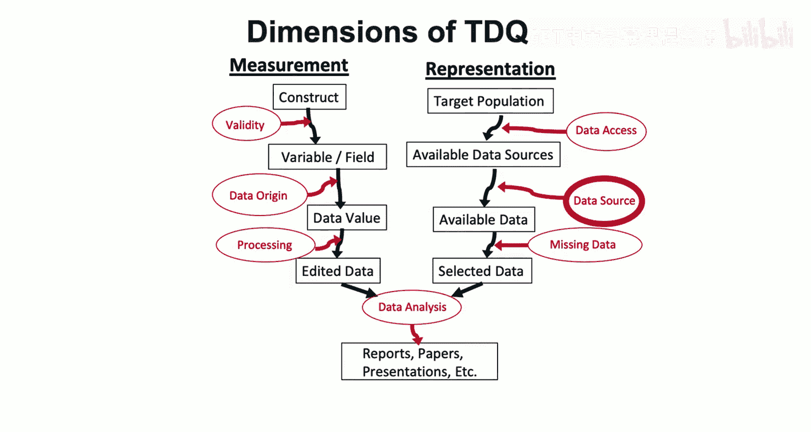
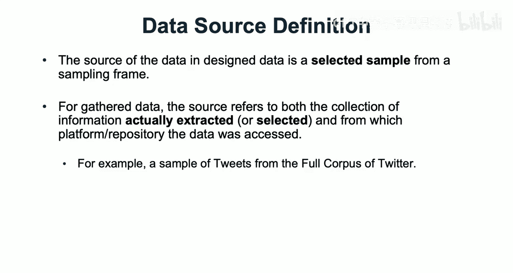
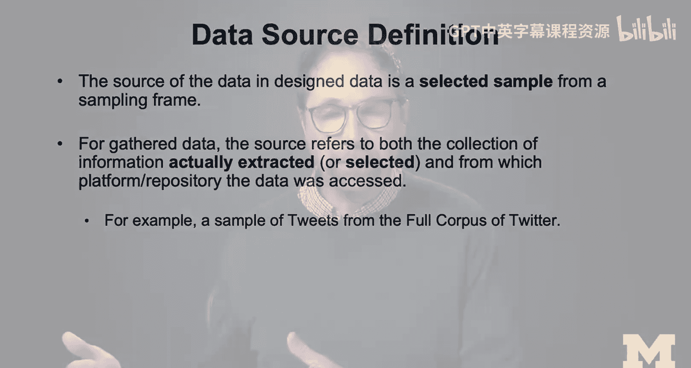
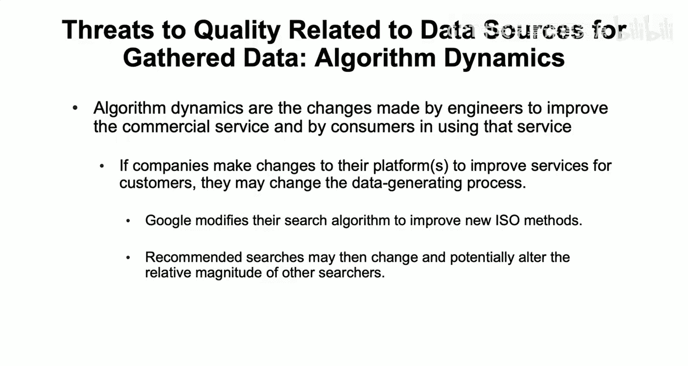
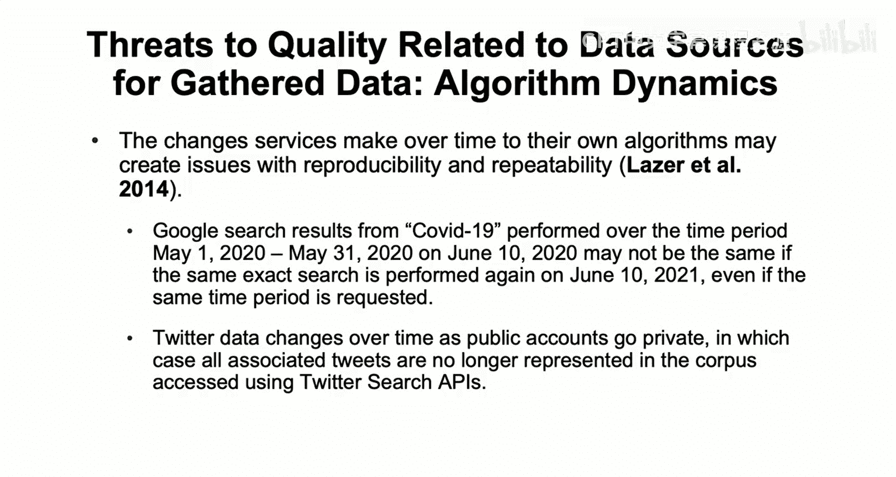
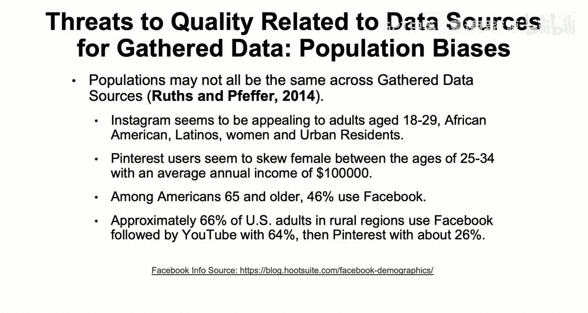
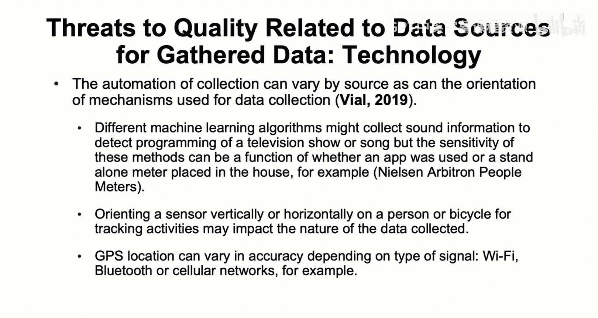
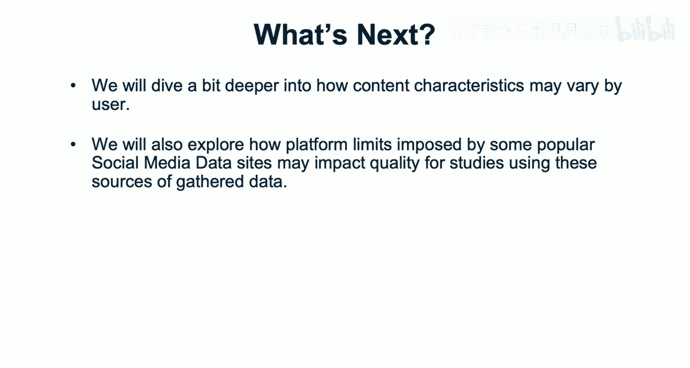
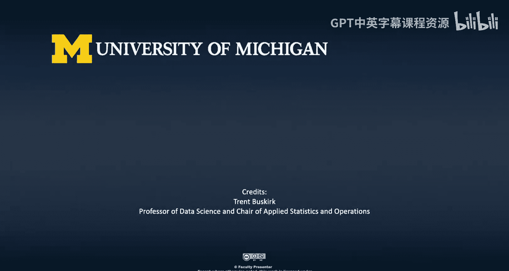

# 密歇根大学《总体数据质量（框架、度量、设计策略）total data quality》 p32 31_采集型数据源威胁因素.zh_en -BV1Jn4y1X7uS_p32-

Hello， welcome back。 I'm Trenmp Buskirk。 I'm happy to have you here。

 We're going to talk about data source threats for gathered data in this video。😊。

So just to keep abreast of sort of where we are in our framework for the total data quality。

 we're on the representation side and we're going to talk about data source threats。

 so this is in between the available data sources and the actual data that you could retrieve。

So it's important to keep in mind the definitions of these terms as we're learning them。

 And there are some nuances between design data and gathered data that might make these things a little bit confusing。

 but we try to。 we're going to try to make them as clear as possible。

 And we've tried to make these definitions as consistent as possible。

 recognizing these small nuanced differences between designed and gathered data。

 Here's an example of that for data source。

The source of the data for design data， as you've already heard from James Wagner and others。

 is a selected sample from a sampling frame。 That's under the design data category。

 But when you talk about gathered data， the source refers to both the collection of information that you've actually extracted or selected。

 depending on how you're getting it。 and from which platform or repository， the data was accessed。

 We include the platform or repository as a qualifier just to be clear。 So here's an example。

 a sample of tweets from the full corpus of Twitter。

 Or we could say we're getting a sample of tweets from the Twitter search API。

Twitter is a different platform or repository of information than Zillow。

 so we try to include the platform or repository as a qualifier for where that information is being accessed。

There are a couple of threats to the quality related to data sources for gathered data that we're going to talk about。

 The first one is algorithm dynamics。 What do I mean by algorithm dynamics。

Algorithms that are used to provide data through APIs or through searches on Google， for example。

 are always being。Upkept， they're always being developed。 They're always being revised。

 So the algorithm dynamics are the changes made by engineers of those platforms or repositories to improve the commercial service and by consumers in using that service。

 So， for example， if companies make changes to their platforms to improve services for customers。

 they may be making changes to the data generating process。 For example。

 Google modifies their search algorithm to improve new search methods。

Recommended searches may then change and potentially alter the relative magnitude of the other searches。

Google is always improving its search algorithm。 If you use Google to acquire data through a Google search。

 and today you enter a search term。And then to morrow， you enter the same search term。

Algorithm dynamics and improvements in those algorithms may actually provide better search results to than what you got today。

These algorithm dynamics are at play， but they're often not known completely to end users。

 We know these things are happening， but we don't often know the schedule by which they're happening。

 or the amount of improvements that are happening daily。

 These kind of algorithm dynamics do offer a threat to data sources for gathered data。

 because we often can't track or we often don't know the complete impact of what they are what they are doing to the results that we are obtaining and that we are using。

 So the biggest source of a threat here， in my opinion。

 is the reproducibility aspect of this that I'm not completely sure how these things are altering reproducibility。

 We know that generally， these platforms are trying to improve their algorithms over time。

 But the amount and magnitude of those improvements are really not known to the end user。

The main driver of the threat to data quality from data sources from the algorithm dynamics perspective is the reproducibility and repeatability。

 Let me give you an example。 So the Google search results from the keyword， Covid 19。

Where I'm looking at the time period of May 1，2020 through May 31，2020。

If I were to do this retrieval on June 10 of 2020 and to repeat the exact same exercise on June 10 of 2021。

I may get different results， even though the parameters of my search， In other words。

 the keyword and the time period that I'm looking at are exactly the same。

 The algorithm is constantly being improved。 So if I were to pull that search on June 10 of 2020 and repeat it on June 10 2021。

 there's no guarantee， even though the parameters are the same， that the results would be the same。

 because the underlying algorithm dynamics are changing and potentially improving over that time period。

Another example on a different platform is Twitter allows users to make their accounts public or private at any time。

So if I were to search for a particular keyword from the last week and I were to repeat that search one week apart。

Even though I'm using the same week and the same search terms on the Twitter search API。

 I may get different results because people may have turned their account to private in between those two time intervals that I did the search。

 So the fact that the privacy or of those accounts is changeable makes the results different over time。

 The other thing about Twitter that's also interesting is this the algorithm dynamics of identifying and removing bots over Twitter can impact the search results as well。

 as Twitter changes their technology for detecting bots and removing bots changes over time The results of a particular search。

 even though I'm looking at the same time window in the same keywords could be different because I could get less bots。

At a later time point， because the algorithm has improved for detecting those bots。

There are additional threats to quality related to data sources for gather data。

 including this concept of proxy population mismatch。

Various sources curate information from distinct population groups。

 You could have a pickleball user group on Facebook。

 or you could have a particular hashtag on Twitter that follows a particular conference。

These proxy effects， as they're defined， are really referring to this concept that populations identified and studied based on self reported identification may not be similar to the broader population。

 For example， Republicans who self identify on Twitter or Facebook may not be like other Republicans in the population who do not identify themselves as such。

 either on Twitter， Facebook or otherwise。The main point here is that。

The Republicans that you might be able to find on Twitter may not be representative of all Republicans in general。

 those who are on Twitter and those who are not on Twitter。

The other thing that's really tricky about these proxy population mismatches and the platforms is that assembled populations cannot be easily shared or archived and then reevaluated by other researchers as per the terms of use。

 So while you might be able to access information and gather some summary information。

 it would be very difficult to share that assembled data set with other researchers。

 because the platforms have terms of use that might prevent that。

Twitter has changed some of their terms of use around this for academic use or academic researchers using their search API version 2。

0。While some of these restrictions may have been lifted， others are still in place。

 So it's a good idea to check the developer website as we've listed here for how those terms of use are changing and what impact that may have on your ability to archive and reevaluate information that you've gathered on Twitter。

 for example。There are also population biases that are threats to quality related to data sources that we should mention。

Instagram seems to be appealing to adults aged 18 to 29， African American Latinos。

 women and urban residents。Pinterest users seem to skew female between the ages of 25 and 34。

 with a slightly higher than average income。Among Americans 65 and older，46% use Facebook。

 and approximately 66% of US adults in rural regions use Facebook。

 followed by YouTube with 64% and followed by Pinterest with about 26%。

So the idea is that certain platforms naturally gather the interest of certain users or certain demographics or certain regions。

 This is an important distinction to know， because if you are trying to use， let's say。

 Instagram for making inference to all pop to the entire population。

 this may be difficult if the primary user is between the ages of 18 to 29。

 but this could also be an advantage if you think about trying to reach。

Adults in the 18 to 29 year old category， Instagram may be a great first step at trying to recruit those individuals。

 So， again， the kind of platforms and the kind of culture that those platforms engender might attract certain segments of the population that don't represent the entire gamut of the population。

This is an important thing to think about when you're trying to think about population projection。

 learning from these particular data sources and how what youre gathering。

 the data that you are gathering may or may not be projectable to the entire population。

This is why we talk about population biases here。

There are also threats to quality related to data sources for gathered data around platform limits。

 Some data sources or gathering tools place limits on the amount of information that's available per user。

 For example， when retrieving tweets from Twitter， there are monthly caps on the total number of tweets that can be gathered and stored。

Even if you have access to the full fire hose。Twitter alsoteethers the number of API calls that can be made in a certain time interval。

They also capped the number of tweets archived per user to 3200。

If you are using web scraping platforms to gather data。

 then they also some of those platforms limit the number of scrape pages per month as part of a tiered system。

 so they could limit the number of pages or they could limit the depth by which you could crawl particular pages。

All of these things。Create some quality threats to data sources because it could limit the amount of data that you could actually capture。

If the data that you' are able to capture represents the rest of the data。

 the threat is relatively tame。 but if the limits are， say。

 to the first X amount of tweets or the first X amount of data。

 and you cannot get the remaining data or any portion of it。

 And if that data somehow systematically different。

 then these threats to quality related to data sources with regard to platform limits could actually be important considerations for how well the data that you were able to get is going to represent the data that you weren't able to get。

 limiting the utility of that data with respect to its quality。

 So considerations here around platform limits are important。

 and you can often find these in the developer pages of the platforms that you care to access。

There are also threats to quality related to data sources for gather data around technology。

The automation of collection can vary by source， As can the orientation of the mechanisms used for the data collection。

 Let me give you some examples。 Different machine learning algorithms might collect sound information to detect programming of a television show or a song。

 But the sensitivity of these methods can be a function of whether an app was used or a standalone meter placed in the house was used how much background noise that was available and how far away the meter was from the actual sound source。

😊，The orientation of a sensor vertically or horizontally on a person or a bicycle for daily tracking activities may impact the nature of the data collected。

 If I wear a sensor on my foot versus on my hip， or if I throw the sensor in my bucket on or in my basket on my bicycle。

It may detect movement differently。 That detection could lead to data quality issues in how I'm actually able to make sense of that data on the back end。

GPS location can vary in accuracy depending on the type of signal。

 Wi Fi signals or Bluetooth or cellular networks signals give different GPS location accuracy and that could actually differ markedly between 50 to 100 meters in accuracy。

To give you a heads up on what's next， we'll take a deeper dive into how content characteristics may vary by user on these platforms。

 and we'll also explore how platform limits imposed by some of the social media data sites may impact the quality for studies using these sources of gathered data。

 So stay tuned for that。 Thanks for joining us。😊。

