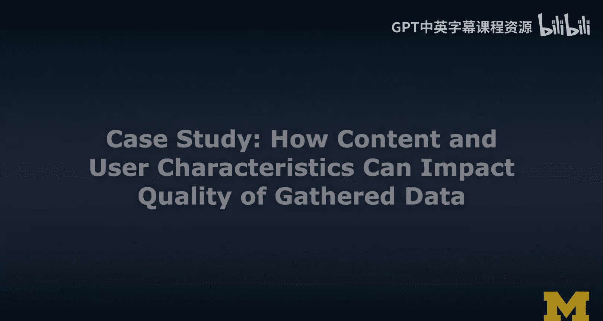
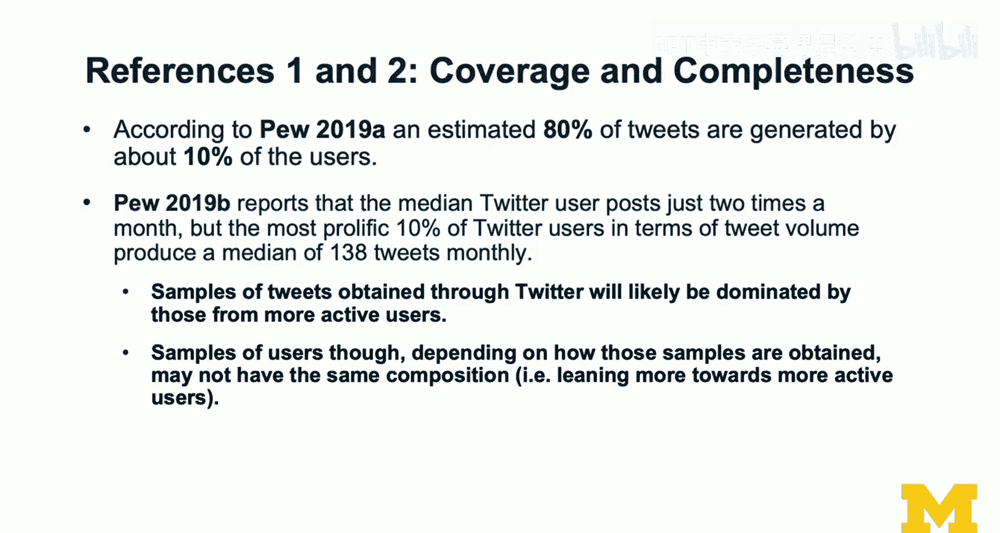
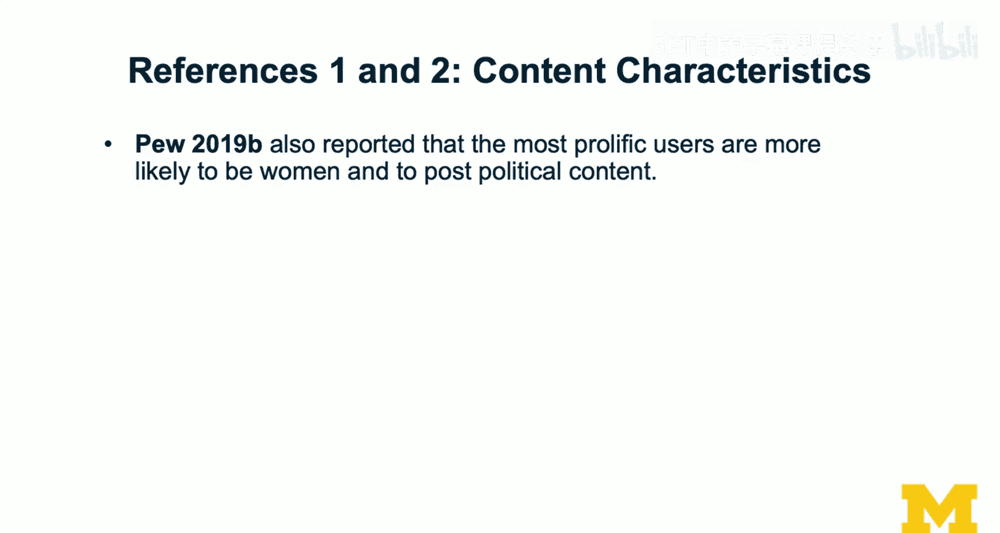
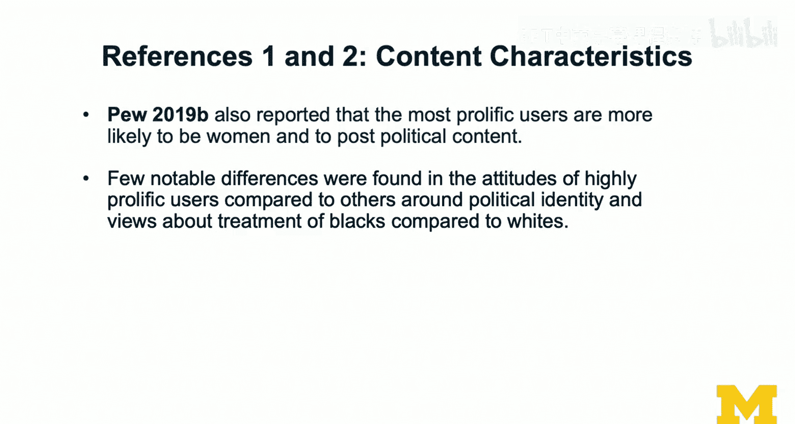
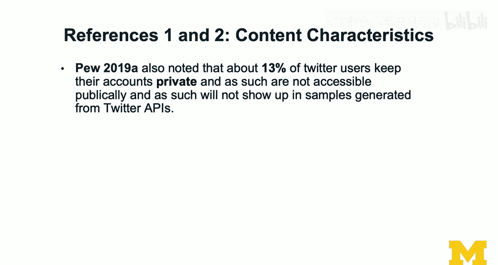
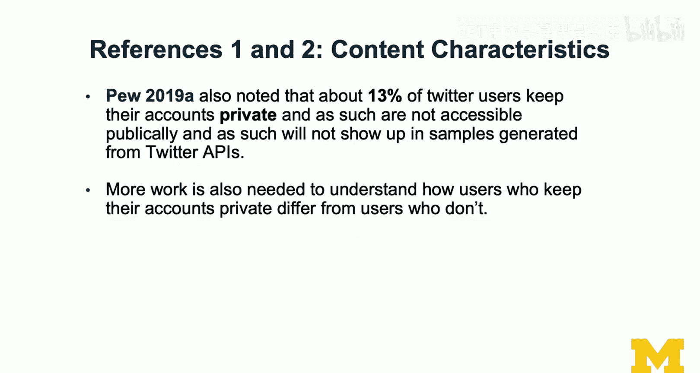
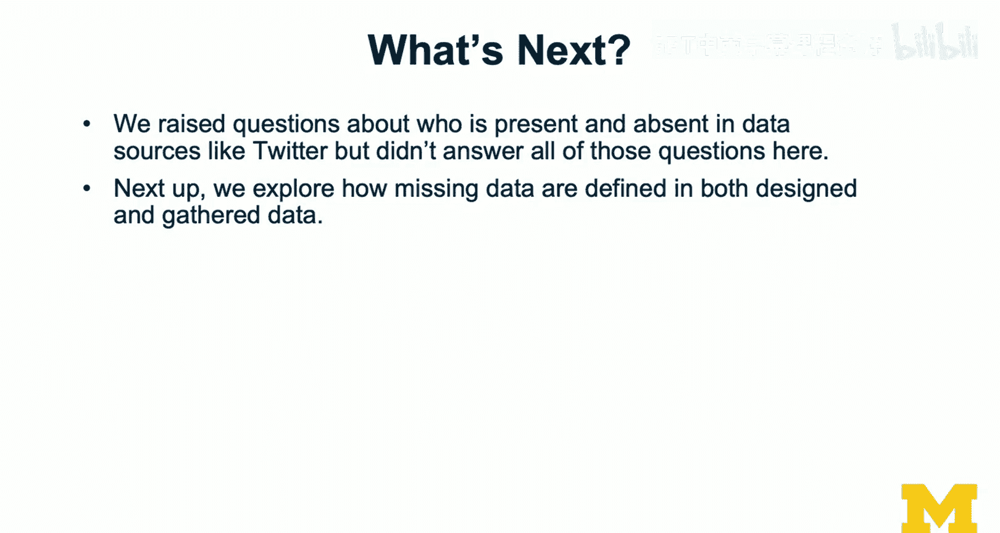

# 密歇根大学《总体数据质量（框架、度量、设计策略）total data quality》 p33 32_案例研究：内容与用户特征对采集质量的影响.zh_en -BV1Jn4y1X7uS_p33-

Thanks for joining us for this case study where we're going to talk about how content and user characteristics can impact the quality of gathered data I'm Trenm Buskirk。

 we're happy to have you here。

So I just want to remind you there was a case study materials document that you should have been able to download as part of the course。

 and so there are a couple of references that we're going to refer to and we ask you to think about some questions as you were going through these documents。

 these questions again appear here and we're going to talk about these in more detail as this segment continues。

If we look at the first two references from Pew， we're going to talk about issues related to coverage and completeness。

According to the first reference from Pew， an estimated 80% of tweets are generated by about 10% of the users。

If we look at the second reference， Pew reports that the median Twitter user posts just two times a month。

 but the most prolific 10% of Twitter users in terms of tweet volume produce a median of about 138 tweets a month。

Samples of tweets obtained through Twitter will likely be dominated by those more active users。

 as you can see here。But samples of users， though， depending on how those samples are obtained。

 may not have the same composition。 In other words， they may not lean toward more active users。

 Again， this is one of those things where we talk about the volume related aspects of social media in terms of the tweets and then the users who are tweeting。

 So it is possible that if you take a random sample of users。

 you'll be able to capture those prolific and nonprolific users。

 But if you generate samples based on tweets， and you take a sample of tweets。

 and then from those tweets， you capture the user metadata and sample that way。

 it is very possible that the sample that you generate will be dominated by more active users in Indeed。

 So the composition of Twitter and the composition more broadly speaking。

 the composition of platforms in general， can impact the coverage and completeness of data sets that you might gather from these sources。

If we look at the second reference from Pew， they reported that the most prolific users are more likely to be women and post politicalical content。

 This study is important because it establishes a possible association between the usage of a platform and demographic variables like gender。

 as well as the kind of content that is posted。 This is really important because if you're trying to use these platforms as a way to recruit people for your study。

 and you're recruiting them based on their on the content of their tweets or on the tweets themselves。

 It is possible that you might only get a sample of women users。

 because they're the ones who are more likely to be posting。

 So these are important considerations when you're thinking about coverage and bias。

 potentially from the data that you're going to source from these platforms。

Pew also reported a few notable differences in the attitudes of highly prolific users compared to others around political identity and the views about treatment of blacks compared to whites。

This is also an important consideration because highly prolific users might be more likely to be recruited if you're using a tweet based recruitment。

 and in that case， the potential for participation。

 bias could exist around the kind of attitudes or opinions that you're trying to study。

This also happens in design data when we worry about nonre bias， for example， or self selection bias。

 So the same kind of concepts could exist。 and the threat。

 really that we're really concerned about is this idea that the people that we recruit in our study。

 are going to be somehow systematically different than the people that are not in our study。

 but are the people that we care about making projections too。

If we go back to the first reference from Pew， they noted that about 13% of Twitter users keep their accounts private as a private account。

 It is not accessible publicly and won't show up in any of the samples generated from any of the Twitter APIs。

 including the fire hose。

This is a really important consideration， because if you' are doing a study that cares about a particular topic and private account holders have a different view than non privatete account holders。

 you could potentially be missing a portion of the understanding from Twitter by using the As as they normally are used because you won't be able to access any of the views from private users。

 And if those views are systematically different， your overall inferences to the entire Twitter population may。

Bi。Affect it。Certainly， more work is needed to understand how users who keep their accounts private differ from those who don't。

 as well as how often this occurs。 people on Twitter can turn their accounts private at any given time and can also revert it back to public at any given time。

 So the flow， the information flow from those who keep their accounts private and turn it back to public is also something that we don't know very much about。

 but could affect the quality of a study over time。

More work is also needed to better understand how samples of tweets likely dominated by prolific users。

 as we've already mentioned， may be biased relative to Twitter as a whole on other matters of public opinion。

 While the Pw study only noted a few differences， It doesn't mean that there might not be other differences that could。

 could occur over time。 This is an area of future research for sure。

Now if we move to the third reference， I want to draw your attention to some of the availability of the metadata content。

 which is also very useful in processing the data that you would get from these repositories。

In addition to who participates in a given platform。

 there are notable gaps in the metadata available from users as we saw from the third reference。

If we go now to the third reference， we're going to talk about the availability of metadata content。

 Now， this metadata content is not the content of the tweets themselves or of the particular posts。

 but it has more to do with the users or additional information that's available about the poster。

Or the user。 So in addition to who participates in a given platform。

 there are notable gaps in the metadata available from these users。

We see that about 69 per cent of Twitter users provide a bio in their profile。

 This bio contains important information about demographics and possibly the location of the Twitter user。

This information could be useful for understanding if there are differences in content related variables with respect to demographics。

 but they could also be useful for figuring out how to filter Twitter users by geography if indeed you wanted to make sure that you included a sample of Twitter users from Chicago and New York。

 for example。About 73% of Twitter users provide some type of location in their profile。

And this location can be useful for the reasons I just mentioned。

But if the information in the Twitter bios or locations is to be used as a waitinging or adjustment factor for samples to assess or to control for potential biases。

 as we often do with design data，Steps are needed first for filling in the gaps currently present in these metadata。

 and some work has been done in this area with varying degrees of success。

 Hs and Joinson in 2018 reported that it's much easier to predict the gender of a Twitter user than it is to predict their political identity。

 for example。So I just want to give you a heads up for what's coming next in we've already raised questions about who is present and absent in data sources like Twitter。

 but we didn't answer all those questions here。In the next segment。

 we're going to explore how missing data are defined in both the designed and gathered data spaces to be able to begin to understand how we might solve or resolve some of these issues。

 Thanks a lot for joining me for the case study。 I hope it was helpful。

 Looking forward to seeing you next time。😊。

