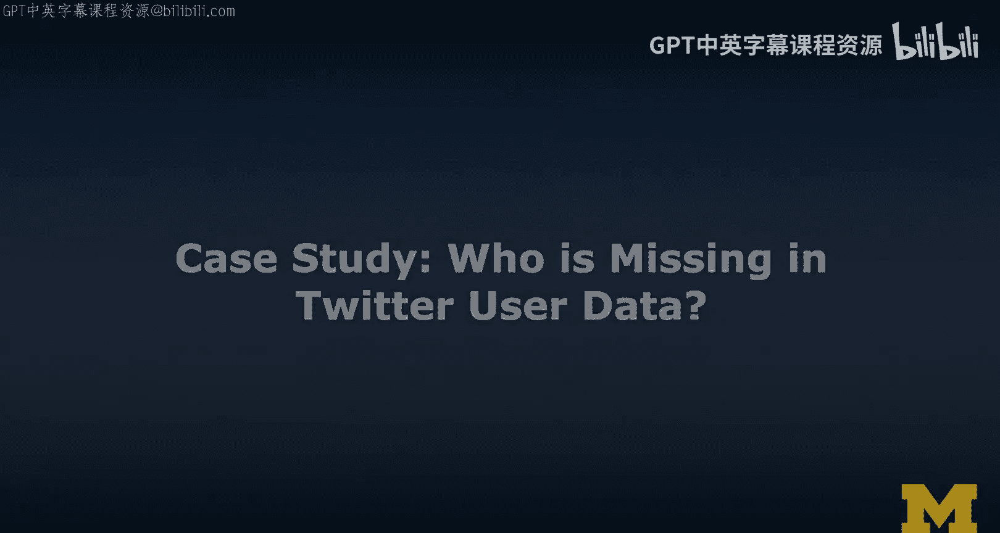
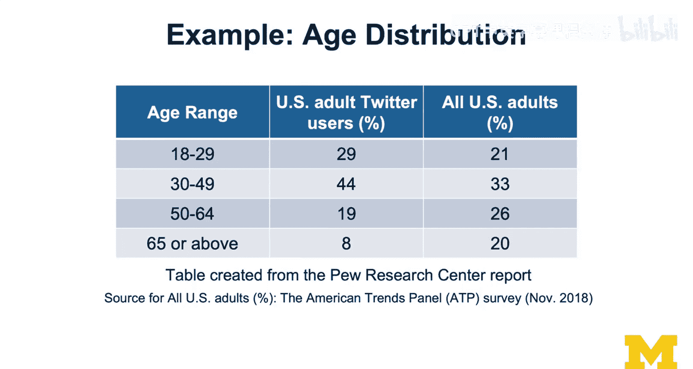
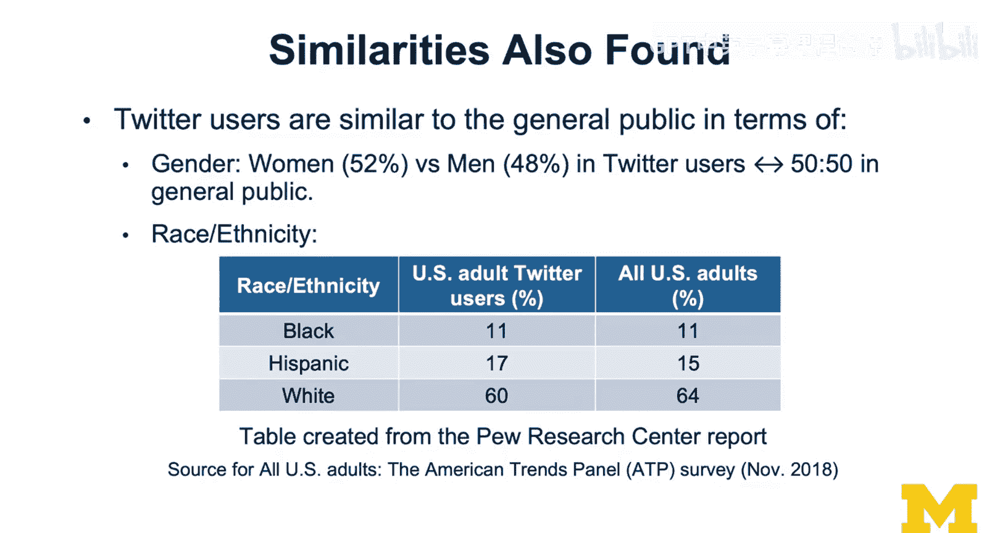

# 密歇根大学《总体数据质量（框架、度量、设计策略）total data quality》 p34 33_案例研究：Twitter用户数据中的缺失群体.zh_en -BV1Jn4y1X7uS_p34-

嗯。In this lecture， well take a look at one of the data source threads with an example of To data。

This presentation is based on online report entitledSizing Op T to usersrs by Pew Research Center in 2019。

You can read the full text of the report by following the URL in the slide。

The main question the report attempts to answer is how can Twitter users be compared to general public？

To answer the question， a total of 2，700 Twitter users who were selected from a probability based online panel of the USS adults was surveyed。

Here are some important observations from the report first。

 only 22% of American adults who use Twitter are representative of the broader population。Second。

 Twitter users are younger， more educated， and more likely to be Democrats than general public。

In other words， people who are older， less educated。

 and more likely to be Republicans are underrepresented in Twitter data， so in gather Twitter data。

 information about these groups of people is likely to be missing。

This is the example of population buyers you have learned in previous lectures about the data source threats。

For more details， let's take a look at a table created from the Pew Research Center report。

The table reports the proportions of US adult Twitter users and all US adults across4 ageG ranges。

Please note that the information about all US adults came from the 2018 American Trans Panels Survey。

According to the table， Twitter users， whose age is between 18 and 29 constitutes 29% of US adult Twitter users who surveyed。

In contrast， 21% of all US adults have the age range。But for the age range of 50 and 64 and 65 or5。

 Twitter users are less likely to fall in the age range compared to all U adults。

These observations indicate that Twitter users tend to be younger than general public。

Then how about education attainment？

Please take a look at the table in the slide。According to the Pew Research Center report。

 42% of Twitter users are college graduates， while 31% of all US adults hold any college degree。

This means that Twitter users are more highly educated than all U adults。

Although Twitter users and US adults show differences in age distribution and educational attainment levels。

 the differences in other demographic features are less stark。For example。

 Twitter users and US adults are similar in gender composition and race and ethnicity。

As presented in the slide。Let's summarize what you have learned from this case study。

The main takeaway is that Twitter users can be different from general public in terms of age。

 education attainment， and political affiliation。This is the example of population bias we talked about as a data source threat for gather data。

So we need to pay special attention to this population bias when we try to infer characteristics of general public from data gathered from social media platforms。

