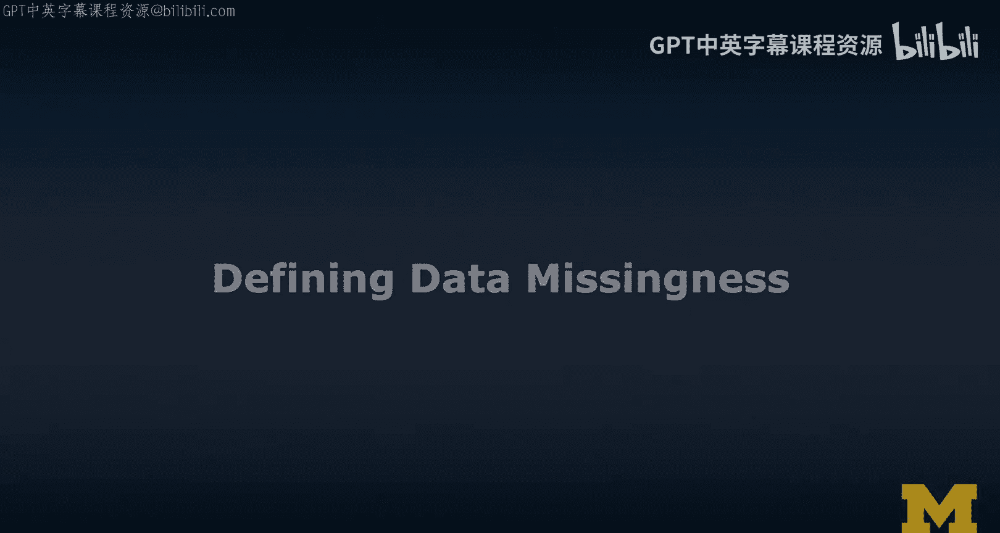
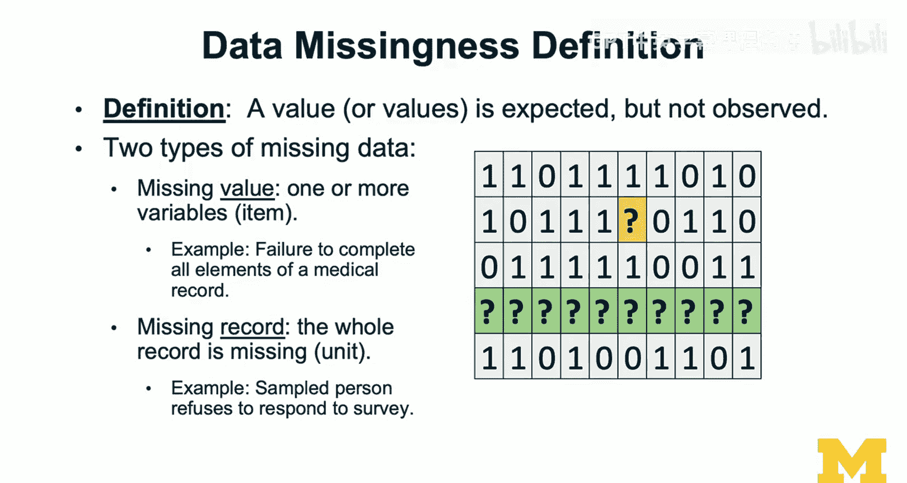
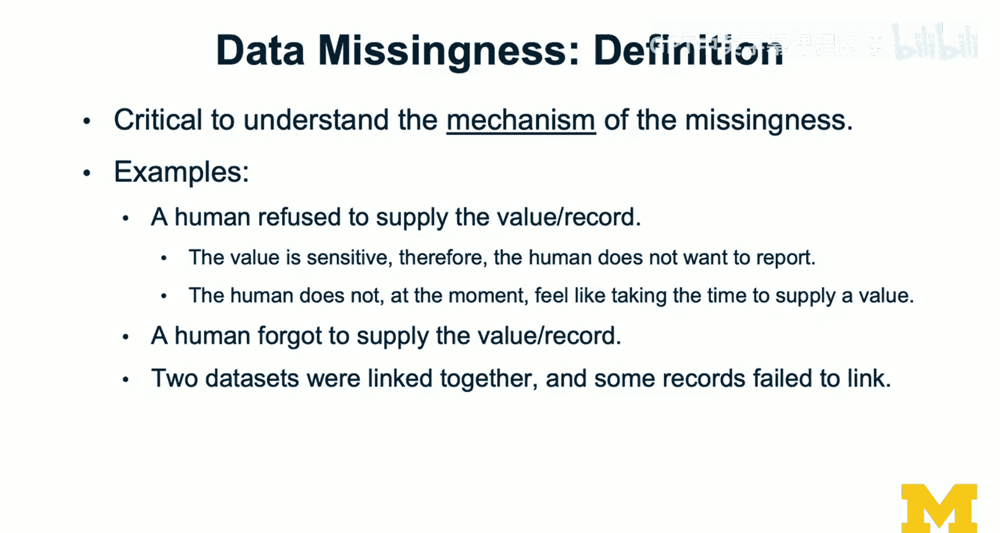
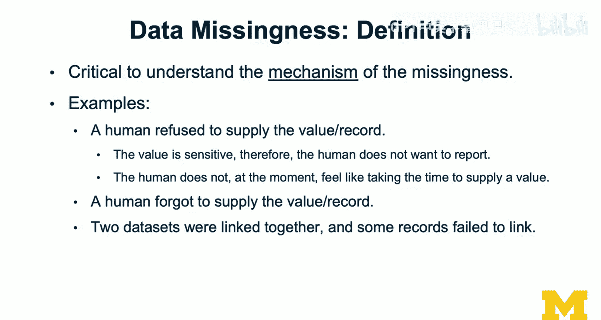
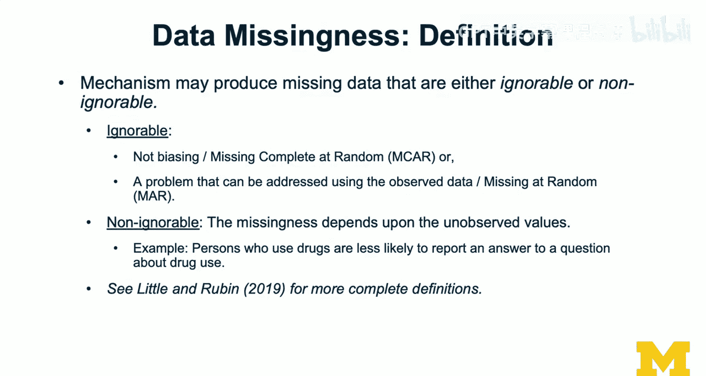
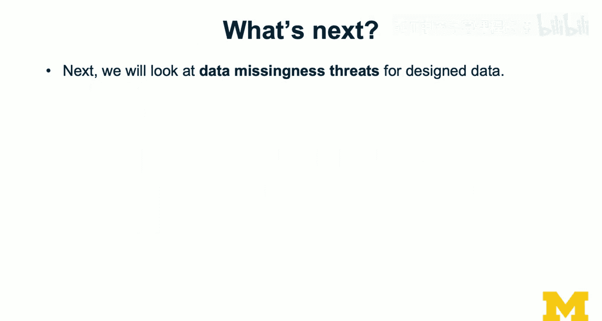

# 密歇根大学《总体数据质量（框架、度量、设计策略）total data quality》 p35 34_数据缺失的定义与分类.zh_en -BV1Jn4y1X7uS_p35-

Welcome， today we're going to talk about data missingness。

 a new error source in our total data quality framework。

Let's look at the dimensions of TDQ， the big picture again。

 we've been talking about errors of representation。

 and today we're going to start talking about a new error source missing data。

When we've selected our data， when we've gone to the available data and selected data。

 when we examine the data， we may find that there are elements missing。

This is a data threat that we're going to describe today and talk about some of its potential consequences。

Let's start with a definition。Simple， straightforward definition of value or values is expected。

 but not observed。Simple， but maybe misleadingly simple。

Part of the issue is knowing when a value should be expected。

And we'll talk some more about that as we go。 In general。

 we're going to describe two types of missing data。

 The first is a missing value when one or more variables or items are missing。Now。

 if you look at the diagram on the right hand side。

 you'll notice one yellow box of the question mark in it representing a missing value。All right。

 for that case， for that unit， we have other values， but that particular one is missing。

An example might be a failure to complete all elements of a medical record。We'll use that example。

Later in the course。The second type of missing data is a missing record where the whole record is missing。

 and sometimes we'll call this unit missingness。In the figure on the right。

 this is represented by the row of green boxes with question marks in them。

The whole record is missing。Now， an example might be when a sampled person refuses to respond to a survey。

We get no data from that person。 And so now we have this unit non response。

We're going to talk about how to identify these missingness situations。

And different for gathered and。

Design data。One thing about data missingness is that it's critical to understand the mechanism of the missingness。

For example， a human refused to supply the value or the record。Now。

 there could be different reasons why the human has refused to supply those records。

The value might be sensitive， and therefore， the person doesn't want to report the sensitive value。

For example。Did you vote in the last election， maybe seen as a sensitive question？

And someone may not be willing to supply the answer to that question if they feel that it's sensitive。

An alternative mechanism or an alternative reason why someone might refuse to supply the value or record is that the person doesn't feel like at that particular moment taking the time to supply a value。

They may be busy， they may be headed out the door， it happened to rain that day。

 and so they're concerned about getting inside before they get wet。

The two cases we've given here， the value is sensitive。 Therefore。

 the person doesn't want to report it is very different than the person is busy。

 They don't have time。To participate， to answer your questions。

 very different mechanisms that might produce different consequences down the road。

 but we'll explore that more。

Another kind of mechanism might be they simply forgot to supply the value。

 Think of the medical record example， the person。Preparing the record was supposed to fill all of the elements they forgot one。

Maybe it's not more difficult， maybe it's not sensitive。

 maybe they simply forgot to complete that part of the record。

Another example of a different kind of mechanism of missingness is when two data sets are linked together and some records failed to link。

All right， so now there may be records that have the linked values in。For some cases。

 but other records do not have the linked data。 Okay， they're missing the linked data。

 This can lead to kind of problems， errors associated with that type of missingness。

Related to your ability to link together records。

Let's explore these in more detail， let's think about that mechanism a little bit more detail。

Mechanisms may produce missing data that are either iorable or non iorable。

 and what do I mean by that？Well Iorable means that it's not biasing。Or to use the statistical term。

 it's missing completely at random。You could think of it as another stage of random sampling。

Just so happens I'm missing some of the elements， I have a smaller sample size as a result。

 but it doesn't bias my estimates。It may increase sampling error， which we recently discussed。

 but it's not going to lead to bias。Another form of iorability is a problem that can be addressed using the observed data。

And we'll talk about more about how to do this in later lectures。But for now。

 we just need to know that there may be situations where I can fix the missingness using the data in hand。

Using statistical terminology， we would call this missing at random。

 I might be able to fix the missingness to repair the missingness using a strategy such as waiting。

Or imputation。 And again， we at these。 we'll look at these options in more detail later。

A second type of mechanism is known as nonignorable。And this is the bad kind。

 This is the missingness that depends upon the unobserved values。So I gave an example of a mechanism。

 a sensitive question a moment ago。Think of a specific question。

 Pers who use drugs may be less likely to report an answer to a question about drug use。

 If that's the case， than the unobserved values。 the drug use may influence the whether or not I'm able to observe that variable。

In this case， using drugs， if that decreases your willingness to respond to this question。

 it might lead to a kind of bias。 That bias is usually of the form I'm underestimating the amount of drug use in the population。

 So the missing data if it's non aorable can lead to biases in our estimate。

Now。I'm giving a conceptual sense。 If you want to learn more about these definitions。

 I'd recommend the citation you'll see at the bottom of the slide。Next。

 we'll talk about data missingness threats for designed data。

 we'll take the data missingness we've talked about today and apply it to the specific situations we sometimes face with designed data。

