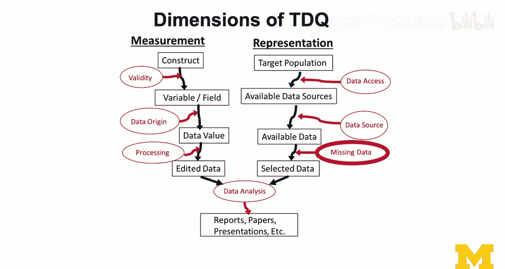
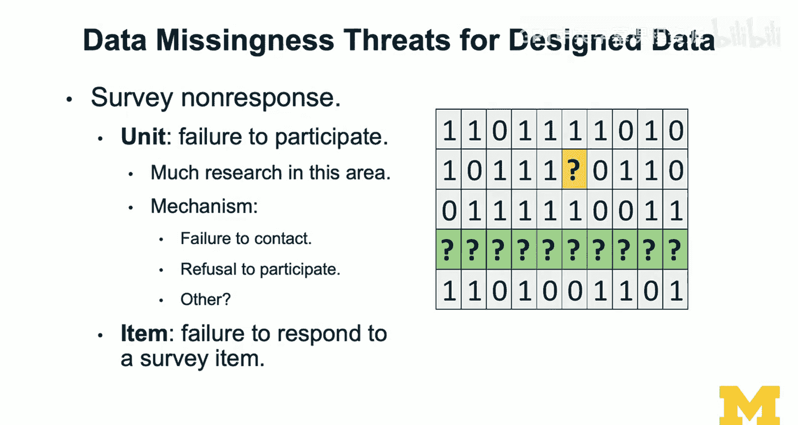
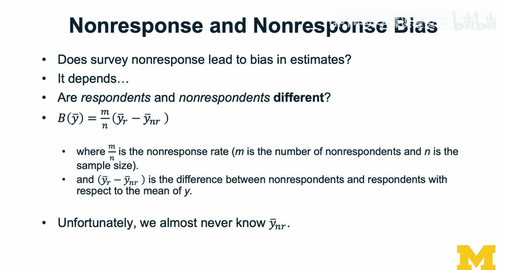
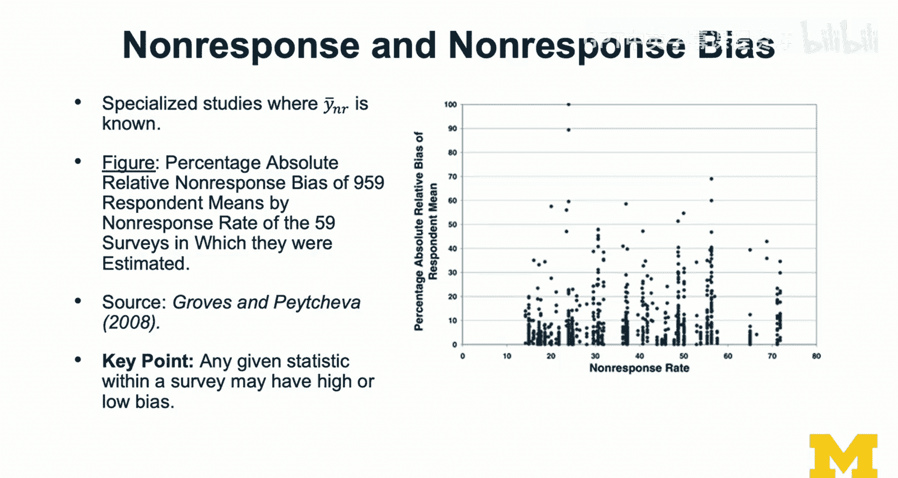
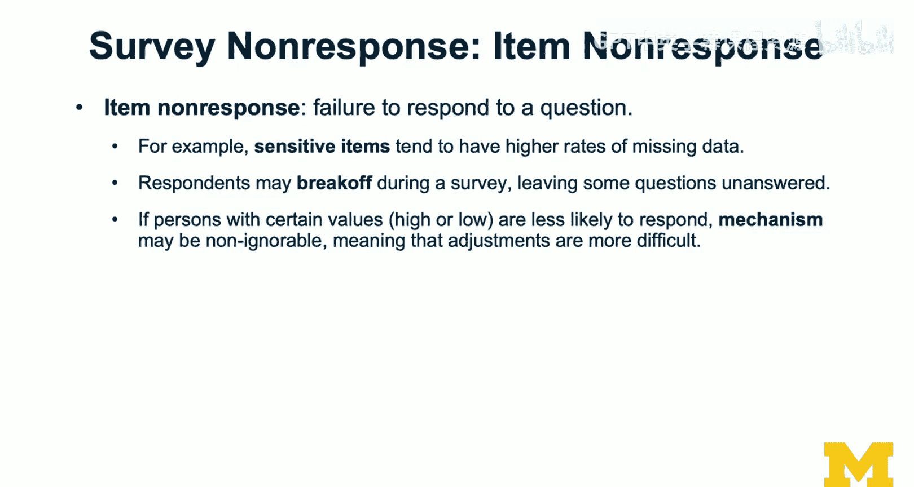
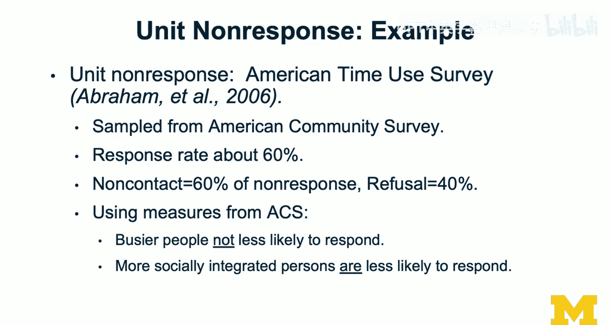
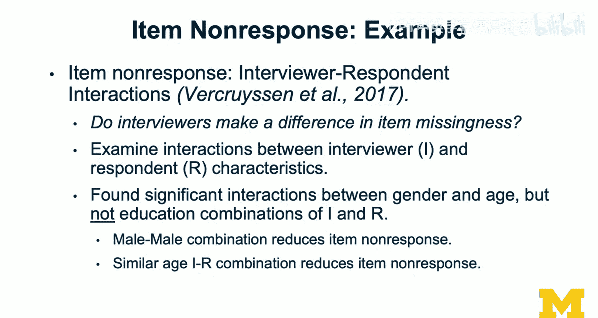
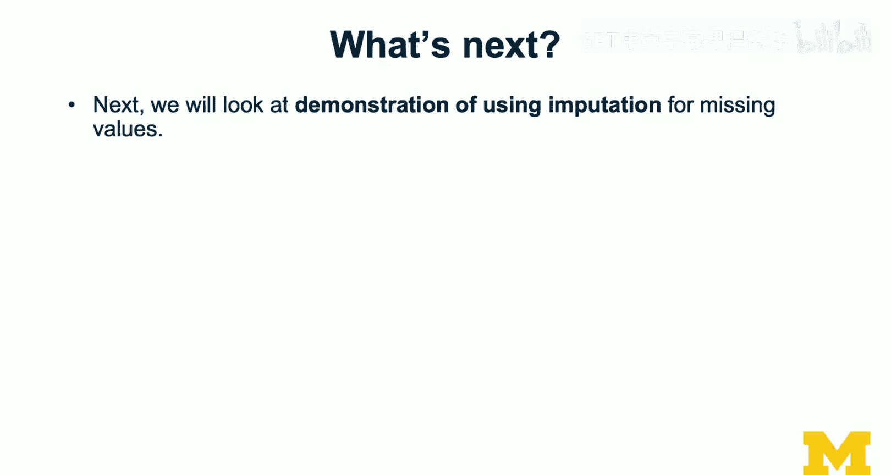

# 密歇根大学《总体数据质量（框架、度量、设计策略）total data quality》 p36 35_设计型数据缺失威胁因素.zh_en -BV1Jn4y1X7uS_p36-

。Hello， welcome back， today we're going to talk about data missingness threats but specifically for designed data。

Remember the big picture， we're talking about dimensions of TDQ。

 we're still on the right hand side the representation dimension we've been talking about missing data and today we're specifically going to talk about the kinds of missing data that can occur with design data。

In this case， the available data are the sample that we've drawn。

And the selected data are the persons who agree to respond to supply the data that we're asking for。

So the missing data generally occur because of non-resse that persons agree。

 don't agree to provide answers to the questions we want to ask。

 and we'll explore the consequences of those missing data today with respect to design data。

Little review。 surveyve non response。Comes in two varieties， the first is unit non response。

 a failure to participate。So there's a lot of research about why this happens。

Why do people fail to participate， Why do they not want to participate。

 And much of that research is focused on the mechanisms。

 And two key mechanisms are our first a failure to contact the sample unit。

 You can imagine if you're doing a telephone survey。

 It may be difficult to contact someone to ask them to participate。

 Maybe they never answer the phone。The same thing can happen in a mail survey if you mail a survey to someone's home and you may never hear back from them。

 you can think of it as a failure to contact， you don't know whether or not they've actually read the mail。

 did they take a look at the survey， did they consider it。On the other hand。

 the other kind of mechanism to broad categories of mechanisms is a refusal to participate。

 So you talk to the person。 You managed to ask them to participate。

 but they said that they would rather not for whatever reason。 Now。

 those are two broad classes of mechanisms that can lead to unit nonresponse。

 And there are many others。 And we could probably more finely grain。

Failure to contact and refusal to participate into smaller categories that fall within those categories。

 But for now， I think those two broad mechanisms can give you a sense of the differences in why people fail to give data in a survey setting。

In addition to unit nonresponse， there can be item nonresponse。

 which is the failure to respond to a particular survey item now they may have agreed to do the survey。

 but when you asked a particular question for whatever reason they decided not to participate with that question。

 they decided not to respond to that question。

Now， again， I think the mechanism is still important and we'll explore other kinds of mechanisms that lead to item non response in a moment。

Let's concentrate on the right hand figure for a second。

 Here we see depicted unit on response as the green boxes with question marks。

 the green boxes in a row， all of the variables are missing because that unit failed to participate。

Item non response， on the other hand， is the yellow box in the middle of the second row。That item。

 that question， the person failed to participate on that question。 We asked the question。

 and they might have said， I'd rather not answer that question。 Let's go to the next one， please。

So those are the two kinds of non response that typically happen for surveys。

 unit non response and item non response。Does survey non response lead to bias in estimates。

The answer that everyone hates to hear， it depends。And it depends upon the answer to the question。

 are respondents and non respondents differed。If they're not different。

 then you could think of non response as effectively another stage of sampling。

 another random stage of sampling。It's just a smaller sample than the one that I originally drew。

So if I have a 70% response rate， the 70% of respondents is smaller than the 100% of the sample size。

But the estimate of the mean is not different。Okay。

 so there's a little notation on this slide that we'll use to describe that potential bias。So that。

Capital B with the y bar in it is meant to denote the bias of the sample estimate or the bias of the sample mean y bar。

Is equal to M over n。Multiped by the difference you see in parentheses。Y bar sub R minus y bar subnR。

Let's take a look at each of those terms for a second。

M over N is the non response rate where M is the number of non respondents， and N is the sample size。

So you can think of that as the non response rate。Let's say I had a sample size of 100。

And I had 30 non respondents。My non response rate would be 0。3 or 30%。

The second term is the difference in the mean。Between the respondents and nonreents。

If they're different， then that is going to be some non zero quantity。If they're the same。

 then that's just that additional sampling stage I talked about。

 the non respondents aren't any different。So the sample of respondents actually represents the full sample。

As well as as the sample of non respondsents could。That's the ideal situation。

 If that quantity in parentheses is if y bar sub R and y bar sub N R equal， that quantity becomes 0。

 and the bias is 0。I suppose the other way I could get0 bias would be to have little M be equal to0。

 that is to have the number of non respondents be equal to 0。That would work。Unfortunately。

 either of these things are hard to do。 It's hard to implement a survey without any non response。

 That's difficult to do。The other problem is that we never know the value for the non respondents。

 remember？We wanted them to participate in the survey， but they failed to participate。

 So most of the time， we never know why Bar and R。 And so we can't say for sure whether that term is equal to the mean of the respondents。

So why do we bother with this formula， I I think it helps us think about how non response bias can occur。

And there's two things to remember from this。 One is that part of the equation is the non response rate。

 So if I have high non response， I may increase the risk of nonre bias。And the other thing is。

 if there's a difference between the respondents and non respondents， now。

 both of those things have to be non zero in order for bias to occur。

As I said， we usually don't know what's the mean of the non respondents。

 They didn't participate in the survey。 so we don't know what they would have said。

But over the years， many people have done specialized studies where that term is actually known。

 We know what the mean of the non respondents would be。Now。

 we wouldn't do such a study because we're interested in learning about the population。

 We already know， we already have the values of all the persons in the population。

 and now we're going to do a specialized study。It wouldn't make sense to do that。

 so these studies were only done to understand why and how non response occurs。

The figure on the right hand side is taken from a famous study that reviewed many of these specialized studies。

 In fact， they found 59 different specialized surveys。

Where they the sampling frame included the variables that were measured in the survey， that is。

 we have that y variable for both respondents and non respondents。In those 59 surveys。

 there were many more than just one question。 Most surveys contained more than one question。

 There were 959 different estimates， different variables for which we could calculate the means。

In those 59 surveys。So what you see in the figure in the right。The Y axis。Is the bias。

 the relative bias of each statistic in those surveys and the X axis is the non response rate。 Now。

 every one of those 59 surveys has a single non response rate。So what you'll see is sort of columns。

 right each of those columns， 59 columns represents a survey。

 and each of the dots within those each of those columns is an estimate from that survey。

What does it say about about nonre bias， The key point we're trying to make with this figure is that any given statistic within a survey might have a high or low bias。

 independent of the response rate。 So look to the far right of the graph。

 Some of the highest response rates recorded here are around 70 per cent。

Some of the statistics estimated from those surveys have relatively low bias。Close to 0。

Others have relatively high bias， close to 30% absolute relative bias。On the other hand。

 if we look more towards the left hand side of the figure。

 we'll see surveys that also have variability of bias across the many different estimates proposed by those estimated from those surveys。

So the key takeaway from this figure is。The response rate is informative。

 It helps us understand about the risk of bias， but bias still varies across different statistics within a survey。

 and we still need to know something about not just the non response rate。

 but also the difference between responders and nonreers with respect to each of those statistics。

We're going to take a look at specific examples and mechanisms for item non response and unit non response。

 starting with item non response。Item non response is the failure to respond to a specific question or item。

For example， sensitive items tend to have higher rates of missing data。Earlier。

 we talked about a drug use example。Questions about drug use can be sensitive。

Questions about sensitive items tend to have higher rates of missing data。

So a question about drug use might have a higher rate of missing data。

Then a question about an attitude or a behavior in another domain。

Respondents may break off during a survey， leaving some questions unanswered。

Now that may happen for a number of reasons， an interview may be long。

A respondent may be cut off in the middle of responding to a survey， they busy， they're pulled away。

And a breakoff can occur for a variety of reasons。Now when we've looked at data。

 when persons who study breakoffs have reviewed data， they find that questions that are difficult。

 that are sensitive， that require lots of concentration to think about how to develop an answer to those questions can lead to breakoffs at higher rates。

 so we know something about potential mechanisms for why these breakoffs occur。

 but it's a form of item non-response data。Now， if persons with certain values are less likely to respond。

 the mechanism may be non iorable， meaning that we can't correct for the problem。

The example we used earlier was the sensitive item example， if the behavior itself。

Is sensitive and the outcome the people who use drugs are less likely to report their true value。

Then we might end up with a biasing item non response process。

Let's look at an example on unit nonresponse， and I'm going to draw on a large survey called the American Time Use Survey if you can read more about the research I'm going to describe for you in the citation you'll see here。

The American Time Use Survey is sampled from a very large survey called the American Community Survey。

 so the American Community Survey samples 3 million households a year and gathers some basic information about those households。

The American Time Use Survey uses that very large survey as its sampling frame。Okay。

The response rate to the American Time Use Survey is about 60%。

Why do people not respond using those two broad categories of mechanisms that I described earlier。

 about 60% of the non response is due to non contact。And about 40% is due to refusals。

So using measures from the ACS。The research that I'm citing here showed that people who are busier were not less likely to respond。

 That is they had information from the American Community Survey about how busy persons are。

 and they used it to evaluate the differences between responders and non responders。

And busier people were not less likely to respond。 Now， for a time use survey。

 you can imagine that would be a horrible outcome if people who are busy。

 people who have used a lot of their time for many different purposes were less likely to respond than a time use survey could report biased estimates。

On the other hand， using the same data from the E S different variables。

 the authors of the cited research showed that more socially integrated persons are less likely to respond。

Could that be a problem， It depends upon the kinds of activities and time use that you're interested in looking at。

If you're interested in learning more about this analysis。

 you can look at the citation that we have here。

Here's an example on item non response。So it looks at interviewer respondent interactions to see if those interactions lead to differences in item non response。

Why would that be， the question really is， do interviewers make a difference in item missingness？Now。

 it could be because of a kind of a rapport between the interviewer and respondent。

 better rapport might lead to less item on response。

Or it could be the behavior of the interviewer encourages item response。 That is。

 when the respondent seems reluctant， does the interviewer encourage them to supply a response。

 for example。

Let's say an interviewers respondent says， I don't know if I want to answer that question。

 the interviewer might say something like。Let me reassure you that all of your responses to this questionnaire will be kept confidential and will never be reported as individual values and only as summarized information。

That extra effort on the part of the interviewer might reassure the respondent and encourage them to supply a response to the question。

In the paper cited here， the authors examine interactions between interviewers and respondent characteristics。

 That is， do the characteristics of the interviewer and the respondent interact such that it leads to different levels of item non response。

In fact， they found significant interactions between gender and age。

 but not education combinations of interviewer and respondent。 So male interviewer。

 male respondent combinations reduced item non response。That that's what I mean by interaction。

 that interaction between the characteristics of the interviewer and the respondent。

 specifically male interviewer， male respondent， LED to reduced item non response。

The other finding was related to age， so similar ages between the interviewer and respondent reduced item non response。

So those are two kinds of interactions。That help explain situations under which item non response is more likely to occur。

So what's next？Next， we'll look at a demonstration of using imputation for missing values。

 Imutation is a potential repair for the missingness we've been talking about。

 whether it's item non response or possibly even unit non response。

