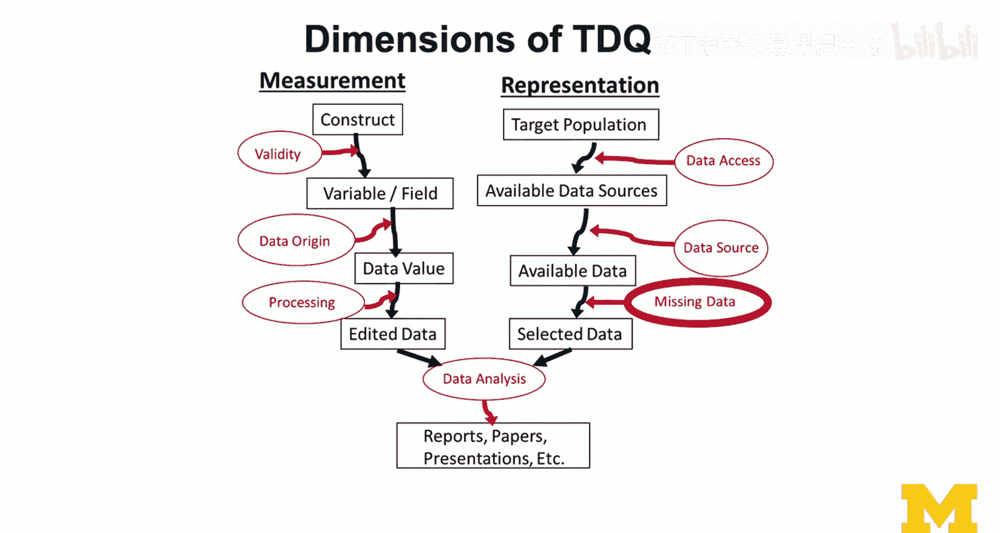
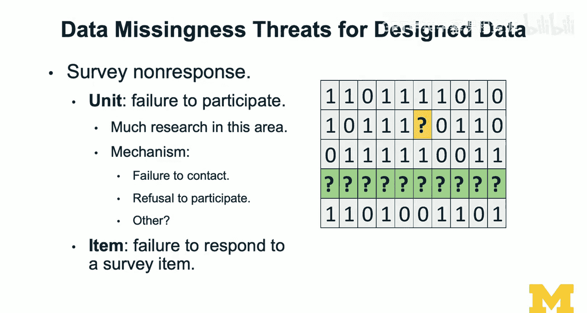
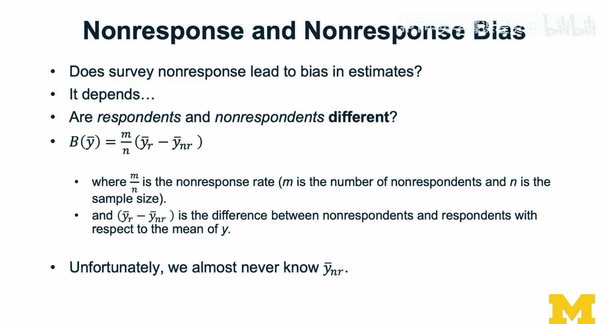
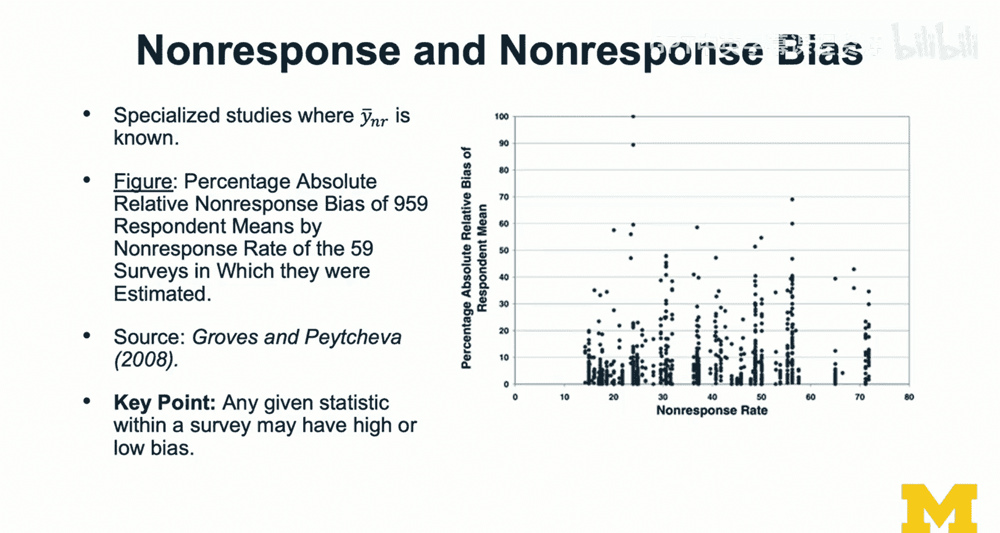
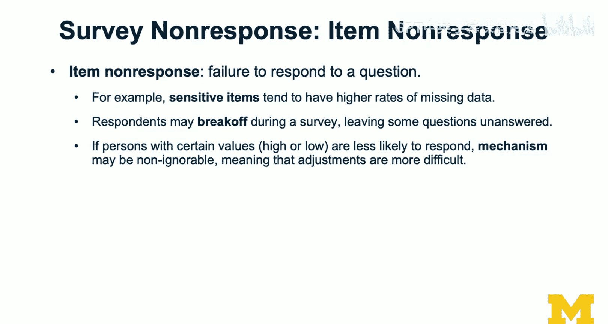
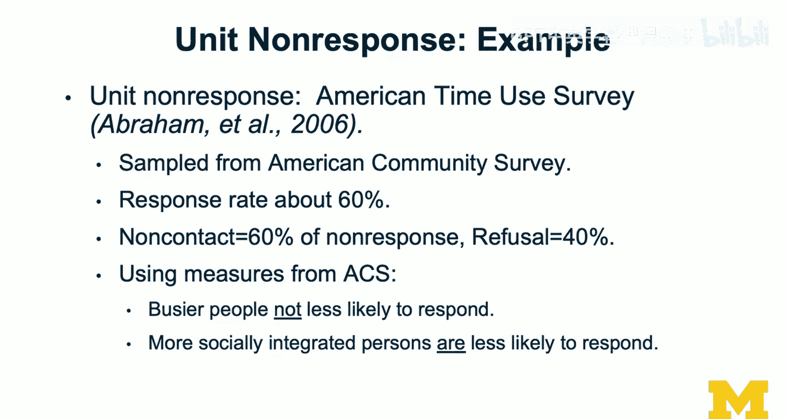
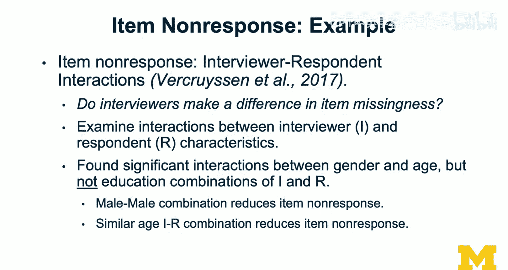
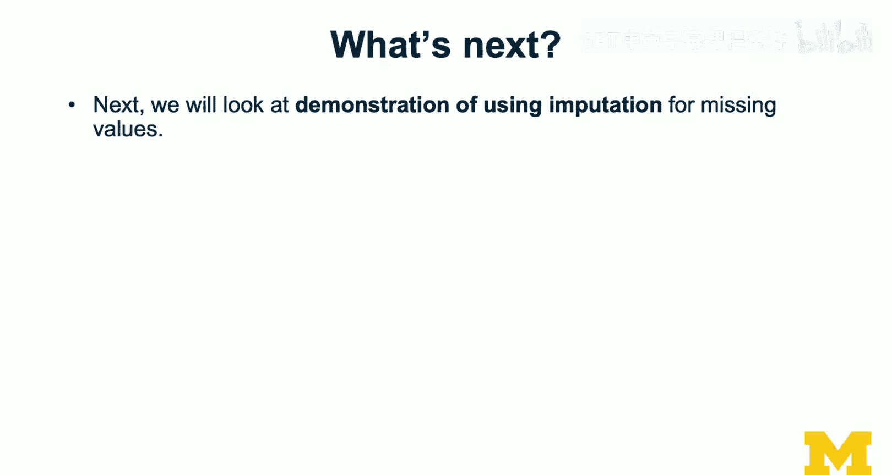

# 总体数据质量：第35讲：设计型数据缺失威胁因素 📊

在本节课中，我们将学习设计型数据（如调查数据）中数据缺失的威胁因素。我们将探讨无应答的两种主要类型——单元无应答和项目无应答，分析它们如何导致估计偏差，并通过具体研究案例来理解其背后的机制。

---

## 概述

我们继续讨论总体数据质量框架中的“表示”维度，特别是数据缺失问题。本节课将聚焦于**设计型数据**（例如通过调查收集的数据）中特有的数据缺失威胁。设计型数据中的缺失通常源于样本个体未能提供我们所需的信息。

---

## 无应答的类型

在调查中，数据缺失通常是因为被选中的个体不同意回答我们的问题。这被称为“无应答”。无应答主要分为两种类型。

以下是两种主要的无应答类型：

*   **单元无应答**：指样本个体完全拒绝参与整个调查。这通常由两种机制导致：
    *   **未能联系到样本单元**：例如，在电话调查中对方不接电话，或在邮寄调查中对方未回复。
    *   **拒绝参与**：成功联系到样本个体，但对方明确表示不愿参与调查。

*   **项目无应答**：指受访者同意参与调查，但在回答到某个特定问题时选择跳过或不回答。

---

## 无应答如何导致偏差？

无应答是否会导致估计值产生偏差？答案是：视情况而定。这取决于一个关键问题：**应答者与非应答者是否存在差异？**

如果应答者与非应答者在所研究的特征上没有差异，那么无应答可以看作是另一个随机抽样阶段，不会引入偏差。反之，则会产生偏差。

我们可以用以下公式来理解无应答偏差：

**Bias(ȳ) = (M/N) * (ȳ_R - ȳ_NR)**

其中：
*   **Bias(ȳ)** 表示样本均值 ȳ 的偏差。
*   **M/N** 是无应答率（M 是非应答者数量，N 是样本总量）。
*   **(ȳ_R - ȳ_NR)** 是应答者均值与非应答者均值之间的差异。

从这个公式可以看出，偏差的产生需要两个条件同时成立：**无应答率不为零**，且**应答者与非应答者的均值存在差异**。然而，在实际调查中，我们通常无法获知非应答者的均值（ȳ_NR），这给评估偏差带来了挑战。

---

## 应答率与偏差的关系

一项综合了59项专门研究（这些研究能同时获取应答者和非应答者的信息）的分析表明：**应答率本身并不能完全决定偏差的大小。**

即使是在应答率相近的调查中，不同统计量的估计偏差也可能有很大差异。有些统计量的偏差接近零，而另一些则可能高达30%。因此，关键不仅在于无应答率，更在于**对于每个具体的统计量，应答者与非应答者之间是否存在系统性差异**。

---

## 项目无应答的机制与例子

现在，让我们具体看看项目无应答的机制。项目无应答指未能回答某个特定问题。

以下是导致项目无应答的一些常见原因：

*   **问题敏感**：涉及敏感话题（如药物使用、收入）的问题通常缺失率更高。
*   **调查中断**：受访者可能因调查时间过长、被其他事情打断或感到问题难以回答而中途退出，导致后续问题缺失。
*   **机制不可忽略**：如果具有某些特征值（如实际使用药物的人）的个体更倾向于不回答，那么这种缺失机制就是“不可忽略的”，可能导致有偏的估计。

---

## 单元无应答的机制与例子

接下来，我们通过一个具体调查的例子来理解单元无应答。以“美国时间使用调查”为例，其应答率约为60%。

利用其抽样框“美国社区调查”的信息，研究者分析了无应答机制：

*   约60%的无应答源于“未能联系到”。
*   约40%源于“拒绝参与”。

研究还发现：
*   **忙碌程度**：更忙碌的人并没有更低的应答倾向。这对时间使用调查来说是个好消息，否则估计会产生严重偏差。
*   **社会融合度**：社会融合度更高的人反而应答可能性更低。这是否构成问题，取决于研究者具体关注哪类时间使用活动。

---

## 采访员与受访者的互动影响

项目无应答还可能受到采访员与受访者互动的影响。一项研究考察了采访员与受访者特征之间的交互作用是否会影响到项目无应答率。

研究发现存在显著的交互效应：
*   **性别交互**：当采访员与受访者同为男性时，项目无应答率会降低。
*   **年龄交互**：当采访员与受访者年龄相近时，项目无应答率也会降低。

这表明，建立良好的互动关系或鼓励受访者回答，可以有效减少特定情况下的项目无应答。

---

## 总结

本节课我们一起学习了设计型数据中数据缺失的威胁因素。

*   我们区分了**单元无应答**和**项目无应答**两种类型及其产生机制。
*   我们通过公式 **Bias(ȳ) = (M/N) * (ȳ_R - ȳ_NR)** 理解了无应答导致估计偏差的条件。
*   我们认识到，**应答率高低不能单独决定偏差大小**，关键在于应答者与非应答者对于目标变量的差异。
*   我们通过“美国时间使用调查”和采访员互动研究等实例，具体分析了无应答背后的复杂机制。

理解这些威胁是进行数据质量评估和修复的第一步。在接下来的课程中，我们将探讨一种修复数据缺失的常用方法——**插补法**。