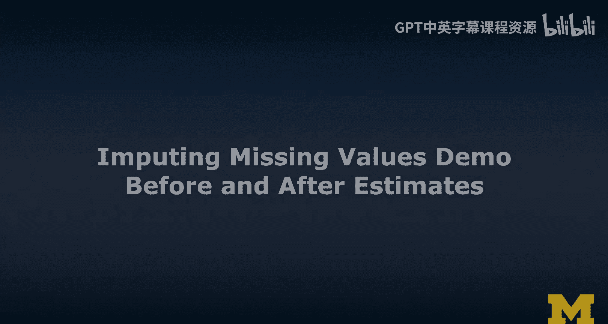
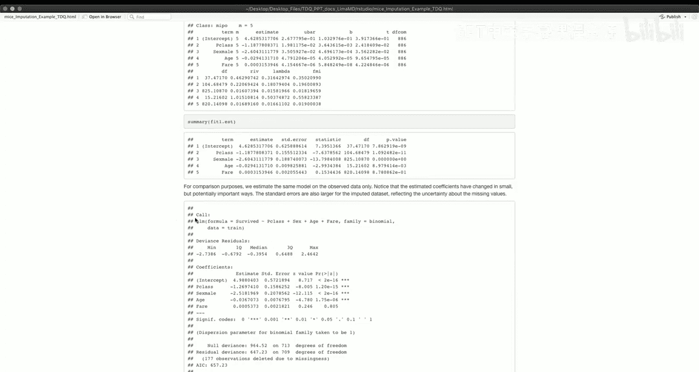
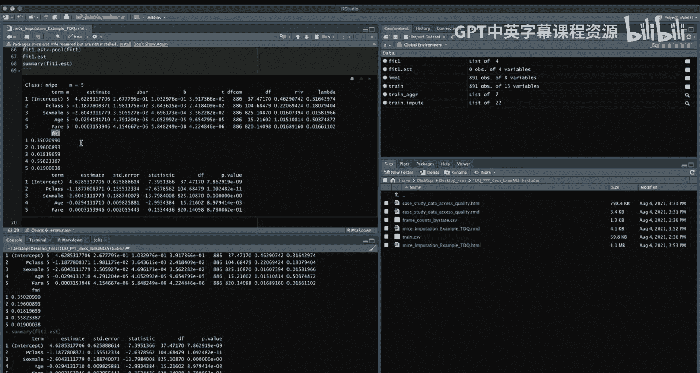
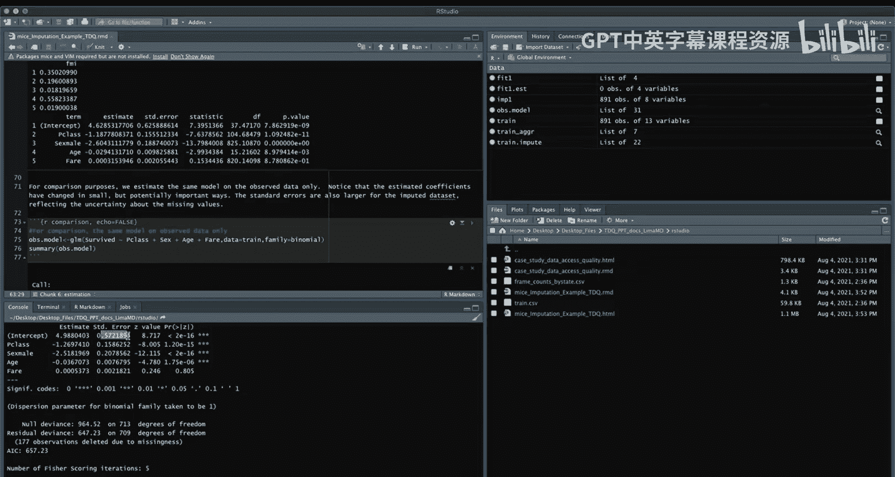

# 密歇根大学《总体数据质量（框架、度量、设计策略）total data quality》 p37 36_缺失值插补演示：处理前后的估计对比.zh_en -BV1Jn4y1X7uS_p37-

Hey， today we're going to talk about one way to deal with missing data。Now。

 missing data can cause problems if it's missing in ways that are related to the outcome。Now。

 one approach to dealing with that problem of missing data is to impute the missing data now imputation creates plausible values。

 values that could plausibly be true。This is usually done by creating a model that predicts what the missing values would be。

 So， for example， if I'm missing。Household income， I might create a model that predicts household income and then use predictions from that model to fill in missing data for those households where I don't have a reported household income。

 I could predict what it would be based on the other characteristics。Now with imputation。

 I might not use the exact predicted value， but I might add a stochastic element to each prediction because I'm not very sure about my predictions。

And when I add that stochastic element， I then up with end up with a distribution of imputed values。

 I might use multiple imputed values to try and help represent my uncertainty about what the true value。

 which is unobserved， might be。Today we're going to take a look at a demonstration of one approach to imputing missing values。

And we're going to use a very popular data set。

The Titanic training data set。I'm going to start out by showing you this overall report from an an R markeddown report using R software to do the imputation procedures。

 I've got one particular data set and I'm going to use one of many possible choices for imputation software。

 The software that I'm going to be using is called mice。

 and that stands for multiple imputation through chain equations。

So what are the steps in this imputation procedure。

 We'll look at this final report for an overview of the steps。

 and then we'll go through each of the steps in detail。 The first step is to load the data。

 As I said， we're going to be using the Titanic training data from Kegel co。

 which has missing values on age for some cases。The second step after loading the data is to look at the pattern of missing data。

And the mice package actually has， I'm sorry。 the Vm package has a nice function called M pattern that allows us to look at patterns of missing data across the whole data set。

 Now， as I said， age is missing for some cases and running it will learn running this function M pattern will learn that 177 cases are missing age in the dataset set。

 but it's complete on the other variables。Here's some additional information。

Showing 177 cases missing age， but complete data on the remainder。

177 is about 20% of the full data set， and so that's what we're missing。That proportion of age。

About 19。8%， 19。9% of the values are missing for age。

Once we've taken a look at that distribution of missing values。

 then we want to create imputed values and that's where we're going to use that mice function。

 Now when we get into the code， I'll explain more about what we're doing here in order to create those imputed values。

We're going to use a small demonstration and we're going to do five imputed values。

Once we've created those imputations， we're going to review them。 Do they look good。

 Do they seem plausible， Did something strange happen in the process of creating these imputed values。

And helpfully， in addition to looking at all the values。

 we can look at the distribution of the values that are imputed。Compared to this blue line。

 which is the observed data。 So what kind of values are being imputed and how do they change the total distribution when I impute that almost 20 per cent of the missing data。

And then we'll look at some summary statistics。That help us understand what kind of values are imputed。

Finally， we'll estimate a regression model， a logistic regression model。

 predicting whether or not somebody would survive the sinking of the Titanic。

 An age is one of the predictors in that model， We'll estimate it using the imputed data。

 And then to see what impact those imputations might have。

 We'll estimate another model that simply excludes cases that have missing data。

 which is actually the default procedure in many statistical functions。

Allright， so let's go take a look at the code。So here we are in our studio。

 an interface to the R software system， open source off software system。

And we're using a kind of program language that allows us to create the HTML file we were just looking at called R markdown and the program I'm using are。

It's called mice Iutation example， TDq。MD is available for you so that you can run these analyses on your own。

Here in this header， we see the title of this program。

 The demonstration of the use of mice for imputing missing values， my name。

The date that we created this program， and I'm telling it， create an HTML document with the results。

Now， one of the nice things about RMD the using R markdown is I can run chunks of code to see if they're going to。

What results they'll produce， I can run the current chunk。Load the package。

 Lo the packages that I need。 The mice package being one that I described earlier。

 I'm also using that vim package to look at the patterns of missing data。Now。

 the first step is for me to load the data， I need the training data available from kgel。com。

I'm going to load use this chunk of code to create an R data frame。There it is。

 I've got 891 observations and 12 variables。look at it， if we like。It's not。

Confidential information about who was on the Titanics。 So In fact， I can see their names。

 and I can see other information， including their age。 And I can see here， Oh， Mr。 James Moran。

 I don't have his age。I have his ticket number。 I have the fare that he paid。

 I have the cabin information。 I have an indicator about whether or not he survived and what class he was in。

What class of passenger？So I can use all of that information to help me predict what was Mr。

 James Moran's age。And as I showed in the output file， that HTML output file。

 I first want to look at the missing data pattern。So I'm going to use this chunk of code to look at the missing data pattern and prepare some output to review。

Here's some of the familiar charts we were looking at a moment ago。

177 persons have age information that's missing。That's about 20% of the full data file。And here。

 if I want to look， I can see， oh， it's 19。86 per of the cases that are missing age。 That's the 177。

All right， so that allows me to look at the missing data。

This data set has a relatively small amount of missing data。 It's just one variable。

 It's about 20% of the cases。The next step is to impute the missing values。 Now。

 there's a number of settings I have to consider when I'm imputing missing values。

The first thing that I do is I make a flag that says whether or not。A variable is missing its value。

 using this function。 that is an a function and an if if L statement。 So that creates a 1。

0 flag that says whether or not age is missing。And then I run the mice function to impute。 Now。

 I'm going to drop the names and some of the other variables that aren't really informative。

For predicting the age。Okay。It's hard for the name to give us much information。

 because each y name is unique。 You could think of it like an I D variable。 It's not very predictive。

 Can't help us figure out what somebody's age is。So I'm dropping that and some of those other variables that aren't going to be helpful。

Then I'm telling it M equals5， I want five imputations。How did I pick five， Well。

 it's actually a small number。 It's kind of a demonstration number。

I might want to do a larger number than that。 In fact， if I have as much as 20% of my data missing。

 I might need more imputations than five。In effect。

 I'm trying to represent the distribution of the unobserved values。

 My uncertainty about those unobserved values。 You could think of it as a small， normal distribution。

 right， I want to see， what do I think that value is。

 And if I wanted to build a 95 per cent confidence interval around my prediction。

 what would it look like。So I need a certain number of imputations to carry that。Analysis out。Now。

 these imputation models run iteratively。 They go through an iteration where they estimate the model without the cases with the missing data。

 They insert an imputed value， and they re estimate the model。

And they keep running that procedure until the model converges to some set of values。

 that is they stop changing， the estimates in the regression models in the background stop changing。

So we want a certain number of iterations。Here， we're saying 50 is the most that we should allow this process to go to。

 to carry out。Then I need to specify a method。 I've been talking about regression。

 but here I'm specifying something known as predictive mean matching。 Okay， so it's an approach。

 There's many other methods。 So， for example， if I was。Estimating a binary variable。

 if I was imputing a binary variable， like whether or not somebody survived the Titanic sinking。

Then I could use logistic regression。 So there's many different methods。

 and you can look at the mice documentation to see the available methods。Now。

 I'm going to set a seed， which I think is good practice so that if I rerun my code。

 I'll get the same set of imputations。 They're random。 There's a stochastic element。

 I haven't determined what they're going to be。 But each time I run this analysis， if I use a seed。

 I'll get the same results。And then I'm going to say print false。

 because I don't want to see all the outputs of the process。 Let's run this chunk of code。Now。

 a big problem might take a long time。 if I have a large data set with many missing values。

 mice might take some time。 So you'll need to， to plan for that， and you may need to optimize mice。

By setting things like the number of imputations or the maximum iterations to achieve a reasonable computation time。

But now I have this object trained do impute that has。5 imputations of each missing value。

So now I want to take a look at those imputations。 I'm going to print them out。

 I'm going to do some plots。 I'm going to do look at the mean of the imputations。

 and I'm going to look at a summary of the values for each imputed value。

 So let's run this chunk of code to see， what's the quality of those imputations。All right。

I think this is a very useful chart。 It shows the blue line shows the distribution。

Of age of the passengers of the Titanic。Excluding the missing cases。

The other lines show after imputation。What's the distribution look like and you can see how it changes。

It seems like。Many values are imputed in this region。What's that about 15 to 30？15 to 35。

Many of the values are imputed in this region and the distribution changes a little bit。

We don't see many values imputed above the age of 80， And there's not much happening here close to 0。

 So we're not changing that distribution much in those as much in those areas。

 So if I think these look like plausible imputations。

 I might be satisfied with the imputations that I've developed so far。Now， I have five data sets。

Each have different imputed values for age， for each person in the data set。Now。

 I can use those estimates。Allow imputed values to create estimates of a regression model。

 So let's say I want to predict survival。I want to project whether or not somebody survived the Titanic and the variables I'm going to use for that model are their class。

 sex， age and fair。Now if I hadn't done imputation， the 20% of cases。

That did not have age would be excluded from the analysis。With the imputation。

 I now have those values imputed。I'm not just going to run that model once。

 I'm going to run it five times。And then I'm going to combine the results together。Rather。

 the mice functions are going to do that for me， and they're going to give me estimates of the parameters。

 the regression coefficients in that model and their standard errors。

Let's take a look at the results。All right， so here we know we have our five imputations。

We have the estimated coefficient。 Here's the intercept。The class。Sex male。The age and the fair。

So let's look at this age characteristic is about negative 。03。 That's the estimate。

 which indicates that your survival probability on the Titanic。Got lower as you got older。

Now we're getting a lot of other information here， I'll take a minute to explain what some of these elements are。

This U bar is the average variance。Across the five data sets that were estimated。

The B bar is the between variance， between each of those regression coefficients。

 What's the estimated。Varariance between each of those five regression coefficients that I estimated for the five different imputed values that I had。

And T is a T statistic that's used to evaluate how do we combine U bar and B。

There's some other things here that are also of value， the RIV Lada。

 and I would focus for a second on these FMI， which is the fraction of missing information。

And that gives us some idea of how much information is missing due to those missing values in age。

It's not just the proportion that are missing。 It's about the information that's missing。

 You could think about it as。The the inverse of variance， right， the inverse of variance。

 the information， how much information is actually missing because age is missing for about 20% of the cases。

All right， so there's the estimates。And their standard errors using this multiply imputed data。

So a reminder for age， the coefficient in this approach is about negative 0。03。Now。

 for comparison purposes， I could estimate the same model。

 but this time I could ignore the missing data。 So the 15， I'm sorry。

 the 20% of cases that have missing age could throw them out。Now， that might be biasing。

Might bias my final results。Let's do the analysis and see what happens。So I run that chunk。

I go down and look at my age estimate， the estimated coefficient is negative0。037。

Slightly different than the estimate I just showed you from those multiply imputed data sets。

So in this case， imputation has made a small difference。

Let's take a look at one other feature of these estimates。The standard errors。

The standard error of this intercept is about 0。63 in my multiple imputation approach。But here。

 if I just look at the complete data。

The standard error is smaller。So I'm not cheating here。 I'm not creating data out of nothing。

 I'm actually giving myself a way to estimate the impact of the missing data on my variance estimates。

 And generally， not always， but generally， multiple imputation is going to lead to increases in my estimates of the standard error。

Now， that gives us a quick overview of how to use mice to create imputed values and how those might be used in analysis to help us account for missing data。

 If you want more information， I'd recommend looking carefully at packages like the mice package that carry out imputation and how they work。

 what's the underlying approach to the development of imputed values。

