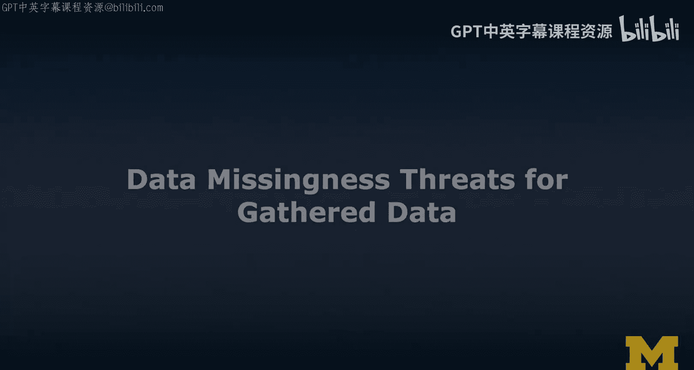
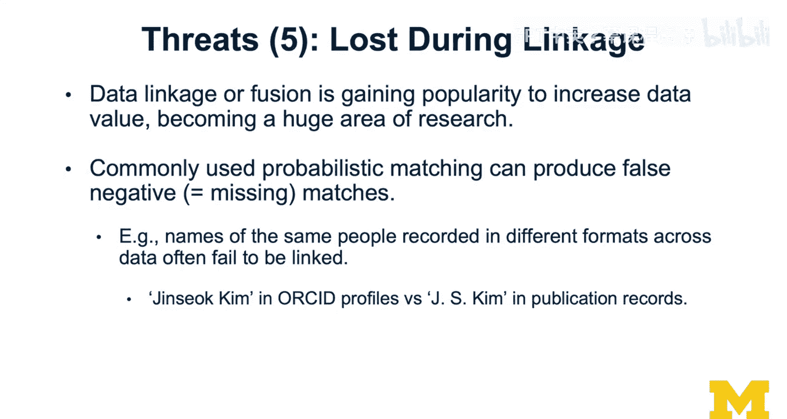
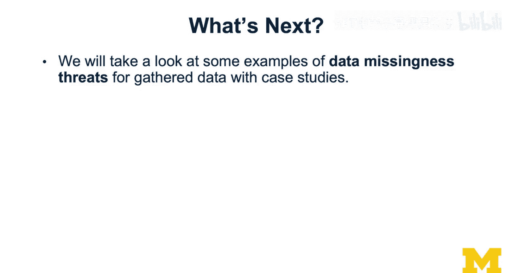
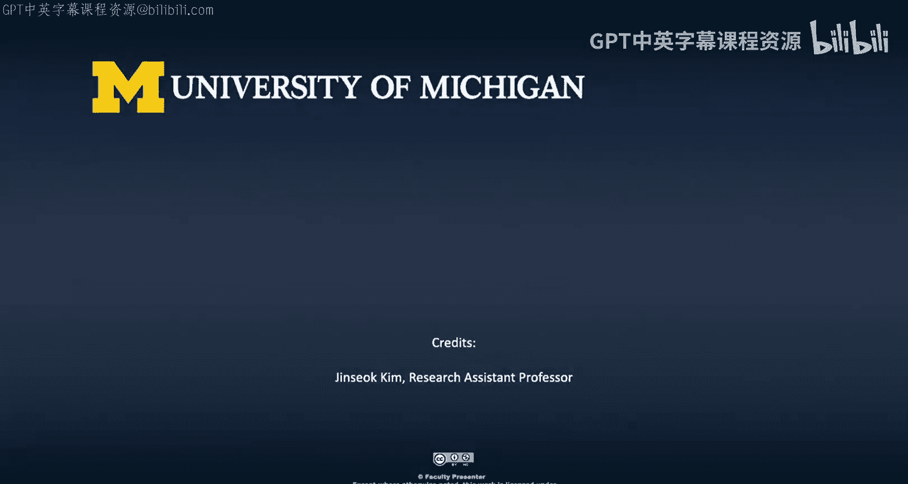

# 密歇根大学《总体数据质量（框架、度量、设计策略）total data quality》 p38 37_采集型数据缺失威胁因素.zh_en -BV1Jn4y1X7uS_p38-

We are now looking at the data missing threads for gather data。

The most common mixed thread for gather data is an item non response。

Information for specific data fields can be left blank or represented as no。

This occurs when users of data platforms choose not to provide any information。For example。

 Twitter users may choose to omit profile photos and description about their jobs or status for privacy concerns。

 so in gather data about Twitter users， many of these data fields can have missing values。

Another reason of missingness in gathered data would be data providers say sharing policy or users choice of nondi。

For example， Twitter users can record gender on their profiles。

 so item non responsesse is not a problem here， but Twitter blocks us to gather gender information through APIs。

In addition， many social media platforms allow users to decide which information can be shown and shared。

So if many users decide to hide their political affiliation from sharing。

 we come together data in which a data field on political affiliation is mostly blank。In gather data。

 you might not see some information at all because information is missing or misplaced in a collection stage。

For example， gathered GPS data can have missing information because GPS signals are blocked while GPS equippedpped cars are running on the ground。

Another example would be electronic health records in which healthcare workers may record information into wrong entries。

Information can be lost also during passing because， for example。

 data users may forget to extract all whole data field。

It is common that foreign language strings such as Chinese characters or serialic characters are not properly includedd and filtered out as non alphabetical characters。

Data linkage can be a source of missing information in gathered data。

Data linkage or fusion is used to increase data values and becomes a huge area of research in data science。

Probabilistic matching is quite popular in data linkage but can miss matches between two data sets if instances to be linked have different features such as string。

For example， researchers often link publication records and OCID IDs。

 which is on open source researcher profiles。A problem in linking them is that the same people can be recorded in different formats across OQ IDDs data and publication data。

My name Jins Kim is recorded in a full name in OQ IDD profiles。

 but can appear as JS Kim or J Kim in public hands， for example。

So when we try to link OKID IDD and publication records based on researcher names。

 we might miss matches which lead to missing information or false negatives， in other words。

We will take a look at some examples of data missing threads for gather data。

