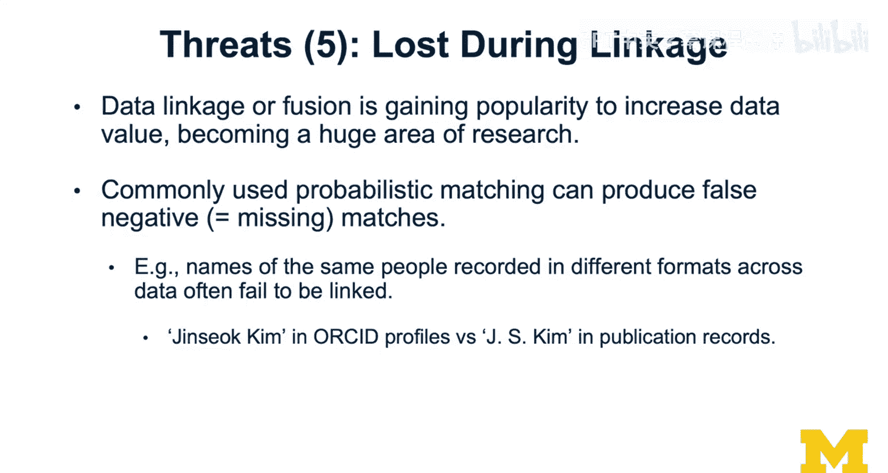
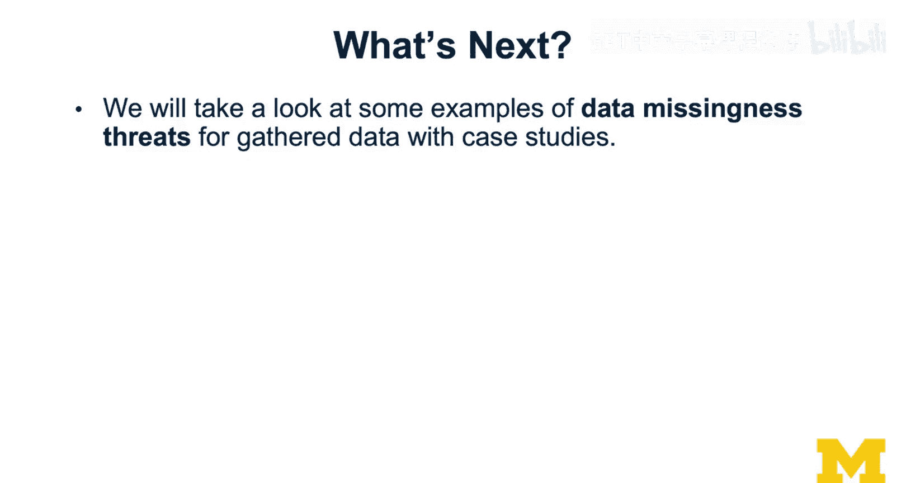

# 总体数据质量：第38讲：采集型数据缺失威胁因素 📊

在本节课中，我们将探讨采集型数据中数据缺失的各类威胁因素。理解这些因素对于评估和提升数据质量至关重要。

上一节我们介绍了数据质量的基本框架，本节中我们来看看在数据采集阶段，哪些情况会导致信息丢失。

## 数据缺失的常见原因

采集型数据中最常见的缺失威胁是**项目无响应**。特定数据字段的信息可能留空或以“无”表示。这种情况发生在数据平台用户选择不提供任何信息时。

以下是几个具体例子：
*   **隐私考虑**：例如，Twitter用户可能出于隐私考虑，选择不提供个人资料照片、工作或状态描述。因此，在采集的Twitter用户数据中，许多字段可能包含缺失值。
*   **平台政策或用户选择**：例如，Twitter用户可以在个人资料中填写性别信息，因此项目无响应本身不是问题。但Twitter的API接口可能阻止我们采集性别信息。此外，许多社交媒体平台允许用户决定哪些信息可以公开分享。如果许多用户选择隐藏其政治倾向，我们采集到的数据中，政治倾向字段就会大部分为空。

## 采集与处理过程中的信息丢失

在采集数据中，你可能完全看不到某些信息，因为信息在收集阶段就已缺失或错位。

以下是信息在采集与传递过程中丢失的例子：
*   **信号受阻**：例如，采集的GPS数据可能因GPS设备在地面行驶时信号被阻挡而出现信息缺失。
*   **记录错误**：例如，在电子健康记录中，医护人员可能将信息记录到错误的条目下。
*   **提取遗漏**：信息也可能在传递过程中丢失。例如，数据使用者可能忘记提取全部数据字段。
*   **字符处理不当**：非字母字符（如中文字符或西里尔字符）未被正确处理并被过滤掉的情况也很常见。

## 数据链接导致的缺失

数据链接或融合是数据科学中的一个重要研究领域，旨在提升数据价值，但它也可能成为采集数据中信息缺失的来源。

**概率匹配**在数据链接中相当流行，但如果待链接的实例具有不同的特征（例如字符串格式不同），则可能错过两个数据集间的匹配项。

以下是数据链接导致缺失的例子：
*   **研究人员记录链接**：研究人员经常将出版物记录与ORCID ID（一种开源研究者档案标识符）进行链接。链接中的一个问题是，同一个人可能在ORCID数据和出版物数据中以不同格式被记录。
*   **名称格式不一致**：例如，姓名“Jins Kim”在ORCID档案中以全名记录，但在出版物中可能显示为“JS Kim”或“J Kim”。

因此，当我们尝试基于研究者姓名来链接ORCID ID和出版物记录时，可能会错过匹配项，从而导致信息缺失，或者换句话说，导致**假阴性**。

## 总结

本节课中我们一起学习了采集型数据中数据缺失的主要威胁因素。我们了解到，缺失可能源于用户的**项目无响应**、平台的**共享政策限制**，也可能发生在**数据采集与传递过程**中（如信号丢失、记录错误），还可能由旨在提升数据价值的**数据链接过程**本身引入（如因名称格式不一致导致的匹配失败）。识别这些威胁是设计有效数据质量保障策略的第一步。